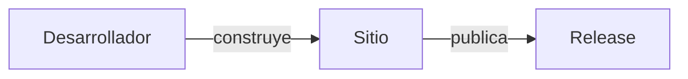

# 📚 Especificación de Estandarización de Documentación

Objetivo: Unificar la estructura de documentación técnica, funcional y general en **doc_ia**
y definir un flujo de trabajo repetible para otros proyectos con IA.

---

## 1. Objetivo

Estandarizar instrucciones de documentación para asegurar:
- **Claridad de usuario**: Documentación funcional orientada a "qué puedo hacer"
- **Claridad de desarrollador**: Documentación técnica orientada a "cómo funciona internamente"
- **Mantenibilidad**: Estructura agnóstica al lenguaje, fácil de auditar y actualizar
- **Automatización**: Generación de docs con agentes, validación con CI/CD
- **Versionamiento**: Sincronización CHANGELOG.md y COMPATIBILITY.md con releases

---

## 2. Estado Actual

### 2.1 Estructura del sitio (Zensical)
- **Generador**: Zensical, único generador de doc_ia y de los destinos (ADR-003); MkDocs no se
  soporta y un destino en MkDocs se migra (`document_project.prompt.md` § *Generador: Zensical y
  migración de destinos MkDocs*).
- **Site**: `mkdocs.yml` (tema Material, que Zensical lee de forma nativa) — fuente única; no se
  usa `zensical.toml`. Sin `hooks:`: Zensical no los ejecuta; el build pasa por
  `scripts/build_docs_zip.py` (pre-build, `zensical build --strict`, post-build).
- **Webs de referencia oficial** (consultar con `--verify-tools` para validar versiones y plugins):
  - Zensical: `https://zensical.org/` — plugins soportados en
    `https://zensical.org/docs/compatibility/mkdocs/plugins/`; los demás se ignoran en silencio
    (guarda: `ZENSICAL_SUPPORTED_PLUGINS` en `tests/test_zensical_compat.py`). Notas de versión:
    `https://github.com/zensical/zensical/releases`.
- **Secciones existentes**:
  - ✅ Guías (DUPLICATE_PROJECT_GUIDE, NEXT_STEPS, README_DUPLICADOR, ARCHITECTURE_VISUAL)
  - ✅ Funcional (`docs/functional/`) — 8 módulos
  - ✅ Ejemplos (`docs/examples/`) — 10+ ejemplos de uso
  - ✅ API/Referencias (`docs/api/`) — 8 módulos técnicos
  - ✅ Compatibilidad y Changelog

### 2.2 Archivos Generados
- Funcional: 8 archivos en `docs/functional/`
- Técnico: 8 archivos en `docs/api/`
- Generador: mkdocstrings integrado (Python docstrings → HTML)

### 2.3 Herramientas y Agentes
| Componente | Ubicación | Estado |
|------------|-----------|--------|
| **Configuración IA** | `CLAUDE.md`, `copilot-instructions.md` | ✅ Existente |
| **Agent: config-reviewer** | `.github/agents/config-reviewer.agent.md` | ✅ Existente |
| **Agent: documentation-generator** | `.github/agents/documentation-generator.agent.md` | ✅ Existente — soporta `--verify-tools` |
| **Agent: documentation-reviewer** | `.github/agents/documentation-reviewer.agent.md` | ✅ Existente |
| **Prompt: config_review** | `.github/prompts/config_review.prompt.md` | ✅ Existente |
| **Prompt: functional_doc** | `.github/prompts/functional_doc.prompt.md` | ✅ Existente |
| **Prompt: technical_doc** | `.github/prompts/technical_doc.prompt.md` | ✅ Existente |
| **Prompt: landing_doc** | `.github/prompts/landing_doc.prompt.md` | ✅ Existente |
| **Prompt: reference_doc** | `.github/prompts/reference_doc.prompt.md` | ✅ Existente (Arq. 12, 2026-10-28) |
| **Prompt: coverage_decisions** | `.github/prompts/coverage_decisions.prompt.md` | ✅ Existente (Arq. 13, 2026-11-04) |
| **Prompt: integration_doc** | `.github/prompts/integration_doc.prompt.md` | ✅ Existente (Arq. 14, 2026-11-09) |
| **Prompt: user_manual_doc** | `.github/prompts/user_manual_doc.prompt.md` | ✅ Existente (Arq. 15, 2026-11-10) |
| **Prompt: documentation_review** | `.github/prompts/documentation_review.prompt.md` | ✅ Existente |

### 2.4 Gaps Actuales
- ✅ Referencia OneDrive → reemplazada por referencias internas al repositorio (§4)
- ✅ Estructura funcional y técnica → mapeada explícitamente en §4.2
- ✅ Roles de agentes → documentados en orden de ejecución en §5
- ⚠️ Seguridad y Rendimiento → cubiertos como opcionales en §3.2 y §4.3; excluidos del nav por defecto

---

## 3. Propuesta de Cambios

### 3.1 Arquetipo 1 — Documentación Funcional (`docs/functional/`)

**Propósito**: Responder "¿Qué hace y por qué?"

**Audiencia**: Product Owner, QA, responsables de negocio.

**Ubicación**: `docs/functional/[módulo].md`

**Prompt**: `.github/prompts/functional_doc.prompt.md` (fuente operativa; esta estructura es su espejo).

**Estructura obligatoria** (8 secciones numeradas, en este orden):

```
# [Título del Módulo/Funcionalidad]

## 1. Objetivo y Descripción
Contexto de negocio y objetivo (2-3 párrafos, sin jerga técnica ni rutas de código).

## 2. Precondiciones
Lista: herramientas, parámetros, ficheros o estado requeridos antes de usar la funcionalidad.
### Actores y permisos          ← condicional: solo si el sistema distingue roles
Tabla: | Rol | Puede | No puede |

## 3. Flujo Principal
Diagrama Mermaid (sequenceDiagram, stateDiagram-v2 o flowchart TD de decisiones; §3.17) + párrafo paso a paso.

## 4. Postcondiciones y Efectos
Estado observable tras la operación: ficheros creados/modificados, artefactos, estado persistido.

## 5. Reglas de Negocio
Tabla: | Regla | Descripción | Impacto si se viola |

## 6. Límites, Flujos Alternativos y Casos Especiales
### Qué NO hace esta funcionalidad
### Flujos alternativos
### Casos especiales

## 7. Criterios de Aceptación      ← EJECUTABLE — derivar del código real
Tabla: | ID | Dado | Cuando | Entonces | Test |
Test: `tests/x.py::test_y` (uno o varios) o `Sin test` — nunca un test inexistente.
Subsección "Pendiente de validación QA" SOLO para criterios no derivables
del código (fallback, no primera opción); si no hay, omitirla.

## 8. Glosario de Dominio
Tabla: | Término | Definición |

??? note "Evidencia"          ← bloque plegable final, sin número (§3.16)
```

> **Cambio respecto a v1** (2026-10-28): la norma definía 5 secciones mientras el prompt ya
> aplicaba 8. Se alinea la norma con el prompt (más información funcional). Las páginas
> generadas con la estructura v1 (5 secciones) siguen siendo válidas en transición y se migran
> al actualizarse. Mapeo v1→v2: Descripción General→§1 · Reglas→§5 · Casos de Uso→§3+§6 ·
> Criterios→§7 · Glosario→§8; §2 Precondiciones y §4 Postcondiciones se derivan del código.

**Regla de sección vacía**: Si un subapartado queda vacío, escribe `*No aplica para este módulo.*` — nunca omitas la sección.

**Variante 1-I — Mapa funcional** (`docs/functional/index.md`, una por sistema): vista funcional
global que enlaza las páginas por módulo. Secciones:

```
# Mapa Funcional — [Nombre del sistema]

## 1. Capacidades del Sistema
Tabla: | Capacidad | Módulo(s) | Página funcional | Criterios | Tests |
(Criterios: rango de IDs AC-xx; Tests: nº de criterios con test / total)

## 2. Recorridos Transversales
Flujos de usuario que cruzan ≥2 módulos: Mermaid (§3.17) + párrafo por recorrido.

## 3. Actores y Permisos
Tabla global: | Rol | Capacidades | Restricciones |  — "No aplica" si no hay roles.

## 4. Glosario Global
Términos de dominio compartidos por ≥2 módulos (los propios de un módulo quedan en su §8).

??? note "Evidencia"
```

**Diagramas**: perspectiva del usuario, sin nombres internos. Tipos, tamaño, etiquetas y
accesibilidad en §3.17.

---

### 3.2 Arquetipo 2 — Documentación Técnica (`docs/api/`)

**Propósito**: Responder "¿Cómo está construido?"

**Audiencia**: desarrolladores que mantienen el tooling o extienden las instrucciones IA.

**Ubicación**: `docs/api/[módulo].md`

**Nota**: Los archivos generados automáticamente por herramientas autodoc (si se incorporan) quedan excluidos de este arquetipo.

**Estructura obligatoria** (secciones numeradas, en este orden):

```
# [Nombre del Componente/Módulo]

[Párrafo introductorio de una frase: responsabilidad exacta del módulo.]

## 1. Arquitectura y Diseño
Diagrama Mermaid de la estructura interna (flowchart, stateDiagram-v2, classDiagram o
erDiagram). Tipos, tamaño, etiquetas y accesibilidad en §3.17.

## 2. Modelo de Datos / Contratos
### API pública
Tabla: | Función/Clase | Firma simplificada | Descripción | Retorna |
Directiva autodoc (`::: paquete.modulo.Clase`) SOLO si el destino tiene mkdocstrings
o equivalente configurado en el generador; si no, omitirla (se renderizaría como texto).
### Contrato de entrada
Tabla: | Parámetro | Tipo | Descripción | Restricciones |
### Contrato de salida
Tipos, estructura y casos especiales.
### Errores y casos especiales
Excepciones propias del módulo y entradas inválidas.

## 3. Componentes y Clases
Responsabilidad de cada clase exportada.
Para módulos con una sola clase: "No aplica para este módulo."

## 4. Dependencias y Requisitos
Tabla: | Dependencia | Propósito | Requerida | Comportamiento sin ella |

## 5. Ejemplos Relacionados      ← OBLIGATORIO (enlace bidireccional con Arquetipo 4 §5)
Lista de enlaces a docs/examples/ con descripción de lo que ilustra cada uno.
Si no existe ningún ejemplo del módulo: "Pendiente — crear ejemplo en docs/examples/[nombre].md"

## 6. Verificación y Tests       ← añadida en 2026-10-28, al final para preservar §5↔§5
Tabla: | Test | Qué verifica | Tipo |   (Tipo: unitario / integración / e2e)
Cierre: comando exacto para ejecutarlos (`python -m pytest tests/test_x.py -q`).
Si el módulo no tiene tests: "*Sin tests automatizados.*" + riesgo principal sin cubrir.

??? note "Evidencia"          ← bloque plegable final, sin número (§3.16)
```

**Prompt**: `.github/prompts/technical_doc.prompt.md`.

**Delimitación con el Arquetipo 12**: el Arquetipo 2 documenta la **API interna de un módulo**
(quien integra código). La superficie que ve el usuario u operador de todo el sistema (CLI,
configuración, códigos de salida, interfaces publicadas) pertenece al Arquetipo 12 (§3.15);
el Arquetipo 2 la enlaza, no la duplica. Los intercambios con otros sistemas (inventario,
contrato, periodicidad, efecto) pertenecen al Arquetipo 14 (§3.19); el §4 los enlaza.

**Regla de sección vacía**: Si un subapartado queda vacío, escribe `*No aplica para este módulo.*`.

**Diagramas**: §3.17.

---

### 3.3 Arquetipo 3a — How-to (`docs/guides/`)

**Propósito**: Responder "¿Cómo resuelvo este problema concreto?"

**Diátaxis**: cuadrante *How-to* — orientado a **tarea**, asume conocimiento base, no enseña por qué.

**Diferencia con Tutorial (Arquetipo 3b, §3.11)**: Un how-to resuelve un problema concreto en el menor número de pasos; no explica el contexto ni guía el aprendizaje. Un tutorial lleva al lector por una experiencia de aprendizaje progresiva donde aprende haciendo.

**Audiencia**: usuarios finales, operadores y desarrolladores que quieren resolver una tarea específica.

**Ubicación**: `docs/guides/[nombre]_howto.md` o `docs/guides/[nombre]_guide.md`

**Prompt**: `.github/prompts/howto_doc.prompt.md`

**Estructura obligatoria** (secciones numeradas, en este orden):

```
# Cómo [verbo + objeto concreto]

## 1. Objetivo
Una frase: qué conseguirás. Verbos imperativos ("instala", "configura", "verifica").

## 2. Requisitos Previos
Lista: herramientas, versiones, accesos o estado inicial requerido.

## 3. Pasos
Procedimiento secuencial numerado con bloques de código.
Cada paso atómico, ejecutable y verificable de forma independiente.

## 4. Verificación
Comando exacto + output esperado para confirmar éxito.

## 5. Variantes y Solución de Problemas
Tabla: | Escenario/Error | Causa probable | Solución |
Si no hay casos conocidos: "No aplica para este módulo."
```

**Excepciones aceptadas**: `docs/index.md` y `docs/legacy-versions.md` están exentos de arquetipo (páginas especiales).

---

### 3.4 Arquetipo 4 — Guías de Ejemplos de Código (`docs/examples/`)

**Propósito**: Responder "¿Cómo se implementa?"

**Audiencia**: desarrolladores que quieren implementar un patrón concreto.

**Ubicación**: `docs/examples/[nombre].md`

**Estructura obligatoria** (secciones numeradas, en este orden):

```
# Ejemplo: [Nombre del Patrón/Funcionalidad]

## 1. Contexto del Ejemplo
Qué problema concreto resuelve este código (1-2 párrafos).

## 2. Implementación de Referencia
Exclusivamente: --8<-- "examples/[ruta].py"

## 3. Explicación del Código
Puntos críticos: concurrencia, rendimiento, contratos.
Para ejemplos triviales: "No aplica para este módulo."

## 4. Ejecución y Pruebas
Comando exacto + output esperado si determinista.

## 5. Referencias Relacionadas      ← OBLIGATORIO (enlace bidireccional con Arquetipo 2 §5)
- Documentación funcional: [enlace a docs/functional/...]
- Referencia técnica: [enlace a docs/api/...]
- Ejemplos relacionados: [otros ejemplos del mismo área si existen]
```

**Regla de snippet**: En `## 2.` usar siempre `--8<--`. Si el `.py` no existe, crearlo antes de referenciar.

---

### 3.5 Arquetipo 5 — Decisión Arquitectónica / ADR (`docs/adr/`)

**Propósito**: Responder "¿Por qué se decidió así?"

**Diátaxis**: cuadrante *Explanation* — razonamiento y contexto de una decisión concreta.

**Estándar**: **MADR 4.0** (Markdown Any Decision Records, septiembre 2024 — [adr.github.io/madr](https://adr.github.io/madr/)).

**Audiencia**: arquitectos de software, tech leads, responsables de plataforma.

**Ubicación**: `docs/adr/ADR-[NNN]-[nombre-kebab-case].md`

**Prompt**: `.github/prompts/architecture_doc.prompt.md`

**Formatos disponibles**:
- **Full** (decisiones críticas con múltiples opciones y consecuencias complejas)
- **Minimal** (decisiones pequeñas: solo Contexto, Decisión, Consecuencias)

**Estructura obligatoria — formato Full**:

```markdown
---
status: "PROPUESTO | ACEPTADO | OBSOLETO | REEMPLAZADO POR ADR-NNN"
date: YYYY-MM-DD
deciders: [nombres o roles]
consulted: [nombres o roles]
informed: [nombres o roles]
---

# Use [Solución] for [Contexto/Problema]   ← Título en forma "Use X for Y"

## Contexto y Problema
Estado anterior, problema identificado, fuerzas en conflicto.

## Decisión
Enunciado claro + justificación breve vs alternativas.

## Consecuencias
Tabla: | Tipo | Descripción |
Tipos: Ventaja / Compromiso (trade-off) / Deuda técnica / Riesgo aceptado

## Alternativas Consideradas
Tabla: | Alternativa | Pros | Contras | Motivo rechazo |
Si no documentadas: "No aplica para este módulo."

## Estado y Revisión
Estado explícito + fecha YYYY-MM-DD.
Si reemplaza a otro ADR: enlazar con "Reemplaza a [ADR-NNN]".
```

**Estructura obligatoria — formato Minimal**:

```markdown
---
status: "PROPUESTO | ACEPTADO | OBSOLETO"
date: YYYY-MM-DD
---

# Use [Solución] for [Contexto/Problema]

## Contexto y Problema
## Decisión
## Consecuencias
```

**Cuándo usar cada formato**:
- Full: decisiones que afectan API pública, eligen entre ≥2 enfoques con trade-offs, introducen/eliminan dependencia significativa, o establecen patrón reutilizable.
- Minimal: decisiones de alcance acotado, tiempo limitado para documentar, o como placeholder hasta completar el Full.

Documenta **una decisión concreta con trade-offs**, no la visión global del sistema (esa es la Variante C del Arquetipo 6). Los documentos de planificación (roadmap, release plans) se marcan con `<!-- arquetipo: informativo-libre -->` y quedan exentos.

---

### 3.6 Arquetipo 6 — Páginas de Navegación Principal (`docs/` raíz)

**Propósito**: Responder "¿Qué es, cómo lo instalo y cómo está organizado?" en las páginas de entrada.

**Audiencia**: cualquier visitante que llega a la documentación por primera vez.

**Ubicación**: `docs/index.md` (Inicio), `docs/installation.md` (Instalación), `docs/architecture.md` (Arquitectura).

**Prompt**: `.github/prompts/landing_doc.prompt.md` (tres variantes A/B/C, 5 secciones cada una).

Estas páginas entran directamente en `nav:` (nivel raíz), no bajo `functional/`, `api/`, `examples/` ni `adr/`:

- **Variante A — Inicio**: Identidad y Propósito → Capacidades → Quick Start → Mapa de la Documentación → Compatibilidad y Soporte.
- **Variante B — Instalación**: Requisitos → Instalación del Paquete → Drivers por Motor → Verificación → Solución de Problemas.
- **Variante C — Arquitectura** (modelo **arc42-lite + C4**): Visión General y Objetivos de Calidad (C4 nivel 1) → Mapa de Módulos / Building Blocks (C4 nivel 3) → Flujo en Ejecución (Runtime) y Despliegue (arc42 §6+§7; Despliegue condicional, alimentado por material `INFRAESTRUCTURA` y `.github/workflows/`) → Conceptos Transversales y Estándares No Funcionales (checklist NFR + 3–5 escenarios de calidad, arc42 §10) → Decisiones, Extensión y Límites (enlace a `docs/adr/`).
- **Variante D — Quick Start**: Prerequisito mínimo → Primer comando → Primer resultado visible → Siguiente paso sugerido. Objetivo: tiempo hasta la primera experiencia exitosa < 5 min. Ubicación: `docs/quickstart.md`. Audiencia: visitante que llega por primera vez y quiere ver el producto funcionando antes de leer la documentación completa. No sustituye a la Variante B (instalación detallada); enlaza a ella al final.

**Distinción con otros arquetipos**:
- El Arquetipo 5 (`architecture_doc`) documenta **un ADR concreto** (decisión con trade-offs, formato MADR-lite); la Variante C es la **vista panorámica del sistema** (arc42-lite + C4) y enlaza al log de ADR. Ambas conviven bajo la sección "Arquitectura" del nav y forman un modelo único: panorámica + decisiones.
- Los Arquetipos 3a (`howto_doc`) y 3b (`tutorial_doc`) cubren guías genéricas (async, drivers, troubleshooting); la Variante B es específica de instalación del paquete y drivers.

**Excepción**: `docs/index.md` y `docs/legacy-versions.md` seguían exentos en v1; con este arquetipo `index.md` pasa a regirse por la Variante A. `legacy-versions.md` permanece exento.

---

### 3.7 Arquetipo 7 — Guía de Incorporación para Desarrolladores (`docs/guides/onboarding_dev.md`)

**Propósito**: Responder "¿Cómo me incorporo al proyecto y pongo en marcha mi entorno?"

**Audiencia**: desarrolladores que se incorporan al proyecto por primera vez.

**Ubicación**: `docs/guides/onboarding_dev.md` (todos los proyectos — mismo convenio que el resto de guías)

**Prompt**: `.github/prompts/onboarding_dev.prompt.md`

**Secciones obligatorias** (11, en este orden):

```
## 1. Prerequisitos del Entorno      — tabla: Herramienta | Versión mínima | Verificar con | Notas
## 2. Obtener el Código              — clone, rama de trabajo, submódulos/dependencias privadas
## 3. Configurar el Entorno          — venv/IDE, credenciales, registros privados, ficheros de config
## 4. Primera Compilación/Instalación — comando principal + tabla de errores frecuentes
## 5. Infraestructura Local           — BD, contenedores, servicios; "*No aplica*" si librería stateless
## 6. Ejecutar la Aplicación          — puertos, URLs, credenciales; "*No aplica*" si librería
## 7. Mapa del Código                 — árbol simplificado, responsabilidad por módulo/paquete, regla de capas
## 8. Convenciones y Herramientas     — lint, format, tipos, tests — verificar contra SHARED_INSTRUCTIONS.md
## 9. Flujo de Trabajo Git            — ramas, Conventional Commits, PR/MR
                                        Diagrama opcional: `gitgraph` cuando el proyecto
                                        tiene branching definido (main + feature + release)
## 10. Verificación del Entorno       — tabla: Verificación | Comando | Output esperado
## 11. Recursos y Referencias         — .ai/*.md, docs/ relevantes, normativa, contacto
```

**Regla de sección vacía**: §5 y §6 **siempre** están presentes. Si el proyecto no requiere infraestructura o no tiene servidor, escribir `*No aplica para este proyecto.*` con explicación breve. Nunca omitir la sección.

**Distinción con Arquetipo 3** (Guías de Usuario):
- Arquetipo 3 documenta **cómo usar o configurar una funcionalidad** (guía how-to para usuarios finales).
- Arquetipo 7 documenta **cómo unirse al equipo de desarrollo** (entorno, código, convenciones, workflow).

**Cuándo actualizar**: en cada release mayor, tras cambios de stack o infraestructura, o cuando un nuevo desarrollador detecte que la guía está desactualizada.

---

### 3.8 Arquetipo 8 — Trazabilidad Normativa (`docs/normativa/`) — **Condicional**

**Propósito**: Responder "¿Qué obligaciones legales o reglamentarias están cubiertas por este sistema?"

**Condición de activación**: SOLO si el proyecto hace referencia explícita a leyes, decretos,
directivas, normas UNE o cualquier normativa de obligado cumplimiento. Verificar en `.ai/product.md`
o `README.md`. Si no hay normativa de referencia → **este arquetipo no aplica** y la carpeta
`docs/normativa/` no se crea.

> **Este proyecto (doc_ia)**: sistema de instrucciones IA y tooling determinista de documentación,
> sin normativa de referencia explícita. El arquetipo no aplica actualmente. Si en el futuro se
> incorpora normativa (ej. RGPD para datos de proyectos documentados, accesibilidad), aplicar entonces.

**Audiencia**: auditores de cumplimiento, técnicos de normativa, responsables de proyecto.

**Ubicación**: `docs/normativa/<abbrev_norma>_traceability.md`  
**Naming**: nombre en minúsculas con guión bajo (ej. `ley39_rd174_traceability.md`, `rgpd_traceability.md`)

**Estructura obligatoria** (secciones en este orden):

```
# Trazabilidad Normativa — <Nombre de las normas>

(versión del sistema analizado + fecha de revisión)

## Propósito

## 1. <Norma A> — <Nombre corto>
  ### 1.1 <Grupo de artículos>
  Tabla: | ID | Artículo | Obligación | Módulo/servicio | Doc de referencia | Cobertura |
  ### ...

## 2. <Norma B> — ...

## N. Resumen de gaps por severidad
  ### Nivel 1 — Crítico (riesgo de incumplimiento o auditoría bloqueada)
  Tabla: | ID | Gap | Norma | Módulo afectado | Acción recomendada |
  ### Nivel 2 — Importante (gap documental, dificulta mantenimiento)
  ### Nivel 3 — Mejora

## N+1. Normativa complementaria referenciada
Tabla: | Norma | Objeto | Cobertura en el sistema |

## N+2. Próximas acciones priorizadas
```

**Leyenda de cobertura** (canónica; §3.16 y §3.18 remiten a ella):

| Símbolo | Significado |
|---------|-------------|
| ✅ | Cubierto: módulo identificado y comportamiento verificado en el código |
| ⚠️ | Parcial: módulo identificado, pero con un hueco funcional o un defecto conocido |
| ❌ | Gap: no hay módulo que lo implemente |
| 🔍 | A verificar: la evidencia no basta (configuración en base de datos, sistemas externos o documentación organizativa no aportada) |

**Columna `ID`**: cada fila de cobertura lleva un identificador estable `COB-<NORMA>-<NNN>`
(p. ej. `COB-RGPD-030`) que **nunca se reutiliza ni se renumera**. Es la clave que enlaza la fila
con su ficha del **Registro de Decisiones de Cobertura** (Arquetipo 13, §3.18), que se genera
siempre junto a este arquetipo. Una vez existe la ficha, el ID de la fila es un enlace a ella y
la cobertura refleja la decisión humana tomada (§3.18 «Aplicar decisiones»).

**Sección en `mkdocs.yml`** (solo si el arquetipo aplica):

```yaml
- Normativa:                                                     # Entre "Funcional" y "Arquitectura"
    - Trazabilidad <Nombre norma>: normativa/<codigo>_traceability.md
```

**Cuándo crear**: al comenzar el proyecto si la normativa es conocida desde el inicio, o en la
primera auditoría de cumplimiento formal.

**Cuándo actualizar**:
- Cuando las personas toman decisiones en el registro del Arquetipo 13 (§3.18)
- Cuando cambia la normativa de referencia (modificación legal, nuevo artículo)
- Cuando se implementa un módulo que cubre un gap documentado
- En cada revisión de versión mayor que afecte lógica de negocio regulada

**Restricciones estrictas**:
- No inventar contenido normativo sin verificar contra el texto oficial
- Marcar como 🔍 cualquier artículo sin evidencia suficiente en código o documentación
- No documentar como ✅ ningún artículo sin módulo del sistema identificado
- No copiar texto legal verbatim; describir la obligación en términos del sistema

**Prompt de generación**: `.github/prompts/normative_traceability.prompt.md`

---

### 3.9 Estándar de la Sección Guías (`docs/guides/`)

Esta sección define el contrato mínimo y las reglas de nomenclatura para **todos los proyectos**.

#### Convenio de nombres

| Regla | Correcto | Incorrecto |
|---|---|---|
| Nombre en minúsculas | `connection_guide.md` | `CONNECTION_GUIDE.md` |
| Palabras con guión bajo | `async_guide.md` | `async-guide.md`, `asyncGuide.md` |
| Ubicación siempre en `guides/` | `docs/guides/troubleshooting.md` | `docs/TROUBLESHOOTING.md` |
| Sin subcarpetas dentro de `guides/` | `guides/deployment_guide.md` | `guides/ops/deployment.md` |

#### Conjunto mínimo obligatorio

| Fichero | Arquetipo | Contenido | Mandatorio |
|---|---|---|---|
| `guides/onboarding_dev.md` | 7 | Incorporación: entorno, código, convenciones, verificación | ✅ Siempre |
| `guides/troubleshooting.md` | 3a | Problemas frecuentes por categoría + solución verificable | ✅ Siempre |
| `CONTRIBUTING.md` (raíz) | 11 | Proceso de contribución, convenciones, calidad | ⚙️ Opt-in — no generado por defecto |
| `CHANGELOG.md` (raíz) | 9 | Historial de cambios por versión (Keep a Changelog) | ⚙️ Opt-in — no generado por defecto |

#### Guías adicionales según tipo de proyecto

| Tipo de proyecto | Guías recomendadas |
|---|---|
| Tooling de documentación (doc_ia) | guías de plataformas IA (`claude_code_guide.md`, `codex_guide.md`, …) — `downloads.md` es página estándar de la sección «Inicio», no una guía |
| Aplicación con servidor (dpss) | `despliegue_docker.md` o `deployment_guide.md` |
| Cualquier proyecto con herramientas IA | Subsección "Herramientas IA" en Guías: claude_code_guide.md, codex_guide.md, etc. |

#### Estructura de la sección en `mkdocs.yml`

```yaml
- Guías:
    - Incorporación para Desarrolladores: guides/onboarding_dev.md   # Siempre primero
    - [Grupos operativos según el proyecto]:                           # Conexión, Despliegue, etc.
        - [Guía específica]: guides/[nombre_guia].md
    - Errores y Diagnóstico:
        - Troubleshooting: guides/troubleshooting.md                  # Siempre en esta subsección
    - Herramientas IA:                                                 # Si el proyecto usa herramientas IA
        - [Nombre herramienta]: guides/[tool]_guide.md
```

#### Cuándo actualizar

- Al incorporar el primer desarrollador externo → generar `onboarding_dev.md` si no existe.
- Tras cambios de stack, build tool o infraestructura → actualizar `onboarding_dev.md`.
- Cuando se reporta un error no documentado → añadir a `troubleshooting.md`.
- Cuando se añade una herramienta IA nueva → añadir su guía en Herramientas IA.

---

### 3.10 Documentación con Múltiples Orígenes

Cuando `/document-project` recibe más de un `Origen`, o cuando el único origen no es un proyecto de código, es obligatorio ejecutar la **Fase 0a — Clasificación de orígenes** antes de inventariar.

#### Tipos de origen

| Tipo | Señales de detección | Tratamiento documental |
|------|---------------------|----------------------|
| `CÓDIGO` | Archivos fuente (`.py`, `.js`, `.ts`, `.cs`, `.java`, `.go`, `.rs`, …), `pyproject.toml`, `package.json`, `pom.xml`, `Cargo.toml`, `go.mod`, `src/`, `tests/` | Documentar como proyecto: inventario completo + arquetipos 1–7 y 12 (si hay señales) |
| `NORMATIVA` | PDFs/docs con palabras clave en nombre: `ley`, `decreto`, `directiva`, `rgpd`, `gdpr`, `une`, `iso`, `reglamento`, `compliance` | Activar Arquetipo 8; enriquece §5 (Reglas de Negocio) del Arquetipo 1 del proyecto principal |
| `ESPECIFICACIÓN` | Word/PDF de requisitos, user stories, pliego, casos de uso; ficheros `.feature` (BDD/Gherkin); carpetas `specs/`, `requirements/`, `ux/`, `user-stories/` | Enriquece Arquetipo 1 §3+§5+§6+§7 del proyecto principal |
| `UI/PANTALLAS` | Wireframes, mockups, capturas (`.png`, `.jpg`, `.pdf` de diseño); carpetas `mockups/`, `screens/`, `wireframes/`, `figma-exports/`. Con la opción `WEB`: capturas de la aplicación **desplegada** en un entorno (p. ej. PRE) | Enriquece Arquetipo 1 §3 (Flujo Principal) y Arquetipo 3 (Guías); con `WEB`, Arquetipo 15 (Manual de funcionamiento) y contraste con el código → fichas `COB-WEB` (Arq. 13) |
| `CONTRATO` | Especificaciones machine-readable de las APIs/datos del **propio proyecto**: `.yaml`/`.json` con clave `openapi:` o `asyncapi:`; `.graphql`/`.gql`; `.proto`; `.avsc`; `.sql` DDL en `db/`/`migrations/`; `.dbml`; carpetas `api/`, `contracts/`, `schemas/`, `proto/` | Enriquece Arquetipo 2 §1 (Arquitectura) y §2 (Modelo de Datos / Contratos) y Arquetipo 12 §5 (Interfaces Publicadas) |
| `INFRAESTRUCTURA` | IaC y despliegue: `.tf`; `Dockerfile`, `docker-compose.yml`; YAML en `k8s/`, `deploy/`, `manifests/`, `helm/`; playbooks Ansible; CloudFormation en `cloudformation/` | Enriquece Arquetipo 2 §4 (Dependencias) y Arquetipo 6C §3 › Despliegue |
| `MANUAL` | Documentación narrativa del **propio proyecto**: `.pdf`, `.docx`, `.md` con `manual`/`guide`/`runbook`/`ayuda`/`help` en nombre; carpetas `manuals/`, `help/`, `user-docs/`; `.chm` | Enriquece Arquetipos 3a §3, 3b §3, 6A/B §1 (Descripción) y 7 §3+§5 |
| `BASE DE DATOS` *(opción `BD`)* | Exportación de `util_bbdd`: `manifest.json` con `format: util_bbdd.doc.markdown` y `docs/catalog.json` (`util_bbdd.doc.catalog`). Esquema real de un entorno desplegado, sin datos | Sección generada `docs/bd/` (objetos del alcance); evidencia del Arq. 2 §2 y del Arq. 12; contraste con el código → fichas `COB-DATOS` (Arq. 13). Se contrasta con `CÓDIGO`, no lo corrige |
| `REFERENCIA` | Manuales de terceros, RFCs, especificaciones de protocolo **ajenas al proyecto** | Enriquece Arquetipo 2 §4 (Dependencias) o Arquetipo 5 (ADR) |

**Orden de evaluación**: las señales se evalúan en el orden de la tabla y se asigna el primer tipo que coincide. `REFERENCIA` va la última: es el tipo de lo ajeno al proyecto y el tipo por defecto si ninguna señal coincide. Un contrato o un manual de un tercero se reclasifica como `REFERENCIA` (la propiedad decide); el usuario confirma siempre la clasificación.

**Requisitos frente a manual** (el momento decide): un documento propio que describe lo que **se va a construir** (PRD, requisitos, user stories, pliego) es `ESPECIFICACIÓN` aunque su nombre contenga `manual` o `guide`; uno que describe lo **ya construido** (uso, operación, ayuda) es `MANUAL`. El nombre del fichero solo propone el tipo: si el contenido contradice la señal, se propone el tipo por contenido y se indica en la columna «Señales encontradas».

**Regla**: la autodetección propone el tipo; el usuario confirma antes de continuar al INVENTARIO. Nunca se asume el tipo sin confirmación.

**Origen WEB** (opción `WEB`): la aplicación desplegada en un entorno no es un tipo nuevo, es una **forma de adquisición** de material `UI/PANTALLAS`: capturas que aporta el usuario o, en modo navegador opcional, recorrido de solo lectura en el chat. Como `BASE DE DATOS`, describe lo desplegado y se **contrasta** con el `CÓDIGO`; ninguno corrige al otro. Requiere siempre un origen `CÓDIGO`. Ver §3.20 y `document_project.prompt.md` § Origen WEB.

**Caso degenerado**: si no hay ningún origen de tipo `CÓDIGO`, `/document-project` no aplica. Usar directamente el prompt de arquetipo correspondiente (`normative_traceability.prompt.md`, `functional_doc.prompt.md`, etc.).

#### Mapeo MATERIAL → arquetipos (referencia rápida)

| Tipo origen | Arquetipo | Sección(es) que enriquece |
|-------------|-----------|--------------------------|
| `NORMATIVA` | 8 + 1 (proyecto principal) | Arq. 8 completo; Arq. 1 §5 Reglas de Negocio |
| `ESPECIFICACIÓN` | 1 (proyecto principal) | §3 Flujo Principal, §5 Reglas de Negocio, §6 Flujos Alternativos, §7 Criterios de Aceptación |
| `UI/PANTALLAS` | 1 + 3 (+ 15 con `WEB`) | Arq. 1 §3 Flujo Principal; Arq. 3 §3 Pasos; con `WEB`, Arq. 15 (Manual de funcionamiento, `docs/manual/`) y fichas `COB-WEB` del contraste |
| `REFERENCIA` | 2 o 5 | Arq. 2 §4 Dependencias; o Arq. 5 (decisión ADR) |
| `CONTRATO` | 2 + 12 (proyecto principal) | Arq. 2 §1 Arquitectura y §2 Modelo de Datos / Contratos; Arq. 12 §5 Interfaces Publicadas |
| `INFRAESTRUCTURA` | 2 + 6 | Arq. 2 §4 Dependencias y Requisitos; Arq. 6C §3 › Despliegue |
| `MANUAL` | 3a · 3b · 6 · 7 | Arq. 3a §3 Pasos; Arq. 3b §3; Arq. 6A/B §1; Arq. 7 §3 y §5 |
| `BASE DE DATOS` | 2 + 12 + 13 | Sección generada `docs/bd/`; Arq. 2 §2 Modelo de Datos (evidencia con ancla de columna); Arq. 12 §5; fichas `COB-DATOS` del contraste |

Los orígenes MATERIAL **no generan páginas propias** en `docs/`; su contenido enriquece las secciones indicadas de los arquetipos del proyecto principal. Excepciones: `BASE DE DATOS` (`docs/bd/`) y `UI/PANTALLAS` con `WEB` (Arquetipo 15, `docs/manual/`).

#### Estrategia para múltiples orígenes CÓDIGO

Cuando hay ≥2 orígenes de tipo `CÓDIGO`, el agente pregunta al usuario la estrategia (nunca la autodetecta):

| Estrategia | Descripción | Cuándo elegir |
|------------|-------------|---------------|
| `federado` | Cada proyecto tiene su propio `docs/` y `mkdocs.yml` independientes | Repos separados, equipos distintos, sin destino compartido |
| `hub+satélite` | Un proyecto "hub" concentra el destino; los demás se documentan como secciones dentro de él | Un destino claro, uno de los proyectos es el consumidor de los demás |
| `monorepo` | Un `mkdocs.yml` raíz agrupa secciones por proyecto | Monorepo, mismo equipo, mismo destino para todos |

Con estrategia `hub+satélite`, el INVENTARIO genera un sub-inventario por proyecto; el PLAN_DOC indica qué secciones del `mkdocs.yml` del hub reciben las páginas de los satélites.

---

### 3.11 Arquetipo 3b — Tutorial Guiado (`docs/guides/`)

**Propósito**: Responder "¿Cómo aprendo a usar esto paso a paso?"

**Diátaxis**: cuadrante *Tutorial* — orientado a **aprendizaje**, el lector aprende haciendo bajo guía.

**Diferencia con How-to (Arquetipo 3a, §3.3)**: Un tutorial lleva al lector por una experiencia de aprendizaje progresiva; incluye el "por qué funciona esto", permite y anticipa errores, y finaliza con reflexión sobre lo aprendido. No asume conocimiento previo del área.

**Audiencia**: usuarios que se acercan a la funcionalidad por primera vez y necesitan ser guiados.

**Ubicación**: `docs/guides/[nombre]_tutorial.md`

**Prompt**: `.github/prompts/tutorial_doc.prompt.md`

**Estructura obligatoria** (secciones numeradas, en este orden):

```
# Tutorial: [Qué aprenderás a hacer]

## 1. Qué aprenderás
Resultado concreto al final del tutorial (1 párrafo). Listado de habilidades adquiridas.

## 2. Antes de empezar
Herramientas, versiones, estado inicial. Nivel de conocimiento esperado.

## 3. [Fase/Paso 1 — nombre descriptivo]
Acción + explicación de por qué funciona. Código ejecutable.
Subsección: "¿Qué ha pasado?" — reflexión sobre lo ocurrido.

## 4. [Fase/Paso 2 — nombre descriptivo]
(Repetir patrón: acción → por qué → reflexión)

## N. Resumen y Siguientes Pasos
Qué has aprendido. Enlace a guías how-to relacionadas (Arquetipo 3a) para uso en producción.
```

**Reglas**:
- Cada fase termina con un estado verificable (el lector sabe que ha tenido éxito).
- Anticipar y explicar errores frecuentes dentro de la fase donde ocurren, no en una sección al final.
- Mantener un hilo narrativo: el lector construye algo a lo largo del tutorial.
- Distinguir `guides/*_tutorial.md` (tutorial) de `guides/*_guide.md` / `guides/*_howto.md` (how-to) en el nombre de fichero.

---

### 3.12 Arquetipo 9 — Changelog / Release Notes (`CHANGELOG.md`)

**Propósito**: Registrar cronológicamente los cambios significativos por versión para usuarios y mantenedores.

**Estándar**: [Keep a Changelog](https://keepachangelog.com/) v1.1.0 + [Semantic Versioning](https://semver.org/).

**Audiencia**: usuarios finales, QA, ops, decisores que necesitan saber qué cambió y cuándo.

**Ubicación**: `CHANGELOG.md` (raíz del repositorio — fichero único). Enlazar desde `nav:` como entrada directa.

**Prompt**: `.github/prompts/changelog.prompt.md`

**Estructura obligatoria**:

```markdown
# Changelog

Todos los cambios notables de este proyecto se documentan aquí.
Formato: [Keep a Changelog](https://keepachangelog.com/) · Versioning: [SemVer](https://semver.org/)

## [Unreleased]
### Added
### Changed
### Deprecated
### Removed
### Fixed
### Security

## [X.Y.Z] — YYYY-MM-DD
### Added
- Descripción de nueva funcionalidad.
### Fixed
- Descripción de bug corregido.

[Unreleased]: https://github.com/[usuario]/[repo]/compare/vX.Y.Z...HEAD
[X.Y.Z]: https://github.com/[usuario]/[repo]/compare/vX.Y.Z-1...vX.Y.Z
```

**Categorías permitidas** (en este orden dentro de cada versión):

| Categoría | Cuándo usarla |
|-----------|--------------|
| `Added` | Nueva funcionalidad (retrocompatible) |
| `Changed` | Cambio en funcionalidad existente |
| `Deprecated` | Funcionalidad marcada para eliminación futura |
| `Removed` | Funcionalidad eliminada |
| `Fixed` | Corrección de bug |
| `Security` | Corrección de vulnerabilidad |

**Reglas**:
- Mantener siempre una sección `[Unreleased]` al inicio.
- Al hacer release: renombrar `[Unreleased]` a `[X.Y.Z] — YYYY-MM-DD` y crear nueva `[Unreleased]` vacía.
- Entradas en pasado o forma nominal ("Añade X", "Corrige Y"); nunca "Vamos a añadir...".
- No documentar cada commit; solo cambios con impacto para el usuario o integrador.
- Actualizar en sincronía con `pyproject.toml` / `package.json` (ver `.github/instructions/sync.instructions.md`).

**Sección en `mkdocs.yml`** (siempre presente si el proyecto tiene CHANGELOG.md):

```yaml
- Proyecto:                     # Sección de mantenimiento al final del nav (§4.1)
    - Changelog: changelog.md
```

---

### 3.13 Arquetipo 10 — Configuración de Agente IA (`docs/ai-config/`)

**Propósito**: Documentar las instrucciones de sistema, permisos, comandos y automatizaciones configuradas para cada plataforma de IA en el proyecto.

**Origen**: Arquetipo propio de doc_ia — no existe estándar externo para este tipo de documento en 2024-2025. El proyecto lo define e implementa como referencia.

**Audiencia**: desarrolladores que integran, configuran o auditan agentes IA en el proyecto; equipos que replican la configuración en otros proyectos.

**Ubicación**: `docs/ai-config/[plataforma].md` (ej: `claude.md`, `gemini.md`, `copilot.md`)

**Prompt**: `.github/prompts/ai_config_doc.prompt.md`

**Estructura obligatoria** (secciones numeradas, en este orden):

```
# Configuración de [Nombre Plataforma IA]

[Versión del modelo objetivo] [Fecha de revisión]

## 1. Plataforma y Modelo
Nombre, versión mínima del modelo, fichero de configuración fuente (CLAUDE.md, copilot-instructions.md, etc.).

## 2. Contexto Obligatorio
Lista de ficheros que el agente debe leer antes de actuar:
- [fichero] — propósito

## 3. Comandos y Slash Commands
Tabla: | Comando | Propósito | Inputs obligatorios | Outputs |

## 4. Permisos y Herramientas
Tabla: | Herramienta/Acción | Permitida | Condición |
Basada en el fichero de configuración real (settings.json, etc.).

## 5. Hooks y Automatizaciones
Tabla: | Evento | Comando ejecutado | Propósito |
Si no hay hooks: "No aplica para esta configuración."

## 6. Restricciones Explícitas
Lista de lo que el agente nunca debe hacer en este proyecto (derivado de la sección prohibiciones del fichero fuente).

## 7. Casos Límite Conocidos
Lista de comportamientos inesperados documentados (de EDGE_CASES.md si existe).
Si no hay: "No aplica para esta configuración."
```

**Reglas**:
- Derivar el contenido del fichero fuente real (CLAUDE.md, copilot-instructions.md, etc.) — no inventar permisos ni comandos.
- Actualizar cuando cambie el fichero fuente o se añadan hooks.
- La sección §4 debe reflejar el estado real de `settings.json` o equivalente.

**Sección en `mkdocs.yml`** (solo si el proyecto tiene ≥1 plataforma IA configurada):

```yaml
- Proyecto:                     # Sección de mantenimiento al final del nav (§4.1)
    - Configuración IA:
        - Claude Code: ai-config/claude.md
        - GitHub Copilot: ai-config/copilot.md
```

---

### 3.14 Arquetipo 11 — Guía de Contribución (`CONTRIBUTING.md`)

**Propósito**: Explicar cómo contribuir al proyecto (issues, PRs, convenciones, proceso de release).

**Diferencia con Arquetipo 7 (Onboarding Dev)**: El onboarding es para quien se incorpora al equipo y trabaja en el día a día; esta guía es para colaboradores externos o primeras contribuciones puntuales.

**Audiencia**: contribuidores externos, colaboradores ocasionales, usuarios que quieren reportar bugs o proponer mejoras.

**Ubicación**: `CONTRIBUTING.md` (raíz del repositorio — fichero único). Enlazar desde `README.md` y desde `nav:`.

**Prompt**: `.github/prompts/contributing_doc.prompt.md`

**Estructura obligatoria** (secciones numeradas, en este orden):

```markdown
# Cómo Contribuir a [Nombre Proyecto]

## 1. Tipos de Contribución Aceptados
Lista: reportar bugs, proponer mejoras, enviar PRs de código, mejorar documentación, etc.
Enlace a la política de issues si existe.

## 2. Antes de Contribuir
Código de conducta (referencia externa si aplica). Requerimientos de CLA si aplica.

## 3. Proceso de Contribución
1. Fork / Clonar el repositorio
2. Crear rama desde [rama-principal] (nombre: `feat/`, `fix/`, `docs/`, `chore/`)
3. Implementar cambio + tests
4. Verificar calidad (lint, tipos, tests)
5. Abrir PR con descripción según la plantilla
6. Proceso de review y merge
Diagrama opcional: `gitgraph` para visualizar el flujo de fork/branch/PR/merge.

## 4. Convenciones de Código y Commits
Referencia a SHARED_INSTRUCTIONS.md / Conventional Commits.
Tabla: | Tipo commit | Cuándo usar |

## 5. Requisitos de Calidad
Herramientas y comandos que deben pasar antes de abrir PR:
```bash
python -m ruff check scripts tests
python -m mypy scripts
python -m pytest
```
Sin errores: merge no procede.

## 6. Proceso de Release y Versionado
Referencia a SemVer. Quién tiene permisos de release. Enlace a CHANGELOG.md.
```

**Reglas**:
- Derivar §4 de `SHARED_INSTRUCTIONS.md` (convenciones) y `.github/workflows/` (CI actual).
- Mantener actualizado cuando cambien las herramientas de calidad.
- Si el proyecto no acepta contribuciones externas: indicarlo explícitamente en §1.

**Sección en `mkdocs.yml`**:

```yaml
- Proyecto:                     # Sección de mantenimiento al final del nav (§4.1)
    - Contribuir: contributing.md
```

---

### 3.15 Arquetipo 12 — Referencia del Sistema (`docs/reference/`)

**Propósito**: Responder "¿Qué opciones, comandos, códigos e interfaces expone el sistema?"

**Diátaxis**: cuadrante *Reference* — se consulta, no se lee de principio a fin.

**Audiencia**: usuarios, operadores e integradores que necesitan un dato concreto (una clave
de configuración, una opción de CLI, el significado de un código de salida).

**Ubicación**: `docs/reference/index.md` (página única por defecto); `docs/reference/[ámbito].md`
cuando la página supere ~300 líneas.

**Prompt**: `.github/prompts/reference_doc.prompt.md`

**Condición de activación**: el INVENTARIO detecta al menos una señal — lecturas de entorno o
ficheros de configuración, parsers de CLI / `[project.scripts]`, `sys.exit(n)` o excepciones
públicas, colas/webhooks/hooks, o material `CONTRATO`. Sin señales → no aplica y
`docs/reference/` no se crea.

**Estructura obligatoria** (secciones numeradas, en este orden):

```
# Referencia — [Nombre del sistema o ámbito]

[Una frase: superficie cubierta y audiencia.]

## 1. Configuración
Tabla: | Clave | Origen | Tipo | Por defecto | Descripción |
Secretos: nombre, tipo y obligatoriedad; nunca el valor.

## 2. CLI y Comandos
Una subsección ### por comando: sinopsis fenced + | Opción / Argumento | Tipo | Por defecto | Descripción |

## 3. Errores y Códigos de Salida
Tabla: | Código / Error | Origen | Cuándo ocurre | Acción recomendada |

## 4. Eventos y Mensajes
Tabla: | Evento / Mensaje | Productor | Consumidor | Payload / formato |

## 5. Interfaces Publicadas
Tabla: | Interfaz | Tipo | Contrato fuente | Descripción |

## 6. Datos                       ← condicional (persistencia, esquemas, ficheros con formato propio)
`erDiagram` global (máx. 12 entidades) +
Tabla: | Entidad | Campo | Tipo | Restricción | Sensibilidad |   (Sensibilidad: pública / interna / personal / secreta)
Ciclos de vida de entidades con estados: `stateDiagram-v2`.

??? note "Evidencia"          ← bloque plegable final, sin número (§3.16)
```

**Regla de sección vacía**: `*No aplica para este sistema.*` — nunca omitir la sección.
La §6 absorbe el antiguo "Modelo de datos" propuesto como arquetipo propio (simplificación S1,
ADR-002).

**Delimitación con el Arquetipo 2**: ver §3.2. Regla práctica: si el dato lo consulta quien
**ejecuta u opera** el sistema → Arquetipo 12; si lo consulta quien **integra o mantiene código**
de un módulo → Arquetipo 2.

**Sección en `mkdocs.yml`** (solo si el arquetipo aplica):

```yaml
- Referencia del Sistema: reference/index.md   # Tras "Referencia Técnica" (api/), antes de "Ejemplos"
```

---

### 3.16 Evidencia y Confianza (transversal a todos los arquetipos)

**Propósito**: que cada afirmación documental sea verificable contra el código y que el lector
distinga lo verificado de lo inferido. Generaliza la leyenda del Arquetipo 8 a todo el estándar.

**Aplica a**: Arquetipos 1, 2, 12 y 15 (obligatorio) y Variante 6C §3–§4 (escenarios y despliegue).
El resto de arquetipos puede usarlo de forma opcional.

**Leyenda de confianza** (la canónica del Arquetipo 8, §3.8, leída sobre una afirmación
documental en lugar de sobre una obligación normativa):

| Símbolo | Significado | Cuándo se escribe |
|---|---|---|
| ✅ | Verificado en código, configuración o test | Implícito en el cuerpo; explícito solo en el bloque "Evidencia" |
| ⚠️ | Parcial — verificado con gap conocido | Al final de la celda o frase afectada |
| 🔍 | Inferido — evidencia insuficiente | Al final de la celda o frase afectada |
| ❌ | Gap — documentado pero sin módulo que lo implemente | Al final de la celda o frase afectada |

**Decisiones humanas sobre ⚠️ / ❌ / 🔍**: cuando el destino adopta el Registro de Decisiones de
Cobertura (Arquetipo 13, §3.18), cada fila no ✅ del bloque "Evidencia" empieza la celda
«Elemento» con su ID `COB-<ÁMBITO>-<NNN>` enlazado a su ficha, y la confianza refleja la decisión
tomada. Sin registro adoptado, las filas siguen sin ID (compatibilidad hacia atrás).

**Bloque "Evidencia"** — al final de la página, plegable y **sin número de sección** (no altera
la numeración de los arquetipos):

```markdown
??? note "Evidencia"

    | Elemento | Fuente | Confianza |
    |---|---|---|
    | Regla «herramientas obligatorias» | `scripts/check_env.py::REQUIRED_TOOLS` | ✅ |
    | AC-03 | `scripts/build_docs_zip.py::main` | ⚠️ |
```

**Reglas de cita**:

1. Formato por defecto `ruta::símbolo` (función, clase, clave de configuración, job de CI);
   `ruta:línea` solo cuando no haya símbolo estable. Las líneas caducan con cualquier edición.
2. Siempre como **código inline**, nunca como enlace Markdown: las rutas fuera de `docs/`
   rompen el build `--strict` y no existen en el sitio publicado.
3. Citar la **ubicación**, nunca el contenido de secretos, tokens ni URLs internas.
4. Rutas relativas a la raíz del origen documentado; con varios orígenes CÓDIGO, prefijar con
   el nombre del proyecto (`api_core/src/x.py::f`). Los documentos convertidos a Markdown se
   citan por su copia en el destino, relativa a la raíz del destino
   (`_fuentes/legales/CA/md/ley.md::Art. 12`), nunca por la ruta del origen externo.
5. En el Arquetipo 1 las rutas solo aparecen dentro del bloque "Evidencia" (el cuerpo sigue
   sin jerga técnica).

**Revisión**: el Documentation Reviewer marca como hallazgo (a) una regla, contrato, error o
criterio de aceptación sin fila en "Evidencia", (b) una cita a un símbolo inexistente y
(c) una fila ✅ cuya fuente no respalda la afirmación.

#### Frontmatter de trazabilidad y detección de drift

Cada página con bloque "Evidencia" declara en su frontmatter las fuentes de las que deriva y su
huella (SHA256 truncado a 12 caracteres, saltos de línea normalizados a LF; en fuentes `.md` se
excluye su propio frontmatter):

```yaml
---
arquetipo: "2"
fuentes:
  scripts/check_env.py: 5a2a60e20da2
  tests/test_check_env.py: 6fa39a48d70d
revisado: 2026-10-28
---
```

`fuentes` = ficheros del repositorio citados en el bloque "Evidencia" (nunca rutas fuera del
repositorio).

`decisiones` = registros del Arquetipo 13 (§3.18) que la página enlaza desde sus IDs `COB-…`, con
la ruta **tal como la escribe el enlace** (relativa a la página) y su huella. `stamp` la rellena
solo; no se escribe a mano. Al resolverse desde la página, funciona igual cuando la documentación
vive en otro repositorio que el código (`--root <origen> drift --docs <destino>/docs`):

```yaml
---
arquetipo: "8"
decisiones:
  ../decisiones/rgpd_decisiones.md: 9c0e4b7a21f3
revisado: 2026-11-04
---
```

El tooling determinista `scripts/doc_trace.py` (si el destino lo incorpora):

| Subcomando | Qué hace | Código de salida |
|---|---|---|
| `stamp <página> [--source <ruta>…]` | Calcula y escribe las huellas. Sin `--source` re-sella las fuentes del frontmatter; con `--source` la lista **se sustituye** entera (no se añade) | `0` / `1` si una fuente falta o sale del repo |
| `drift` | Lista páginas cuyas fuentes o registros cambiaron (`stale`, `missing`, `outside_repo`) y páginas que enlazan un registro sin sellarlo (`unsealed`) | `0` sin drift / `1` con drift |
| `matrix` | Cruza los `AC-xx` del Arq. 1 §7 con los tests reales; lista citados inexistentes y tests sin criterio | `0` / `1` si hay tests citados inexistentes |
| `llms` | Genera `docs/llms.txt` ([llmstxt.org](https://llmstxt.org/)) desde el `nav` | `0` / `1` con `--check` si está desactualizado |

Flujo: al generar o actualizar una página → `stamp`; antes de cerrar la sesión → `drift`,
`matrix` y `llms --check`. Un `drift` con hallazgos no se corrige re-sellando a ciegas: primero
se revisa la página contra el cambio de la fuente. Falso positivo conocido: cambios triviales
(comentarios, espacios) en una fuente también alteran la huella.

---

### 3.17 Diagramas Mermaid (transversal a todos los arquetipos)

**Propósito**: fuente única de las reglas de diagramas. `docs.instructions.md`, los prompts de
arquetipo y los agentes remiten a esta sección en lugar de repetirla.

**Versión de Mermaid**: el sitio sirve su propia copia, con versión exacta
(`docs/assets/vendor/mermaid/mermaid-<versión>.min.js`, hoy 12.2.0), seguida de
`assets/js/mermaid-theme.js`. El tema de Zensical solo descarga Mermaid de unpkg si no existe
`window.mermaid`, así que con la copia local dibuja con la versión fijada y el ZIP offline
muestra los diagramas sin conexión. En v12 el flowchart usa por defecto el layout
ELK. No se añade CDN propio ni `mermaid.run()` (§4).

#### Selección de tipo

| Tipo | Úsalo cuando | Nivel | Colores del tema |
|---|---|---|---|
| `sequenceDiagram` | Varios actores intercambian peticiones y respuestas en un orden | OBLIGATORIO | ✅ |
| `flowchart TD` / `LR` | Decisiones, pipelines con ramas, contexto o despliegue | OBLIGATORIO | ✅ |
| `stateDiagram-v2` | Una entidad o proceso pasa por estados con nombre y transiciones | RECOMENDADO | ✅ |
| `classDiagram` | La jerarquía de clases importa al consumidor | RECOMENDADO | ✅ |
| `erDiagram` | Modelo de datos verificable en el código (relacional o de artefactos) | RECOMENDADO (condicional) | ✅ |
| `gitgraph` | Estrategia de ramas de contribución | OPCIONAL | ❌ |
| `mindmap`, `timeline`, `quadrantChart` | Jerarquía de conceptos, hitos o matriz de 2 ejes con datos reales | OPCIONAL | ❌ |
| `architecture-beta` | Topología física con iconos (beta: no renderiza en GitHub ni en VS Code) | OPCIONAL | ❌ |

OBLIGATORIO: la sección del arquetipo exige un diagrama y será de uno de estos tipos.
RECOMENDADO: úsalo cuando el patrón del módulo lo justifique. OPCIONAL: solo si aporta valor
demostrable. "Colores del tema" = el tema de Zensical adapta el diagrama al modo claro u
oscuro; los tipos ❌ funcionan pero sin esa adaptación y se ven mal en móvil. Excluidos por
experimentales: C4, `kanban`, `sankey`, `radar`, `venn`, `ishikawa`, `wardley`, `treemap`,
`treeview`, `packet`, `block`, `event modeling`.

**Cuándo no diagramar**: decisiones independientes entre sí o mapeos 1→N sin flujo (p. ej.
"arquetipo → prompt") van en una **tabla**; un diagrama solo aporta cuando hay orden, ramas o
relaciones.

#### Una vista por arquetipo

| Arquetipo | Perspectiva | Tipos | Nombres internos |
|---|---|---|---|
| 1 Funcional §3 · 1-I §2 | Lo que vive el usuario | `sequenceDiagram` (actores), `stateDiagram-v2` (estados), `flowchart TD` (decisiones sin actores) | No |
| 2 Técnica §1 | Estructura interna | `flowchart` (llamadas o pipeline), `stateDiagram-v2`, `classDiagram`, `erDiagram` | Sí (símbolos del código) |
| 6 Navegación | Contexto o resumen | `flowchart`, máximo 8 nodos | No |
| 12 Referencia | Modelo de datos o artefactos | `erDiagram`, `classDiagram` | Sí |

Un mismo proceso no se dibuja igual en dos arquetipos: cada uno muestra su perspectiva y la
página de navegación enlaza a ellas en lugar de repetirlas.

#### Tamaño

Máximo **12 nodos** (8 en el Arquetipo 6). Cómo se cuentan: `flowchart` = IDs de nodo distintos
(los `subgraph` no cuentan); `sequenceDiagram` = participantes y actores; `stateDiagram-v2` =
estados declarados, incluidos los de dentro de un compuesto (`[*]` no cuenta); `erDiagram` y
`classDiagram` = entidades o clases. Si se supera: dividir en dos diagramas con una frase que los
enlace, agrupar y sacar el detalle a otro diagrama, o pasar a tabla si no hay flujo.

#### Etiquetas

- Idioma del destino. Saltos de línea con `<br/>` (`\n` funciona, pero no está documentado).
- Label con `@`, `(`, `)`, `{`, `}` o que empieza por `/` → **entre comillas dobles**
  (`A["Cl@ve (firma)"]`, `B["/opt/data"]`); una `"` interna se escribe `#quot;`. **Prohibidas las
  entidades HTML** (`&#64;`): Mermaid no las decodifica y pinta un `&` sobrante.
- Sin comillas, `[/texto/]` es un nodo paralelogramo: una `/` inicial sin cierre rompe el diagrama.
- `subgraph id[título]` con ID alfanumérico sin guiones; prohibido `subgraph id[(título)]`.
- En diagramas de contexto y despliegue, las flechas llevan la relación como etiqueta
  (`DEV -- usa --> CHAT`).

#### Accesibilidad

Todo bloque declara, justo después del tipo, `accTitle:` (una línea) y `accDescr:` (una línea) o
`accDescr { … }` (varias). Mermaid los convierte en `<title>`/`<desc>` del SVG con `aria-*` para
lectores de pantalla. No sustituyen al párrafo explicativo que pida el arquetipo.



#### Estilo y contenido

- Sin `style`, `classDef` ni `linkStyle` con colores fijos, ni tema en frontmatter: romperían el
  modo oscuro.
- Nunca diagramas ASCII (`┌─┐`, `──>`): sustituirlos por un bloque Mermaid equivalente.
- Solo flujos e interacciones presentes en el código real; si un paso no se puede inferir, se
  documenta la incertidumbre en lugar de inventarlo.

#### Validación

`zensical build --strict` no valida Mermaid. Si el destino tiene tests de conformidad, cubren las
reglas deterministas (entidades, comillas, accesibilidad, tamaño) y un job de CI con
`@mermaid-js/mermaid-cli` valida la sintaxis con el parser real. En doc_ia:
`tests/test_docs_conformance.py::test_mermaid_*` y el job `mermaid` de `.github/workflows/ci.yml`.

---

### 3.18 Arquetipo 13 — Registro de Decisiones de Cobertura (`docs/decisiones/`) — **Condicional, transversal**

**Propósito**: responder "¿Qué hemos decidido sobre cada apartado parcial, sin cubrir o sin
verificar, quién lo decidió y con qué contexto?". El agente genera el registro a partir de la
leyenda de cobertura (§3.8); **las personas lo revisan y lo editan a mano**; las revisiones
posteriores lo leen y actualizan la documentación citándolo.

**Condición de activación**:
- **Siempre** que exista el Arquetipo 8 (`docs/normativa/`): un registro por norma.
- Con Arquetipos 1, 2 y 12: si el destino ya tiene `docs/decisiones/` o el usuario lo pide.
  Un registro por módulo (ámbito compartido por sus páginas funcional, técnica y de referencia).

> **Este proyecto (doc_ia)**: sin Arquetipo 8, pero adopta el registro para sus Arquetipos 1, 2,
> 6C y 1-I (dogfooding, 2026-11-04): un registro por módulo en `docs/decisiones/`. Toda fila
> ⚠️ / ❌ / 🔍 de un bloque "Evidencia" lleva su ID
> (`tests/test_docs_conformance.py::test_unverified_evidence_rows_have_coverage_id`).

**Audiencia**: responsables de producto, cumplimiento y arquitectura que deciden; equipo de
documentación que aplica las decisiones.

**Ubicación**: `docs/decisiones/<ámbito>_decisiones.md` — `<ámbito>` en minúsculas, igual al
`<ÁMBITO>` de sus IDs (p. ej. `rgpd_decisiones.md` ↔ `COB-RGPD-030`).
**Publicación**: se publica en el sitio y en el ZIP offline. No escribir en él datos personales,
secretos ni URLs internas (§3.16 regla 3); si una decisión es confidencial, el registro cita la
ubicación del acta, no su contenido.

**Identificadores**: `COB-<ÁMBITO>-<NNN>`, con `<ÁMBITO>` en `[A-Z0-9]+` (abreviatura de la norma
o del módulo) y `<NNN>` de tres dígitos. Un ID **nunca se reutiliza ni se renumera**; los
apartados nuevos toman el siguiente número libre y los retirados conservan su ficha con la
decisión «No aplica».

**Estructura obligatoria** (secciones en este orden; plantilla en
`.github/templates/DECISIONES_COBERTURA.template.md`):

```
---
arquetipo: "13"
ambito: RGPD
---
# Registro de Decisiones de Cobertura — <Ámbito>

(versión del sistema analizado + fecha de la última generación)

## 1. Cómo usar este registro
  Leyenda canónica (§3.8), vocabulario de decisiones y quién edita cada campo

## 2. Resumen
  Tabla: | Estado detectado | Fichas | Pendientes | Decididas |   ← la mantiene el agente

## 3. Decisiones
  ### COB-<ÁMBITO>-001 — <apartado> { #cob-<ámbito>-001 }
  Tabla: | Campo | Valor |   (una ficha por ID; ver abajo)

## 4. Historial de revisiones
  Tabla: | Fecha | Revisión | Decisiones aplicadas | Por |
```

**Ficha** — nombres de campo fijos (los lee `doc_trace decisions`):

| Campo | Lo rellena | Contenido |
|---|---|---|
| Página | Agente | Enlace a la página y fila documentadas |
| Estado detectado | Agente | Símbolo de la leyenda asignado al generar (✅ ⚠️ ❌ 🔍) |
| Evidencia | Agente | `ruta::símbolo` en código inline y, si aplica, qué falta para verificar |
| **Decisión** | Persona | Una del vocabulario cerrado; `Pendiente` al generar |
| **Contexto aportado** | Persona | Información nueva: dónde está la configuración, qué sistema externo lo cubre, plan de remediación, justificación del riesgo… |
| **Responsable** | Persona | Rol o persona que decide |
| **Fecha** | Persona | `AAAA-MM-DD` de la decisión |
| **Estado resultante** | Persona | Símbolo de la leyenda o `No aplica` tras la decisión |

**Vocabulario de decisiones** (cerrado; depende del estado detectado):

| Estado detectado | Decisiones admitidas | Contexto que debe aportar la persona |
|---|---|---|
| ✅ Cubierto | Confirmar · Reabrir | Al reabrir: el defecto o hueco observado |
| ⚠️ Parcial | Remediar · Aceptar riesgo · Reclasificar | Plan y plazo del hueco; o justificación y alcance del riesgo aceptado |
| ❌ Gap | Implementar · Medida compensatoria · Aceptar riesgo · No aplica | Dónde se implementará; qué control fuera del sistema lo cubre; o por qué no aplica |
| 🔍 A verificar | Aportar evidencia · Reclasificar · No aplica | La evidencia que faltaba (configuración en BD, sistema externo, documentación organizativa) |

`Pendiente` es válida en cualquier estado. «No aplica» exige `Estado resultante: No aplica`, y
viceversa. Una decisión distinta de `Pendiente` exige Responsable, Fecha y Estado resultante.

**Generar o actualizar el registro** (agente):
1. Una ficha por cada apartado ⚠️ / ❌ / 🔍 de las páginas del ámbito (en el Arq. 8, también los
   ✅, para poder reabrirlos).
2. Los IDs existentes se conservan; solo se añaden fichas nuevas al final de §3.
3. **Nunca** se modifican los campos de persona. Si el estado detectado cambia en una ficha
   `Pendiente`, se actualiza «Estado detectado»; si la ficha ya tiene decisión, se informa en el
   RESUMEN y no se toca.
4. Sellar la página (`stamp`): sus registros enlazados quedan en `decisiones:` del frontmatter
   (§3.16) sin indicarlos a mano. Cuando las personas editan un registro, `doc_trace drift` marca
   como `stale` cada página que lo enlaza, también si la documentación vive en otro repositorio
   que el código; una página que enlaza un registro sin sellarlo sale como `unsealed`.

**Aplicar decisiones** (agente, en cada revisión):
1. Ejecutar `python scripts/doc_trace.py decisions` (si el destino lo incorpora) o leer el registro.
2. Por cada ficha con decisión: en todas las filas de cobertura que citan el ID, enlazar el ID a
   la ficha (`[COB-RGPD-030](../decisiones/rgpd_decisiones.md#cob-rgpd-030)`) y dejar como
   **último** símbolo de la fila el «Estado resultante» (se admite la transición `🔍 → ✅`) o
   escribir `No aplica`. Actualizar también las marcas del cuerpo de la página que repiten esa
   fila (§3.16: ⚠️ / 🔍 / ❌ al final de una frase o celda), que no llevan ID ni las comprueba
   `decisions`. En el Arq. 8, si la decisión cierra un gap, retirarlo de §N y de §N+2.
3. Añadir una fila a §4 «Historial de revisiones» con las decisiones aplicadas.
4. Re-sellar la página (`stamp`) y volver a ejecutar `decisions` hasta que termine con 0.

**`doc_trace decisions`** — hallazgos (código de salida 1 si hay alguno; las fichas `Pendiente`
se listan, pero no son hallazgo):

| Tipo | Significado |
|---|---|
| `duplicate` | El mismo ID tiene dos fichas |
| `orphan_ref` | Una página cita un ID sin ficha |
| `orphan_entry` | Una ficha cuyo ID no cita ninguna página |
| `invalid` | Ámbito distinto del fichero, estado sin símbolo, decisión fuera del vocabulario o del estado, fecha mal formada, «No aplica» incoherente |
| `incomplete` | Decisión tomada sin Responsable, Fecha o Estado resultante |
| `unreflected` | Decisión tomada que alguna fila no refleja (sin enlace a la ficha o con otro símbolo) |
| `mismatch` | Ficha `Pendiente` cuyo estado detectado no coincide con el de la página |

Los IDs dentro de bloques de código o de código inline no cuentan (permite documentar el formato).

**Sección en `mkdocs.yml`** (tras «Funcional»; si existe «Normativa», como subsección **dentro** de ella para
no superar el máximo de 9 pestañas de §4.1):

```yaml
- Decisiones:
    - Decisiones <Ámbito>: decisiones/<ámbito>_decisiones.md

# Con Arquetipo 8:
- Normativa:
    - Trazabilidad <Nombre norma>: normativa/<codigo>_traceability.md
    - Decisiones:
        - Decisiones <Ámbito>: decisiones/<ámbito>_decisiones.md
```

**Relación con los ADR (Arquetipo 5)**: las decisiones de cobertura son muchas y de grano fino;
viven en el registro. Si una decisión es arquitectónica, se redacta además un ADR y la ficha lo
enlaza en «Contexto aportado».

**Prompt**: `.github/prompts/coverage_decisions.prompt.md`

**Restricciones estrictas**:
- El agente nunca decide: no rellena ni modifica campos de persona.
- No aplicar una decisión incompleta o inválida; informarla en el RESUMEN.
- No borrar fichas ni reutilizar IDs.

---

### 3.19 Arquetipo 14 — Integraciones (`docs/integraciones/`) — **Condicional**

**Propósito**: responder "¿Con qué sistemas intercambia datos el proyecto, en qué sentido, cuándo,
con qué contrato y qué efecto tiene cada intercambio sobre el dominio?".

**Audiencia**: responsables de producto y operación (vista funcional) y desarrolladores e
integradores (vista técnica).

**Condición de activación**: el INVENTARIO detecta al menos una **señal de integración**. Sin
señales → no aplica y `docs/integraciones/` no se crea.

| Señal | Ejemplos |
|---|---|
| Cliente HTTP / REST / SOAP | `RestTemplate`, `WebClient`, `@FeignClient`, `HttpClient`, `requests`, `httpx`, `fetch`, axios, WSDL / `@WebService` |
| Mensajería | JMS, Kafka, RabbitMQ / AMQP, colas de la nube |
| Ficheros remotos | FTP / SFTP, intercambio de CSV o Excel con otro sistema |
| Planificación de cargas | cron, `@Scheduled`, Quartz, tablas de planificador que lanzan llamadas |
| Identidad federada | OAuth2 / OIDC, SAML, LDAP / Active Directory |
| Llamadas entrantes de otros sistemas | webhooks, callbacks, endpoints de integración o exportación para terceros |
| Componentes internos del producto | librerías o servicios de otro módulo usados en proceso, base de datos compartida, motor BPM, informes |
| Material | origen `ESPECIFICACIÓN` de **diseño técnico de integraciones** (contratos, periodicidad) |

**Ubicación y estructura** (tres páginas; las secciones de los arquetipos 1 y 2, con el inventario
como contenido obligatorio):

```
docs/integraciones/index.md      ← vista FUNCIONAL (estructura del Arquetipo 1, §3.1)
  ## 1. Objetivo y Descripción     + tabla inventario funcional:
       | Integración | Sistema | Sentido | Qué aporta al dominio |
  ## 2. Precondiciones             (orden de ejecución, datos previos, credenciales disponibles)
  ### Actores y permisos
  ## 3. Flujo Principal            (sequenceDiagram con el orden y la periodicidad)
  ## 4. Postcondiciones y Efectos
  ## 5. Reglas de Negocio          (altas, bajas, modificaciones; qué pasa con procesos en curso)
  ## 6. Límites, Flujos Alternativos y Casos Especiales
  ### Qué NO hace esta funcionalidad   ← incluye «Fuera de alcance»: integraciones del sistema
                                         que no alimentan el ámbito documentado (una línea cada una)
  ## 7. Criterios de Aceptación
  ## 8. Glosario de Dominio
  ??? note "Evidencia"

docs/integraciones/externas.md   ← vista TÉCNICA (estructura del Arquetipo 2, §3.2)
docs/integraciones/internas.md   ← vista TÉCNICA de las dependencias con otros componentes
  ## 1. Arquitectura y Diseño      + tabla inventario técnico OBLIGATORIA:
       | Integración | Sentido | Mecanismo | Autenticación | Periodicidad | Datos | Destino | Errores |
  ## 2. Modelo de Datos / Contratos   (endpoint u operación, parámetros, correspondencia
                                      campo origen → tabla/campo destino, errores y reintentos)
  ## 3. Componentes y Clases
  ## 4. Dependencias y Requisitos
  ## 5. Ejemplos Relacionados       ← enlace bidireccional con el Arquetipo 4
  ## 6. Verificación y Tests
  ??? note "Evidencia"
```

`internas.md` es opcional si el proyecto no tiene dependencias internas relevantes; `externas.md`
y `index.md` existen siempre que el arquetipo aplica. Las tres páginas llevan bloque Evidencia
(§3.16) y, si el destino adopta el registro (§3.18), un ámbito propio `INTEG`.

**Reglas**:
- **Inventario completo y verificado**: cada fila sale del código (cliente, endpoint, planificador)
  o del diseño técnico, con su evidencia. No inventar sistemas, periodicidades ni contratos; lo que
  solo consta en el diseño o en una wiki va con 🔍.
- **Sentido explícito**: entrante (otro sistema → proyecto), saliente (proyecto → otro sistema) o
  bidireccional; los servicios que el proyecto **ofrece** a terceros también son integraciones.
- **Credenciales**: se nombra la clave o el fichero donde están, **nunca el valor** (§3.16 regla 3).
  Las credenciales que viajan en URL, sin verificar o en claro son hallazgos (⚠️).
- **Efecto sobre el dominio**: la vista funcional explica qué cambia en los datos del ámbito
  (altas, bajas lógicas, modificaciones, procesos en curso) y las salvaguardas ante respuestas
  incompletas.
- **Fuera de alcance**: las integraciones del sistema que no alimentan el ámbito documentado se
  listan, no se documentan.

**Delimitación**: el Arquetipo 14 describe **el intercambio** (quién, qué, cuándo, cómo y con qué
efecto). El Arquetipo 2 §4 (Dependencias) de un módulo **enlaza** a la integración que usa, no la
repite. El Arquetipo 12 §5 (Interfaces publicadas) solo **lista** las interfaces que el sistema
publica y enlaza aquí para el detalle. Con varios orígenes CÓDIGO (§3.10), la integración entre
ellos se documenta en `internas.md` del hub.

**Prompt**: `.github/prompts/integration_doc.prompt.md`

**Sección en `mkdocs.yml`** (pestaña propia si quedan pestañas libres en §4.1; si no, sección dentro de
«Técnica»):

```yaml
- Integraciones:
    - Integraciones: integraciones/index.md
    - Externas: integraciones/externas.md
    - Internas: integraciones/internas.md
```

---

### 3.20 Arquetipo 15 — Manual de Funcionamiento (`docs/manual/`) — **Condicional**

**Propósito**: responder "¿Cómo uso la aplicación tal como está desplegada, con mi rol, y qué
necesito antes de empezar?".

**Audiencia**: usuarios finales y sus responsables (coordinadores, gestores, soporte). No es
documentación para desarrolladores: sin clases, rutas de código ni jerga técnica en el cuerpo.

**Condición de activación**: la sesión `/document-project` recibe la opción **`WEB`** (aplicación
desplegada en un entorno, p. ej. PRE) junto a un origen `CÓDIGO`. Sin `WEB` → no aplica y
`docs/manual/` no se crea. Un manual narrativo ya escrito (`MANUAL`) no lo activa: enriquece los
arquetipos 3a/3b/6/7.

**Ubicación y estructura** (manual único con indicación del rol en cada tarea; un manual por rol
solo si los roles no comparten pantallas):

```
docs/manual/index.md            ← portada del manual
  ## 1. Propósito y Destinatarios     + tabla | Rol | Qué puede hacer | Áreas |
  ## 2. Requisitos de Uso             (navegador, permisos y roles, acceso y red, requisitos
                                       previos del negocio, entorno y versión de las capturas)
  ## 3. Acceso al Sistema
  ## 4. Mapa de Pantallas             (flowchart de navegación, ≤ 12 nodos)
  ??? note "Evidencia"

docs/manual/<área>.md           ← una página por área funcional (menú o módulo de la aplicación)
  ## 1. Para Qué Sirve
  ## 2. Antes de Empezar              (rol, permisos, datos que deben existir)
  ## 3. Pantallas                     (captura + tabla | Campo / acción | Descripción | Obligatorio |)
  ## 4. Tareas Paso a Paso            (cada tarea indica el rol; enlace al how-to 3a si existe)
  ## 5. Mensajes y Errores            (tabla | Mensaje | Cuándo aparece | Qué hacer |; enlace al
                                       Arquetipo 12 si existe)
  ## 6. Preguntas Frecuentes
  ??? note "Evidencia"
```

**Reglas**:
- **Lo desplegado, con fecha**: la portada (§2) indica el entorno, la versión desplegada que se
  ve en las capturas y la fecha; nunca se presenta como «el sistema» sin más. La URL del entorno
  **no se escribe** en ninguna página ni fichero versionado.
- **Capturas revisadas**: solo entran en `docs/assets/manual/<origen>/` con
  `scripts/web_captures.py publish`, tras la revisión humana de datos personales; cada captura
  lleva texto alternativo y figura en el frontmatter `fuentes:` de la página que la cita (el
  `drift` detecta la captura republicada). `web_captures.py check` en la revisión final y en el
  CIERRE.
- **Solo lectura**: el manual describe también los flujos con escritura, pero el recorrido nunca
  los ejecuta en el entorno; sus capturas las aporta el usuario.
- **Contraste**: pantalla, campo, literal o permiso que solo está en la web o solo en el código →
  ⚠️ en la Evidencia y ficha `COB-WEB-…` (§3.18). Manda la decisión humana; ninguno corrige al
  otro.
- **Evidencia** (§3.16): cada fila cita la captura (`docs/assets/manual/<origen>/<fichero>`) y,
  si se verifica, el símbolo de código (`ruta::símbolo`) que la sustenta; lo visto solo en la
  web sin código localizado va con 🔍.
- **Datos ficticios**: los ejemplos de valores en las tablas son ficticios evidentes, aunque la
  captura (ya revisada) muestre otros.

**Delimitación**: el Arquetipo 1 explica **qué hace** el módulo y sus reglas (para producto); el
3a resuelve **una tarea** concreta; el Arquetipo 15 recorre **la aplicación desplegada** pantalla
a pantalla para quien la usa, y enlaza a ambos en lugar de repetirlos.

**Prompt**: `.github/prompts/user_manual_doc.prompt.md`

**Sección en `mkdocs.yml`** (pestaña propia si quedan pestañas libres en §4.1; si no, sección dentro de
«Guías»):

```yaml
- Manual:
    - Manual: manual/index.md
    - Procesos: manual/procesos.md
```

---

## 4. Configuración Recomendada mkdocs.yml

La siguiente configuración es la **referencia estándar** para todos los proyectos.
Adapta los valores de `site_*`, `extra.version` y `nav` a cada proyecto; el resto es la base común.

### 4.1 Configuración Completa (Referencia)

> Basada en la experiencia de `util_bbdd` y `doc_ia` (actualizada 2026-06-10).
> Ver la guía operativa completa en `docs.instructions.md` → "mkdocs.yml — Base de referencia".

```yaml
site_name: [Nombre del Proyecto]
site_description: [Descripción breve del proyecto]
site_author: [Autor / Equipo]
site_url: https://[usuario].github.io/[repo]/
repo_url: https://github.com/[usuario]/[repo]
repo_name: [usuario]/[repo]
docs_dir: docs
site_dir: site
use_directory_urls: false  # ← URLs *.html: ZIP con doble clic en index.html

theme:
  name: material
  language: es  # o en
  palette:
    - media: "(prefers-color-scheme: light)"
      scheme: default
      primary: indigo
      accent: blue
      toggle:
        icon: material/brightness-7
        name: Cambiar a modo oscuro
    - media: "(prefers-color-scheme: dark)"
      scheme: slate
      primary: indigo
      accent: blue
      toggle:
        icon: material/brightness-4
        name: Cambiar a modo claro
  features:
    - navigation.tabs           # Pestañas principales en la barra superior
    - navigation.tabs.sticky    # Pestañas visibles al hacer scroll
    - navigation.indexes        # La pestaña «Inicio» abre su index.md
    - navigation.top            # Botón "volver arriba"
    - navigation.footer         # Anterior / Siguiente en el footer
    - content.code.copy         # Botón copiar en bloques de código
    - content.code.annotate     # Anotaciones en código
    - content.tabs.link         # Tabs de código sincronizadas
    - search.highlight
    - search.suggest
    - toc.follow
  icon:
    repo: fontawesome/brands/github

plugins:
  - search:
      lang: es  # o en
  - offline  # ← índice de búsqueda también como JS (file://)
  # Solo si el proyecto tiene código Python con docstrings a autodocumentar:
  # - mkdocstrings:
  #     handlers:
  #       python:
  #         paths: [src]
  #         options:
  #           docstring_style: google
  #           show_source: true
  #           show_root_heading: true
  #           show_root_full_path: false
  #           show_symbol_type_heading: true
  #           show_symbol_type_toc: true
  #           merge_init_into_class: true
  #           members_order: source
  #           filters: ["!^_"]

markdown_extensions:
  - admonition
  - pymdownx.details
  - pymdownx.superfences:
      custom_fences:
        - name: mermaid
          class: mermaid
          format: !!python/name:pymdownx.superfences.fence_code_format
  - pymdownx.highlight:
      anchor_linenums: true
      line_spans: __span
      pygments_lang_class: true
  - pymdownx.inlinehilite
  - pymdownx.snippets:
      base_path: [docs]   # ← rutas --8<-- relativas a docs/, ej: "examples/foo.py"
  - pymdownx.tabbed:
      alternate_style: true
  - pymdownx.emoji:
      emoji_index: !!python/name:material.extensions.emoji.twemoji
      emoji_generator: !!python/name:material.extensions.emoji.to_svg
  - tables
  - toc:
      permalink: true
  - attr_list
  - md_in_html

# Máximo 9 entradas de primer nivel (pestañas): las pestañas no tienen desplegables y, con más,
# la barra superior se corta. Las páginas de entrada van en «Inicio»; las de mantenimiento, en «Proyecto».
nav:
  # ── Entrada ─────────────────────────────────────────────────────────────────
  - Inicio:
      - Inicio: index.md          # con título: llms.txt no muestra «index.md»
      - Quick Start: quickstart.md   # Opcional (§4.3)
      - Instalación: installation.md
      - Descargas: downloads.md   # SIEMPRE obligatorio — Variante A (con build_docs_zip.py) o Variante B (sin script, build local + placeholder)

  # ── Audiencia: Product Owner, QA, responsables de negocio ──────────────────
  - Documentación Funcional:
      - [Área de dominio]:
          - [Nombre módulo]: functional/[modulo].md

  # ── Audiencia: Desarrolladores, ingenieros, DBAs ────────────────────────────
  - Referencia Técnica:
      - [Área de dominio]:
          - [Nombre módulo]: api/[modulo].md

  # ── Audiencia: usuarios y operadores (Arquetipo 12, condicional) ────────────
  - Referencia del Sistema: reference/index.md

  # ── Ejemplos de código ──────────────────────────────────────────────────────
  - Ejemplos:
      - [Área de dominio]:
          - [Caso de uso]: examples/[caso].md

  # ── Guías de uso y operación ────────────────────────────────────────────────
  - Guías:
      - Incorporación:
          - Onboarding de Desarrolladores: guides/onboarding_dev.md
      - Errores y Diagnóstico:
          - Troubleshooting: guides/troubleshooting.md
      - Herramientas IA:   # Si el proyecto usa herramientas IA
          - [Nombre herramienta]: guides/[tool]_guide.md

  # ── Contexto del proyecto ────────────────────────────────────────────────────
  - Arquitectura:
      - [Visión del Sistema]: architecture.md
      - [ADR-NNN — Título]: adr/ADR-NNN-titulo.md

  # ── Mantenimiento (solo si existe alguna; si no, se omite la sección) ───────
  - Proyecto:
      - Configuración IA:         # Arquetipo 10, si hay plataforma IA configurada
          - [Plataforma]: ai-config/[plataforma].md
      - Changelog: changelog.md   # Arquetipo 9, opt-in
      - Contribuir: contributing.md   # Arquetipo 11, opt-in

extra:
  homepage: index.html  # ← logo a index.html; con navigation.indexes iría a una carpeta (sin servidor: listado)
  polyfills:
    - assets/vendor/iframe-worker/iframe-worker-shim-1.0.4.min.js  # ← copia desde doc_ia/docs/assets/; evita unpkg
  social:
    - icon: fontawesome/brands/github
      link: https://github.com/[usuario]/[repo]
    # Solo si está en PyPI:
    # - icon: fontawesome/brands/python
    #   link: https://pypi.org/project/[nombre]/

# Mermaid: integración nativa del tema vía pymdownx.superfences custom_fences, con copia local
extra_javascript:
  - assets/js/sidebar-toggle.js # ← copia desde doc_ia/docs/assets/
  - assets/vendor/mermaid/mermaid-12.2.0.min.js  # ← ídem; antes de mermaid-theme.js
  - assets/js/mermaid-theme.js  # ← ídem

extra_css:
  - assets/css/mermaid.css  # ← copia desde doc_ia/docs/assets/
  - assets/css/nav.css      # ← copia desde doc_ia/docs/assets/
```

**Notas críticas:**
- `!!python/name:` genera advertencias en linters YAML estándar — falso positivo; válido para Zensical.
- Sin `custom_fences` de `mermaid` en `pymdownx.superfences`, los diagramas salen como bloque de código aunque el build pase. Con él, el tema (Material o Zensical) renderiza con la copia local de Mermaid (§3.17) y los colores del esquema claro/oscuro, también sin conexión. **No** añadir el CDN de Mermaid ni un `mermaid.run()` propio: el render se duplica y deja SVG de error ocultos (`.claude/EDGE_CASES.md § Mermaid`).
- `navigation.sections` y `navigation.tabs` son compatibles técnicamente, pero con tabs activados los grupos de área se muestran en la sidebar del tab activo; `navigation.sections` no aporta valor adicional. No incluir ambos.
- Los seis recursos (`assets/js/sidebar-toggle.js`, `assets/css/mermaid.css`, `assets/css/nav.css`, `assets/vendor/mermaid/`, `assets/js/mermaid-theme.js` y `assets/vendor/iframe-worker/`) deben copiarse desde `doc_ia/docs/assets/` sin modificación; una librería Mermaid o un shim de otra versión se sustituye.
- `use_directory_urls: false` + plugin `offline` + shim iframe-worker en `extra.polyfills`: el ZIP se abre con doble clic en `index.html`, con búsqueda, sin servidor ni red. Sin el shim local, Material y Zensical lo descargan de unpkg (`.claude/EDGE_CASES.md § offline`).
- **Máximo 9 pestañas** (entradas de primer nivel del `nav`). Material y Zensical no tienen menús desplegables en las pestañas: una sección se muestra como pestaña y sus páginas en la barra lateral; con más de 9 la barra superior se corta y la última pestaña queda oculta. Orden: Inicio, Funcional, Normativa (con Decisiones dentro) o Decisiones, Referencia Técnica, Referencia del Sistema, Ejemplos, Guías, Arquitectura, Proyecto.
- **Sección «Inicio»**: `index.md` (con título), Quick Start, Instalación y Descargas. Con `navigation.indexes`, la pestaña abre `index.md`. Mover a ella una entrada `Inicio`, `Quick Start`, `Instalación` o `Descargas` de primer nivel ya existente (modo incremental): mover, nunca duplicar. Las URL no cambian (`downloads.html` sigue igual).
- **Sección «Proyecto»**: Configuración IA, Changelog y Contribuir. Si no existe ninguna de las tres, no se crea.
- La indentación de `nav:` usa **4 espacios extra por nivel**: secciones a 2 espacios, ítems de primer nivel a 6, segundo nivel a 10.

---

### 4.2 Navegación de doc_ia (Implementación Actual)

La navegación real de doc_ia vive **solo** en `mkdocs.yml` (fuente única; no se duplica aquí
para evitar copias desactualizadas). Sigue la estructura de §4.1 con estas concreciones:

- "Documentación Funcional" empieza por el **Mapa Funcional** (`functional/index.md`, Variante 1-I).
- "Referencia del Sistema" (`reference/index.md`, Arquetipo 12) va tras "Referencia Técnica".
- 9 pestañas: «Inicio» agrupa Inicio, Quick Start, Instalación y 📥 Descargas; «Proyecto» agrupa
  Configuración IA, Changelog y Contribuir (`tests/test_docs_conformance.py` lo comprueba).
- Dentro de Funcional, Técnica y Ejemplos se agrupa por área: *Tooling Determinista* y *Flujos IA*.
- `docs/llms.txt` se regenera desde el `nav` con `python scripts/doc_trace.py llms`.

---

### 4.3 Secciones Opcionales (Agregar según necesidad)

| Sección | Ubicación | Arquetipo | Cuándo agregar |
|---------|-----------|-----------|----------------|
| **Quick Start** | `docs/quickstart.md` | 6 Variante D | Cuando la instalación completa supera 5 min y se quiere mostrar el producto de forma rápida |
| **Tutorial Guiado** | `docs/guides/*_tutorial.md` | 3b (§3.11) | Curvas de aprendizaje complejas; usuarios que llegan al proyecto sin conocimiento previo |
| **Changelog** | `CHANGELOG.md` + enlace nav | 9 (§3.12) | Opt-in explícito — proyectos con releases versionados |
| **Contribución** | `CONTRIBUTING.md` + enlace nav | 11 (§3.14) | Opt-in explícito — proyectos open source o con colaboradores externos |
| **Configuración IA** | `docs/ai-config/` | 10 (§3.13) | Proyectos con ≥1 plataforma IA configurada (CLAUDE.md, copilot, etc.) |
| **Seguridad** | `docs/security/` | — | Proyectos con auth, datos sensibles o auditoría |
| **FAQ** | `docs/faq.md` | — | Preguntas frecuentes por módulo |
| **Glosario** | `docs/glossary.md` | — | Dominio específico con muchos términos |
| **Web Interface** | `docs/web-interface.md` | — | Si el proyecto tiene UI web |
| **Arquitectura Web API** | `docs/architecture/web-api.md` | — | Si existe `src/**/web/` con FastAPI/Flask/etc. |
| **Microservicios** | `docs/architecture/microservices.md` | — | Si el proyecto expone o consume múltiples servicios |
| **Docker / Contenedores** | `docs/architecture/docker.md` | — | Si existe `Dockerfile` o `docker-compose.yml` en el repo |
| **Normativa** | `docs/normativa/` | 8 (§3.8) | **Solo** si el proyecto referencia leyes, decretos o normativas de obligado cumplimiento |
| **Decisiones** | `docs/decisiones/` | 13 (§3.18) | Siempre que exista el Arquetipo 8; con Arq. 1/2/12, si el destino adopta el registro de decisiones |
| **Integraciones** | `docs/integraciones/` | 14 (§3.19) | **Solo** si el INVENTARIO detecta señales de integración (clientes HTTP/SOAP, mensajería, cargas planificadas, identidad federada, endpoints para terceros) |
| **Manual de funcionamiento** | `docs/manual/` | 15 (§3.20) | **Solo** con la opción `WEB` (aplicación desplegada en un entorno) y un origen `CÓDIGO` |

---

## 5. Roles de Agentes y Flujo de Trabajo

### Flujo Recomendado para Documentación

| Fase | Agente | Tarea | Entrada | Salida |
|------|--------|-------|---------|--------|
| **1. Planificación** | `Plan Architect` | Validar estructura actual vs propuesta | `mkdocs.yml` + código fuente | `PLAN` + `AUDIT_PLAN` |
| **2. Validación IA** | `config-reviewer` | Revisar coherencia en `CLAUDE.md`, `copilot-instructions.md` | Archivos IA | Findings + recomendaciones |
| **3. Exploración** | `Explore` | Mapear módulos existentes vs faltantes | `src/`, `docs/` | Matriz de cobertura |
| **4. Generación** | `documentation-generator` | Crear/actualizar docs funcional + técnica | Código fuente + prompts | Archivos en `docs/` + `mkdocs.yml` |
| **5. Auditoría** | `documentation-reviewer` | Validar completitud, ejemplos, coherencia | Docs generadas | Findings + mejoras |
| **6. Verificación de config** (opt-in `--verify-tools`) | `documentation-generator` | Fetch webs oficiales — validar plugins y versiones en `mkdocs.yml` | Config + webs MkDocs/Zensical/PyPI | Discrepancias por severidad |
| **6b. Verificación de build** (opt-in `--verify-build`) | `documentation-generator` | Build + inspección HTML generado — alias bug, snippets, Mermaid, nav | `site/` (Modo A) o `localhost:8000` (Modo B `--serve`) | Hallazgos por página + acciones recomendadas |
| **7. Cierre** | `Version Closer` | Sincronizar `CHANGELOG.md` + `COMPATIBILITY.md` | Cambios completados | Release notes |

### Cuándo Usar Cada Agente

| Agente | Cuándo | Comando | Scope |
|--------|--------|---------|-------|
| `documentation-generator` | Generar docs por primera vez o actualizar módulo completo | `/new-feature "generar doc [módulo]"` | `scripts/` → `docs/` |
| `documentation-reviewer` | Auditar docs existentes (calidad, ejemplos, claridad) | `/audit-code` | `docs/functional/`, `docs/api/` |
| `config-reviewer` | Sincronizar instrucciones IA entre archivos de configuración | `/config-review` | `CLAUDE.md`, `copilot-instructions.md` |
| `Plan Architect` | Cambio estructural en `mkdocs.yml` o nuevo módulo importante | `/new-feature` o `/refactor` | `mkdocs.yml` |

---

## 6. Restricciones y Decisiones

### Restricciones Generales

- ✅ **Zensical** (versión exacta fijada) — único generador (ADR-003); tema Material sobre `mkdocs.yml`
- ✅ **Diagramas Mermaid** — Agnóstico a Graphviz, integrado en el tema (copia local, §3.17)
- ✅ **Lenguaje agnóstico** — Ejemplos Python en carpetas separadas si hay múltiples lenguajes
- ✅ **NO inventar código** — Todos los ejemplos deben validarse contra `scripts/` y el árbol real
- ✅ **Encoding UTF-8** — Todos los archivos markdown
- ❌ **NO guardar en OneDrive o Google Drive** — Usar referencias internas al repositorio

### Decisiones Críticas

1. **Separación Funcional ↔ Técnica**: Cada módulo tiene 2 documentos separados, no mezcladas
   - Funcional: `docs/functional/[módulo].md` (usuario final)
   - Técnica: `docs/api/[módulo].md` (desarrollador)

2. **Ubicaciones Fijas** (No cambiar sin consenso):
   - Funcional: `docs/functional/[módulo].md`
   - Técnica: `docs/api/[módulo].md`
   - Ejemplos: `docs/examples/[caso].md` (ficheros **planos en disco**, sin subcarpetas por tipo).
     En `nav:` **se agrupan en subsecciones por área funcional**, igual que `Referencia Técnica`
     y `Documentación Funcional` (ver `docs.instructions.md` → "Agrupación en subsecciones por área").
   - Guías: `docs/guides/[nombre].md` (ficheros en carpeta `guides/`, **nombre siempre en minúsculas con guiones bajos**).
     En `nav:` **se agrupan en subsecciones temáticas** (Incorporación, Conexión y Drivers, Errores y Diagnóstico,
     Rendimiento, Migración de Versión, Herramientas IA…), no por módulo.

3. **Actualización de mkdocs.yml**: Automatizada con `mkdocstrings` + agente `documentation-generator`

4. **Build CI/CD**: `python scripts/build_docs_zip.py` (`zensical build --strict`) validado en cada PR, detecta links rotos

5. **Versionamiento**: Sincronizar CHANGELOG.md según `.github/instructions/sync.instructions.md`

---

## 7. Cómo Proceder

Los pasos corresponden 1:1 con las fases de §5.

### Paso 1: Planificar (20 min)
```text
@Plan Architect
Validar estructura docs/ vs mkdocs.yml real. Entregar PLAN + AUDIT_PLAN.
```

### Paso 2: Validar Configuración IA (30 min)
```text
@config-reviewer
Revisar coherencia propuesta vs código real en scripts/.
Validar que estructura propuesta es implementable.
```

### Paso 3: Explorar Módulos (15 min)
```text
@Explore
Mapear módulos en scripts/ vs docs/. Identificar faltantes. Solo lectura.
```

### Paso 4: Generar/Actualizar Documentación (1-2 h)
```text
@documentation-generator
Generar docs para módulo específico O proyecto completo.
Actualiza mkdocs.yml automáticamente.
```

### Paso 5: Auditar Documentación (30 min)
```text
@documentation-reviewer
Validar ejemplos contra código real.
Verificar coherencia, completitud, claridad.
Reportar mejoras.
```

### Paso 6: Integración y Build (15 min)
```text
@Code Auditor
Ejecutar python scripts/build_docs_zip.py. Verificar links. Reportar errores de build.
```

### Paso 7: Sincronizar Versión (20 min)
```text
@Version Closer
Actualizar CHANGELOG.md.
Generar release notes.
```

### Criterio de Completitud

La estandarización se considera **completa** cuando:

- [ ] `python scripts/build_docs_zip.py` (`zensical build --strict`) finaliza sin errores ni warnings de links rotos
- [ ] Todos los módulos en `scripts/` tienen doc funcional (`docs/functional/`) y técnica (`docs/api/`)
- [ ] Todos los archivos referenciados en `docs/examples/` existen en disco
- [ ] `CHANGELOG.md` (cuando exista) refleja la versión actual de `pyproject.toml`
- [ ] Las instrucciones IA (`CLAUDE.md`, `copilot-instructions.md`) son coherentes con el código real
- [ ] Todos los documentos en `nav:` (excepto `legacy-versions.md`) tienen exactamente las secciones numeradas de su arquetipo asignado (`index.md`, `INSTALLATION.md` y `ARCHITECTURE.md` se rigen por el Arquetipo 6)
- [ ] Las secciones vacías contienen `*No aplica para este módulo.*` en lugar de estar omitidas
- [ ] Los prompts `.github/prompts/howto_doc.prompt.md`, `tutorial_doc.prompt.md` y `example_doc.prompt.md` existen y son coherentes con Arquetipos 3a, 3b y 4
- [ ] Si hay releases: `CHANGELOG.md` sigue el estándar Keep a Changelog (Arquetipo 9) y tiene entrada `[Unreleased]`
- [ ] Si hay ≥1 plataforma IA configurada: existe `docs/ai-config/[plataforma].md` derivado del fichero fuente real (Arquetipo 10)
- [ ] Si el proyecto acepta contribuciones: `CONTRIBUTING.md` existe en raíz y enlaza desde README (Arquetipo 11)
- [ ] Si el sistema expone configuración, CLI, códigos de salida o interfaces: existe `docs/reference/` (Arquetipo 12)
- [ ] Las páginas de los Arquetipos 1, 2 y 12 terminan con el bloque plegable "Evidencia" y sus citas usan `ruta::símbolo` en código inline (§3.16)
- [ ] Si existe `docs/normativa/` o `docs/decisiones/`: cada ID `COB-…` tiene ficha en su registro y `python scripts/doc_trace.py decisions` termina con 0 (§3.18)
- [ ] Cada diagrama Mermaid declara `accTitle`/`accDescr`, no supera 12 nodos (8 en Arquetipo 6), no usa entidades HTML y no repite el diagrama de otro arquetipo (§3.17)

---

## 📎 Referencias Internas

- [`.github/SHARED_INSTRUCTIONS.md`](.github/SHARED_INSTRUCTIONS.md) — Fuente canónica de arquitectura
- [`CLAUDE.md`](CLAUDE.md) — Instrucciones para Claude Code
- [`.github/copilot-instructions.md`](.github/copilot-instructions.md) — Instrucciones para Copilot Chat
- [`.github/instructions/docs.instructions.md`](.github/instructions/docs.instructions.md) — Guía de estilo para documentación
- [`pyproject.toml`](pyproject.toml) — Versión actual del proyecto
- [`.ai/product.md`](.ai/product.md) — Contexto de producto
- [`mkdocs.yml`](mkdocs.yml) — Configuración actual de MkDocs
- [`.github/instructions/sync.instructions.md`](.github/instructions/sync.instructions.md) — Sincronización de versiones
