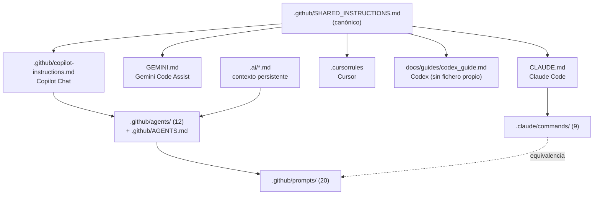

# Mapa de Integración IA — doc_ia

> Gobernanza del sistema de instrucciones IA multiplataforma. Regenerado en el
> bootstrap (2026-06-10) desde el árbol real del proyecto.

## 1. Vista general

## 2. Inventario por plataforma

| Plataforma | Entry point | Lee además | Mecanismo de invocación |
|---|---|---|---|
| Claude Code | `CLAUDE.md` | `.claude/settings.json` (hooks), `.claude/commands/` | Slash commands + lenguaje natural |
| Gemini Code Assist | `GEMINI.md` | canónico | Chat |
| Copilot Chat | `.github/copilot-instructions.md` | `.github/agents/`, `#file:` | Agentes (`runSubagent`) |
| Cursor | `.cursorrules` | canónico | Reglas automáticas del editor |
| Codex (OpenAI) | — (sin fichero propio) | `CLAUDE.md`, canónico, `AGENTS.md` | Prompt explícito; guía en `docs/guides/codex_guide.md` |

## 3. Inventario de activos

### Prompts (`.github/prompts/`, 20)

| Grupo | Ficheros |
|---|---|
| Método (11) | `new_feature`, `hotfix`, `refactor`, `audit_code`, `security_review`, `tech_debt`, `maturity_assessment`, `version_closure`, `config_review`, `documentation_review`, `normative_traceability` |
| Arquetipos (12) | `functional_doc`, `technical_doc`, `howto_doc`, `tutorial_doc`, `example_doc`, `architecture_doc`, `landing_doc`, `onboarding_dev`, `changelog`, `ai_config_doc`, `contributing_doc`, `reference_doc` (+ `guide_doc` heredado) |
| Producto (1) | `document_project` — punto de entrada único para documentar un proyecto (valida origen/destino/generador/idioma; orquesta Documentation Generator + arquetipos) |
| Cross-project (1) | `bootstrap_ai_config` |

### Slash commands (`.claude/commands/`, 9)

`new-feature`, `hotfix`, `refactor`, `audit-code`, `security-review`, `tech-debt`,
`maturity-assessment`, `version-closure` — equivalentes 1:1 a los prompts de método
del mismo nombre — y `document-project`, equivalente al prompt de producto `document_project`.

### Agentes (`.github/agents/`, 12)

Ver registro completo en [`AGENTS.md`](AGENTS.md). Los 8 con slash command + 4 sin él
(`documentation-reviewer`, `documentation-generator`, `config-reviewer`, `explore`)
y 1 interno (`workflow-director`).

### Instrucciones por tipo de archivo (`.github/instructions/`)

| Fichero | applyTo | Propósito |
|---|---|---|
| `python.instructions.md` | `scripts/**/*.py`, `tests/**/*.py` | Reglas del tooling determinista |
| `sync.instructions.md` | `CHANGELOG.md`, `docs/**`, `.ai/**` | Checklist de sincronización en VERSION |
| `docs.instructions.md` | `docs/**` | Reglas operativas de documentación (Mermaid, Markdown, snippets, autodoc) |

## 4. Reglas de sincronización

1. **Regla de oro**: editar `SHARED_INSTRUCTIONS.md` primero; entry points solo especializan.
2. Cambio de agente ⇒ actualizar `AGENTS.md` y este mapa.
3. Cambio de slash command ⇒ actualizar tabla en `CLAUDE.md`.
4. Cambio de arquetipo ⇒ actualizar `DOCUMENTATION_STANDARD.md` y los entry points que lo citan.
5. Auditoría de coherencia: agente **Config Reviewer** (`config_review.prompt.md`).

## 5. Diferencias deliberadas respecto al origen del bootstrap (util_bbdd)

| Aspecto | util_bbdd (origen) | doc_ia |
|---|---|---|
| Workflows IA en CI (`doc_agents.yml`) | Sí (Anthropic/OpenAI) | ❌ Excluido — prohibido por principio "sin API keys" |
| Builder por defecto | Zensical | MkDocs Material (Zensical opcional) |
| Código de negocio | Librería `src/util_bbdd/` | Solo tooling `scripts/` |
| Empaquetado PyPI | Sí (`python -m build`) | No aplica |

---

*Actualizado: 2026-06-10*
