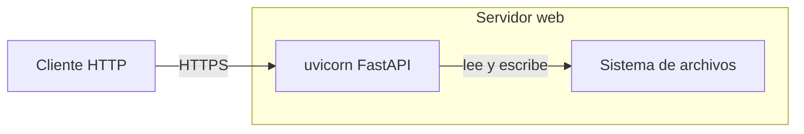

# Documentación — guía de estilo y reglas operativas

> **TL;DR** — Las estructuras obligatorias de los **arquetipos (1–12)** viven en
> [`DOCUMENTATION_STANDARD.md`](../DOCUMENTATION_STANDARD.md) y **no se duplican aquí**.
> Este fichero contiene las reglas operativas: Mermaid.js para diagramas, MkDocs Material
> como generador estático, reglas Markdown críticas, snippets `--8<--`, autodoc y
> verificación de build. No inventar nada. Si una sección de arquetipo queda vacía,
> escribe `*No aplica para este módulo.*` — nunca la omitas.

---

## Principios generales

- Escribe documentación clara y concisa orientada al lector objetivo de cada arquetipo.
- **NO inventes** módulos, clases, funciones, parámetros, comportamientos ni ejemplos que no estén en el código real. Si no puedes verificar un dato leyendo el código, indícalo como "pendiente de verificación".
- Mantén la documentación actualizada con los cambios de código; no dejes secciones obsoletas.
- **Unifica creación y actualización**: si el documento ya existe, actualiza sus secciones en lugar de crearlo de nuevo. El flujo de creación y el de actualización son idénticos.
- **Criterios de detección de página desactualizada (estado B)** — al menos uno de los siguientes:
  - Firma de función/clase pública cambiada (parámetro añadido/eliminado, nombre o tipo de retorno)
  - Nuevo símbolo público en el código (función, clase, constante) no documentado en la página
  - Símbolo documentado en la página ya no existe en el módulo actual
  - Tests actuales contradicen el comportamiento descrito en la documentación
  - Sección marcada "Pendiente de verificación" ya verificable leyendo el código actual
- **Protocolo de actualización**: (1) leer el documento existente completo antes de escribir;
  (2) comparar sección a sección con el código; (3) actualizar solo las secciones afectadas;
  (4) conservar verbatim las secciones que siguen vigentes; (5) nunca eliminar "Pendiente de
  verificación" sin haberlo verificado explícitamente en el código.
- Los ejemplos de uso deben ser reproducibles con el código actual, sin credenciales reales.
- **Sección vacía → `*No aplica para este módulo.*`**: nunca omitas una sección del arquetipo aunque no tenga contenido.
- En doc_ia los arquetipos son además **producto**: se aplican a proyectos origen externos
  pasando **origen** y **destino** como parámetros de cada ejecución. Estas reglas operativas
  aplican igual a la documentación propia de doc_ia y a la generada para proyectos origen.

## Arquetipos formales

Las estructuras obligatorias (secciones numeradas, audiencias, reglas de lenguaje,
enlace bidireccional Arquetipo 2 §5 ↔ Arquetipo 4 §5, bloque "Evidencia" de §3.16) están definidas en
[`DOCUMENTATION_STANDARD.md`](../DOCUMENTATION_STANDARD.md) §3, con un prompt por arquetipo
en `.github/prompts/*_doc.prompt.md`. Este fichero no las repite (DRY).

---

## Generador estático: MkDocs con Material for MkDocs

El proyecto usa **MkDocs** con el tema **Material for MkDocs** como generador estático
(Zensical es recíprocamente compatible; ver `scripts/build_docs_zip.py --builder`).
Zensical no ejecuta `hooks:` ni los plugins que no soporta, y no avisa. Construir con
`python scripts/build_docs_zip.py --builder zensical`; para destinos, ver
`document_project.prompt.md` § *Reglas por generador: Zensical*.

- Toda documentación generada debe tener su entrada en `mkdocs.yml` bajo `nav:`.
- La estructura de navegación objetivo (secciones top-level y configuración de referencia)
  está en `DOCUMENTATION_STANDARD.md` §4. No añadir secciones top-level fuera de ella.
- No añadir plugins sin justificación documentada.

### mkdocs.yml — Base de referencia

Todo `mkdocs.yml` generado para un proyecto origen debe seguir esta estructura mínima
(adaptar `site_name`, `site_description`, `site_url`, `repo_url`, `repo_name` al proyecto):

```yaml
site_name: <nombre>
site_description: <descripción>
site_author: <autor>
site_url: https://<usuario>.github.io/<repo>/
repo_url: https://github.com/<usuario>/<repo>
repo_name: <usuario>/<repo>
docs_dir: docs
site_dir: site
use_directory_urls: false  # URLs *.html: ZIP con doble clic en index.html

theme:
  name: material
  language: <es|en|...>
  palette:
    - media: "(prefers-color-scheme: light)"
      scheme: default
      primary: indigo
      accent: blue
      toggle:
        icon: material/brightness-7
        name: Cambiar a modo oscuro
    - media: "(prefers-color-scheme: dark)"
      scheme: slate
      primary: indigo
      accent: blue
      toggle:
        icon: material/brightness-4
        name: Cambiar a modo claro
  features:
    - navigation.tabs
    - navigation.tabs.sticky
    - navigation.top
    - navigation.footer
    - content.code.copy
    - content.code.annotate
    - content.tabs.link
    - search.highlight
    - search.suggest
    - toc.follow
  icon:
    repo: fontawesome/brands/github

plugins:
  - search:
      lang: <es|en|...>
  - offline  # índice de búsqueda también como JS (file://)
  # Solo si el proyecto tiene código Python con docstrings a autodocumentar:
  # - mkdocstrings:
  #     handlers:
  #       python:
  #         paths: [src]
  #         options:
  #           docstring_style: google
  #           show_source: true
  #           show_root_heading: true
  #           show_root_full_path: false
  #           show_symbol_type_heading: true
  #           show_symbol_type_toc: true
  #           merge_init_into_class: true
  #           members_order: source
  #           filters: ["!^_"]

markdown_extensions:
  - admonition
  - pymdownx.details
  - pymdownx.superfences:
      custom_fences:
        - name: mermaid
          class: mermaid
          format: !!python/name:pymdownx.superfences.fence_code_format
  - pymdownx.highlight:
      anchor_linenums: true
      line_spans: __span
      pygments_lang_class: true
  - pymdownx.inlinehilite
  - pymdownx.snippets:
      base_path: [docs]
  - pymdownx.tabbed:
      alternate_style: true
  - pymdownx.emoji:
      emoji_index: !!python/name:material.extensions.emoji.twemoji
      emoji_generator: !!python/name:material.extensions.emoji.to_svg
  - tables
  - toc:
      permalink: true
  - attr_list
  - md_in_html

nav:
  # ... ver sección "Agrupación en subsecciones por área"

extra:
  polyfills:
    - assets/vendor/iframe-worker/iframe-worker-shim-1.0.4.min.js  # shim local: sin unpkg
  social:
    - icon: fontawesome/brands/github
      link: https://github.com/<usuario>/<repo>
    # Solo si el proyecto está en PyPI:
    # - icon: fontawesome/brands/python
    #   link: https://pypi.org/project/<nombre>/

# Mermaid: integración nativa del tema vía pymdownx.superfences custom_fences, con copia local
extra_javascript:
  - assets/js/sidebar-toggle.js  # botón ◀/▶ para ocultar/mostrar sidebar
  - assets/vendor/mermaid/mermaid-12.2.0.min.js  # librería, siempre antes de
  - assets/js/mermaid-theme.js  # startOnLoad:false + theme default

extra_css:
  - assets/css/mermaid.css
  - assets/css/nav.css
```

**Notas críticas:**
- `!!python/name:` genera advertencias en linters YAML estándar; es válido para MkDocs (falso positivo).
- Sin `custom_fences` de `mermaid` en `pymdownx.superfences`, los bloques mermaid salen como código resaltado y **no se renderizan**. Con él, el tema renderiza con la copia local de Mermaid (usa `window.mermaid` si existe y no descarga nada, así que los diagramas se ven sin conexión). **No** añadir el CDN de Mermaid ni un `mermaid.run()` propio: duplican el render (`.claude/EDGE_CASES.md § Mermaid`).
- `pymdownx.snippets.base_path: [docs]` → las rutas en `--8<--` son **relativas a `docs/`** (no a la raíz del repo). Ejemplo: `--8<-- "examples/mi_snippet.py"`, no `--8<-- "docs/examples/mi_snippet.py"`.
- Los seis recursos se copian íntegros desde `doc_ia/docs/assets/` sin modificación:
  - `sidebar-toggle.js` — botón ◀/▶ fijo en desktop para ocultar/mostrar la sidebar; persiste en `localStorage`; desactivado automáticamente en móvil (viewport < 76.1875em)
  - `mermaid.css` — centrado y responsive de SVGs Mermaid
  - `nav.css` — grupos colapsables + `.md-grid { max-width: min(90vw, 1600px) }` + CSS del toggle
  - `vendor/mermaid/` — librería Mermaid con versión exacta (`mermaid-<versión>.min.js`), `LICENSE` y
    `SOURCE.txt`; una versión distinta en el destino se sustituye
  - `mermaid-theme.js` — `startOnLoad: false` (evita el render propio de la librería) y
    `theme: "default"` (con Mermaid 12, Material dejaba los subgrafos ilegibles en modo oscuro)
  - `vendor/iframe-worker/` — shim con versión exacta (`iframe-worker-shim-<versión>.min.js`), `LICENSE`
    y `SOURCE.txt`, declarado en `extra.polyfills`: la búsqueda funciona abriendo `index.html` con
    doble clic (plugin `offline`); sin él, el tema lo descarga de unpkg
- `mkdocstrings` solo si el proyecto tiene código Python con docstrings; comentado por defecto.

### Agrupación en subsecciones por área

`Documentación Funcional`, `Referencia Técnica`, `Ejemplos` y `Guías` **agrupan sus entradas en
subsecciones** (no listas planas) cuando tienen más de un puñado de entradas.

- En `Documentación Funcional`, `Referencia Técnica` y `Ejemplos` los grupos son **áreas de dominio**
  con nombres **consistentes entre las tres secciones**, de modo que un mismo dominio aparece bajo el
  mismo rótulo en funcional, técnica y ejemplos. En doc_ia las áreas derivan del código real
  (p. ej. `Tooling de Documentación` · `Distribución Offline` · `Configuración IA`); al documentar
  un proyecto origen externo, las áreas derivan de los módulos de ese proyecto.
- En `Guías` los grupos son **temáticos** (how-tos transversales), p. ej. `Herramientas IA` ·
  `Errores y Diagnóstico` · `Incorporación`. Pueden reusar nombres de área de dominio cuando la
  guía trata de un módulo concreto.
- Una subsección con **un solo documento es válida**.
- Un documento que no encaje en ningún grupo puede agruparse bajo un rótulo propio.
- La agrupación es **solo de navegación**: los ficheros `.md` siguen **planos en sus carpetas**
  (`docs/`, `docs/guides/`, `docs/examples/`, `docs/functional/`, `docs/api/`), sin subcarpetas
  por área; ver `DOCUMENTATION_STANDARD.md` §6 "Decisiones Críticas".

```yaml
nav:
  - Inicio: index.md
  - Instalación: installation.md
  - Documentación Funcional:
      - [Área]:
          - [Nombre módulo]: functional/[nombre-modulo].md
  - Referencia Técnica:
      - [Área]:
          - [Nombre módulo]: api/[nombre-modulo].md
  - Guías:
      - [Tema]:
          - [Nombre guía]: guides/[nombre_guia].md
  - Ejemplos:
      - [Área]:
          - [Nombre ejemplo]: examples/[nombre-ejemplo].md
  - Arquitectura:
      - [ADR-NNN]: adr/[adr-nombre].md
```

## Detección de lenguaje y autodoc

Antes de generar documentación técnica, identificar el lenguaje primario del proyecto
documentado (doc_ia mismo o el proyecto origen parametrizado):

| Indicador | Lenguaje | Handler mkdocstrings | Convención docstring |
|---|---|---|---|
| Archivos `*.py` | Python | `python` | Google Style o NumPy |
| Archivos `*.java` | Java | `java` (mkdocs-javadoc) | Javadoc `/** */` |
| Archivos `*.ts` / `*.tsx` | TypeScript | `typescript` | TSDoc `/** */` |
| Archivos `*.js` | JavaScript | — | JSDoc `/** */` |

Para doc_ia: **Python** (`scripts/`, Google Style docstrings). `mkdocstrings` **no está
configurado actualmente** en doc_ia; las reglas siguientes aplican cuando el proyecto
documentado use autodoc.

### Reglas críticas para directivas autodoc (`::: ruta.Clase`)

**NUNCA usar aliases de variable como destino de directiva.**

Los aliases de variable (`alias = ClaseReal`) son tratados por `mkdocstrings` como
escalares, no como clases: los métodos no se expanden y el API queda sin documentar.

```markdown
# ❌ INCORRECTO — alias de variable, no expande los miembros de la clase
::: paquete.modulo.alias_de_clase

# ✅ CORRECTO — usa siempre el nombre real de la clase
::: paquete.modulo.ClaseReal
```

**Checklist antes de escribir una directiva autodoc:**

1. Abrir el archivo fuente e identificar la **definición real** de la clase (`class NombreClase:`).
2. Usar la ruta completa hasta esa definición: `modulo.submodulo.NombreClase`.
3. Verificar que no es un alias (`NombreAlias = NombreClase`); si lo es, usar `NombreClase`.
4. Si la clase vive en un subpaquete privado (`_internal/`), usar su ruta completa incluyendo el guión bajo.
5. Ejecutar `mkdocs build --strict` y confirmar que la sección muestra los métodos expandidos.

**Señales de alias incorrecto en el build:** la sección autodoc aparece sin métodos, solo
muestra el docstring de clase, o parece vacía o truncada.

**Regla de cobertura:** cada clase exportada en `__all__` de un módulo público del proyecto
documentado debe tener su directiva `:::` en un archivo `.md` registrado en `mkdocs.yml`.
Al añadir una clase nueva a `__all__`, añadir también su directiva — exportarla en
`__init__.py` no basta. Quedan excluidas las clases re-exportadas desde un módulo ya cubierto.

---

## Visualización: Mermaid.js

Usa **Mermaid.js** para diagramas: texto plano que el tema convierte en SVG. Las reglas completas
(selección de tipo, una vista por arquetipo, máximo 12 nodos, etiquetas, accesibilidad, estilo y
validación) viven en [`DOCUMENTATION_STANDARD.md` §3.17](../DOCUMENTATION_STANDARD.md) y **no se
duplican aquí**. Recordatorio de lo que rompe el render o la conformidad:

- `accTitle:` y `accDescr:` en todo bloque, justo después del tipo.
- Máximo 12 nodos (8 en páginas del Arquetipo 6); si no hay flujo, tabla en vez de diagrama.
- Labels con `@`, `(`, `)`, `{`, `}` o `/` inicial, entre comillas dobles; nunca entidades HTML
  (`&#64;` se pinta como `&@`).
- Saltos de línea con `<br/>`; sin `style`/`classDef` de colores fijos (modo oscuro).
- Nunca diagramas ASCII; solo flujos presentes en el código real.

### Estructura del documento (headings y listas)

- **Nunca uses texto en negrita como pseudo-subheading antes de listas** (`**Componente:**
- item`).
  En MkDocs y VSCode preview los bloques se mezclan visualmente. Usa `####` para subsecciones
  reales, o un diagrama Mermaid si los componentes tienen relación entre sí. Cuando hay tres o
  más componentes con responsabilidades distintas y flujo entre ellos, un `flowchart TD` con
  subgraphs es siempre más claro que listas de bullets independientes.
- **Para listas de características o features, usa `####` + lista** (nunca `**Label:**
- item`).
  No añadas ✅/❌ inline si el contexto ya deja claro que son características activas — reserva
  los emojis para tablas comparativas.
- **Para listas de validaciones o parámetros, usa siempre una tabla**, no bullets. Una tabla
  con columnas `Campo | Requerido | Regla` separa cada dimensión y se renderiza correctamente.
  El subheading debe ser `####` (no negrita) seguido de una línea en blanco antes de la tabla.

### Sección de Arquitectura física (condicional)

Añade `## Arquitectura física` **inmediatamente después del diagrama principal** cuando el
proyecto documentado incluya cualquiera de:

| Indicador | Señales en el código o repositorio |
|---|---|
| Web API | `FastAPI`, `Flask`, `Django`, `APIRouter` |
| Servidor web / proxy | `nginx.conf`, `uvicorn`, `gunicorn`, `Caddy`, `traefik` |
| Base de datos | `SQLAlchemy`, `psycopg2`, `pymongo`, `redis`, `sqlite3`, `alembic` |
| Contenedores | `Dockerfile`, `docker-compose.yml`, `.dockerignore` |

La sección contiene un párrafo breve con los componentes de infraestructura detectados (no
inventes) y un `flowchart LR` con un `subgraph` por contenedor o red y la relación en cada
flecha. `architecture-beta` es opcional (§3.17): el tema no le aplica colores y no renderiza en
GitHub ni en VS Code.



Si se usa `architecture-beta`: labels `[]` solo con alfanuméricos, espacios y guiones; el ID de
servicio nunca igual al nombre del icono; conectores `A:R -- L:B`; iconos integrados `cloud`,
`database`, `disk`, `internet`, `server`.

---

## Documentación de todo el proyecto

Para generar o actualizar la documentación completa (de doc_ia o de un proyecto origen):

1. **Inventario**: lista los módulos del código documentado (en doc_ia: `scripts/`; en un
   proyecto origen: su árbol de código) y clasifica qué arquetipo necesita cada documento
   (`docs/functional/` → Arquetipo 1, `docs/api/` → Arquetipo 2, `docs/guides/` → Arquetipos 3 y 7,
   `docs/examples/` → Arquetipo 4, `docs/adr/` → Arquetipo 5, páginas raíz → Arquetipo 6,
   `docs/normativa/` → Arquetipo 8 si aplica, `docs/reference/` → Arquetipo 12 si aplica).
2. **Orden de generación**: empieza por módulos base (contratos, utilidades) antes que
   servicios; los servicios antes que CLIs y capa web.
3. **Generación por arquetipo**: aplica el prompt correspondiente
   (`functional_doc`, `technical_doc`, `reference_doc`, `howto_doc`, `tutorial_doc`, `example_doc`,
   `architecture_doc`, `landing_doc`, `onboarding_dev` o `normative_traceability`) a cada archivo.
4. **mkdocs.yml**: actualiza la sección `nav:` con todas las entradas nuevas o modificadas.
5. **Consistencia**: usa el mismo tono, nivel de detalle y estructura en todos los archivos
   del mismo arquetipo.

---

## Verificación en tiempo real (opciones `--verify-tools` y `--verify-build`)

Dos opciones independientes y complementarias. Ambas son opt-in; ninguna se activa automáticamente.

### `--verify-tools` — Verificar configuración contra documentación oficial

Activar cuando el usuario solicite comprobar compatibilidad de versiones o plugins con las webs de referencia oficial.

#### Fuentes oficiales

| Herramienta | URL de referencia |
|---|---|
| MkDocs | `https://www.mkdocs.org/about/release-notes/` |
| Material for MkDocs | `https://squidfunk.github.io/mkdocs-material/plugins/` |
| Zensical | `https://zensical.org/` |

#### Procedimiento

1. Fetch la documentación oficial según el generador activo (`mkdocs.yml` → `theme.name`, o `zensical.toml`).
   Con Zensical, contrastar además cada plugin con `https://zensical.org/compatibility/plugins/`.
2. Contrasta las directivas del fichero de configuración con la documentación oficial.
3. Reporta discrepancias con severidad:
   - **Nivel 1** — plugin o directiva inexistente en la versión instalada (build roto).
   - **Nivel 2** — directiva deprecada con alternativa disponible.
   - **Nivel 3** — configuración subóptima o con comportamiento no documentado.
4. No modifica ningún fichero de configuración sin confirmación explícita del usuario.

### `--verify-build` — Verificar el HTML generado tras el build

Activar tras la generación de documentación para detectar errores solo visibles en el output
renderizado (alias bug, snippets sin resolver, autodoc vacío).

#### Modo A — build (por defecto)

```bash
python -m mkdocs build --strict
```

Leer páginas clave de `site/`. Priorizar páginas con directivas `:::`, bloques Mermaid o snippets `--8<--`.

| Verificación | Señal buscada | Fallo si |
|---|---|---|
| Autodoc expandido | `doc-function` o `doc-class` con métodos en el HTML | Solo aparece docstring de clase |
| Alias bug | Métodos presentes bajo el nombre real de la clase | Sección autodoc vacía |
| Snippet `--8<--` resuelto | Ausencia de `--8<--` literal en el HTML | La cadena aparece como texto |
| Mermaid presente | `<code class="language-mermaid">` o SVG | Bloque no encontrado |
| Nav sin huérfanos | Cada página del `nav:` existe en `site/` | Fichero `.html` ausente |
| Build limpio | `--strict` termina con código 0 | Cualquier warning con `--strict` |

#### Modo B — serve (activar con `--verify-build --serve`)

```bash
python -m mkdocs serve   # confirmar con el usuario antes de arrancar
```

Verificar sobre `http://localhost:8000/` las mismas señales que el Modo A. El servidor ejecuta
JavaScript: los diagramas Mermaid aparecen como SVG (verificación más completa). Indicar al
usuario que detenga el servidor tras la verificación.

#### Restricción común a ambos modos

No modifica ningún fichero basándose solo en hallazgos del HTML. Propone correcciones y espera confirmación.

---

## Reglas Markdown (CRÍTICAS)

- Genera Markdown portable y legible.
- Prioriza CommonMark; usa extensiones solo si el renderer ya las soporta (ver `mkdocs.yml`).
- No uses macros, directivas ni shortcodes propietarios.
- Evita HTML embebido salvo que no exista alternativa razonable y quede justificado.
- Usa preferentemente:
  - `#`–`####` para títulos
  - listas `-` o `*`
  - tablas Markdown estándar
  - bloques de código ` ``` `
  - enlaces relativos `[texto](ruta.md)`
- No incluyas TOC automáticos.
- Usa tablas para comparar opciones o mostrar configuraciones.
- **Deja siempre una línea en blanco antes de cada tabla.** Sin ella, VSCode preview,
  GitHub y otros renderers Markdown tratan el bloque como texto plano y la tabla
  no se visualiza. Esto aplica aunque el párrafo anterior sea un label en negrita
  como `**Parameters:**` o `**Fields:**`.
- **Deja siempre una línea en blanco antes de cada lista**, aunque el párrafo anterior
  termine en dos puntos (`:`). Sin ella, la frase introductoria y la lista se fusionan
  visualmente en MkDocs y VS Code preview.
- **Mantén las celdas de tabla cortas** (máx. ~80 caracteres de contenido por celda).
  Si necesitas aclarar una excepción o nota, añádela como párrafo o lista debajo de
  la tabla, no dentro de la celda. Evita notaciones de pie de página inline (`No¹`,
  `*`, etc.) dentro de celdas.
- **Bloques de código anidados: usa 4 backticks en el fence exterior.** Cuando un bloque
  ` ```markdown ` (o cualquier tipo) contiene a su vez bloques ` ```bash `, ` ```python `
  u otros, el fence exterior debe abrirse y cerrarse con 4 backticks para que los 3
  internos no lo cierren prematuramente. Nunca uses `\`` para escapar backticks dentro
  de un bloque fenced — no funciona: los backslashes se muestran literalmente.

## Inclusión de código en documentación (CRÍTICO)

### Estándar de Snippets MkDocs (`--8<--`)

Usa la sintaxis de snippets de MkDocs (`--8<--`, extensión `pymdownx.snippets` ya activa en
`mkdocs.yml`) para las referencias a archivos `.py` ejecutables en `docs/examples/`.

**Regla principal:** la directiva `--8<--` debe ser el **ÚNICO contenido** dentro del bloque
fenced ` ```python ` (u otro lenguaje). Nunca mezcles código inline con la directiva en el
mismo bloque.

**Rutas con `base_path: [docs]`:** las rutas en `--8<--` son relativas a `docs/`, no a la raíz
del repo. Usar `"examples/mi_snippet.py"`, **no** `"docs/examples/mi_snippet.py"`.

```markdown
# ✅ CORRECTO — relativo a docs/
--8<-- "examples/check_env_usage.py"

# ❌ INCORRECTO — incluye el prefijo docs/
--8<-- "docs/examples/check_env_usage.py"
```

### Cuándo usar snippets vs. código inline

| Caso | Usar | Motivo |
|---|---|---|
| Fragmento ≥30 líneas | Snippet (`--8<--`) | Evita bloat en `.md`; permite testeo `.py` |
| Fragmento <10 líneas trivial | Código inline | Rápida referencia, no reutilizable |
| Patrón usado en 2+ documentos | Snippet | SSOT: cambios sincronizados automáticamente |
| Código ejecutable completo | Snippet en `examples/` | Permite pytest automatizado |
| Pseudo-código o ilustración | Código inline | Legibilidad; no pensado para ejecutar |

### Convención de archivos de ejemplo

Cada archivo `.py` referenciado desde `docs/examples/` debe:

1. **Tener nombre descriptivo:** `build_docs_zip_offline.py`, NO `example.py` o `snippet.py`
2. **Incluir docstring de módulo (1-2 líneas)**
3. **Ser sintácticamente válido** (testeable con `python -m py_compile`)
4. **No contener credenciales reales** (usar placeholders o comentarios `# replace with`)
5. **Poder ejecutarse de forma standalone** si es posible

Los ficheros de `docs/examples/` son **planos en disco** (sin subcarpetas por tipo); la
agrupación por área se hace solo en `nav:` (ver "Agrupación en subsecciones por área").

### Validación antes de documentar

Antes de referenciar `--8<-- "..."` en un `.md`:

- [ ] ¿El archivo `.py` existe?
- [ ] ¿Es sintácticamente válido? (`python -m py_compile`)
- [ ] ¿No contiene hardcoded credentials/secrets?
- [ ] ¿Se actualiza `mkdocs.yml` si es un archivo nuevo?

Ejecuta `python -m mkdocs build --strict` para validar que la referencia se resuelve sin ERROR.

---

*Adaptado para doc_ia desde util_bbdd (estándar v2.1) — 2026-06-10. Los arquetipos formales
(8 en doc_ia) viven en `DOCUMENTATION_STANDARD.md`; este fichero solo contiene reglas operativas.*
