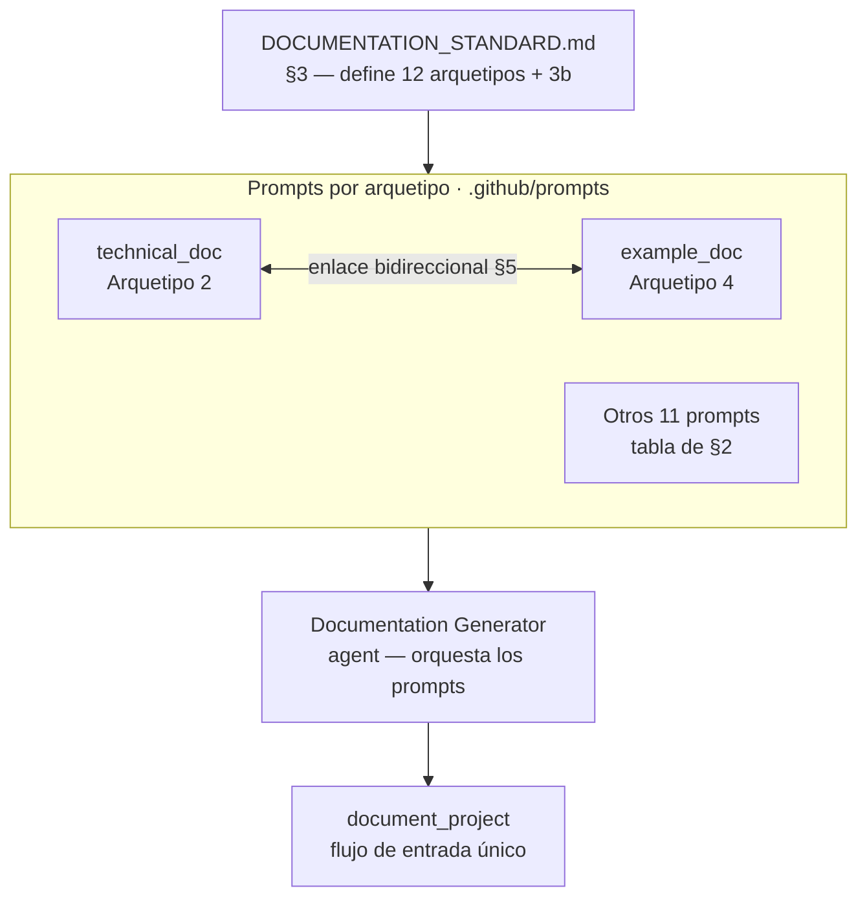

# archetypes

Sistema de doce arquetipos de documentación (más variante 3b) con estructura fija, audiencia definida y ubicación establecida que garantiza coherencia y auditabilidad en todos los proyectos documentados con doc_ia. Los arquetipos 1–8 son la base; 3b y 9–11 son las adiciones 2024-2025; el 12 y las reglas transversales de evidencia (`DOCUMENTATION_STANDARD.md` §3.16) y de diagramas (§3.17) son las adiciones 2026.

## 1. Arquitectura y Diseño



La relación arquetipo → prompt → ubicación de salida está en la tabla de §2.

## 2. Modelo de Datos / Contratos

### API pública

| Arquetipo | Prompt | Ubicación de salida | Pregunta que responde |
|---|---|---|---|
| **1 — Funcional** | `functional_doc.prompt.md` | `docs/functional/` | ¿Qué hace y por qué? |
| **2 — Técnica/API** | `technical_doc.prompt.md` | `docs/api/` | ¿Cómo funciona internamente? |
| **3a — How-to** | `howto_doc.prompt.md` | `docs/guides/*_howto.md` | ¿Cómo resuelvo esta tarea concreta? |
| **3b — Tutorial** | `tutorial_doc.prompt.md` | `docs/guides/*_tutorial.md` | ¿Cómo aprendo esto paso a paso? |
| **4 — Ejemplos de Código** | `example_doc.prompt.md` | `docs/examples/` | ¿Cómo se implementa? |
| **5 — ADR / MADR 4.0** | `architecture_doc.prompt.md` | `docs/adr/` | ¿Por qué se decidió así? |
| **6 — Navegación Principal** | `landing_doc.prompt.md` | `docs/` raíz (Var. A/B/C/D) | Intro + instalación + visión + quick start |
| **7 — Onboarding** | `onboarding_dev.prompt.md` | `docs/guides/onboarding_dev.md` | ¿Cómo me incorporo al proyecto? |
| **8 — Normativa** | `normative_traceability.prompt.md` | `docs/normativa/` | ¿Qué normativa aplica? (condicional) |
| **9 — Changelog** *(opt-in)* | `changelog.prompt.md` | `CHANGELOG.md` (raíz) | ¿Qué cambió en cada versión? |
| **10 — Config Agente IA** | `ai_config_doc.prompt.md` | `docs/ai-config/` | ¿Cómo está configurado el agente IA? |
| **11 — Guía de Contribución** *(opt-in)* | `contributing_doc.prompt.md` | `CONTRIBUTING.md` (raíz) | ¿Cómo contribuyo al proyecto? |
| **12 — Referencia del Sistema** *(condicional)* | `reference_doc.prompt.md` | `docs/reference/` | ¿Qué configuración, comandos y códigos expone? |

### Contrato de entrada

| Parámetro | Tipo | Descripción | Restricciones |
|---|---|---|---|
| `Módulo a documentar` | ruta | Script o componente origen | Debe existir y ser legible en el workspace |
| `Destino` | ruta | Ruta del archivo Markdown de salida | Dentro de la carpeta canónica del arquetipo |
| `Idioma` | string | Código ISO 639-1 (`es`, `en`, …) | Aplica a todo el contenido generado |

### Contrato de salida

Cada arquetipo produce un archivo Markdown con las secciones numeradas obligatorias de su plantilla. Las secciones vacías contienen `*No aplica para este módulo.*` — nunca se omiten.

### Errores y casos especiales

| Caso | Comportamiento |
|---|---|
| Sección del arquetipo sin contenido verificable | Escribir `*No aplica para este módulo.*`; nunca omitir la sección |
| Enlace bidireccional Arg. 2 §5 → Arg. 4 aún sin crear | Escribir marcador "Pendiente — crear ejemplo en docs/examples/..." |
| Arquetipo 8 invocado sin normativa de referencia | No aplica: el Arquetipo 8 solo se genera si el origen referencia normativa de obligado cumplimiento |
| Arquetipo 9 o 11 no generados tras `/document-project` | Comportamiento esperado: son opt-in y no se incluyen por defecto; solicitarlos con `Arquetipos: changelog` o `Arquetipos: contribución` |
| Arquetipo 12 sin señales en el inventario (sin configuración, CLI, códigos ni interfaces) | No se genera `docs/reference/` ni su entrada en `nav` |
| Cita de evidencia a código fuera de `docs/` | Se escribe como código inline (`ruta::símbolo`), nunca como enlace: un enlace rompería `mkdocs build --strict` |
| Arquetipo 4 sin archivo `.py` de soporte | Para flujos de chat (no Python): usar bloques inline; no se requiere `.py` |

## 3. Componentes y Clases

| Componente | Ruta | Responsabilidad |
|---|---|---|
| Estándar de documentación | `.github/DOCUMENTATION_STANDARD.md` §3 | Define estructura obligatoria, audiencia y ubicación de cada arquetipo |
| Prompts de arquetipos | `.github/prompts/*_doc.prompt.md` | Instrucciones de generación por arquetipo; uno por arquetipo |
| Trazabilidad determinista | `scripts/doc_trace.py` | Sella el frontmatter `fuentes` de las páginas con Evidencia y detecta drift, tests citados inexistentes y `llms.txt` desactualizado (§3.16) |
| Reglas operativas | `.github/instructions/docs.instructions.md` | Resumen de Mermaid (reglas completas en §3.17 del estándar), snippets `--8<--`, MkDocs, reglas de sección vacía |

## 4. Dependencias y Requisitos

| Dependencia | Propósito | Requerida | Comportamiento sin ella |
|---|---|---|---|
| `.github/DOCUMENTATION_STANDARD.md` | Fuente canónica de estructuras de arquetipo | Sí | Sin definición de secciones, la generación no tiene plantilla |
| `.github/instructions/docs.instructions.md` | Reglas operativas complementarias | Sí | Riesgo de formato inconsistente (Mermaid, snippets, secciones vacías) |
| `mkdocs.yml` del destino | Para sincronizar la navegación tras generar | Sí (para publicar) | La página no aparece en el sitio aunque exista en disco |

## 5. Ejemplos Relacionados

- [Ejemplo: Aplicar Arquetipos Individualmente](../examples/archetypes_usage.md) — cómo
  seleccionar el arquetipo correcto para un módulo e invocar su prompt directamente sin
  pasar por el flujo completo de `/document-project`.

## 6. Verificación y Tests

Los arquetipos son plantillas y prompts; se verifica su **resultado** sobre `docs/` de doc_ia
con `tests/test_docs_conformance.py`:

| Test | Qué verifica | Tipo |
|---|---|---|
| `test_functional_pages_follow_archetype_1` | 8 secciones, columna `Test` y Evidencia en cada página funcional | conformidad |
| `test_api_pages_follow_archetype_2` | 6 secciones y Evidencia en cada página técnica | conformidad |
| `test_reference_follows_archetype_12` | 6 secciones, Evidencia y entrada en el `nav` | conformidad |
| `test_functional_map_follows_variant_1i` | 4 secciones y una fila por página funcional | conformidad |
| `test_every_script_has_functional_technical_and_example_pages` | Arq. 1 + 2 + 4 por script | conformidad |
| `test_api_and_example_link_both_ways` | Enlace bidireccional §5 ↔ §5 | conformidad |
| `test_numbered_sections_are_never_empty` | Ninguna sección numerada vacía | conformidad |
| `test_no_normative_archetype_without_normative`, `test_changelog_follows_keep_a_changelog`, `test_ai_config_has_seven_sections`, `test_contributing_has_six_sections`, `test_guides_naming_convention` | Arquetipos 8, 9, 10, 11 y nombres de guías | conformidad |

```bash
python -m pytest tests/test_docs_conformance.py -q
```

Sin cubrir: la calidad del contenido (lo revisa el Documentation Reviewer) y la deriva entre la
norma y los prompts (como la corregida en ADR-002).

??? note "Evidencia"

    | Elemento | Fuente | Confianza |
    |---|---|---|
    | 12 arquetipos + 3b y sus ubicaciones | `.github/DOCUMENTATION_STANDARD.md` §3.1–§3.15 | ✅ |
    | Un prompt por arquetipo | `.github/prompts/` (`functional_doc`, `technical_doc`, `howto_doc`, `tutorial_doc`, `example_doc`, `architecture_doc`, `landing_doc`, `onboarding_dev`, `normative_traceability`, `changelog`, `ai_config_doc`, `contributing_doc`, `reference_doc`) | ✅ |
    | Regla transversal de evidencia | `.github/DOCUMENTATION_STANDARD.md` §3.16 | ✅ |
    | Regla transversal de diagramas | `.github/DOCUMENTATION_STANDARD.md` §3.17 | ✅ |
    | Sección vacía → `*No aplica para este módulo.*` | `.github/DOCUMENTATION_STANDARD.md` §3.1, §3.2 | ✅ |
    | Marcador "Pendiente" en Arq. 2 §5 | `.github/DOCUMENTATION_STANDARD.md` §3.2 | ✅ |
    | Arquetipo 8 condicional | `.github/DOCUMENTATION_STANDARD.md` §3.8 | ✅ |
    | Arquetipos 9 y 11 opt-in | `.github/DOCUMENTATION_STANDARD.md` §3.9 (conjunto mínimo de guías) | ✅ |
    | Arquetipo 12 condicional | `.github/DOCUMENTATION_STANDARD.md` §3.15 | ✅ |
    | Citas como código inline | `.github/DOCUMENTATION_STANDARD.md` §3.16 (reglas de cita) | ✅ |
    | Arquetipo 4 sin `.py` en flujos de chat | `.github/prompts/example_doc.prompt.md` | 🔍 |
    | Dependencias: norma, `docs.instructions.md`, `mkdocs.yml` | `.github/agents/documentation-generator.agent.md` (contexto obligatorio) | ✅ |
