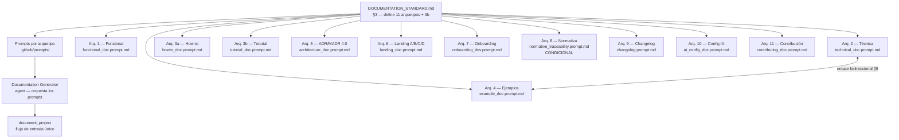

# archetypes

Sistema de once arquetipos de documentación (más variante 3b) con estructura fija, audiencia definida y ubicación establecida que garantiza coherencia y auditabilidad en todos los proyectos documentados con doc_ia. Los arquetipos 1–8 son la base; 3b y 9–11 son las adiciones 2024-2025.

## 1. Arquitectura y Diseño

## 2. Modelo de Datos / Contratos

### API pública

| Arquetipo | Prompt | Ubicación de salida | Pregunta que responde |
|---|---|---|---|
| **1 — Funcional** | `functional_doc.prompt.md` | `docs/functional/` | ¿Qué hace y por qué? |
| **2 — Técnica/API** | `technical_doc.prompt.md` | `docs/api/` | ¿Cómo funciona internamente? |
| **3a — How-to** | `howto_doc.prompt.md` | `docs/guides/*_howto.md` | ¿Cómo resuelvo esta tarea concreta? |
| **3b — Tutorial** | `tutorial_doc.prompt.md` | `docs/guides/*_tutorial.md` | ¿Cómo aprendo esto paso a paso? |
| **4 — Ejemplos de Código** | `example_doc.prompt.md` | `docs/examples/` | ¿Cómo se implementa? |
| **5 — ADR / MADR 4.0** | `architecture_doc.prompt.md` | `docs/adr/` | ¿Por qué se decidió así? |
| **6 — Navegación Principal** | `landing_doc.prompt.md` | `docs/` raíz (Var. A/B/C/D) | Intro + instalación + visión + quick start |
| **7 — Onboarding** | `onboarding_dev.prompt.md` | `docs/guides/onboarding_dev.md` | ¿Cómo me incorporo al proyecto? |
| **8 — Normativa** | `normative_traceability.prompt.md` | `docs/normativa/` | ¿Qué normativa aplica? (condicional) |
| **9 — Changelog** | `changelog.prompt.md` | `CHANGELOG.md` (raíz) | ¿Qué cambió en cada versión? |
| **10 — Config Agente IA** | `ai_config_doc.prompt.md` | `docs/ai-config/` | ¿Cómo está configurado el agente IA? |
| **11 — Guía de Contribución** | `contributing_doc.prompt.md` | `CONTRIBUTING.md` (raíz) | ¿Cómo contribuyo al proyecto? |

### Contrato de entrada

| Parámetro | Tipo | Descripción | Restricciones |
|---|---|---|---|
| `Módulo a documentar` | ruta | Script o componente origen | Debe existir y ser legible en el workspace |
| `Destino` | ruta | Ruta del archivo Markdown de salida | Dentro de la carpeta canónica del arquetipo |
| `Idioma` | string | Código ISO 639-1 (`es`, `en`, …) | Aplica a todo el contenido generado |

### Contrato de salida

Cada arquetipo produce un archivo Markdown con las secciones numeradas obligatorias de su plantilla. Las secciones vacías contienen `*No aplica para este módulo.*` — nunca se omiten.

### Errores y casos especiales

| Caso | Comportamiento |
|---|---|
| Sección del arquetipo sin contenido verificable | Escribir `*No aplica para este módulo.*`; nunca omitir la sección |
| Enlace bidireccional Arg. 2 §5 → Arg. 4 aún sin crear | Escribir marcador "Pendiente — crear ejemplo en docs/examples/..." |
| Arquetipo 8 invocado sin normativa de referencia | No aplica: el Arquetipo 8 solo se genera si el origen referencia normativa de obligado cumplimiento |
| Arquetipo 4 sin archivo `.py` de soporte | Para flujos de chat (no Python): usar bloques inline; no se requiere `.py` |

## 3. Componentes y Clases

| Componente | Ruta | Responsabilidad |
|---|---|---|
| Estándar de documentación | `.github/DOCUMENTATION_STANDARD.md` §3 | Define estructura obligatoria, audiencia y ubicación de cada arquetipo |
| Prompts de arquetipos | `.github/prompts/*_doc.prompt.md` | Instrucciones de generación por arquetipo; uno por arquetipo |
| Reglas operativas | `.github/instructions/docs.instructions.md` | Mermaid, snippets `--8<--`, MkDocs, reglas de sección vacía |

## 4. Dependencias y Requisitos

| Dependencia | Propósito | Requerida | Comportamiento sin ella |
|---|---|---|---|
| `.github/DOCUMENTATION_STANDARD.md` | Fuente canónica de estructuras de arquetipo | Sí | Sin definición de secciones, la generación no tiene plantilla |
| `.github/instructions/docs.instructions.md` | Reglas operativas complementarias | Sí | Riesgo de formato inconsistente (Mermaid, snippets, secciones vacías) |
| `mkdocs.yml` del destino | Para sincronizar la navegación tras generar | Sí (para publicar) | La página no aparece en el sitio aunque exista en disco |

## 5. Ejemplos Relacionados

- [Ejemplo: Aplicar Arquetipos Individualmente](../examples/archetypes_usage.md) — cómo
  seleccionar el arquetipo correcto para un módulo e invocar su prompt directamente sin
  pasar por el flujo completo de `/document-project`.
