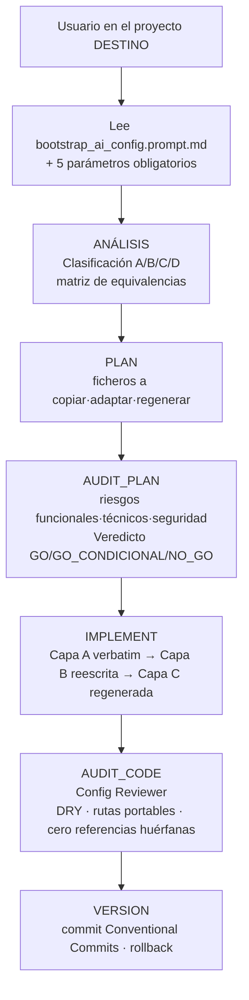

# bootstrap

Traslada el sistema de instrucciones IA de doc_ia a un proyecto destino de cualquier lenguaje y arquitectura, clasificando cada fichero en cuatro capas y emitiendo un plan de transferencia auditado.

## 1. Arquitectura y Diseño

## 2. Modelo de Datos / Contratos

### API pública

| Componente | Tipo | Descripción | Retorna |
|---|---|---|---|
| `bootstrap_ai_config.prompt.md` | prompt multiplataforma | Instrucciones completas del bootstrap; se invoca desde el proyecto destino | Fases ANÁLISIS → VERSION |
| `config-reviewer.agent.md` | agente | Audita la coherencia de las instrucciones IA generadas tras el bootstrap | AUDIT_CODE con veredicto |

### Contrato de entrada

| Parámetro | Tipo | Descripción | Restricciones |
|---|---|---|---|
| `Origen` | ruta | Ruta del repositorio doc_ia (solo lectura) | Obligatorio; el destino lee los ficheros del origen pero no los modifica |
| `Destino` | ruta | Raíz del proyecto que recibirá el sistema IA | Obligatorio; el código real del destino debe ser accesible para regenerar Capa C |
| `Lenguaje/arquitectura destino` | string | Stack real del destino (ej. TypeScript + NestJS) | Obligatorio; determina la matriz de equivalencias de comandos |
| `Plataformas IA activas` | lista | Plataformas a configurar (Claude Code, Gemini, Copilot, Cursor, Codex) | Obligatorio; determina qué entry points se crean |
| `Generador de documentación` | string | `mkdocs-material`, `Docusaurus`, `Hugo`, `ninguno`… | Obligatorio si el destino publica docs; determina si `mkdocs.yml` se copia o se adapta |
| `Fase` | string | `PLAN y AUDIT_PLAN únicamente` o `completa` | Opcional; por defecto flujo completo |

### Capas de transferencia

| Capa | Carácter | Acción |
|---|---|---|
| **A — Metodología** | Agnóstico de lenguaje: ciclo PLAN/IMPLEMENT/VERSION, agentes, prompts, plantilla de sesión | Copiar verbatim (revisar comandos embebidos) |
| **B — Especialización** | Entry points IA + instrucciones compartidas; mezcla método + dominio | Copiar y reescribir las secciones de dominio |
| **C — Contexto de dominio** | 100 % específico del origen: módulos, lenguaje, motores, capacidades | Regenerar desde cero analizando el destino |
| **D — No copiar** | Historial y estado del origen: sesiones pasadas, CHANGELOG, caches | Excluir |

### Contrato de salida

Seis bloques en el chat, en este orden: ANÁLISIS → PLAN → AUDIT_PLAN → IMPLEMENT → AUDIT_CODE → VERSION.

### Errores y casos especiales

| Caso | Comportamiento |
|---|---|
| Parámetro obligatorio faltante | El flujo se detiene antes del ANÁLISIS y pide completarlo |
| Generador de docs no indicado | Si el destino publica docs, el bootstrap pregunta antes de omitir `mkdocs.yml` |
| Bootstrap lanzado desde el origen en lugar del destino | Riesgo de arrastrar suposiciones del stack origen; el prompt lo prohíbe explícitamente |
| Fichero de Capa D presente en el origen | Se excluye siempre; no se copia ni con instrucciones explícitas del usuario |

## 3. Componentes y Clases

| Componente | Ruta | Responsabilidad |
|---|---|---|
| Prompt de bootstrap | `.github/prompts/bootstrap_ai_config.prompt.md` | Clasificación por capas, matrix de equivalencias, instrucciones por plataforma, salida esperada |
| Config Reviewer | `.github/agents/config-reviewer.agent.md` | Auditoría post-bootstrap: DRY, rutas portables, cero referencias huérfanas, veredicto APROBADO/RECHAZADO |

## 4. Dependencias y Requisitos

| Dependencia | Propósito | Requerida | Comportamiento sin ella |
|---|---|---|---|
| Código real del proyecto destino | Fuente para regenerar Capa C (`.ai/*.md`, instrucciones por lenguaje) | Sí | La Capa C queda vacía o con contenido del origen, no del destino |
| Entry points IA del origen (Capa A+B) | Plantillas que se copian o reescriben | Sí | Sin ellas no hay nada que transferir |
| `.github/DOCUMENTATION_STANDARD.md` | Si el destino publica docs: plantilla de arquetipos (Capa B) | Solo si el destino publica docs | La documentación del destino no hereda los arquetipos formales |

## 5. Ejemplos Relacionados

- [Ejemplo: Bootstrap de Configuración IA](../examples/bootstrap_usage.md) — invocación
  a un servicio TypeScript + NestJS, salida esperada del ANÁLISIS y del PLAN, y resultado
  tras completar el IMPLEMENT.
