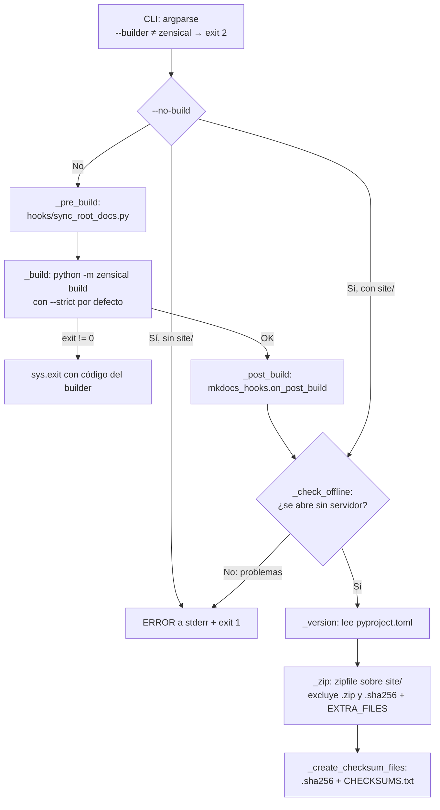
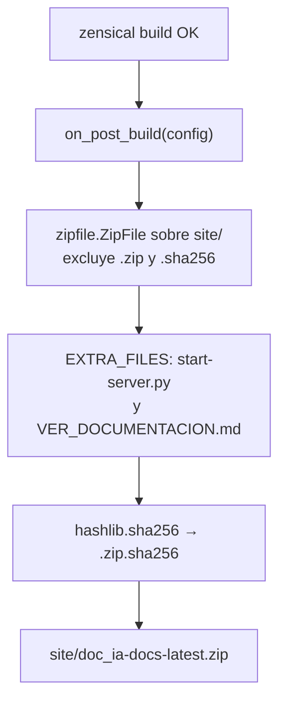

# build_docs_zip

Distribución offline del sitio de documentación. Zensical es el único generador (ADR-003) y no
ejecuta `hooks:`, así que el script `scripts/build_docs_zip.py` es el pipeline de build: sincroniza
los ficheros raíz, construye con Zensical, genera el ZIP automático "latest" con
`mkdocs_hooks.py` y empaqueta el ZIP versionado.

## 1. Arquitectura y Diseño

### Script (`scripts/build_docs_zip.py`)



Pipeline secuencial de funciones privadas orquestadas por `main()`; cada etapa falla rápido con
código de salida explícito. Zensical ignora la clave `hooks:` (y `mkdocs.yml` ya no la declara),
así que el script ejecuta él mismo `hooks/sync_root_docs.py` antes del build y `mkdocs_hooks.py`
después, **solo si el build termina con `0`**. Ambos módulos se cargan por ruta desde la raíz del
repositorio (`_load_hook`), porque al ejecutar `python scripts/build_docs_zip.py` la raíz no está
en `sys.path`. `--builder` se mantiene una versión para no romper llamadas existentes: `zensical`
se acepta sin efecto y cualquier otro valor (`mkdocs`) termina con código `2` antes de construir.

Antes de empaquetar, `_check_offline` exige que `site/` se pueda abrir desde `file://` (doble
clic en `index.html`). `_offline_problems` devuelve la lista de motivos, vacía si está listo:
falta `index.html`; no existe ninguno de `OFFLINE_SEARCH_INDEXES` (`search.js` de Zensical, o
`search/search_index.js` de sitios MkDocs anteriores), que escribe el plugin `offline`; alguna
página tiene un `<script src>` remoto (con esquema o `//`), como el shim de unpkg que añade el
tema sin la copia local; o algún `href`/`src` local enlaza a una carpeta (`_is_folder`: ignorando
`?` y `#`, la ruta termina en `/` o su último segmento es `.` o `..`, como el logo con
`navigation.indexes` sin `extra.homepage`; una ruta vacía es la propia página). Se informan
hasta `MAX_REPORTED_PROBLEMS` (20) y el número de los restantes.

### Post-build (`mkdocs_hooks.py`)



Función `on_post_build` que el pipeline invoca tras cada build correcto, cuando el sitio ya está
completo (índice de búsqueda `search.js` incluido). Sin instalación ni entry points. El nombre del
módulo es heredado de la etapa MkDocs y se mantiene (ADR-003).

## 2. Modelo de Datos / Contratos

### API pública

| Función | Fichero | Firma simplificada | Descripción | Retorna |
|---|---|---|---|---|
| `main` | `scripts/build_docs_zip.py` | `main() -> None` | Punto de entrada CLI: parsea argumentos y ejecuta el pipeline | — (termina con `sys.exit` en error) |
| `on_post_build` | `mkdocs_hooks.py` | `on_post_build(config, **kwargs) -> None` | Post-build: genera ZIP+SHA256 "latest" tras cada build correcto | — |

Las funciones `_version`, `_load_hook`, `_pre_build`, `_build`, `_post_build`, `_is_remote`,
`_is_folder`, `_offline_problems`, `_check_offline`, `_zip`, `_sha256_file` y
`_create_checksum_files` del script son privadas (prefijo `_`) y no forman parte del contrato
público. La función `_sha256` del post-build también es privada.

### Contrato de entrada — Script (argumentos CLI)

| Parámetro | Tipo | Descripción | Restricciones |
|---|---|---|---|
| `--no-strict` | flag | Omite `--strict` en el build | Por defecto el build es estricto |
| `--no-build` | flag | Empaqueta `site/` existente sin reconstruir | Requiere que `site/` exista |
| `--output-dir` | ruta | Carpeta de salida del ZIP | Por defecto `dist/`; relativa se resuelve contra la raíz del repo; se crea si no existe |
| `--builder` | `zensical` | Obsoleto: se acepta una versión para llamadas existentes | Cualquier otro valor (p. ej. `mkdocs`) → código `2` sin construir |

### Contrato de entrada — Post-build

| Parámetro | Tipo | Descripción |
|---|---|---|
| `config` | `dict` | Se usa `config["site_dir"]` para localizar el sitio generado (el pipeline pasa `site/`) |
| `**kwargs` | — | Ignorados |

### Contrato de salida

**Script**:
- `dist/doc_ia-docs-<versión>.zip` — sitio completo (sin `.zip`/`.sha256` anidados) más
  `EXTRA_FILES` en la raíz, igual que el ZIP "latest"; versión leída de `pyproject.toml`.
- `dist/doc_ia-docs-<versión>.zip.sha256` — línea `<hash>  <nombre_zip>`.
- `dist/CHECKSUMS.txt` — registro acumulativo `<hash>  <nombre>  (<timestamp ISO>)`.
- stdout: progreso con prefijo `[build_docs_zip]` (comando de build, ruta del ZIP, tamaño en MB, hash).

**Post-build**:
- `site/doc_ia-docs-latest.zip` — sitio completo; incluye `EXTRA_FILES` (`start-server.py`,
  `VER_DOCUMENTACION.md`) en la raíz del ZIP.
- `site/doc_ia-docs-latest.zip.sha256` — línea `<hash>  <nombre_zip>`.
- stdout: progreso con prefijo `[ZIP]` / `[OK]`.

### Errores y casos especiales

- **Script** — `--builder` distinto de `zensical`: error de argparse por stderr («no longer
  supported … ADR-003») y código `2`, sin pre-build ni build.
- **Script** — build fallido: proceso termina con el código de salida del builder (`sys.exit`).
  El pre-build ya se ha ejecutado (copias de `docs/` actualizadas) pero el post-build no: el ZIP
  "latest" de un build anterior no se sobrescribe.
- **Script** — `--no-build` sin `site/` existente: mensaje `ERROR` por stderr y código `1`.
- **Script** — `site/` que no se abre sin servidor: `ERROR` por stderr con la configuración
  esperada (`use_directory_urls: false`, plugin `offline`, iframe-worker local en
  `extra.polyfills`), una línea `- <página>: <problema>` por problema (máximo 20) y código `1`,
  sin crear `dist/`. El ZIP "latest" ya se ha generado en `site/`.
- **Script** — `CHECKSUMS.txt` es acumulativo (modo append): conserva el histórico.
- **Post-build** — si `site_dir` no existe en el momento de `on_post_build`: se imprime WARN y se
  retorna sin error fatal.

## 3. Componentes y Clases

| Componente | Ruta | Responsabilidad |
|---|---|---|
| `main` | `scripts/build_docs_zip.py` | CLI: parsea argumentos y orquesta el pipeline de build+ZIP |
| `on_post_build` | `mkdocs_hooks.py` | Post-build: genera `site/doc_ia-docs-latest.zip` tras cada build correcto |
| `_sha256` | `mkdocs_hooks.py` | Calcula la huella SHA256 del ZIP (el `.sha256` lo escribe `on_post_build`) |

El script (`build_docs_zip.py`) contiene solo funciones privadas (`_version`, `_load_hook`,
`_pre_build`, `_build`, `_post_build`, `_is_remote`, `_is_folder`, `_offline_problems`,
`_check_offline`, `_zip`, `_sha256_file`, `_create_checksum_files`) y las constantes `BUILDER`,
`LEGACY_BUILDER_FLAG`, `OFFLINE_SEARCH_INDEXES`, `MAX_REPORTED_PROBLEMS` y `EXTRA_FILES` (esta,
también en el post-build), sin clases. `mkdocs_hooks.py` es el patrón canónico de referencia para
otros proyectos: copiar y cambiar únicamente `zip_path`.

## 4. Dependencias y Requisitos

| Dependencia | Propósito | Componente | Comportamiento sin ella |
|---|---|---|---|
| `argparse`, `hashlib`, `importlib`, `re`, `zipfile`, `subprocess`, `tomllib`, `pathlib`, `datetime` (stdlib) | CLI, SHA256, comprobación del HTML, ZIP, builder, carga de los pasos, versión | script | — (stdlib Python ≥ 3.11) |
| Plugin `offline` + `docs/assets/vendor/iframe-worker/` en `extra.polyfills` | Índice de búsqueda en JS y shim local: el sitio se abre sin servidor | sitio | El script termina con código `1` (sin índice JS, o con el shim de unpkg) |
| `hashlib`, `os`, `zipfile`, `pathlib` (stdlib) | ZIP + SHA256 | post-build | — (stdlib Python ≥ 3.11) |
| `zensical` + `zensical-ui` (versión exacta en `requirements-docs.txt`) | Generador único, invocado con `python -m zensical` | script | Falla con su código de error si no está instalado en el intérprete que ejecuta el script |
| `hooks/sync_root_docs.py`, `mkdocs_hooks.py` | Pasos pre/post-build del pipeline | script | Error al cargarlos si faltan |
| `scripts/start-server.py`, `VER_DOCUMENTACION.md` | Servidor HTTP local e instrucciones de visualización incluidos en el ZIP (`EXTRA_FILES`) | ambos | ZIP válido, sin el fichero que falte |

## 5. Ejemplos Relacionados

- [Ejemplo: Generar ZIP Offline](../examples/build_docs_zip_offline.md) — invocaciones CLI
  típicas, validación del checksum y output esperado.

## 6. Verificación y Tests

| Test | Qué verifica | Tipo |
|---|---|---|
| `test_main_builds_strict_and_packages_versioned_zip` | Build con `--strict`, ZIP versionado, `.sha256` y `CHECKSUMS.txt` | integración (CLI, build simulado) |
| `test_versioned_zip_matches_latest_layout` | ZIP versionado sin `.zip`/`.sha256` anidados y con `start-server.py` + `VER_DOCUMENTACION.md` en la raíz | integración (CLI) |
| `test_main_no_strict_omits_flag` | `--no-strict` no pasa `--strict` al generador | unitario |
| `test_main_no_build_without_site_exits_1` | `--no-build` sin `site/` termina con `1` sin crear `dist/` | integración (CLI) |
| `test_main_build_failure_propagates_exit_code` | El código de error del generador se propaga y no se crea ZIP | integración (CLI) |
| `test_main_no_build_relative_output_dir` | `--output-dir` relativo se resuelve contra la raíz | integración (CLI) |
| `test_sha256_file_matches_archive` | El `.sha256` coincide con el hash real del ZIP | unitario |
| `test_checksums_txt_is_append_only` | `CHECKSUMS.txt` acumula una línea por build | unitario |
| `test_zensical_runs_hooks_around_build` | Comando `python -m zensical build --strict` y orden pre → build → post | integración (CLI, build simulado) |
| `test_zensical_build_failure_skips_post_build` | Build fallido: sin post-build ni ZIP | integración (CLI) |
| `test_legacy_builder_flag_zensical_is_accepted` | `--builder zensical` funciona igual que sin la opción | integración (CLI, build simulado) |
| `test_mkdocs_builder_is_rejected` | `--builder mkdocs` → código `2`, mensaje en stderr, sin pre-build ni build | integración (CLI) |
| `test_zensical_with_real_hooks_syncs_and_creates_latest_zip` | Con los pasos reales: copia `CHANGELOG.md` a `docs/` y genera el ZIP `latest` + `.sha256` | integración (CLI, build simulado) |
| `test_post_build_hook_creates_latest_zip` | `mkdocs_hooks.on_post_build`: ZIP `latest` + `.sha256`, incluye `start-server.py` y `VER_DOCUMENTACION.md`, excluye `.zip`/`.sha256` | unitario |
| `test_zensical_search_index_layout_is_accepted` | Índice `search.js` en la raíz (Zensical) válido | integración (CLI) |
| `test_external_and_file_links_are_not_folder_links` | Enlaces externos, `mailto:`, a ficheros con `#…/`, anclas y `href=""` no son enlaces a carpeta | integración (CLI) |
| `test_site_not_browsable_from_file_exits_1` | Enlace a carpeta (`api/x/`, `../#a`, `./`, `..`, `./..`, `.`, `/doc_ia/.`) o script remoto (`https:`, `//`) → código `1`, página y problema en stderr, sin `dist/` | integración (CLI, 9 casos) |
| `test_missing_search_index_js_exits_1` | Sin índice JS → código `1` y aviso del plugin `offline` | integración (CLI) |
| `test_offline_check_runs_after_build` | La comprobación va después del build que crea el índice | integración (CLI, build simulado) |
| `test_problem_report_is_truncated` | 25 problemas → 20 líneas + «... and 5 more» | integración (CLI) |

```bash
python -m pytest tests/test_build_docs_zip.py -q
```

Sin cubrir en los tests: el build real con Zensical (se simula `subprocess.run`). La CI ejecuta
el pipeline real (`python scripts/build_docs_zip.py`, bloqueante) y comprueba el ZIP `latest`.

??? note "Evidencia"

    | Elemento | Fuente | Confianza |
    |---|---|---|
    | `main` y opciones `--no-strict`, `--no-build`, `--output-dir`, `--builder` (obsoleto) | `scripts/build_docs_zip.py::main` | ✅ |
    | `--builder` distinto de `zensical` → código `2` | `scripts/build_docs_zip.py::main` (`parser.error`), `::BUILDER`, `::LEGACY_BUILDER_FLAG` | ✅ |
    | `on_post_build` | `mkdocs_hooks.py::on_post_build` | ✅ |
    | Versión desde `pyproject.toml` | `scripts/build_docs_zip.py::_version` | ✅ |
    | Build con Zensical, `--strict` y salida con el código del builder | `scripts/build_docs_zip.py::_build`, `::BUILDER` | ✅ |
    | ZIP `doc_ia-docs-<versión>.zip` | `scripts/build_docs_zip.py::_zip`, `::ZIP_PREFIX` | ✅ |
    | `.sha256` y `CHECKSUMS.txt` acumulativo | `scripts/build_docs_zip.py::_create_checksum_files` | ✅ |
    | `--no-build` sin `site/` → stderr + código `1` | `scripts/build_docs_zip.py::main` | ✅ |
    | Post-build: `site_dir` desde la configuración, WARN si no existe | `mkdocs_hooks.py::on_post_build` | ✅ |
    | Post-build: excluye `.zip`/`.sha256` e incluye `EXTRA_FILES` | `mkdocs_hooks.py::on_post_build`, `::EXTRA_FILES` | ✅ |
    | Script: mismo contenido que el ZIP "latest" (sin anidados + `EXTRA_FILES`) | `scripts/build_docs_zip.py::_zip`, `::EXTRA_FILES` | ✅ |
    | [COB-BUILDZIP-001](../decisiones/buildzip_decisiones.md#cob-buildzip-001) · Hook ejecutado antes del aborto por `--strict` (solo MkDocs; desde ADR-003 el post-build va tras un build OK) | `mkdocs.commands.build::build` (MkDocs 1.6.1, retirado) | ⚠️ (decisión: Aceptar riesgo) |
    | `_sha256` | `mkdocs_hooks.py::_sha256` | ✅ |
    | Dependencias stdlib del script y del post-build | `scripts/build_docs_zip.py`, `mkdocs_hooks.py` (imports) | ✅ |
    | Pre/post-build siempre; post solo con build OK | `scripts/build_docs_zip.py::_build`, `::_pre_build`, `::_post_build` | ✅ |
    | Carga de los pasos por ruta desde la raíz | `scripts/build_docs_zip.py::_load_hook` | ✅ |
    | [COB-BUILDZIP-002](../decisiones/buildzip_decisiones.md#cob-buildzip-002) · Zensical ignora `hooks:` de `mkdocs.yml` | zensical.org/compatibility/configuration (Zensical 0.0.73; re-verificado con 0.1.1) | ⚠️ (decisión: Aceptar riesgo) |
    | Comprobación «se abre sin servidor», sus cuatro motivos y el límite de 20 | `scripts/build_docs_zip.py::_offline_problems`, `::_check_offline`, `::_is_remote`, `::_is_folder`, `::OFFLINE_SEARCH_INDEXES`, `::MAX_REPORTED_PROBLEMS` | ✅ |
    | [COB-BUILDZIP-003](../decisiones/buildzip_decisiones.md#cob-buildzip-003) · Índice JS de Zensical en `search.js` | Build real con Zensical 0.0.73 (sesión 2026-10-29d) y 0.1.1 (sesión 2026-11-12) | ⚠️ (decisión: Aceptar riesgo) |
    | `EXTRA_FILES` opcionales en el ZIP | `mkdocs_hooks.py::on_post_build` (`if extra_path.exists()`), `scripts/build_docs_zip.py::_zip` (`if extra_path.is_file()`) | ✅ |
