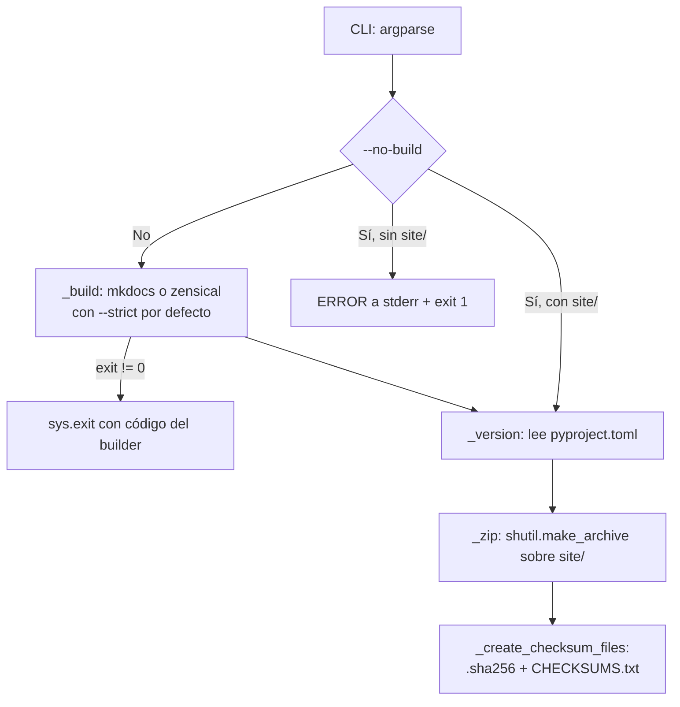

# build_docs_zip

Construye el sitio de documentación (MkDocs por defecto, Zensical opcional) y lo empaqueta como `dist/doc_ia-docs-<versión>.zip` con checksum SHA256.

## 1. Arquitectura y Diseño

Pipeline secuencial de funciones privadas orquestadas por `main()`; cada etapa
falla rápido con código de salida explícito.

## 2. Modelo de Datos / Contratos

### API pública

| Función/Clase | Firma simplificada | Descripción | Retorna |
|---|---|---|---|
| `main` | `main() -> None` | Punto de entrada CLI: parsea argumentos y ejecuta el pipeline | — (termina con `sys.exit` en error) |

Las funciones `_version`, `_build`, `_zip`, `_sha256_file` y `_create_checksum_files`
son privadas (prefijo `_`) y no forman parte del contrato público.

### Contrato de entrada (argumentos CLI)

| Parámetro | Tipo | Descripción | Restricciones |
|---|---|---|---|
| `--builder` | `mkdocs` \| `zensical` | Generador a usar | Por defecto `mkdocs`; `zensical` debe estar instalado |
| `--no-strict` | flag | Omite `--strict` en el build | Por defecto el build es estricto |
| `--no-build` | flag | Empaqueta `site/` existente sin reconstruir | Requiere que `site/` exista |
| `--output-dir` | ruta | Carpeta de salida del ZIP | Por defecto `dist/`; relativa se resuelve contra la raíz del repo; se crea si no existe |

### Contrato de salida

- `dist/doc_ia-docs-<versión>.zip` — sitio completo; versión leída de `pyproject.toml`.
- `dist/doc_ia-docs-<versión>.zip.sha256` — línea `<hash>  <nombre_zip>`.
- `dist/CHECKSUMS.txt` — registro acumulativo `<hash>  <nombre>  (<timestamp ISO>)`.
- stdout: progreso con prefijo `[build_docs_zip]` (comando de build, ruta del ZIP, tamaño en MB, hash).

### Errores y casos especiales

- Build fallido → el proceso termina con el código de salida del builder (`sys.exit`).
- `--no-build` sin `site/` existente → mensaje `ERROR` por stderr y código de salida `1`.
- `CHECKSUMS.txt` es acumulativo (modo append): conserva el histórico de ejecuciones.

## 3. Componentes y Clases

*No aplica para este módulo.* (Módulo de funciones; sin clases.)

## 4. Dependencias y Requisitos

| Dependencia | Propósito | Requerida | Comportamiento sin ella |
|---|---|---|---|
| `argparse`, `hashlib`, `shutil`, `subprocess`, `tomllib`, `pathlib`, `datetime` (stdlib) | CLI, SHA256, ZIP, ejecución del builder, lectura de versión | Sí | — (stdlib de Python ≥ 3.11) |
| `mkdocs` + `mkdocs-material` | Builder por defecto | Sí (vía `requirements.txt`) | El build falla y el proceso termina con su código de error |
| `zensical` | Builder alternativo | No | Solo necesario con `--builder zensical`; si no está instalado el comando falla |

## 5. Ejemplos Relacionados

- [Ejemplo: Generar ZIP Offline](../examples/build_docs_zip_offline.md) — invocaciones CLI
  típicas, validación del checksum y output esperado.
