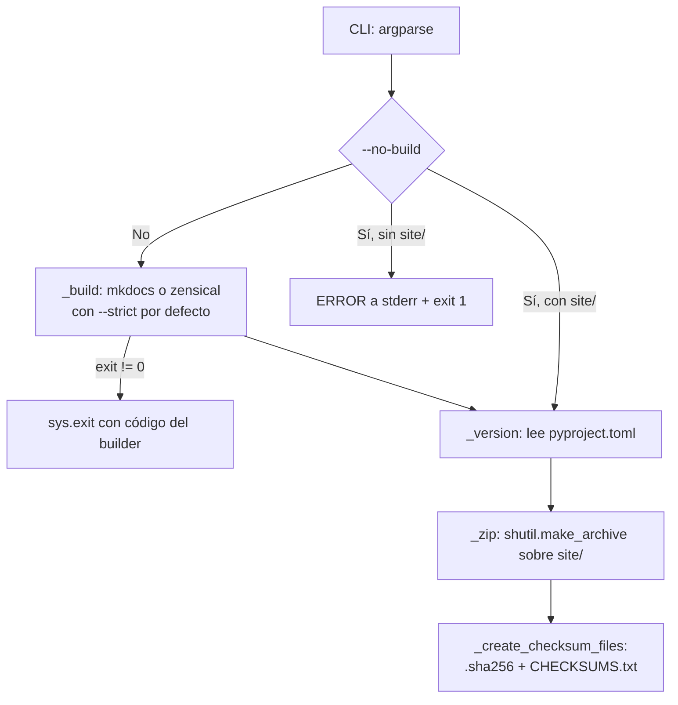

# build_docs_zip

Distribución offline del sitio de documentación mediante dos mecanismos complementarios: el script `scripts/build_docs_zip.py` (ZIP versionado manual) y el hook `mkdocs_hooks.py` (ZIP automático "latest" en cada build).

## 1. Arquitectura y Diseño

### Script (`scripts/build_docs_zip.py`)

Pipeline secuencial de funciones privadas orquestadas por `main()`; cada etapa
falla rápido con código de salida explícito.

### Hook (`mkdocs_hooks.py`)

```mermaid
flowchart TD
    MK[mkdocs build] --> H[on_post_build&#40;config&#41;]
    H --> Z[zipfile.ZipFile sobre site/\nexcluye .zip y .sha256]
    Z --> S[start-server.py incluido en ZIP]
    S --> C2[hashlib.sha256 → .zip.sha256]
    C2 --> OUT[site/doc_ia-docs-latest.zip]
```

Función `on_post_build` invocada por MkDocs tras cada build exitoso. Sin instalación ni
entry points; cargado directamente por MkDocs mediante la clave `hooks:` de `mkdocs.yml`.

## 2. Modelo de Datos / Contratos

### API pública

| Función | Fichero | Firma simplificada | Descripción | Retorna |
|---|---|---|---|---|
| `main` | `scripts/build_docs_zip.py` | `main() -> None` | Punto de entrada CLI: parsea argumentos y ejecuta el pipeline | — (termina con `sys.exit` en error) |
| `on_post_build` | `mkdocs_hooks.py` | `on_post_build(config, **kwargs) -> None` | Callback MkDocs: genera ZIP+SHA256 "latest" tras cada build exitoso | — |

Las funciones `_version`, `_build`, `_zip`, `_sha256_file` y `_create_checksum_files` del
script son privadas (prefijo `_`) y no forman parte del contrato público. La función `_sha256`
del hook también es privada.

### Contrato de entrada — Script (argumentos CLI)

| Parámetro | Tipo | Descripción | Restricciones |
|---|---|---|---|
| `--builder` | `mkdocs` \| `zensical` | Generador a usar | Por defecto `mkdocs`; `zensical` debe estar instalado |
| `--no-strict` | flag | Omite `--strict` en el build | Por defecto el build es estricto |
| `--no-build` | flag | Empaqueta `site/` existente sin reconstruir | Requiere que `site/` exista |
| `--output-dir` | ruta | Carpeta de salida del ZIP | Por defecto `dist/`; relativa se resuelve contra la raíz del repo; se crea si no existe |

### Contrato de entrada — Hook (callback MkDocs)

| Parámetro | Tipo | Descripción |
|---|---|---|
| `config` | `dict` | Configuración MkDocs; se usa `config["site_dir"]` para localizar el sitio generado |
| `**kwargs` | — | Argumentos adicionales de MkDocs; ignorados |

### Contrato de salida

**Script**:
- `dist/doc_ia-docs-<versión>.zip` — sitio completo; versión leída de `pyproject.toml`.
- `dist/doc_ia-docs-<versión>.zip.sha256` — línea `<hash>  <nombre_zip>`.
- `dist/CHECKSUMS.txt` — registro acumulativo `<hash>  <nombre>  (<timestamp ISO>)`.
- stdout: progreso con prefijo `[build_docs_zip]` (comando de build, ruta del ZIP, tamaño en MB, hash).

**Hook**:
- `site/doc_ia-docs-latest.zip` — sitio completo; incluye `start-server.py` en la raíz del ZIP.
- `site/doc_ia-docs-latest.zip.sha256` — línea `<hash>  <nombre_zip>`.
- stdout: progreso con prefijo `[ZIP]` / `[OK]`.

### Errores y casos especiales

- **Script** — build fallido: proceso termina con el código de salida del builder (`sys.exit`).
- **Script** — `--no-build` sin `site/` existente: mensaje `ERROR` por stderr y código `1`.
- **Script** — `CHECKSUMS.txt` es acumulativo (modo append): conserva el histórico.
- **Hook** — si el build lanza una excepción, MkDocs no invoca `on_post_build` y el ZIP "latest"
  no se sobreescribe. Con `--strict`, en cambio, MkDocs ejecuta `on_post_build` **antes** de
  abortar por avisos: el ZIP "latest" se regenera aunque el build termine con error ⚠️.
- **Hook** — si `site_dir` no existe en el momento de `on_post_build`: se imprime WARN y se retorna sin error fatal.

## 3. Componentes y Clases

| Componente | Ruta | Responsabilidad |
|---|---|---|
| `main` | `scripts/build_docs_zip.py` | CLI: parsea argumentos y orquesta el pipeline de build+ZIP |
| `on_post_build` | `mkdocs_hooks.py` | Hook MkDocs: genera `site/doc_ia-docs-latest.zip` tras cada build |
| `_sha256` | `mkdocs_hooks.py` | Calcula la huella SHA256 del ZIP (el `.sha256` lo escribe `on_post_build`) |

El script (`build_docs_zip.py`) contiene solo funciones privadas (`_version`, `_build`, `_zip`,
`_sha256_file`, `_create_checksum_files`) sin clases. El hook (`mkdocs_hooks.py`) es el patrón
canónico de referencia para otros proyectos: copiar y cambiar únicamente `zip_path`.

## 4. Dependencias y Requisitos

| Dependencia | Propósito | Componente | Comportamiento sin ella |
|---|---|---|---|
| `argparse`, `hashlib`, `shutil`, `subprocess`, `tomllib`, `pathlib`, `datetime` (stdlib) | CLI, SHA256, ZIP, builder, versión | script | — (stdlib Python ≥ 3.11) |
| `hashlib`, `os`, `zipfile`, `pathlib` (stdlib) | ZIP + SHA256 | hook | — (stdlib Python ≥ 3.11) |
| `mkdocs` + `mkdocs-material` | Builder por defecto; invocador del hook | ambos | Script: falla con su código de error. Hook: sin mkdocs no hay `on_post_build` |
| `zensical` | Builder alternativo | script | Solo con `--builder zensical`; falla si no está instalado |
| `scripts/start-server.py` | Servidor HTTP local incluido en el ZIP | hook | ZIP válido, sin el servidor de conveniencia |

## 5. Ejemplos Relacionados

- [Ejemplo: Generar ZIP Offline](../examples/build_docs_zip_offline.md) — invocaciones CLI
  típicas, validación del checksum y output esperado.

## 6. Verificación y Tests

*Sin tests automatizados.* Riesgo principal sin cubrir: la convivencia de los dos mecanismos
(script y hook) — nombre del ZIP, formato del `.sha256` y modo append de `CHECKSUMS.txt` solo se
validan en el workflow `docs-zip-release.yml` al publicar.

??? note "Evidencia"

    | Elemento | Fuente | Confianza |
    |---|---|---|
    | `main` y opciones `--builder`, `--no-strict`, `--no-build`, `--output-dir` | `scripts/build_docs_zip.py::main` | ✅ |
    | `on_post_build` | `mkdocs_hooks.py::on_post_build` | ✅ |
    | Versión desde `pyproject.toml` | `scripts/build_docs_zip.py::_version` | ✅ |
    | Build con `--strict` y salida con el código del builder | `scripts/build_docs_zip.py::_build` | ✅ |
    | ZIP `doc_ia-docs-<versión>.zip` | `scripts/build_docs_zip.py::_zip`, `::ZIP_PREFIX` | ✅ |
    | `.sha256` y `CHECKSUMS.txt` acumulativo | `scripts/build_docs_zip.py::_create_checksum_files` | ✅ |
    | `--no-build` sin `site/` → stderr + código `1` | `scripts/build_docs_zip.py::main` | ✅ |
    | Hook: `site_dir` desde la configuración, WARN si no existe | `mkdocs_hooks.py::on_post_build` | ✅ |
    | Hook: excluye `.zip`/`.sha256` e incluye `start-server.py` | `mkdocs_hooks.py::on_post_build` | ✅ |
    | Hook ejecutado antes del aborto por `--strict` | `mkdocs.commands.build::build` (MkDocs 1.6.1) | ⚠️ |
    | `_sha256` | `mkdocs_hooks.py::_sha256` | ✅ |
    | Dependencias stdlib del script y del hook | `scripts/build_docs_zip.py`, `mkdocs_hooks.py` (imports) | ✅ |
    | `zensical` como builder alternativo | `scripts/build_docs_zip.py::_build` | ✅ |
    | `start-server.py` opcional en el ZIP | `mkdocs_hooks.py::on_post_build` (`if server_script.exists()`) | ✅ |
