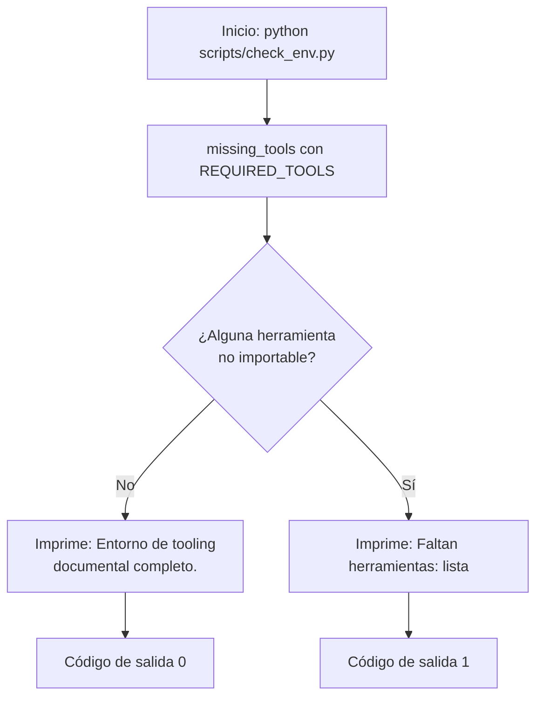

# check_env

Verifica de forma determinista que las herramientas del tooling documental (`mkdocs`, `ruff`, `mypy`, `pytest`) son importables en el entorno Python activo. Además reporta la disponibilidad de herramientas opcionales de conversión: `docling`, `markitdown` (con plugins), `pandoc` y `nvidia-smi`.

## 1. Arquitectura y Diseño



Script standalone sin dependencias entre módulos del proyecto: usa solo
`importlib.util.find_spec` para detectar importabilidad sin ejecutar las herramientas.

## 2. Modelo de Datos / Contratos

### API pública

| Función/Clase | Firma simplificada | Descripción | Retorna |
|---|---|---|---|
| `REQUIRED_TOOLS` | `tuple[str, ...]` | Constante con las herramientas requeridas: `("mkdocs", "ruff", "mypy", "pytest")` | — |
| `OPTIONAL_PYTHON_TOOLS` | `tuple[str, ...]` | Herramientas opcionales de conversión: `("markitdown", "docling")` | — |
| `SYSTEM_TOOLS` | `tuple[str, ...]` | Herramientas de sistema opcionales: `("pandoc",)` | — |
| `missing_tools` | `missing_tools(tools=REQUIRED_TOOLS) -> list[str]` | Filtra las herramientas Python no importables en el entorno actual | Lista de nombres ausentes (vacía si completo) |
| `missing_system_tools` | `missing_system_tools(tools=SYSTEM_TOOLS) -> list[str]` | Filtra herramientas de sistema no encontradas en el PATH | Lista de nombres ausentes |
| `check_markitdown_plugins` | `() -> tuple[list[str], list[str]]` | Comprueba plugins de markitdown (pdfminer, docx, pptx, openpyxl, xlrd) | `(instalados, faltantes)` |
| `main` | `main() -> int` | Imprime el estado del entorno (requeridas + opcionales) | `0` completo, `1` falta algo requerido |

### Contrato de entrada

| Parámetro | Tipo | Descripción | Restricciones |
|---|---|---|---|
| `tools` | `tuple[str, ...]` | Nombres de módulos a comprobar | Por defecto `REQUIRED_TOOLS`; deben ser nombres importables válidos |

### Contrato de salida

- `missing_tools` devuelve `list[str]` preservando el orden de entrada; lista vacía = entorno completo.
- `main` escribe en stdout una línea de estado seguida, si procede, de avisos `⚠` sobre
  herramientas opcionales, y devuelve el código de salida (`0`/`1`), apto para CI y hooks
  (`sys.exit(main())`). Los avisos de opcionales no cambian el código (`0`).

### Errores y casos especiales

- No lanza excepciones propias: una herramienta no instalada produce entrada en la lista,
  no un error.
- No hay acceso a red ni a servicios IA; el resultado depende solo del entorno local.

## 3. Componentes y Clases

*No aplica para este módulo.* (Módulo de funciones; sin clases.)

## 4. Dependencias y Requisitos

| Dependencia | Propósito | Requerida | Comportamiento sin ella |
|---|---|---|---|
| `importlib.util` (stdlib) | Detección de importabilidad sin importar realmente | Sí | — (siempre disponible) |
| `shutil` (stdlib) | Búsqueda de binarios en el PATH (`pandoc`, `nvidia-smi`) | Sí | — (siempre disponible) |
| `sys` (stdlib) | Código de salida del proceso | Sí | — (siempre disponible) |

## 5. Ejemplos Relacionados

- [Ejemplo: Verificar Entorno](../examples/check_env_usage.md) — uso de `missing_tools`
  desde código propio y ejecución CLI con output esperado.

## 6. Verificación y Tests

| Test | Qué verifica | Tipo |
|---|---|---|
| `tests/test_check_env.py::test_missing_tools_empty_when_tools_exist` | Un módulo importable (`sys`) no aparece como ausente | unitario |
| `tests/test_check_env.py::test_missing_tools_detects_absent_tool` | Un módulo inexistente aparece en la lista de ausentes | unitario |
| `tests/test_check_env.py::test_missing_system_tools_detects_absent_tool` | Un binario inexistente aparece como ausente del PATH | unitario |
| `tests/test_check_env.py::test_missing_system_tools_empty_when_tool_exists` | Un binario presente (`python`, `python3` o `git`) no aparece como ausente | unitario |
| `tests/test_check_env.py::test_main_script_survives_non_utf8_console` | El script con `PYTHONIOENCODING=cp1252` muestra los avisos sin `UnicodeEncodeError` y termina con 0 o 1 | integración (subproceso) |

Sin cubrir: `check_markitdown_plugins` y el contenido exacto de los avisos de `main`.

```bash
python -m pytest tests/test_check_env.py -q
```

??? note "Evidencia"

    | Elemento | Fuente | Confianza |
    |---|---|---|
    | `REQUIRED_TOOLS` | `scripts/check_env.py::REQUIRED_TOOLS` | ✅ |
    | `OPTIONAL_PYTHON_TOOLS` | `scripts/check_env.py::OPTIONAL_PYTHON_TOOLS` | ✅ |
    | `SYSTEM_TOOLS` | `scripts/check_env.py::SYSTEM_TOOLS` | ✅ |
    | `missing_tools` | `scripts/check_env.py::missing_tools` | ✅ |
    | `missing_system_tools` | `scripts/check_env.py::missing_system_tools` | ✅ |
    | `check_markitdown_plugins` y sus 5 plugins | `scripts/check_env.py::check_markitdown_plugins`, `::MARKITDOWN_PLUGINS` | ✅ |
    | `main` — `1` si falta una requerida, `0` en otro caso | `scripts/check_env.py::main` | ✅ |
    | `nvidia-smi` solo se consulta con docling instalado | `scripts/check_env.py::main` | ✅ |
    | Sin excepciones propias | `scripts/check_env.py` (sin `raise`) | ✅ |
    | Dependencias `importlib.util`, `shutil`, `sys` | `scripts/check_env.py` (imports) | ✅ |
    | Tests del §6 | `tests/test_check_env.py` | ✅ |
