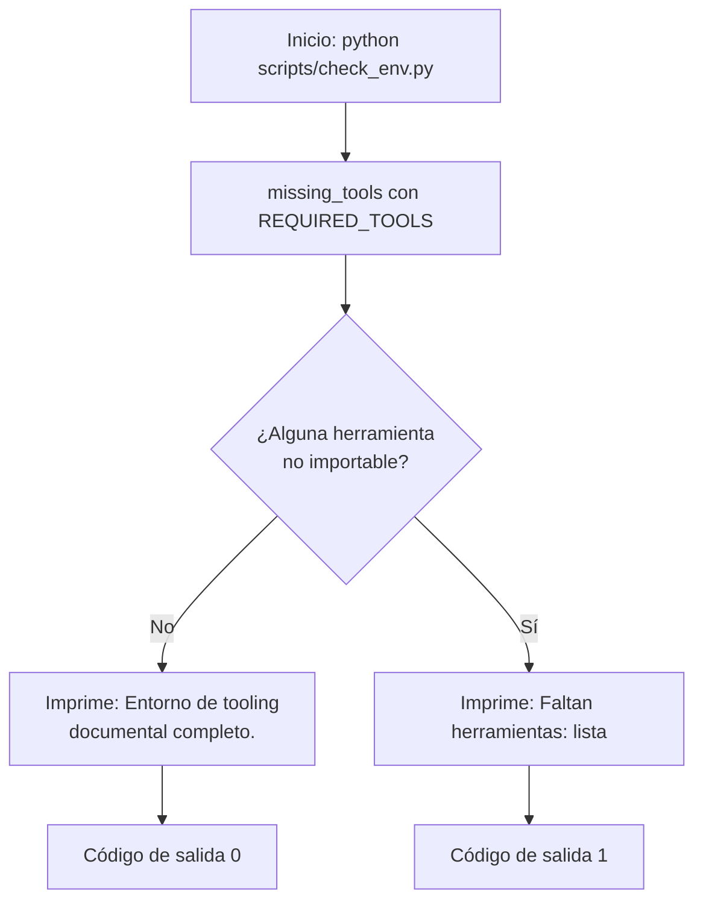

# check_env

Verifica de forma determinista que las herramientas del tooling documental (`mkdocs`, `ruff`, `mypy`, `pytest`) son importables en el entorno Python activo.

## 1. Arquitectura y Diseño

Script standalone sin dependencias entre módulos del proyecto: usa solo
`importlib.util.find_spec` para detectar importabilidad sin ejecutar las herramientas.

## 2. Modelo de Datos / Contratos

### API pública

| Función/Clase | Firma simplificada | Descripción | Retorna |
|---|---|---|---|
| `REQUIRED_TOOLS` | `tuple[str, ...]` | Constante con las herramientas requeridas: `("mkdocs", "ruff", "mypy", "pytest")` | — |
| `missing_tools` | `missing_tools(tools=REQUIRED_TOOLS) -> list[str]` | Filtra las herramientas no importables en el entorno actual | Lista de nombres ausentes (vacía si completo) |
| `main` | `main() -> int` | Imprime el estado del entorno | `0` completo, `1` falta algo |

### Contrato de entrada

| Parámetro | Tipo | Descripción | Restricciones |
|---|---|---|---|
| `tools` | `tuple[str, ...]` | Nombres de módulos a comprobar | Por defecto `REQUIRED_TOOLS`; deben ser nombres importables válidos |

### Contrato de salida

- `missing_tools` devuelve `list[str]` preservando el orden de entrada; lista vacía = entorno completo.
- `main` escribe una única línea en stdout y devuelve el código de salida (`0`/`1`),
  apto para CI y hooks (`sys.exit(main())`).

### Errores y casos especiales

- No lanza excepciones propias: una herramienta no instalada produce entrada en la lista,
  no un error.
- No hay acceso a red ni a servicios IA; el resultado depende solo del entorno local.

## 3. Componentes y Clases

*No aplica para este módulo.* (Módulo de funciones; sin clases.)

## 4. Dependencias y Requisitos

| Dependencia | Propósito | Requerida | Comportamiento sin ella |
|---|---|---|---|
| `importlib.util` (stdlib) | Detección de importabilidad sin importar realmente | Sí | — (siempre disponible) |
| `sys` (stdlib) | Código de salida del proceso | Sí | — (siempre disponible) |

## 5. Ejemplos Relacionados

- [Ejemplo: Verificar Entorno](../examples/check_env_usage.md) — uso de `missing_tools`
  desde código propio y ejecución CLI con output esperado.
