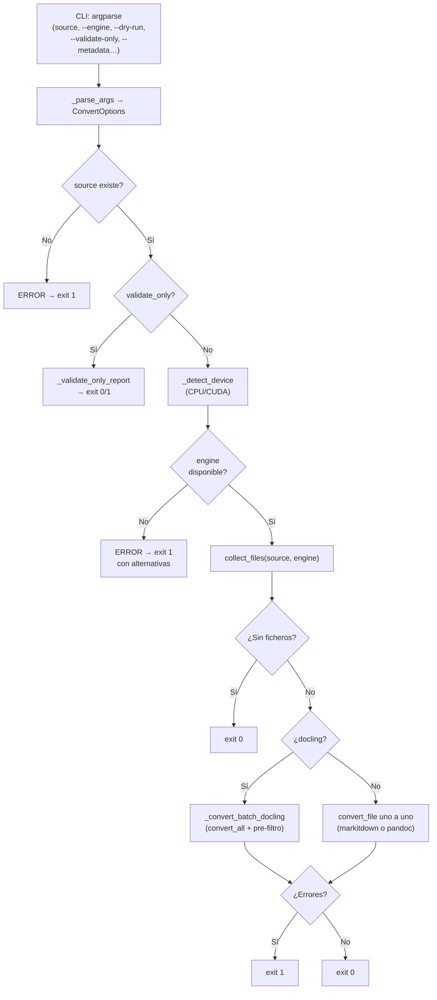

# convert_to_md

Convierte ficheros en formatos no legibles directamente por el agente IA (PDF, DOCX, PPTX,
imágenes, email, audio…) a Markdown, depositando el resultado en `<origen>/md/` con la
estructura de subdirectorios reflejada. Soporta tres motores: docling (default), markitdown
y pandoc.

## 1. Arquitectura y Diseño



Pipeline determinista: cada fichero se procesa de forma independiente; un error en un fichero
no detiene los restantes. Docling usa `convert_all()` para procesamiento batch optimizado;
markitdown y pandoc procesan fichero a fichero.

## 2. Modelo de Datos / Contratos

### ConvertOptions (dataclass)

| Campo | Tipo | Default | Descripción |
|---|---|---|---|
| `source` | `Path` | `Path(".")` | Fichero o directorio origen |
| `engine` | `str` | `"docling"` | Motor: `docling`, `markitdown`, `pandoc` |
| `dry_run` | `bool` | `False` | Simular sin convertir |
| `validate_only` | `bool` | `False` | Solo validar, no convertir |
| `force` | `bool` | `False` | Re-convertir aunque exista salida |
| `metadata` | `bool` | `False` | Añadir frontmatter YAML |
| `chunk` | `bool` | `False` | Generar chunks RAG (solo docling) |
| `chunk_max_tokens` | `int` | `512` | Tokens máximo por chunk |
| `ocr` | `bool` | `True` | Habilitar OCR (solo docling) |
| `ocr_engine` | `str` | `"auto"` | Motor OCR: `auto`, `easyocr`, `tesseract`, `rapidocr` |
| `ocr_lang` | `list[str]` | `["es", "en"]` | Idiomas OCR |
| `table_mode` | `str` | `"accurate"` | Modo tablas: `accurate`, `fast` |
| `image_export` | `str` | `"placeholder"` | Exportación imágenes: `placeholder`, `embedded`, `referenced` |
| `pdf_backend` | `str` | `"docling-parse"` | Backend PDF: `docling-parse`, `pypdfium2` |
| `timeout` | `int` | `300` | Timeout por documento (segundos) |
| `device` | `str` | `"cpu"` | Dispositivo: `cpu`, `cuda`, `auto` |
| `num_threads` | `int` | `4` | Hilos CPU para docling |
| `flash_attention` | `bool` | `False` | Flash Attention 2 (GPU Ampere+) |
| `batch_size` | `int` | `1` | Documentos por lote (docling) |
| `workers` | `int` | `1` | Concurrencia por lote (docling) |

### API pública

| Función | Firma | Descripción | Retorna |
|---|---|---|---|
| `docling_available` | `() -> bool` | Comprueba si docling está instalado | `True` si disponible |
| `markitdown_available` | `() -> bool` | Comprueba si markitdown está instalado | `True` si disponible |
| `pandoc_available` | `() -> bool` | Comprueba si pandoc está en el PATH | `True` si disponible |
| `engine_available` | `(engine: str) -> bool` | Comprueba disponibilidad del motor indicado | `True` si disponible |
| `validate_file` | `(source_file: Path) -> tuple[bool, str]` | Valida integridad: tamaño, ZIP, cabecera PDF/imagen, audio | `(True, "")` o `(False, razón)` |
| `collect_files` | `(source: Path, engine: str) -> list[Path]` | Recopila ficheros convertibles para el motor; excluye `md/` | Lista ordenada de `Path` |
| `output_path` | `(source_file, source_root, md_root) -> Path` | Calcula ruta de salida reflejando estructura relativa | `Path` bajo `md_root` |
| `convert_file` | `(source_file, source_root, md_root, *, options) -> bool` | Convierte un fichero con el motor indicado; idempotente | `True` si éxito u omisión |
| `main` | `(argv: list[str] \| None) -> int` | Punto de entrada CLI | `0` ok · `1` error |

### CLI

```
python scripts/convert_to_md.py <source> [--engine {docling,markitdown,pandoc}]
    [--dry-run] [--validate-only] [--force] [--metadata] [--chunk]
    [--ocr | --no-ocr] [--ocr-engine {auto,easyocr,tesseract,rapidocr}]
    [--device {cpu,cuda,auto}] [--batch-size N] [--workers N]
```

| Argumento | Tipo | Descripción | Restricciones |
|---|---|---|---|
| `source` | `Path` | Fichero o directorio a convertir | Obligatorio; debe existir |
| `--engine` | choice | Motor de conversión | Default: `docling` |
| `--dry-run` | flag | Simular sin convertir | — |
| `--validate-only` | flag | Solo validar integridad | — |
| `--force` | flag | Re-convertir aunque exista | — |
| `--metadata` | flag | Añadir frontmatter YAML | — |
| `--chunk` | flag | Generar chunks RAG | Solo con `--engine docling` |
| `--no-ocr` | flag | Deshabilitar OCR | — |
| `--device` | choice | CPU/CUDA/auto | `--flash-attention` requiere `cuda` o `auto` |
| `--batch-size` | int | Lote docling | Solo con `--engine docling` |
| `--workers` | int | Concurrencia lote | Solo con `--engine docling` |

### Constantes

| Nombre | Tipo | Contenido |
|---|---|---|
| `DOCLING_EXTENSIONS` | `frozenset[str]` | `.pdf`, `.docx`, `.pptx`, `.xlsx`, `.csv`, `.html`, `.htm`, `.epub`, `.png`, `.jpg`, `.jpeg`, `.tiff`, `.bmp`, `.webp`, `.eml`, `.msg`, `.md`, `.tex`, `.latex`, `.wav`, `.mp3` |
| `MARKITDOWN_EXTENSIONS` | `frozenset[str]` | `.pdf`, `.docx`, `.pptx`, `.xlsx`, `.xls`, `.csv`, `.epub`, `.html`, `.htm`, `.msg` |
| `PANDOC_EXTENSIONS` | `frozenset[str]` | `.doc`, `.odt`, `.rst`, `.tex`, `.latex` |
| `ENGINE_EXTENSIONS` | `dict[str, frozenset]` | Mapeo motor → extensiones soportadas |
| `CONVERTIBLE_EXTENSIONS` | `frozenset[str]` | Unión de las tres anteriores |

### Contrato de salida (stdout)

| Situación | Línea impresa |
|---|---|
| Fichero ya convertido | `  OMITIR  <rel> -> md/<rel_salida> (ya existe)` |
| Conversión exitosa | `  OK      <rel> -> md/<rel_salida>` |
| Conversión exitosa (docling batch) | `  CONV    <rel> ... OK -> md/<rel_salida>` |
| Error de conversión | `  ERROR   <rel>: <mensaje>` |
| Fichero inválido | `  INVÁLID <rel>: <razón>` |
| Formato no soportado | `  NOSOPOR <rel>: formato '<ext>' no soportado por motor '<engine>'` |
| `--dry-run` | `  DRY-RUN <rel> -> md/<rel_salida>` |
| Validate-only OK | `  OK      <rel>` |
| Motor no disponible | `ERROR: Motor '<engine>' no disponible.` |

### Errores y casos especiales

| Caso | Comportamiento |
|---|---|
| `source` no existe | `exit 1` con mensaje |
| Motor no instalado (sin `--dry-run`) | `exit 1` con alternativas |
| `--validate-only` sin motor | Reporta como `NO INSTALADO` pero continúa validación |
| Fichero vacío (0 bytes) | `INVÁLID` — no intenta conversión |
| PDF con cabecera no `%PDF-` | `INVÁLID` — fichero corrupto |
| DOCX/PPTX/XLSX/EPUB no ZIP válido | `INVÁLID` — formato corrupto |
| Imagen con magic bytes incorrectos | `INVÁLID` — fichero corrupto |
| Audio < 1KB | `INVÁLID` — demasiado pequeño |
| `--device cuda` sin nvidia-smi | `exit 1` |
| `--device auto` sin `CUDA_VISIBLE_DEVICES` exportado previamente | Detecta CUDA con `nvidia-smi`: el `""` que fija el módulo al importarse (`_CUDA_ENV_INJECTED`) no cuenta como elección del usuario |
| `--chunk` con motor no docling | Error de argparse |

## 3. Componentes y Clases

| Componente | Ruta | Responsabilidad |
|---|---|---|
| Script principal | `scripts/convert_to_md.py` | Lógica de detección, routing, validación y conversión |
| `ConvertOptions` | `scripts/convert_to_md.py` | Dataclass con todos los parámetros CLI |
| Motor docling | `_convert_with_docling`, `_convert_batch_docling` | Conversión con pipeline docling + batch |
| Motor markitdown | `_convert_with_markitdown` | Conversión con MarkItDown |
| Motor pandoc | `_convert_with_pandoc` | Conversión vía subprocess |
| Validación | `validate_file`, `_validate_only_report` | Integridad previa y modo validate-only |
| Detección CUDA | `_cuda_available`, `_detect_device` | Resolución CPU/CUDA sin importar torch |
| Chunking RAG | `_run_chunking` | Fragmentación con HybridChunker |
| Metadata | `_build_metadata_basic`, `_format_frontmatter` | Frontmatter YAML |

## 4. Dependencias y Requisitos

| Dependencia | Propósito | Requerida para | Sin ella |
|---|---|---|---|
| `docling` (Python) | Motor principal de conversión | `--engine docling` | Usar `--engine markitdown` o `pandoc` |
| `markitdown` (Python) | Motor ligero de conversión | `--engine markitdown` | Usar `--engine docling` o `pandoc` |
| `pandoc` (binario) | Conversión de formatos legacy | `--engine pandoc` | Usar `--engine docling` o `markitdown` |
| `nvidia-smi` (sistema) | Detección CUDA | `--device cuda/auto` | Solo CPU disponible |
| `pathlib`, `subprocess`, `importlib.util`, `shutil`, `zipfile` | Infraestructura | Todos | stdlib Python ≥ 3.12 |

Verificar entorno: `python scripts/check_env.py` (reporta disponibilidad de docling, markitdown y pandoc).

## 5. Ejemplos Relacionados

- [Ejemplo: Convertir Documentos a Markdown](../examples/convert_to_md_usage.md) — invocaciones
  por motor, validación, metadata, batch y chunking.
- Integrado en el flujo [Documentar un Proyecto](../functional/document_project.md) § Fase 0b.

## 6. Verificación y Tests

72 tests en `tests/test_convert_to_md.py`, agrupados por prefijo:

| Test | Qué verifica | Tipo |
|---|---|---|
| `test_validate_*` (14, excluye `test_validate_only_*`) | `validate_file`: fichero vacío o inexistente, cabeceras PDF/PNG/JPEG, ZIP de DOCX/XLSX, audio < 1 KB, texto plano | unitario |
| `test_validate_only_*` (4) | `_validate_only_report`: todo válido, fichero inválido, motor no instalado, sin crear `md/` | unitario |
| `test_main_validate_only_no_files` (1) | `main` con `--validate-only` y sin ficheros convertibles devuelve `0` | integración |
| `test_collect_files_*` (6) | `collect_files`: fichero único, no convertible, directorio, anidado, exclusión de `md/`, filtro por motor | unitario |
| `test_output_path_*` (2) | `output_path`: estructura plana y anidada | unitario |
| `test_convert_file_*` (10) | `convert_file`: omisión si existe, inválido, `--dry-run` por motor, motor no instalado, formato no soportado, `--force` | unitario |
| `test_prefilter_*` (3) | Pre-filtro del batch docling: omite existentes, rechaza inválidos, `--dry-run` | unitario |
| `test_parse_args_*` (19) | `_parse_args`: valores por defecto, flags y restricciones entre opciones (`--chunk`, `--batch-size`, `--workers`, `--flash-attention`) | unitario |
| `test_engine_extensions_keys`, `test_docling_covers_markitdown_formats`, `test_pandoc_has_unique_formats` (3) | Coherencia de los conjuntos de extensiones por motor | unitario |
| `test_detect_device_*` (7) | `_detect_device`: `cpu`, `auto` con y sin CUDA, `cuda` sin GPU, respeto de `CUDA_VISIBLE_DEVICES` del usuario, `auto` ignora el valor por defecto del import | unitario |
| `test_cuda_available_*` (3) | `_cuda_available`: sin `nvidia-smi`, respuesta correcta, timeout | unitario |
| `test_convert_options_new_fields_defaults` (1) | Valores por defecto de `ConvertOptions` | unitario |

Sin cubrir: conversiones reales con los motores instalados (los tests simulan su ausencia o usan
`--dry-run`).

```bash
python -m pytest tests/test_convert_to_md.py -q
```

??? note "Evidencia"

    | Elemento | Fuente | Confianza |
    |---|---|---|
    | `ConvertOptions` y sus 20 campos por defecto | `scripts/convert_to_md.py::ConvertOptions` | ✅ |
    | `docling_available`, `markitdown_available`, `pandoc_available` | `scripts/convert_to_md.py::docling_available`, `::markitdown_available`, `::pandoc_available` | ✅ |
    | `engine_available` | `scripts/convert_to_md.py::engine_available` | ✅ |
    | `validate_file` | `scripts/convert_to_md.py::validate_file` | ✅ |
    | `collect_files` (excluye `md/`) | `scripts/convert_to_md.py::collect_files` | ✅ |
    | `output_path` | `scripts/convert_to_md.py::output_path` | ✅ |
    | `convert_file` | `scripts/convert_to_md.py::convert_file` | ✅ |
    | `main` — códigos `0`/`1` | `scripts/convert_to_md.py::main` | ✅ |
    | Opciones CLI y restricciones (`parser.error`) | `scripts/convert_to_md.py::_parse_args` | ✅ |
    | Constantes de extensiones | `scripts/convert_to_md.py::DOCLING_EXTENSIONS`, `::MARKITDOWN_EXTENSIONS`, `::PANDOC_EXTENSIONS`, `::ENGINE_EXTENSIONS`, `::CONVERTIBLE_EXTENSIONS` | ✅ |
    | Líneas de stdout (`OMITIR`, `OK`, `CONV`, `ERROR`, `INVÁLID`, `NOSOPOR`, `DRY-RUN`) | `scripts/convert_to_md.py::convert_file`, `::_prefilter_files`, `::_process_batch_result`, `::_convert_with_markitdown`, `::_convert_with_pandoc` | ✅ |
    | `--validate-only` con motor `NO INSTALADO` | `scripts/convert_to_md.py::_validate_only_report` | ✅ |
    | Validaciones de cabecera, ZIP y audio | `scripts/convert_to_md.py::validate_file`, `::_validate_header`, `::_IMAGE_HEADERS` | ✅ |
    | `--device cuda` sin `nvidia-smi` → `exit 1` | `scripts/convert_to_md.py::_detect_device` | ✅ |
    | `--device auto` ignora el valor fijado al importar | `scripts/convert_to_md.py::_CUDA_ENV_INJECTED`, `::_detect_device` | ✅ |
    | `_detect_device` solo se llama con docling y sin `--dry-run` | `scripts/convert_to_md.py::main` | ✅ |
    | Componentes de motor, validación, CUDA, chunking y metadata | `scripts/convert_to_md.py::_convert_with_docling`, `::_convert_batch_docling`, `::_convert_with_markitdown`, `::_convert_with_pandoc`, `::_validate_only_report`, `::_cuda_available`, `::_run_chunking`, `::_build_metadata_basic`, `::_format_frontmatter` | ✅ |
    | Dependencias docling, markitdown, pandoc, `nvidia-smi` | `scripts/convert_to_md.py::engine_available`, `::_cuda_available` | ✅ |
    | Grupos de tests del §6 | `tests/test_convert_to_md.py` (72 tests recogidos por pytest) | ✅ |
