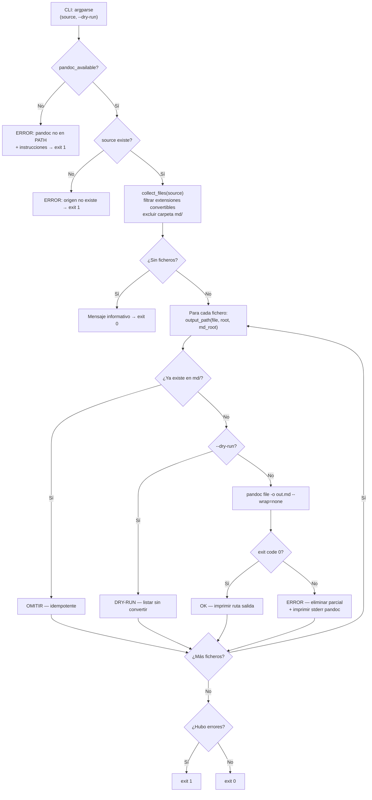

# convert_to_md

Convierte ficheros en formatos no legibles directamente por el agente IA (PDF, DOCX, PPTX…) a Markdown mediante pandoc, depositando el resultado en `<origen>/md/` con la estructura de subdirectorios reflejada.

## 1. Arquitectura y Diseño



Pipeline determinista: cada fichero se procesa de forma independiente; un error en un fichero no detiene los restantes. La función `main` acumula contadores y devuelve el código de salida agregado.

## 2. Modelo de Datos / Contratos

### API pública

| Función | Firma | Descripción | Retorna |
|---|---|---|---|
| `pandoc_available` | `() -> bool` | Comprueba si `pandoc` está en el PATH del sistema mediante `shutil.which` | `True` si disponible |
| `collect_files` | `(source: Path) -> list[Path]` | Recopila ficheros convertibles bajo `source`; excluye `md/` para evitar recursión | Lista ordenada de `Path` |
| `output_path` | `(source_file: Path, source_root: Path, md_root: Path) -> Path` | Calcula la ruta de salida reflejando la estructura relativa del origen | `Path` bajo `md_root` |
| `convert_file` | `(source_file: Path, source_root: Path, md_root: Path, *, dry_run: bool = False) -> bool` | Convierte un fichero con pandoc; idempotente si ya existe en `md/`; elimina parciales en error | `True` si éxito u omisión |
| `main` | `() -> int` | Punto de entrada CLI: parsea args, verifica pandoc, itera ficheros, devuelve código de salida | `0` ok · `1` error |

### CLI

```
python scripts/convert_to_md.py <source> [--dry-run]
```

| Argumento | Tipo | Descripción | Restricciones |
|---|---|---|---|
| `source` | `Path` | Fichero o directorio a convertir | Obligatorio; debe existir |
| `--dry-run` | flag | Lista qué se convertiría sin ejecutar pandoc | Opcional |

### Constantes

| Nombre | Tipo | Valor |
|---|---|---|
| `CONVERTIBLE_EXTENSIONS` | `frozenset[str]` | `{".pdf", ".docx", ".doc", ".pptx", ".odt", ".epub", ".rst", ".html", ".htm"}` |

### Contrato de salida (stdout)

| Situación | Línea impresa |
|---|---|
| Fichero ya convertido | `  OMITIR  <rel_origen> → md/<rel_salida> (ya existe)` |
| Conversión exitosa | `  OK      <rel_origen> → md/<rel_salida>` |
| Error de pandoc | `  ERROR   <rel_origen>: <mensaje stderr pandoc>` |
| `--dry-run` | `  DRY-RUN <rel_origen> → md/<rel_salida>` |
| Sin ficheros convertibles | `No se encontraron ficheros convertibles en: <source>` |
| pandoc no instalado | `ERROR: pandoc no encontrado en el PATH.\n<instrucciones>` |

### Errores y casos especiales

| Caso | Comportamiento |
|---|---|
| `pandoc` no en PATH | Imprime instrucciones de instalación por plataforma + `exit 1` |
| `source` no existe | `exit 1` con mensaje |
| Sin ficheros convertibles | Mensaje informativo + `exit 0` |
| Fichero ya existe en `md/` | `OMITIR` — no re-convierte; comportamiento idempotente |
| Error de pandoc en un fichero | Imprime stderr, elimina el parcial, acumula fallo; continúa con el resto |
| Al menos un fallo al finalizar | `exit 1`; los ficheros convertidos correctamente se conservan |

## 3. Componentes y Clases

| Componente | Ruta | Responsabilidad |
|---|---|---|
| Script principal | `scripts/convert_to_md.py` | Lógica completa de detección, conversión e informe |
| Constante `CONVERTIBLE_EXTENSIONS` | `scripts/convert_to_md.py:22` | Conjunto de extensiones soportadas; único punto de configuración |
| Dependencia externa | `pandoc` (binario en PATH) | Conversión real de cada formato a Markdown; no incluido en el repositorio |

## 4. Dependencias y Requisitos

| Dependencia | Propósito | Requerida | Comportamiento sin ella |
|---|---|---|---|
| `pandoc` (binario externo) | Convierte PDF, DOCX, PPTX… a Markdown | Sí | `exit 1` con instrucciones de instalación |
| `pathlib.Path` | Manipulación de rutas | Sí (stdlib Python ≥ 3.4) | — |
| `subprocess` | Invocación de pandoc | Sí (stdlib) | — |
| `shutil.which` | Detección de pandoc en PATH | Sí (stdlib) | — |

Verificar entorno antes de usar: `python scripts/check_env.py` (reporta si pandoc está instalado).

## 5. Ejemplos Relacionados

- [Ejemplo: Convertir Documentos a Markdown](../examples/convert_to_md_usage.md) — invocaciones
  para directorio completo, fichero individual, `--dry-run` y gestión de errores.
- Integrado en el flujo [Documentar un Proyecto](../functional/document_project.md) § Fase 0b:
  propuesto automáticamente cuando se detectan ficheros binarios en el origen.
