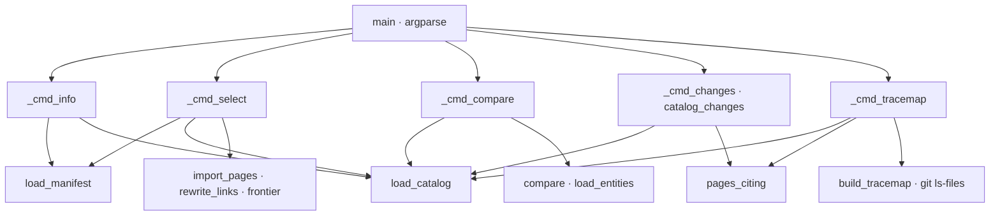

# db_trace

Origen BASE DE DATOS: lee la exportación Markdown de `util_bbdd` (`manifest.json` con `format: util_bbdd.doc.markdown` v1/v2 y `docs/catalog.json` con `format: util_bbdd.doc.catalog` v1), importa al destino las páginas del alcance, contrasta `entities.xml` con el catálogo, compara dos catálogos y genera el `trace_map.toml` de `util_bbdd`. Sin conexión a base de datos ni red.

## 1. Arquitectura y Diseño



Script standalone, solo stdlib, con funciones puras sobre `Path` y diccionarios JSON que los
tests ejercitan con una exportación inventada en una carpeta temporal. El contrato con
`util_bbdd` (su ADR-006) se comprueba en un único punto: `load_manifest` y `load_catalog`
validan `format` y `format_version`, y `load_catalog` exige además que cada objeto tenga
`id`, `kind`, `name` y `path` (`REQUIRED_KEYS`); fallan con `DbTraceError`. El resto de campos
(`hash`, `comment`, `columns`, `fk_out`, `fk_in`) son opcionales para el script.

`select_objects` aplica el alcance con `fnmatch` sobre los nombres en mayúsculas; sin patrones,
devuelve todos los objetos. `import_pages` comprueba primero, sin escribir nada, el entorno
(no vacío), el contrato, que el alcance no esté vacío y que existan todas las páginas que cita el
catálogo; después copia cada página del alcance a
`<root>/docs/<subdir>/<path>` pasando por `rewrite_links`, que resuelve cada destino relativo
con `posixpath` y convierte en `` `etiqueta` `` los enlaces a páginas no importadas (conserva
los que llevan esquema `xxx:` o empiezan por `#`, y las imágenes ``, que `LINK_RE` no
captura). Escribe con `_write_if_changed` (solo si
cambia el contenido, LF), retira los `.md` de la carpeta que ya no están en el alcance (salvo
`index.md`), genera el índice (`_index_page`, con la frontera de `frontier`: ids enlazados por
`fk_out`/`fk_in` fuera del alcance, profundidad 1) y guarda en `_fuentes/<name>/` el catálogo
del subconjunto y la cabecera del manifiesto con `doc_ia_entorno`, en JSON ordenado.

`compare` cruza el modelo de `load_entities` (tabla → entidad y columnas con
`(nullable, tabla referenciada)`) con las tablas y vistas del alcance (`SCHEMA_KINDS`; las
rutinas no se contrastan). `catalog_changes` filtra los dos catálogos por el alcance y compara
por `id` y `hash`. `pages_citing` busca nombres como palabra completa en los `.md` de `docs/`
excepto la sección importada (`skip`, por defecto `bd`); con `prefix=True`, un nombre con minúsculas (una entidad) admite un
sufijo que empiece en mayúscula. `build_tracemap` busca por nombre de tabla y de entidad,
clasifica las páginas con `is_functional` y localiza el código con `is_entity_code` sobre la
salida de `git -c core.quotepath=off ls-files -z`.

## 2. Modelo de Datos / Contratos

### API pública

| Función/Clase | Firma simplificada | Descripción | Retorna |
|---|---|---|---|
| `DbTraceError` | `Exception` | Exportación fuera de contrato, fichero inexistente o parámetro inválido | — |
| `load_manifest` | `load_manifest(export) -> dict` | `<export>/manifest.json` con `format` y `format_version` ∈ {1, 2} | Manifiesto |
| `load_catalog` | `load_catalog(path) -> dict` | Catálogo con `format`, `format_version` ∈ {1} y lista `objects` con `id`, `kind`, `name` y `path` no vacíos | Catálogo |
| `matches` | `matches(name, patterns) -> bool` | Algún patrón glob encaja, sin distinguir mayúsculas | `bool` |
| `select_objects` | `select_objects(catalog, patterns) -> list[dict]` | Objetos del alcance; todos si no hay patrones | Lista |
| `frontier` | `frontier(selected) -> list[str]` | Ids fuera del alcance enlazados por FK (entrantes o salientes) | Ids ordenados |
| `rewrite_links` | `rewrite_links(text, page_rel, imported) -> str` | Enlaces a páginas no importadas → código inline | Texto |
| `ImportReport` | `dataclass`: `changes: list[(tipo, ruta)]` | `creado`, `actualizado` o `retirado` por ruta relativa al destino | — |
| `import_pages` | `import_pages(export, root, name, patterns, subdir="bd", env="") -> ImportReport` | Importación idempotente del alcance (subcomando `select`); `env` en blanco → `DbTraceError` | `ImportReport` |
| `Finding` | `dataclass(frozen)`: `kind`, `obj`, `detail` | Discrepancia `tabla`, `columna`, `nulabilidad` o `fk` | — |
| `load_entities` | `load_entities(path) -> dict` | `entities.xml` (vdyn): `TABLA → {entity, columns: {COL: (nullable, ref)}}` | Modelo |
| `compare` | `compare(catalog, model, patterns) -> list[Finding]` | Discrepancias código ↔ BD en tablas y vistas del alcance | Hallazgos |
| `catalog_changes` | `catalog_changes(new, old, patterns=()) -> list[(cambio, id)]` | `alta`, `baja` y `modificado` (huella distinta) de los objetos del alcance, en ese orden | Lista |
| `pages_citing` | `pages_citing(docs, names, skip="bd", prefix=False) -> dict` | Páginas de `docs/` (fuera de `skip`) que citan cada nombre | Nombre → rutas |
| `is_functional` | `is_functional(page) -> bool` | `functional/…` o `guides/…_howto.md` / `…_tutorial.md` | `bool` |
| `is_entity_code` | `is_entity_code(path, entity) -> bool` | Raíz `I?<Entidad>` con sufijo opcional que empieza en mayúscula, o carpeta con el nombre de la entidad | `bool` |
| `build_tracemap` | `build_tracemap(catalog, docs, origin, entities, patterns, subdir="bd") -> str` | Texto TOML del `trace_map` | TOML |
| `main` | `main(argv=None) -> int` | CLI con subcomandos `info`, `select`, `compare`, `changes`, `tracemap` | Código de salida |

### Contrato de entrada

| Parámetro | Tipo | Descripción | Restricciones |
|---|---|---|---|
| `info --export` | `Path` | Carpeta de la exportación | Obligatorio; con `manifest.json` y `docs/catalog.json` |
| `select --export` | `Path` | Carpeta de la exportación | Obligatorio |
| `select --root` | `Path` | Raíz del destino | Obligatorio; se crea lo que falte |
| `select --name` | `str` | Nombre del origen en `_fuentes/` | Obligatorio; letras, dígitos, `.`, `_`, `-`, nunca solo puntos (`NAME_RE`) |
| `select --env` | `str` | Entorno que representa la exportación (p. ej. `Calidad`) | Obligatorio; en blanco → error |
| `select` / `changes` / `tracemap --subdir` | `str` | Sección importada dentro de `docs/` | Por defecto `bd`; admite subcarpetas (`bd/<base>`); en `select`, ruta relativa sin `..` y distinta de `.`; en `changes` y `tracemap`, carpeta que no cuenta como evidencia |
| `compare --catalog` | `Path` | Catálogo (normalmente `_fuentes/<nombre>/catalog.json`) | Obligatorio |
| `compare --entities` | `Path` | Modelo del código `entities.xml` | Obligatorio; XML válido |
| `compare --output` | `Path` | Informe Markdown además de stdout | Opcional |
| `changes --catalog` / `--previous` | `Path` | Catálogo nuevo (puede ser el completo de la exportación) y anterior (`_fuentes/<nombre>/catalog.json`) | Obligatorios |
| `changes --docs` | `Path` | `docs/` del destino | Opcional; sin él no se buscan páginas |
| `tracemap --catalog` / `--docs` / `--output` | `Path` | Catálogo, `docs/` del destino y fichero TOML | Obligatorios |
| `tracemap --origin` | `Path` | Repositorio del código | Opcional; si `git ls-files` falla, sin código |
| `tracemap --entities` | `Path` | `entities.xml` para nombres de entidad y código | Opcional |
| `--include` | glob (repetible) | Patrones de nombre del alcance | En `select`, `compare`, `changes` y `tracemap`; sin él, todos los objetos |

Campos del catálogo que lee el script, por objeto: `id` (`<tipo>:<ESQUEMA>.<NOMBRE>`), `kind`
(`table`, `view`, `procedure`, `function`), `name`, `path` (relativa a `docs/` de la
exportación), `hash`, `comment`, `columns[]` (`name`, `nullable`), `fk_out[]` (`columns`, `ref`)
y `fk_in[]` (ids). Del manifiesto: `database`, `schema`, `engine`, `generated_at`,
`util_bbdd_version`. De `entities.xml`: `entity@name`, `entity@table` y, por `field`,
`column`, `nullable`, `manyToOne` y `foreignType`.

### Contrato de salida

- `select`: `<root>/docs/<subdir>/<path>` por objeto del alcance (texto con enlaces
  reescritos), `<root>/docs/<subdir>/index.md` (comentario «Generado por doc_ia…», tabla
  entorno, base de datos / esquema, motor, fecha y versión de `util_bbdd`, tabla de objetos y frontera),
  `<root>/_fuentes/<name>/catalog.json` (el catálogo con solo los objetos del alcance y la clave
  añadida `doc_ia_alcance`) y `<root>/_fuentes/<name>/manifest.json` (`doc_ia_entorno` y las siete
  claves de cabecera). Stdout: `[db_trace] N cambio(s) en <root>` y una línea por cambio (`CREADO`,
  `ACTUALIZADO`, `RETIRADO`). Código `0` sin cambios, `1` con cambios.
- `compare`: informe Markdown `# Contraste código ↔ base de datos`, `Discrepancias: N` y tabla
  `Tipo | Objeto | Detalle`. Código `0` sin discrepancias, `1` con ellas.
- `changes`: `# Cambios de esquema (N)` y `- <cambio>: `NOMBRE` → <páginas o —>`. Código `0`
  sin cambios, `1` con cambios.
- `tracemap`: fichero TOML con cabecera comentada y, por tabla o vista con evidencia, una
  sección `[tables."NOMBRE"]` o `[views."NOMBRE"]` con `code`, `functional` y `technical`
  (rutas `docs/…` y rutas del repositorio). Las rutinas no se incluyen. Stdout:
  `[db_trace] trace_map escrito en <ruta>`. Código `0`.
- `info`: `[db_trace] <database> · <engine> · util_bbdd <versión> · <generated_at>` y
  `[db_trace] objetos: <tipo> <n>, …`. Código `0`.

Tipos de discrepancia de `compare`:

| `kind` | Cuándo |
|---|---|
| `tabla` | Tabla del alcance solo en `entities.xml` o solo en el catálogo (tabla o vista) |
| `columna` | Columna solo en un lado |
| `nulabilidad` | `nullable` del código (`true`/`false`) distinto del de la BD; sin atributo, no se compara |
| `fk` | Solo en tablas: relación `manyToOne` sin FK en la columna, o FK hacia otra tabla |

### Errores y casos especiales

| Caso | Comportamiento |
|---|---|
| `select` con `--name` solo de puntos o con `/`, `--subdir` `.`/`..`/absoluto o una página del catálogo con `../` | `DbTraceError` (exit 2) antes de escribir nada |
| Manifiesto o catálogo inexistente, JSON inválido o no objeto | `DbTraceError`; `[db_trace] ERROR: …` por stderr y código `2` |
| `format` distinto o `format_version` no admitida | `DbTraceError` («no es una exportación…», «… no soportada»); código `2` |
| Catálogo sin lista `objects` | `DbTraceError`; código `2` |
| Objeto del catálogo sin `id`, `kind`, `name` o `path` (o que no es un objeto) | `DbTraceError` `<catálogo>: objeto N sin name, path`; código `2` |
| `select` con `--env` en blanco | `DbTraceError` `indica el entorno que representa la exportación (--env)`; código `2`; sin `--env`, argparse (código `2`) |
| Alcance sin coincidencias en `select` | `DbTraceError` `ningún objeto encaja con [...]`; código `2`; no se escribe nada |
| El catálogo cita páginas inexistentes | `DbTraceError` `el catálogo cita páginas inexistentes: …`; código `2`; se comprueba antes de escribir: el destino no cambia |
| `entities.xml` inexistente o mal formado | `DbTraceError` o `ET.ParseError`; código `2` |
| `OSError` (permisos, disco) | Capturado en `main`; código `2` |
| Relación hacia una entidad que no está en el mismo `entities.xml` | La referencia queda como `(Entidad)`: solo se exige que la columna tenga FK |
| `--origin` sin git o fuera de un repositorio | Sin ficheros de código, sin error |
| Rutinas (`procedure`, `function`) en el alcance | Se importan en `select`, pero `compare` las ignora y `tracemap` no les da sección |
| `changes` con el catálogo completo de una exportación frente al subconjunto guardado | Con `--include`, solo se comparan los objetos del alcance; sin él, lo de fuera sale como `alta`. Se ejecuta antes de `select`, que sustituye el subconjunto |
| Consola no UTF-8 (cp1252) | Solo al ejecutarse como script, stdout/stderr se reconfiguran a UTF-8 |

## 3. Componentes y Clases

| Componente | Responsabilidad |
|---|---|
| `MANIFEST_FORMAT`, `CATALOG_FORMAT`, `SUPPORTED_MANIFEST`, `SUPPORTED_CATALOG` | Contrato admitido con `util_bbdd` |
| `LINK_RE` | Enlaces Markdown `[texto](destino)` sin espacios en el destino, sin imágenes |
| `REQUIRED_KEYS`, `SCHEMA_KINDS` | Claves obligatorias de cada objeto del catálogo; tipos que se contrastan con el código (`table`, `view`) |
| `GENERATED_NOTE` | Comentario inicial del índice generado |
| `FUNCTIONAL_GUIDES` | Sufijos de guías funcionales (`_howto.md`, `_tutorial.md`) |
| `_index_page`, `_write_if_changed`, `_short`, `_toml_list` | Auxiliares de índice, escritura idempotente, nombre corto y listas TOML |
| `_cmd_info`, `_cmd_select`, `_cmd_compare`, `_cmd_changes`, `_cmd_tracemap`, `_parser`, `_patterns` | Capa CLI: argumentos, mensajes `[db_trace]` y códigos de salida |

## 4. Dependencias y Requisitos

| Dependencia | Propósito | Requerida | Comportamiento sin ella |
|---|---|---|---|
| `argparse`, `fnmatch`, `json`, `posixpath`, `re`, `subprocess`, `xml.etree.ElementTree`, `dataclasses`, `pathlib` (stdlib) | CLI, alcance, catálogo, enlaces, XML y git | Sí | — (siempre disponibles) |
| Exportación de `util_bbdd` ≥ 5.3 | Manifiesto, catálogo y páginas | Sí | `DbTraceError` → código `2` |
| `entities.xml` (vdyn) | Modelo del código | En `compare`; opcional en `tracemap` | `compare` no se puede ejecutar; `tracemap` sin entidad ni código |
| `git` en el `PATH` | `ls-files` del repositorio del código | Solo `tracemap --origin` | Sin ficheros de código (si falta el ejecutable, `OSError` → código `2`) |

El script se distribuye en el kit de cada destino (`.doc_ia/scripts/db_trace.py`).

## 5. Ejemplos Relacionados

- [Ejemplo: Origen Base de Datos con db_trace](../examples/db_trace_usage.md) — importación,
  contraste con `entities.xml`, cambios entre catálogos y `trace_map` desde código propio, y la
  CLI con sus códigos de salida.

## 6. Verificación y Tests

| Test | Qué verifica | Tipo |
|---|---|---|
| `test_rejects_foreign_or_newer_formats` | Catálogo v2 rechazado; manifiesto de otro formato → código `2` | unitario + CLI |
| `test_rewrite_links_keeps_imported_and_external` | Solo los enlaces a páginas no importadas pasan a código | unitario |
| `test_import_pages_selects_scope_and_is_idempotent` | Alcance, enlace reescrito, índice con motor y frontera, subconjunto y segunda pasada sin cambios | integración |
| `test_import_pages_retires_objects_out_of_scope` | `retirado` y enlace al objeto retirado como texto | integración |
| `test_import_pages_without_matches_is_an_error` | `ningún objeto` | unitario |
| `test_compare_reports_tables_columns_nullability_and_fk` | Los siete hallazgos de los cuatro tipos | integración |
| `test_compare_cli_exit_codes` | Códigos `1` y `0` | integración (CLI) |
| `test_catalog_changes_by_hash` | `alta`, `baja`, `modificado` | unitario |
| `test_tracemap_from_documentation_evidence` | Secciones `tables`/`views`, funcional y técnica, sin evidencia sin entrada, `docs/bd/` excluido | integración |
| `test_entity_code_and_page_classification` | `is_entity_code` (clase, interfaz, carpeta; no otra entidad) e `is_functional` | unitario |
| `test_tracemap_finds_pages_by_entity_name` | Página que cita una clase de la entidad, no la de una entidad más larga | integración |
| `test_select_requires_env_and_does_not_write_partially` | Entorno en blanco y página inexistente → error sin crear la sección | integración |
| `test_select_rejects_name_or_subdir_outside_their_folder` (5 casos), `test_select_rejects_catalog_paths_outside_the_section`, `test_select_cli_rejects_dot_dot_name` | `--name`/`--subdir`/rutas del catálogo fuera de su carpeta → error (exit 2) sin escribir; la raíz intacta | integración |
| `test_select_accepts_nested_subdir` | `--subdir bd/<base>` sigue funcionando | integración |
| `test_rewrite_links_leaves_images_alone` | Las imágenes no se reescriben | unitario |
| `test_catalog_with_incomplete_object_is_an_error` | Objeto sin `name` ni `path` → `DbTraceError` | unitario |
| `test_compare_ignores_routines` | Una rutina del alcance no genera discrepancia | unitario |
| `test_changes_limited_to_scope` | Sin alcance, altas fuera del módulo; con alcance, sin cambios | unitario |

Sin cubrir: `info` con exportación válida, `changes` y `--subdir` desde la CLI, `tracemap --origin` con un
repositorio git real y `compare --output`.

```bash
python -m pytest tests/test_db_trace.py -q
```

??? note "Evidencia"

    | Elemento | Fuente | Confianza |
    |---|---|---|
    | Contrato, versiones admitidas y objetos completos | `scripts/db_trace.py::load_manifest`, `::load_catalog`, `::SUPPORTED_MANIFEST`, `::SUPPORTED_CATALOG`, `::REQUIRED_KEYS` | ✅ |
    | Alcance y frontera | `scripts/db_trace.py::matches`, `::select_objects`, `::frontier` | ✅ |
    | Reescritura de enlaces (sin imágenes) | `scripts/db_trace.py::rewrite_links`, `::LINK_RE` | ✅ |
    | Importación sin escrituras a medias, entorno, retirada, índice y `_fuentes/` | `scripts/db_trace.py::import_pages`, `::_index_page`, `::_write_if_changed` | ✅ |
    | Modelo `entities.xml` y discrepancias en tablas y vistas | `scripts/db_trace.py::load_entities`, `::compare`, `::SCHEMA_KINDS`, `::Finding` | ✅ |
    | Cambios por alcance entre catálogos y páginas citantes | `scripts/db_trace.py::catalog_changes`, `::pages_citing`, `::_cmd_changes` | ✅ |
    | `changes` antes de `select` | `.github/prompts/document_project.prompt.md::Origen BASE DE DATOS (opción BD)` (punto 5) | ✅ |
    | `trace_map`: nombres de tabla y entidad, clasificación y código | `scripts/db_trace.py::build_tracemap`, `::is_functional`, `::is_entity_code`, `::FUNCTIONAL_GUIDES` | ✅ |
    | Sección excluida configurable (`--subdir`) | `scripts/db_trace.py::pages_citing` (`skip`), `::build_tracemap`, `::_parser` | ✅ |
    | Mensajes, opciones y códigos de salida | `scripts/db_trace.py::_parser`, `::_cmd_info`, `::_cmd_select`, `::_cmd_compare`, `::_cmd_changes`, `::_cmd_tracemap`, `::main` | ✅ |
    | Distribución en el kit | `.github/kit/MANIFEST.txt` | ✅ |
    | Tests del §6 | `tests/test_db_trace.py` | ✅ |
