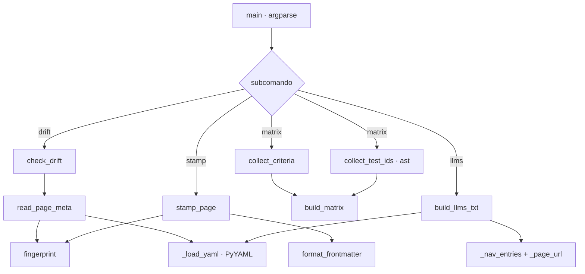

# doc_trace

Trazabilidad determinista entre la documentación y el código: sella huellas SHA256 de las fuentes en el frontmatter de cada página, detecta páginas desactualizadas (drift), cruza criterios de aceptación con tests reales y genera `llms.txt` desde el `nav` de `mkdocs.yml`.

## 1. Arquitectura y Diseño



Script standalone sin dependencias de otros módulos del proyecto. Cada subcomando es una
función `_cmd_*` que delega en funciones puras sobre `Path`, de modo que los tests las
ejercitan con repositorios temporales sin red ni git.

## 2. Modelo de Datos / Contratos

### API pública

| Función/Clase | Firma simplificada | Descripción | Retorna |
|---|---|---|---|
| `PageMeta` | `dataclass(frozen)`: `page`, `archetype`, `sources: dict[str, str]`, `reviewed` | Frontmatter de trazabilidad de una página | — |
| `DriftFinding` | `dataclass(frozen)`: `page`, `source`, `status` | Fuente desactualizada; `status` ∈ `stale` \| `missing` \| `outside_repo` | — |
| `CriterionRow` | `dataclass(frozen)`: `page`, `criterion`, `tests: tuple[str, ...]` | Fila `AC-xx` de una página funcional | — |
| `fingerprint` | `fingerprint(path) -> str` | SHA256 truncado a `HASH_LENGTH` (12) con CRLF→LF; en `.md` excluye el frontmatter | Huella hex |
| `read_page_meta` | `read_page_meta(page) -> PageMeta \| None` | Lee el frontmatter; `None` si no hay o no declara `fuentes` | `PageMeta` o `None` |
| `format_frontmatter` | `format_frontmatter(meta) -> str` | Serializa el frontmatter con fuentes ordenadas | Bloque `---…---\n` |
| `stamp_page` | `stamp_page(page, repo_root, *, sources=None, archetype=None, reviewed=None) -> PageMeta` | Recalcula huellas y reescribe el frontmatter conservando el cuerpo | `PageMeta` escrito |
| `check_drift` | `check_drift(docs_dir, repo_root) -> list[DriftFinding]` | Recorre `docs_dir/**/*.md` sellados y compara huellas | Hallazgos en orden estable |
| `collect_test_ids` | `collect_test_ids(tests_dir, repo_root) -> set[str]` | Ids `tests/x.py::test_y` y `::Clase::test_y` vía `ast` (sin importar los tests) | Conjunto de ids |
| `collect_criteria` | `collect_criteria(functional_dir) -> list[CriterionRow]` | Filas `\| AC-xx \|` de `functional_dir/*.md`; tests de la última celda si la fila tiene ≥5 celdas | Filas |
| `build_matrix` | `build_matrix(criteria, test_ids, repo_root) -> tuple[str, list[str]]` | Matriz Markdown por página, totales, tests inexistentes y tests sin criterio | `(markdown, inexistentes)` |
| `build_llms_txt` | `build_llms_txt(mkdocs_yml, site_url=None) -> str` | `llms.txt` con `site_name`, `site_description` y una sección `##` por grupo del `nav` | Contenido |
| `main` | `main(argv=None) -> int` | CLI con subcomandos `drift`, `stamp`, `matrix`, `llms` | Código de salida |

### Contrato de entrada

| Parámetro | Tipo | Descripción | Restricciones |
|---|---|---|---|
| `--root` | `Path` | Raíz del repositorio (opción global, antes del subcomando) | Por defecto, el padre de `scripts/` |
| `drift --docs` | `Path` | Carpeta de documentación | Por defecto `docs/` |
| `stamp pages` | `Path` (1..n) | Páginas a sellar | Deben existir |
| `stamp --source` | `str` (repetible) | Fuente relativa a `--root` | Dentro del repositorio y existente; si se omite, se reutilizan las del frontmatter |
| `stamp --archetype` / `--date` | `str` | Arquetipo y fecha `YYYY-MM-DD` | Por defecto, el arquetipo actual y la fecha del día |
| `matrix --docs` / `--tests` / `--output` | `Path` | Carpetas de docs y tests; fichero de salida opcional | Lee `--docs/functional/*.md` (no recursivo) |
| `llms --config` / `--output` / `--site-url` / `--check` | `Path` / `str` / flag | Configuración MkDocs, destino, URL base, modo comprobación | Por defecto `mkdocs.yml`, `docs/llms.txt` y `site_url` del config |

### Contrato de salida

- Frontmatter escrito por `stamp`: `arquetipo` entre comillas, `fuentes` ordenadas
  alfabéticamente, `revisado`, saltos de línea LF.
- `drift`: una línea `[doc_trace] <status> <página> ← <fuente>` por hallazgo.
- `matrix`: Markdown a stdout o a `--output` (crea el directorio padre).
- `llms`: URLs absolutas con `site_url`; con `use_directory_urls: true`, `x.md` → `x/` e
  `index.md` → raíz de su carpeta; sin `site_url`, rutas relativas. Las entradas del `nav`
  que no son `.md` se omiten y las páginas de primer nivel van a "Páginas principales".

### Errores y casos especiales

| Caso | Comportamiento |
|---|---|
| Fuente con `../` fuera de `--root` | `drift`: hallazgo `outside_repo` sin leer el fichero; `stamp`: `ValueError` → código `1` |
| `stamp` sin `--source` ni fuentes previas | `ValueError("sin fuentes")` → código `1` |
| Fuente inexistente al sellar | `ValueError` → código `1` |
| Página inexistente al sellar | `OSError` capturado en `_cmd_stamp` → `[doc_trace] ERROR:` y código `1` |
| Etiquetas `!!python/name:` o `!ENV` en `mkdocs.yml` | Se ignoran (`_load_yaml` con `SafeLoader` derivado) |
| `mkdocs.yml` sin `nav` | `ValueError` capturado en `_cmd_llms` → `[doc_trace] ERROR:` y código `1` |
| Consola no UTF-8 (cp1252) | Solo al ejecutarse como script, stdout/stderr se reconfiguran a UTF-8 |

## 3. Componentes y Clases

| Componente | Responsabilidad |
|---|---|
| `PageMeta`, `DriftFinding`, `CriterionRow` | Dataclasses inmutables de transporte entre funciones |
| `_load_yaml` | Único punto de importación de PyYAML (import diferido, sin stubs) |
| `_resolve_source` | Guarda de seguridad: resuelve la ruta y exige `is_relative_to(repo_root)` |
| `_nav_entries`, `_page_url` | Aplanado del `nav` («Grupo › Página») y cálculo de URLs publicadas |
| `_cmd_drift`, `_cmd_stamp`, `_cmd_matrix`, `_cmd_llms`, `_parser` | Capa CLI: argumentos, mensajes `[doc_trace]` y códigos de salida |

## 4. Dependencias y Requisitos

| Dependencia | Propósito | Requerida | Comportamiento sin ella |
|---|---|---|---|
| PyYAML (instalada con `mkdocs`) | Leer frontmatter y `mkdocs.yml` | Para `drift`, `stamp` y `llms` | `ImportError` al ejecutarlos; `matrix` funciona sin ella |
| `ast`, `hashlib`, `re`, `argparse`, `pathlib`, `dataclasses`, `datetime` (stdlib) | Tests vía AST, huellas, regex, CLI | Sí | — (siempre disponibles) |

## 5. Ejemplos Relacionados

- [Ejemplo: Auditar la Trazabilidad](../examples/doc_trace_usage.md) — uso de `check_drift`
  y `build_matrix` desde código propio y de los cuatro subcomandos con su salida real.

## 6. Verificación y Tests

| Test | Qué verifica | Tipo |
|---|---|---|
| `test_fingerprint_*` (2) | Huella independiente de CRLF/LF y del frontmatter en `.md` | unitario |
| `test_read_page_meta_*` (3) | Sin frontmatter, sin `fuentes` y lectura de los tres campos | unitario |
| `test_stamp_then_no_drift`, `test_stamp_preserves_existing_sources_and_archetype` (2) | Sellado, conservación del cuerpo y reutilización de fuentes/arquetipo | unitario |
| `test_drift_*` (3) | Hallazgos `stale`, `missing` y `outside_repo` | unitario |
| `test_stamp_rejects_source_outside_repo`, `test_stamp_requires_sources` (2) | Errores de `stamp_page` | unitario |
| `test_collect_test_ids_includes_class_methods`, `test_matrix_reports_unknown_and_uncited` (2) | Ids de tests (incluidos métodos de clase), inexistentes y sin citar | unitario |
| `test_main_matrix_exit_code_on_unknown_test` (1) | `matrix` devuelve `1` con un test inexistente | integración (CLI) |
| `test_build_llms_txt_tolerates_python_tags` (1) | Etiquetas `!!python/name:`, URLs con `site_url` y omisión de enlaces externos | unitario |
| `test_main_llms_check_detects_outdated` (1) | `llms --check` antes y después de generar | integración (CLI) |
| `test_main_llms_without_nav_returns_error`, `test_main_stamp_missing_page_returns_error` (2) | Errores controlados de la CLI con código `1` | integración (CLI) |
| `test_main_requires_subcommand` (1) | Sin subcomando → `SystemExit(2)` | integración (CLI) |

Sin cubrir: los mensajes de `drift` y `stamp` por la CLI, `llms` sin `site_url` y la
reconfiguración UTF-8 de la consola.

```bash
python -m pytest tests/test_doc_trace.py -q
```

??? note "Evidencia"

    | Elemento | Fuente | Confianza |
    |---|---|---|
    | `PageMeta`, `DriftFinding`, `CriterionRow` | `scripts/doc_trace.py::PageMeta`, `::DriftFinding`, `::CriterionRow` | ✅ |
    | Huella de 12 hex, CRLF→LF y sin frontmatter en `.md` | `scripts/doc_trace.py::fingerprint`, `::HASH_LENGTH` | ✅ |
    | Lectura del frontmatter | `scripts/doc_trace.py::read_page_meta`, `::FRONTMATTER_RE` | ✅ |
    | Serialización ordenada | `scripts/doc_trace.py::format_frontmatter` | ✅ |
    | `stamp_page` y sus errores | `scripts/doc_trace.py::stamp_page` | ✅ |
    | Guarda fuera del repositorio | `scripts/doc_trace.py::_resolve_source` | ✅ |
    | `check_drift` y orden estable | `scripts/doc_trace.py::check_drift` | ✅ |
    | Ids de tests vía AST | `scripts/doc_trace.py::collect_test_ids` | ✅ |
    | Filas AC y ≥5 celdas | `scripts/doc_trace.py::collect_criteria`, `::AC_ROW_RE`, `::TEST_ID_RE` | ✅ |
    | Matriz y listas | `scripts/doc_trace.py::build_matrix` | ✅ |
    | `llms.txt`, URLs y omisión de no-`.md` | `scripts/doc_trace.py::build_llms_txt`, `::_page_url`, `::_nav_entries` | ✅ |
    | Etiquetas ignoradas en YAML | `scripts/doc_trace.py::_load_yaml` | ✅ |
    | Errores de `stamp` y `llms` capturados en la CLI | `scripts/doc_trace.py::_cmd_stamp`, `::_cmd_llms`; `tests/test_doc_trace.py::test_main_stamp_missing_page_returns_error`, `::test_main_llms_without_nav_returns_error` | ✅ |
    | Códigos de salida de la CLI | `scripts/doc_trace.py::main`, `::_cmd_drift`, `::_cmd_stamp`, `::_cmd_matrix`, `::_cmd_llms` | ✅ |
    | `matrix` sin PyYAML | `scripts/doc_trace.py::_cmd_matrix` (no llama a `_load_yaml`) | ✅ |
    | Reconfiguración UTF-8 solo en `__main__` | `scripts/doc_trace.py` (bloque `if __name__ == "__main__"`) | ✅ |
    | Tests del §6 | `tests/test_doc_trace.py` | ✅ |
