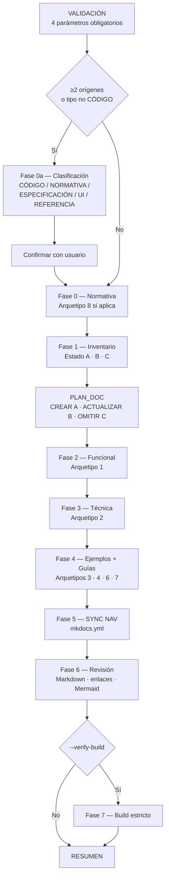

# document_project

Punto de entrada único del producto doc_ia: orquesta los arquetipos formales sobre un proyecto origen para generar o actualizar su documentación completa.

## 1. Arquitectura y Diseño

## 2. Modelo de Datos / Contratos

### API pública

| Componente | Tipo | Descripción | Retorna |
|---|---|---|---|
| `/document-project` | slash command | Entrada en Claude Code: valida inputs y ejecuta el flujo | Fases VALIDACIÓN → RESUMEN en el chat |
| `document_project.prompt.md` | prompt multiplataforma | Equivalente del slash command para Gemini, Copilot, Cursor, Codex | Mismas fases |
| `documentation-generator.agent.md` | agente | Ejecutor por fases del flujo; orquestado por el prompt | Fases 0-7 |

### Contrato de entrada

| Parámetro | Tipo | Descripción | Restricciones |
|---|---|---|---|
| `Origen(es)` | ruta(s) | Ruta raíz del/los proyectos a documentar | Obligatorio; debe existir y ser accesible |
| `Destino` | ruta | Ruta donde se escriben los archivos Markdown | Obligatorio; no se asume `docs/` por defecto |
| `Generador` | string | `mkdocs-material` (por defecto) o `zensical` | Obligatorio; determina el formato de `mkdocs.yml` |
| `Idioma` | string | `es`, `en` u otro código ISO 639-1 | Obligatorio; aplica a todo el contenido generado |
| `Tipo de cada origen` | string | `CÓDIGO` · `NORMATIVA` · `ESPECIFICACIÓN` · `UI/PANTALLAS` · `REFERENCIA` · `CONTRATO` · `INFRAESTRUCTURA` | Opcional; autodetectado si se omite; se confirma antes de continuar. Catálogo completo en [Tipos de Origen](../functional/origin_types.md) |
| `Estrategia` | string | `federado` · `hub+satélite` · `monorepo` | Solo con ≥2 orígenes CÓDIGO; nunca autodetectado |
| `Alcance` | string | Módulos o subconjunto | Opcional; por defecto proyecto completo |
| `Arquetipos` | string | Subconjunto de arquetipos a aplicar | Opcional; por defecto todos los aplicables |
| `Verificación` | flags | `--verify-tools` y/o `--verify-build [--serve]` | Opcional; nunca automático |

### Contrato de salida

Diez bloques en el chat, en este orden:
1. `VALIDACIÓN DE INPUTS` — tabla de estado por parámetro; si hay ❌ el flujo se detiene.
2. `CLASIFICACIÓN DE ORÍGENES` — solo con ≥2 orígenes o si el único no es CÓDIGO.
3. `INVENTARIO` — tabla módulo × estado (A/B/C) × acción × arquetipos afectados.
4. `PLAN_DOC` — orden de ejecución con secciones afectadas por módulo.
5. `GENERACIÓN` — contenido de cada página, fase a fase.
6. `SYNC NAV` — diff de `mkdocs.yml`.
7. `REVISIÓN` — checklist de validación.
8. `BUILD` — resultado de `--verify-build` (solo opt-in).
9. `RESUMEN` — contadores de archivos creados/actualizados/omitidos y entradas de nav.
10. `CIERRE DE SESIÓN` — siempre obligatorio: artefactos `.ai/sessions/YYYY-MM-DD/` en el destino + propuesta de commit Conventional Commits.

### Errores y casos especiales

| Caso | Comportamiento |
|---|---|
| Parámetro obligatorio faltante o ambiguo | El flujo se detiene en VALIDACIÓN y pide completar el campo antes de continuar |
| Origen no legible o fuera del workspace | El flujo se detiene y pide confirmación de ruta |
| Todos los orígenes son MATERIAL (sin CÓDIGO) | El flujo se detiene con mensaje orientativo hacia los prompts de arquetipo directo |
| `--verify-build` falla | Se reportan errores del build MkDocs; el RESUMEN los lista como pendientes |
| Estado B con secciones vigentes | Solo se actualizan las secciones afectadas; las vigentes se copian verbatim |
| CIERRE omitido por el agente | Error del flujo: el cierre es siempre obligatorio; si falta, solicitar al agente que cree los artefactos `.ai/sessions/` y proponga el commit antes de cerrar la sesión |

## 3. Componentes y Clases

| Componente | Ruta | Responsabilidad |
|---|---|---|
| Slash command | `.claude/commands/document-project.md` | Validación, instrucciones de uso y ejemplos de entrada para Claude Code |
| Prompt multiplataforma | `.github/prompts/document_project.prompt.md` | Equivalente del slash command para el resto de plataformas IA |
| Agente | `.github/agents/documentation-generator.agent.md` | Flujo por fases (0a–7); protocolos CREAR/ACTUALIZAR/OMITIR; mapeo MATERIAL→arquetipos |

## 4. Dependencias y Requisitos

| Dependencia | Propósito | Requerida | Comportamiento sin ella |
|---|---|---|---|
| `.github/DOCUMENTATION_STANDARD.md` | Define los 8 arquetipos formales y sus estructuras | Sí | Las fases de generación no tienen plantilla de referencia |
| `.github/instructions/docs.instructions.md` | Reglas operativas (Mermaid, snippets, MkDocs) | Sí | Riesgo de inconsistencias de estilo y formato |
| `mkdocs.yml` (destino) | Navegación que se sincroniza en Fase 5 | Sí para generador mkdocs-material | Sin él, SYNC NAV no puede actualizar la navegación |
| Prompts de arquetipo (`.github/prompts/`) | Plantillas de cada tipo de documento | Sí | Las fases 2-4 no tienen instrucciones para generar cada arquetipo |
| `python -m mkdocs build` | Verificación de build (Fase 7) | Solo con `--verify-build` | Si falta, la fase 7 no se puede ejecutar |

## 5. Ejemplos Relacionados

- [Ejemplo: Documentar un Proyecto](../examples/document_project_usage.md) — invocación
  con los 3 escenarios principales (sin doc, parcial, `--verify-build`) y output esperado
  de cada fase.
