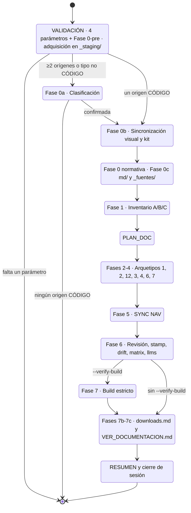

# document_project

Punto de entrada único del producto doc_ia: orquesta los arquetipos formales sobre un proyecto origen para generar o actualizar su documentación completa.

## 1. Arquitectura y Diseño

La vista del mismo flujo desde el usuario (qué pide, qué confirma y qué recibe) está en la
[página funcional](../functional/document_project.md#3-flujo-principal).

## 2. Modelo de Datos / Contratos

### API pública

| Componente | Tipo | Descripción | Retorna |
|---|---|---|---|
| `/document-project` | slash command | Entrada en Claude Code: valida inputs y ejecuta el flujo | Fases VALIDACIÓN → RESUMEN en el chat |
| `document_project.prompt.md` | prompt multiplataforma | Equivalente del slash command para Gemini, Copilot, Cursor, Codex | Mismas fases |
| `documentation-generator.agent.md` | agente | Ejecutor por fases del flujo; orquestado por el prompt | Fases 0-7 |
| `/documentar` (destino con kit) | lanzador por plataforma | `.claude/commands/documentar.md`, `.github/prompts/documentar.prompt.md`, `AGENTS.md`, `GEMINI.md`: leen `.ai/prompts/documentar.prompt.md` y aplican este flujo desde `.doc_ia/` (`<doc_ia>` = `.doc_ia/`); modo opcional `incremental` \| `completo` \| `verificar` \| `aplicar-decisiones` \| `zip` | Mismas fases con los parámetros del prompt de instancia |

### Contrato de entrada

| Parámetro | Tipo | Descripción | Restricciones |
|---|---|---|---|
| `Origen(es)` | ruta(s) o forma de origen | Ruta raíz del/los proyectos a documentar, o una forma de origen de la Fase 0-pre: fichero con `{ver}` en el nombre, carpeta de red (UNC), biblioteca de SharePoint (copia sincronizada con OneDrive) o repositorio remoto con `Ref` | Obligatorio; debe existir y ser accesible. Lo que no es una carpeta local de trabajo se copia a `<raíz del destino>/_staging/<nombre>/` (ignorada por git): MATERIAL con [`snapshot_sources.py`](snapshot_sources.md) (`add` + `sync`), CÓDIGO remoto con `git fetch` + `git worktree add --detach … origin/<ref>`; el origen nunca se escribe |
| `Destino` | ruta | Ruta donde se escriben los archivos Markdown | Obligatorio; no se asume `docs/` por defecto |
| `Generador` | string | `mkdocs-material` (por defecto) o `zensical` | Obligatorio. Ambos usan `mkdocs.yml` (nunca `zensical.toml`); con `zensical` se aplican las *Reglas por generador: Zensical* del prompt (pipeline sin hooks, Gap A4, plugins soportados, build vía script) |
| `Idioma` | string | `es`, `en` u otro código ISO 639-1 | Obligatorio; aplica a todo el contenido generado |
| `Tipo de cada origen` | string | `CÓDIGO` · `NORMATIVA` · `ESPECIFICACIÓN` · `UI/PANTALLAS` · `REFERENCIA` · `CONTRATO` · `INFRAESTRUCTURA` · `MANUAL` | Opcional; autodetectado si se omite; se confirma antes de continuar. Catálogo completo en [Tipos de Origen](../functional/origin_types.md) |
| `Estrategia` | string | `federado` · `hub+satélite` · `monorepo` | Solo con ≥2 orígenes CÓDIGO; nunca autodetectado |
| `Alcance` | string | Módulos o subconjunto | Opcional; por defecto proyecto completo. Un módulo funcional transversal dentro de un repositorio mayor se expresa como pathspecs de git (`doc_trace.py --path`), propuestos y aplicados en el INVENTARIO (se informan; el usuario puede corregirlos sin que el flujo se detenga) |
| `Ref` | string | Rama, etiqueta o commit de un origen CÓDIGO remoto | Solo con repositorio remoto; se pregunta, nunca se asume `main` |
| `Arquetipos` | string | Subconjunto de arquetipos a aplicar | Opcional; por defecto todos los aplicables |
| `Verificación` | flags | `--verify-tools` y/o `--verify-build [--serve]` | Opcional; nunca automático |
| `Modo` | string | `incremental` · `completo` | Opcional; por defecto `incremental` si `<raíz destino>/.ai/doc_state.json` tiene baseline del origen. La Fase 1 parte de `doc_trace.py changes`; su código `3` (sin baseline, sin git, commit fuera del historial u otra versión menor de doc_ia) fuerza `completo`. El CIERRE siempre ejecuta `doc_trace.py baseline` |

### Contrato de salida

Doce bloques en el chat, en este orden (más `ADQUISICIÓN` tras el primero, solo con Fase 0-pre):
1. `VALIDACIÓN DE INPUTS` — tabla de estado por parámetro; si hay ❌ el flujo se detiene.
   Con orígenes no locales sigue `ADQUISICIÓN`: tabla `Origen · Forma · Ruta de trabajo
   (_staging/…) · Versión / Ref · Estado` y salida de `snapshot_sources.py sync` (altas,
   modificados, bajas y cambios de versión).
2. `CLASIFICACIÓN DE ORÍGENES` — solo con ≥2 orígenes o si el único no es CÓDIGO.
3. `INVENTARIO` — tabla módulo × estado (A/B/C) × acción × arquetipos afectados; incluye estado de las tres señales ZIP offline (`TIENE_ZIP_SCRIPT`, `TIENE_MKDOCS_PLUGIN`, `TIENE_WORKFLOW_GITHUB`) y, con Zensical, `TIENE_PIPELINE_SIN_HOOKS`; con documentos convertidos, la sub-sección "Fuentes convertidas (`_fuentes/`)" (copiados, sin cambios, huérfanos y migración pendiente).
4. `PLAN_DOC` — orden de ejecución con secciones afectadas por módulo.
5. `GENERACIÓN` — contenido de cada página, fase a fase.
6. `SYNC NAV` — diff de `mkdocs.yml`; como máximo 9 entradas de primer nivel, con Inicio, Quick Start, Instalación y Descargas en «Inicio» y Configuración IA, Changelog y Contribuir en «Proyecto».
7. `REVISIÓN` — checklist de validación.
8. `BUILD` — resultado de `--verify-build` (solo opt-in).
9. `DOWNLOADS` — `docs/downloads.md` creado/actualizado (siempre obligatorio); indica variante A o B; reporta huecos de las señales ZIP que falten (Gaps A1-A3 y, con Zensical, A4: script de build sin pasos pre/post).
10. `VISUALIZACIÓN` — `VER_DOCUMENTACION.md` (idioma `en`: `VIEW_DOCS.md`) creado/actualizado en la raíz del destino desde `.github/templates/VER_DOCUMENTACION.template.md` (siempre obligatorio); tabla marcador → valor → fuente verificada; Ruta A solo con publicación verificada; Gaps V1 (sin `requirements-docs.txt`), V2 (`EXTRA_FILES` en hook/script) y V3 (hook sin `on_post_build.mkdocs_priority = -200`: el ZIP latest sale sin búsqueda). La Ruta B es el doble clic en `index.html` del ZIP extraído, que la Fase 0b hace posible (`use_directory_urls: false`, plugin `offline`, shim iframe-worker local en `extra.polyfills`); `start-server.py`, la alternativa.
11. `RESUMEN` — contadores de archivos creados/actualizados/omitidos y entradas de nav; estado
    del kit (`kit.py sync`/`check`: versión de doc_ia, cambios y conflictos); con
    registro de decisiones (Arquetipo 13), decisiones aplicadas (ID → páginas), fichas
    `Pendiente` con la pregunta para quien decide e inválidas o incompletas.
12. `CIERRE DE SESIÓN` — siempre obligatorio: artefactos `.ai/sessions/YYYY-MM-DD/` en el destino + propuesta de commit Conventional Commits. Crea o actualiza el prompt de instancia `.ai/prompts/documentar.prompt.md` desde `<doc_ia>/.github/templates/kit/documentar.prompt.template.md` (secciones 1-7) con los parámetros y decisiones de la sesión; en la primera sesión completa §3 de `DOCUMENTAR.md` con ejemplos reales. El commit incluye `.doc_ia/`, los lanzadores, `DOCUMENTAR.md` y el prompt de instancia.

La Fase 0b ejecuta en toda sesión `python <repositorio doc_ia>/scripts/kit.py sync --root <raíz destino>`
(desde un destino: `python .doc_ia/scripts/kit.py --from <repositorio doc_ia> sync …`), que deja
`.doc_ia/` con `kit.lock.json`, los lanzadores y `DOCUMENTAR.md` si falta ([kit](kit.md)).
`<doc_ia>` en las instrucciones es la raíz de doc_ia o, lanzada la sesión desde un destino con
kit, su carpeta `.doc_ia/`.

### Errores y casos especiales

| Caso | Comportamiento |
|---|---|
| Parámetro obligatorio faltante o ambiguo | El flujo se detiene en VALIDACIÓN y pide completar el campo antes de continuar |
| Destino con `docs/decisiones/` editado por personas | Fase 3: se aplican las decisiones antes de regenerar (`coverage_decisions.prompt.md`, modo aplicación); Fase 6: `doc_trace decisions` con código `0` |
| Origen no legible o fuera del workspace | El flujo se detiene y pide confirmación de ruta |
| Todos los orígenes son MATERIAL (sin CÓDIGO) | El flujo se detiene con mensaje orientativo hacia los prompts de arquetipo directo |
| `--verify-build` falla | Se reportan errores del build MkDocs; el RESUMEN los lista como pendientes |
| Estado B con secciones vigentes | Solo se actualizan las secciones afectadas; las vigentes se copian verbatim |
| `snapshot_sources.py sync` con código `2` | Origen inexistente o patrón `{ver}` sin coincidencias: se muestra el error y se pide la ruta correcta; no se inventan ficheros |
| Biblioteca de SharePoint no sincronizada en local | Se pide al usuario que la sincronice con OneDrive; no se inventan rutas |
| Clon local del repositorio remoto desfasado | `git fetch` y worktree desacoplado en `_staging/`; nunca `pull` ni `checkout` en el clon del usuario sin confirmación |
| Origen con carpetas `md/` | Fase 0c, Paso 5: copia siempre en `<raíz del destino>/_fuentes/<nombre_origen>/<ruta relativa al origen>`, fuera de `docs_dir`; solo copia lo que falta o cambió; los huérfanos se listan y no se borran sin confirmación |
| Destino con `.fuentes/` o `fuentes/` en su raíz | Migración a `_fuentes/` con confirmación; si un mismo fichero difiere entre carpetas, el flujo se detiene; las referencias de `docs/` se reescriben y se vuelven a sellar con `doc_trace.py --root` |
| `kit.py sync` con código `2` | Fichero del kit editado en el destino o lanzador ajeno con el mismo nombre: se informa y no se usa `--force` sin que lo pida el usuario |
| Sin repositorio doc_ia accesible en la Fase 0b | `kit.py check` sobre la copia del destino y aviso en RESUMEN de que el kit no se ha podido actualizar |
| CIERRE omitido por el agente | Error del flujo: el cierre es siempre obligatorio; si falta, solicitar al agente que cree los artefactos `.ai/sessions/` y proponga el commit antes de cerrar la sesión |

## 3. Componentes y Clases

| Componente | Ruta | Responsabilidad |
|---|---|---|
| Slash command | `.claude/commands/document-project.md` | Validación, instrucciones de uso y ejemplos de entrada para Claude Code |
| Prompt multiplataforma | `.github/prompts/document_project.prompt.md` | Equivalente del slash command para el resto de plataformas IA |
| Agente | `.github/agents/documentation-generator.agent.md` | Flujo por fases (0a–7); protocolos CREAR/ACTUALIZAR/OMITIR; mapeo MATERIAL→arquetipos |

## 4. Dependencias y Requisitos

| Dependencia | Propósito | Requerida | Comportamiento sin ella |
|---|---|---|---|
| `.github/DOCUMENTATION_STANDARD.md` | Define los 12 arquetipos formales y sus estructuras | Sí | Las fases de generación no tienen plantilla de referencia |
| `.github/instructions/docs.instructions.md` | Reglas operativas (resumen de Mermaid, snippets, MkDocs; reglas de diagramas en `DOCUMENTATION_STANDARD.md` §3.17) | Sí | Riesgo de inconsistencias de estilo y formato |
| `mkdocs.yml` (destino) | Navegación que se sincroniza en Fase 5 | Sí, con cualquiera de los dos generadores | Sin él, SYNC NAV no puede actualizar la navegación |
| Prompts de arquetipo (`.github/prompts/`) | Plantillas de cada tipo de documento | Sí | Las fases 2-4 no tienen instrucciones para generar cada arquetipo |
| `scripts/kit.py` y `.github/kit/MANIFEST.txt` | Kit de documentación en el destino (Fase 0b) | Sí | Sin kit, el destino no se puede relanzar con `/documentar` sin doc_ia |
| `python -m mkdocs build` | Verificación de build (Fase 7) | Solo con `--verify-build` | Si falta, la fase 7 no se puede ejecutar |
| `python scripts/build_docs_zip.py --builder zensical` (o `python -m zensical build --strict`) | Verificación de build con Zensical (Fase 7) | Solo con `--verify-build` y generador `zensical` | Sin el script, los hooks no se ejecutan y se reporta Gap A4 |

## 5. Ejemplos Relacionados

- [Ejemplo: Documentar un Proyecto](../examples/document_project_usage.md) — invocación
  con 6 escenarios (sin doc, parcial, `--verify-build`, orígenes heterogéneos, opt-in
  changelog, CONTRATO+INFRAESTRUCTURA) y output esperado de cada fase.

## 6. Verificación y Tests

*Sin tests del comportamiento.* El flujo es un conjunto de instrucciones ejecutadas en el chat, no
código Python. Riesgo principal sin cubrir: que el comando, el prompt y el agente se desincronicen
(fases, bloques de salida, mapeos MATERIAL → arquetipos). Hoy solo lo detecta una revisión manual
o el Documentation Reviewer, salvo en dos puntos: `test_sources_folder_is_canonical` comprueba que
las cuatro instrucciones fijan la misma ruta `_fuentes/` y que los demás nombres solo aparecen
para prohibirlos o migrarlos; `test_kit_rule_everywhere` y
`test_kit_manifest_ships_everything_the_flow_cites` comprueban que el comando, el prompt y el
agente exigen `kit.py sync` y el prompt de instancia, y que el kit distribuye todo prompt,
agente o plantilla que citan.

??? note "Evidencia"

    | Elemento | Fuente | Confianza |
    |---|---|---|
    | `/document-project` | `.claude/commands/document-project.md` | ✅ |
    | Prompt multiplataforma | `.github/prompts/document_project.prompt.md` | ✅ |
    | Agente por fases | `.github/agents/documentation-generator.agent.md` | ✅ |
    | 4 parámetros obligatorios y 5 opcionales | `.github/prompts/document_project.prompt.md` (sección "Contexto a completar") | ✅ |
    | Estrategia nunca autodetectada | `.github/prompts/document_project.prompt.md` (opcional "Estrategia") | ✅ |
    | Once bloques de salida (1–10 + 8b) | `.github/prompts/document_project.prompt.md` (sección "Devuelve en este orden") | ✅ |
    | Fase 2 con Mapa Funcional y Fase 3 con Arquetipo 12 | `.github/prompts/document_project.prompt.md` (Fases 2 y 3) | ✅ |
    | Registro de decisiones: aplicar antes de regenerar, `decisions` en Fase 6 y RESUMEN | `.github/prompts/document_project.prompt.md` (Fases 3 y 6, punto 9), `.claude/commands/document-project.md` (Inputs requeridos) | ✅ |
    | Parada por parámetro faltante | `.github/prompts/document_project.prompt.md` (sección "VALIDACIÓN") | ✅ |
    | Origen no legible o fuera del workspace | `.claude/commands/document-project.md` (casos límite) | ✅ |
    | Caso degenerado sin origen CÓDIGO | `.github/prompts/document_project.prompt.md` (Fase 0a, paso 5) | ✅ |
    | Estado B: secciones vigentes verbatim | `.github/prompts/document_project.prompt.md` (protocolo ACTUALIZAR) | ✅ |
    | Cierre de sesión obligatorio | `.github/prompts/document_project.prompt.md` (bloque 10) | ✅ |
    | Fase 0-pre: formas de origen, `_staging/`, `Ref`, bloque `ADQUISICIÓN` y sus casos | `.github/prompts/document_project.prompt.md` (Fase 0-pre, opcionales "Alcance" y "Ref"), `.claude/commands/document-project.md` (Inputs requeridos, bloque 1b, casos límite), `scripts/snapshot_sources.py::main` | ✅ |
    | Kit: Fase 0b, `<doc_ia>`, conflictos, RESUMEN, prompt de instancia en el CIERRE y lanzadores `/documentar` | `.github/prompts/document_project.prompt.md` (Kit de documentación en el destino y `<doc_ia>`, Fase 0b, puntos 9 y 10), `.claude/commands/document-project.md` (Fase 0b, RESUMEN, CIERRE), `.github/agents/documentation-generator.agent.md` (inventario), `.github/templates/kit/documentar.command.md`, `.github/templates/kit/AGENTS.md`, `tests/test_docs_conformance.py::test_kit_rule_everywhere` | ✅ |
    | Copia en `_fuentes/` y migración de otros nombres | `.github/prompts/document_project.prompt.md` (Fase 0c, Paso 5), `tests/test_docs_conformance.py::test_sources_folder_is_canonical` | ✅ |
    | Generador `zensical`: `TIENE_PIPELINE_SIN_HOOKS`, Gap A4, plugins soportados, build vía script | `.github/prompts/document_project.prompt.md` (sección "Reglas por generador: Zensical") | ✅ |
    | Dependencias: norma, `docs.instructions.md`, `mkdocs.yml`, prompts, `mkdocs build` | `.github/prompts/document_project.prompt.md`, `.github/agents/documentation-generator.agent.md` | ✅ |
