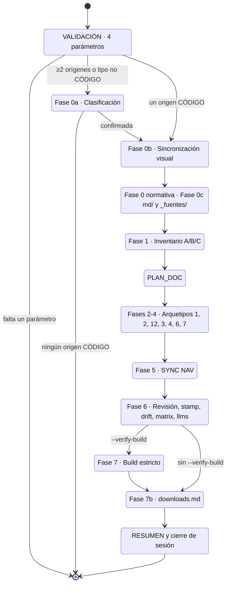

# document_project

Punto de entrada único del producto doc_ia: orquesta los arquetipos formales sobre un proyecto origen para generar o actualizar su documentación completa.

## 1. Arquitectura y Diseño

La vista del mismo flujo desde el usuario (qué pide, qué confirma y qué recibe) está en la
[página funcional](../functional/document_project.md#3-flujo-principal).

## 2. Modelo de Datos / Contratos

### API pública

| Componente | Tipo | Descripción | Retorna |
|---|---|---|---|
| `/document-project` | slash command | Entrada en Claude Code: valida inputs y ejecuta el flujo | Fases VALIDACIÓN → RESUMEN en el chat |
| `document_project.prompt.md` | prompt multiplataforma | Equivalente del slash command para Gemini, Copilot, Cursor, Codex | Mismas fases |
| `documentation-generator.agent.md` | agente | Ejecutor por fases del flujo; orquestado por el prompt | Fases 0-7 |

### Contrato de entrada

| Parámetro | Tipo | Descripción | Restricciones |
|---|---|---|---|
| `Origen(es)` | ruta(s) | Ruta raíz del/los proyectos a documentar | Obligatorio; debe existir y ser accesible |
| `Destino` | ruta | Ruta donde se escriben los archivos Markdown | Obligatorio; no se asume `docs/` por defecto |
| `Generador` | string | `mkdocs-material` (por defecto) o `zensical` | Obligatorio. Ambos usan `mkdocs.yml` (nunca `zensical.toml`); con `zensical` se aplican las *Reglas por generador: Zensical* del prompt (pipeline sin hooks, Gap A4, plugins soportados, build vía script) |
| `Idioma` | string | `es`, `en` u otro código ISO 639-1 | Obligatorio; aplica a todo el contenido generado |
| `Tipo de cada origen` | string | `CÓDIGO` · `NORMATIVA` · `ESPECIFICACIÓN` · `UI/PANTALLAS` · `REFERENCIA` · `CONTRATO` · `INFRAESTRUCTURA` · `MANUAL` | Opcional; autodetectado si se omite; se confirma antes de continuar. Catálogo completo en [Tipos de Origen](../functional/origin_types.md) |
| `Estrategia` | string | `federado` · `hub+satélite` · `monorepo` | Solo con ≥2 orígenes CÓDIGO; nunca autodetectado |
| `Alcance` | string | Módulos o subconjunto | Opcional; por defecto proyecto completo |
| `Arquetipos` | string | Subconjunto de arquetipos a aplicar | Opcional; por defecto todos los aplicables |
| `Verificación` | flags | `--verify-tools` y/o `--verify-build [--serve]` | Opcional; nunca automático |

### Contrato de salida

Once bloques en el chat, en este orden:
1. `VALIDACIÓN DE INPUTS` — tabla de estado por parámetro; si hay ❌ el flujo se detiene.
2. `CLASIFICACIÓN DE ORÍGENES` — solo con ≥2 orígenes o si el único no es CÓDIGO.
3. `INVENTARIO` — tabla módulo × estado (A/B/C) × acción × arquetipos afectados; incluye estado de las tres señales ZIP offline (`TIENE_ZIP_SCRIPT`, `TIENE_MKDOCS_PLUGIN`, `TIENE_WORKFLOW_GITHUB`) y, con Zensical, `TIENE_PIPELINE_SIN_HOOKS`; con documentos convertidos, la sub-sección "Fuentes convertidas (`_fuentes/`)" (copiados, sin cambios, huérfanos y migración pendiente).
4. `PLAN_DOC` — orden de ejecución con secciones afectadas por módulo.
5. `GENERACIÓN` — contenido de cada página, fase a fase.
6. `SYNC NAV` — diff de `mkdocs.yml`.
7. `REVISIÓN` — checklist de validación.
8. `BUILD` — resultado de `--verify-build` (solo opt-in).
9. `DOWNLOADS` — `docs/downloads.md` creado/actualizado (siempre obligatorio); indica variante A o B; reporta huecos de las señales ZIP que falten (Gaps A1-A3 y, con Zensical, A4: script de build sin pasos pre/post).
10. `RESUMEN` — contadores de archivos creados/actualizados/omitidos y entradas de nav.
11. `CIERRE DE SESIÓN` — siempre obligatorio: artefactos `.ai/sessions/YYYY-MM-DD/` en el destino + propuesta de commit Conventional Commits.

### Errores y casos especiales

| Caso | Comportamiento |
|---|---|
| Parámetro obligatorio faltante o ambiguo | El flujo se detiene en VALIDACIÓN y pide completar el campo antes de continuar |
| Origen no legible o fuera del workspace | El flujo se detiene y pide confirmación de ruta |
| Todos los orígenes son MATERIAL (sin CÓDIGO) | El flujo se detiene con mensaje orientativo hacia los prompts de arquetipo directo |
| `--verify-build` falla | Se reportan errores del build MkDocs; el RESUMEN los lista como pendientes |
| Estado B con secciones vigentes | Solo se actualizan las secciones afectadas; las vigentes se copian verbatim |
| Origen con carpetas `md/` | Fase 0c, Paso 5: copia siempre en `<raíz del destino>/_fuentes/<nombre_origen>/<ruta relativa al origen>`, fuera de `docs_dir`; solo copia lo que falta o cambió; los huérfanos se listan y no se borran sin confirmación |
| Destino con `.fuentes/` o `fuentes/` en su raíz | Migración a `_fuentes/` con confirmación; si un mismo fichero difiere entre carpetas, el flujo se detiene; las referencias de `docs/` se reescriben y se vuelven a sellar con `doc_trace.py --root` |
| CIERRE omitido por el agente | Error del flujo: el cierre es siempre obligatorio; si falta, solicitar al agente que cree los artefactos `.ai/sessions/` y proponga el commit antes de cerrar la sesión |

## 3. Componentes y Clases

| Componente | Ruta | Responsabilidad |
|---|---|---|
| Slash command | `.claude/commands/document-project.md` | Validación, instrucciones de uso y ejemplos de entrada para Claude Code |
| Prompt multiplataforma | `.github/prompts/document_project.prompt.md` | Equivalente del slash command para el resto de plataformas IA |
| Agente | `.github/agents/documentation-generator.agent.md` | Flujo por fases (0a–7); protocolos CREAR/ACTUALIZAR/OMITIR; mapeo MATERIAL→arquetipos |

## 4. Dependencias y Requisitos

| Dependencia | Propósito | Requerida | Comportamiento sin ella |
|---|---|---|---|
| `.github/DOCUMENTATION_STANDARD.md` | Define los 12 arquetipos formales y sus estructuras | Sí | Las fases de generación no tienen plantilla de referencia |
| `.github/instructions/docs.instructions.md` | Reglas operativas (resumen de Mermaid, snippets, MkDocs; reglas de diagramas en `DOCUMENTATION_STANDARD.md` §3.17) | Sí | Riesgo de inconsistencias de estilo y formato |
| `mkdocs.yml` (destino) | Navegación que se sincroniza en Fase 5 | Sí, con cualquiera de los dos generadores | Sin él, SYNC NAV no puede actualizar la navegación |
| Prompts de arquetipo (`.github/prompts/`) | Plantillas de cada tipo de documento | Sí | Las fases 2-4 no tienen instrucciones para generar cada arquetipo |
| `python -m mkdocs build` | Verificación de build (Fase 7) | Solo con `--verify-build` | Si falta, la fase 7 no se puede ejecutar |
| `python scripts/build_docs_zip.py --builder zensical` (o `python -m zensical build --strict`) | Verificación de build con Zensical (Fase 7) | Solo con `--verify-build` y generador `zensical` | Sin el script, los hooks no se ejecutan y se reporta Gap A4 |

## 5. Ejemplos Relacionados

- [Ejemplo: Documentar un Proyecto](../examples/document_project_usage.md) — invocación
  con 6 escenarios (sin doc, parcial, `--verify-build`, orígenes heterogéneos, opt-in
  changelog, CONTRATO+INFRAESTRUCTURA) y output esperado de cada fase.

## 6. Verificación y Tests

*Sin tests del comportamiento.* El flujo es un conjunto de instrucciones ejecutadas en el chat, no
código Python. Riesgo principal sin cubrir: que el comando, el prompt y el agente se desincronicen
(fases, bloques de salida, mapeos MATERIAL → arquetipos). Hoy solo lo detecta una revisión manual
o el Documentation Reviewer, salvo en un punto: `test_sources_folder_is_canonical` comprueba que
las cuatro instrucciones fijan la misma ruta `_fuentes/` y que los demás nombres solo aparecen
para prohibirlos o migrarlos.

??? note "Evidencia"

    | Elemento | Fuente | Confianza |
    |---|---|---|
    | `/document-project` | `.claude/commands/document-project.md` | ✅ |
    | Prompt multiplataforma | `.github/prompts/document_project.prompt.md` | ✅ |
    | Agente por fases | `.github/agents/documentation-generator.agent.md` | ✅ |
    | 4 parámetros obligatorios y 5 opcionales | `.github/prompts/document_project.prompt.md` (sección "Contexto a completar") | ✅ |
    | Estrategia nunca autodetectada | `.github/prompts/document_project.prompt.md` (opcional "Estrategia") | ✅ |
    | Once bloques de salida (1–10 + 8b) | `.github/prompts/document_project.prompt.md` (sección "Devuelve en este orden") | ✅ |
    | Fase 2 con Mapa Funcional y Fase 3 con Arquetipo 12 | `.github/prompts/document_project.prompt.md` (Fases 2 y 3) | ✅ |
    | Parada por parámetro faltante | `.github/prompts/document_project.prompt.md` (sección "VALIDACIÓN") | ✅ |
    | Origen no legible o fuera del workspace | `.claude/commands/document-project.md` (casos límite) | ✅ |
    | Caso degenerado sin origen CÓDIGO | `.github/prompts/document_project.prompt.md` (Fase 0a, paso 5) | ✅ |
    | Estado B: secciones vigentes verbatim | `.github/prompts/document_project.prompt.md` (protocolo ACTUALIZAR) | ✅ |
    | Cierre de sesión obligatorio | `.github/prompts/document_project.prompt.md` (bloque 10) | ✅ |
    | Copia en `_fuentes/` y migración de otros nombres | `.github/prompts/document_project.prompt.md` (Fase 0c, Paso 5), `tests/test_docs_conformance.py::test_sources_folder_is_canonical` | ✅ |
    | Generador `zensical`: `TIENE_PIPELINE_SIN_HOOKS`, Gap A4, plugins soportados, build vía script | `.github/prompts/document_project.prompt.md` (sección "Reglas por generador: Zensical") | ✅ |
    | Dependencias: norma, `docs.instructions.md`, `mkdocs.yml`, prompts, `mkdocs build` | `.github/prompts/document_project.prompt.md`, `.github/agents/documentation-generator.agent.md` | ✅ |
