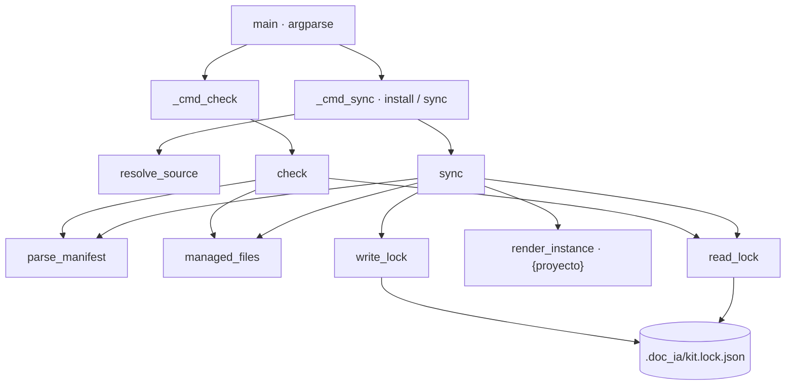

# kit

Kit de documentación de un destino: copia la metodología y los scripts de la lista blanca `.github/kit/MANIFEST.txt` a `<destino>/.doc_ia/`, instala los lanzadores `/documentar`, crea `DOCUMENTAR.md` si falta y registra versión y huellas en `<destino>/.doc_ia/kit.lock.json`; `check` comprueba esa copia. Sin red.

## 1. Arquitectura y Diseño



Script standalone, solo stdlib, con funciones puras sobre `Path` que los tests ejercitan con
un doc_ia y un destino temporales. El manifiesto tiene tres secciones: `[metodologia]` (ruta
relativa a doc_ia, que se copia a `.doc_ia/<misma ruta>`), `[lanzadores]` y `[instancia]`
(pares `origen -> destino`, en la raíz del destino). `managed_files` junta metodología y
lanzadores: son los ficheros cuyo SHA256 guarda el lock. La instancia (`DOCUMENTAR.md`) queda
fuera: se crea solo si falta y no se registra.

La huella de un fichero de texto normaliza CRLF a LF antes del SHA256: el checkout de git
puede cambiar los finales de línea (`autocrlf`, `eol=lf`) y, sin normalizar, el mismo fichero
se daría por editado en otro equipo. Un fichero con un byte NUL en sus primeros 8 KiB se trata
como binario y se resume tal cual.

`sync` decide por fichero comparando tres huellas: la de doc_ia (`wanted`), la del destino
(`current`) y la del lock (`previous`). Igual a `wanted` → sin cambio; sin `previous` → fichero
ajeno; `current != previous` → editado; en otro caso se copia (`shutil.copyfile`). Después
retira lo que está en el lock y ya no en el manifiesto, y escribe el lock salvo con `dry_run`.
`check` solo lee: integridad contra el lock, presencia de `DOCUMENTAR.md` y del prompt de
instancia y, con `source`, comparación con doc_ia.

El script se distribuye en el propio kit (`.doc_ia/scripts/kit.py`): `ROOT` es entonces
`.doc_ia/` y `resolve_source` obliga a indicar `--from`.

## 2. Modelo de Datos / Contratos

### API pública

| Función/Clase | Firma simplificada | Descripción | Retorna |
|---|---|---|---|
| `KitError` | `Exception` | doc_ia inválido, manifiesto mal formado, lock ilegible o destino inutilizable | — |
| `Manifest` | `dataclass(frozen)`: `methodology`, `launchers`, `instance` | Lista blanca leída; lanzadores e instancia como pares `(origen, destino)` | — |
| `Report` | `dataclass`: `changes: list[(tipo, ruta)]`, `conflicts: list[(ruta, motivo)]` | Resultado de `sync`/`check` | — |
| `parse_manifest` | `parse_manifest(path) -> Manifest` | Lee secciones; ignora vacías y `#` | `Manifest` |
| `sha256` | `sha256(path) -> str` | SHA256 del contenido; en texto (sin NUL en los primeros 8 KiB), con CRLF normalizado a LF | Hex de 64 caracteres |
| `doc_ia_version` | `doc_ia_version(source) -> str` | `project.version` del `pyproject.toml` de doc_ia | Versión |
| `read_lock` | `read_lock(dest) -> dict` | Lee `.doc_ia/kit.lock.json`; `{}` si no existe o no es un objeto | Lock |
| `write_lock` | `write_lock(dest, version, files, today) -> None` | Escribe `doc_ia`, `fecha` y `ficheros` ordenados (sangría 2, UTF-8) | — |
| `managed_files` | `managed_files(source, manifest) -> dict[str, Path]` | Ruta POSIX en el destino → fichero de doc_ia (metodología y lanzadores) | Mapa |
| `render_instance` | `render_instance(template, dest) -> str` | Plantilla sin su primer comentario `<!-- … -->`, con `{proyecto}` = `site_name` (o nombre de la carpeta) | Texto |
| `resolve_source` | `resolve_source(source) -> Path` | `--from` o `ROOT`; `KitError` si la carpeta se llama `.doc_ia` | Ruta resuelta |
| `sync` | `sync(source, dest, *, force=False, dry_run=False, today="") -> Report` | Instala o actualiza el kit | `Report` |
| `check` | `check(dest, source=None) -> Report` | Integridad del kit y, con `source`, desfase respecto a doc_ia | `Report` |
| `main` | `main(argv=None) -> int` | CLI con subcomandos `install`, `sync` y `check` | Código de salida |

### Contrato de entrada

| Parámetro | Tipo | Descripción | Restricciones |
|---|---|---|---|
| `--from` | `Path` | doc_ia de origen; opción global, antes del subcomando | Por defecto, el doc_ia que contiene el script; obligatorio desde `.doc_ia/` en `install`/`sync` |
| `install` / `sync` | subcomando | Alias: mismo comportamiento | — |
| `--root` | `Path` | Raíz del destino (carpeta con `mkdocs.yml`) | Obligatorio; debe existir y no ser doc_ia ni contener a doc_ia como `.doc_ia/` |
| `--force` | flag | Sobrescribe editados y ajenos; retira aunque esté editado | Solo `install`/`sync` |
| `--dry-run` | flag | Informa sin escribir ficheros ni lock | Solo `install`/`sync` |
| `--date` | `str` | Fecha del lock | Por defecto, hoy (`YYYY-MM-DD`); no se valida el formato |
| `check --root` | `Path` | Raíz del destino | Obligatorio; con `--from`, además compara con doc_ia |
| `MANIFEST.txt` | fichero | Secciones `[metodologia]`, `[lanzadores]`, `[instancia]` | Sección desconocida, entrada fuera de sección o par sin `->` → `KitError` |

### Contrato de salida

- `<destino>/.doc_ia/<ruta>`: copia byte a byte de cada fichero de `[metodologia]`.
- Lanzadores en la raíz del destino: `.claude/commands/documentar.md`,
  `.github/prompts/documentar.prompt.md`, `AGENTS.md`, `GEMINI.md`.
- `<destino>/DOCUMENTAR.md`: solo si no existe, desde `DOCUMENTAR.template.md`.
- `<destino>/.doc_ia/kit.lock.json`:

    ```json
    {
      "doc_ia": "<versión de doc_ia>",
      "fecha": "YYYY-MM-DD",
      "ficheros": {"<ruta POSIX en el destino>": "<sha256 de 64 hex>"}
    }
    ```

    Las claves de `ficheros` son las rutas de `managed_files`; un fichero en conflicto
    «editado» conserva la huella anterior (sigue detectándose); uno «ajeno» no se registra.
    Solo se reescribe si cambian la versión de doc_ia o alguna huella: una sincronización sin
    cambios no deja diff en el destino (la `fecha` es la del último cambio).
- `sync`: `[kit] doc_ia <versión> → <destino>: sin cambios | N cambio(s)`, una línea por cambio
  (`CREADO`, `ACTUALIZADO`, `RETIRADO`) y por conflicto (`CONFLICTO <ruta> — <motivo>`). Código
  `0` sin cambios, `1` con cambios (también con `--dry-run`), `2` con algún conflicto.
- `check`: `[kit] kit doc_ia <versión> en <destino>`, líneas `CONFLICTO` (`falta`, `editado en
  el destino`, `kit no instalado`, `falta (lo crea /documentar o el CIERRE)`) y, con `--from`,
  `DESFASADO`, `NUEVO EN DOC_IA` o `RETIRADO EN DOC_IA`; `[kit] Kit al día.` y código `0` si no hay hallazgos; `1` si
  los hay.

### Errores y casos especiales

| Caso | Comportamiento |
|---|---|
| Fichero existente sin huella en el lock y distinto de doc_ia | Conflicto `fichero ajeno: no lo instaló el kit`; código `2` sin `--force` |
| Fichero con huella distinta de la del lock | Conflicto `editado en el destino`; código `2` sin `--force` |
| Fichero del lock que doc_ia ya no distribuye, editado | Conflicto `doc_ia ya no lo distribuye y está editado`; sin editar, `RETIRADO` |
| Fichero del lock retirado por doc_ia y ya ausente | Se quita del lock sin informar |
| Fichero idéntico a doc_ia sin huella en el lock | Se adopta: se registra sin informar cambio |
| `sync` desde un `kit.py` copiado sin `--from` | `[kit] ERROR: este kit.py es la copia de un destino: indica el doc_ia con --from`; código `2` |
| Destino igual a doc_ia o cuyo `.doc_ia/` es el origen | `KitError` `el destino no puede ser el propio doc_ia`; código `2` |
| Destino inexistente | `KitError`; código `2` |
| Sin `MANIFEST.txt` en el origen, manifiesto mal formado o fichero citado inexistente | `KitError`; código `2` |
| Lock con JSON inválido | `KitError`; código `2` (en `sync` y en `check`) |
| `OSError` (permisos, disco) | Capturado en `main`: `[kit] ERROR: …` por stderr; código `2` |
| `check` sin kit instalado | Un único hallazgo `kit no instalado`; código `1` |
| Conflictos con `--dry-run` | Se informan igual y el código es `2` |
| Consola no UTF-8 (cp1252) | Solo al ejecutarse como script, stdout/stderr se reconfiguran a UTF-8 |

`check --from` aplica `resolve_source`: rechaza la copia `.doc_ia/` del propio destino
(`KitError`, código `2`) e informa también de los ficheros que doc_ia ha retirado del manifiesto.

## 3. Componentes y Clases

| Componente | Responsabilidad |
|---|---|
| `Manifest`, `Report` | Dataclasses de transporte entre lectura del manifiesto, operación e informe |
| `KIT_DIR`, `LOCK_NAME`, `MANIFEST`, `INSTANCE_PROMPT` | Rutas fijas: `.doc_ia`, `kit.lock.json`, `.github/kit/MANIFEST.txt`, `.ai/prompts/documentar.prompt.md` |
| `SECTIONS` | Secciones admitidas del manifiesto |
| `LEADING_COMMENT_RE`, `SITE_NAME_RE` | Quitar el comentario de la plantilla y leer `site_name` de `mkdocs.yml` |
| `ROOT` | doc_ia que contiene el script (o `.doc_ia/` en una copia) |
| `_cmd_sync`, `_cmd_check`, `_parser`, `_print` | Capa CLI: argumentos, mensajes `[kit]` y códigos de salida |

## 4. Dependencias y Requisitos

| Dependencia | Propósito | Requerida | Comportamiento sin ella |
|---|---|---|---|
| `argparse`, `hashlib`, `json`, `re`, `shutil`, `tomllib`, `dataclasses`, `datetime`, `pathlib` (stdlib) | CLI, huellas, lock, plantillas y copia | Sí | — (siempre disponibles) |
| `.github/kit/MANIFEST.txt` de doc_ia | Lista blanca | Sí, en `sync` y en `check --from` | `KitError` → código `2` |
| `pyproject.toml` de doc_ia | Versión del lock y del mensaje | En `sync` | `OSError` → código `2` |
| Plantillas `.github/templates/kit/` | Lanzadores y `DOCUMENTAR.template.md` | Sí, si las cita el manifiesto | `KitError` → código `2` |
| `mkdocs.yml` del destino | `site_name` para `{proyecto}` | No | Se usa el nombre de la carpeta del destino |

## 5. Ejemplos Relacionados

- [Ejemplo: Kit de Documentación en un Destino](../examples/kit_usage.md) — instalación,
  comprobación, actualización y conflicto por edición local desde código propio, e instalación
  del kit real de doc_ia desde la CLI con sus códigos de salida.

## 6. Verificación y Tests

| Test | Qué verifica | Tipo |
|---|---|---|
| `test_digest_ignores_line_endings_but_not_binary` | Huella igual con CRLF y LF en texto; distinta en binario | unitario |
| `test_checkout_with_other_line_endings_is_not_an_edit` | Un fichero del kit con otro fin de línea no es conflicto | integración |
| `test_install_copies_methodology_launchers_and_instance` | Copia en `.doc_ia/`, lanzador, `DOCUMENTAR.md` con `site_name` y lock sin la instancia | integración |
| `test_sync_is_idempotent_and_keeps_project_owned_files` | Segunda sincronización sin cambios; `DOCUMENTAR.md` editado se conserva | integración |
| `test_sync_updates_changed_and_removes_retired` | `actualizado` y `retirado` | integración |
| `test_sync_never_overwrites_local_edits_without_force` | Conflicto por edición y `--force` | integración |
| `test_sync_does_not_overwrite_foreign_launcher` | Conflicto por fichero ajeno | integración |
| `test_check_detects_edits_missing_instance_and_outdated` | `kit no instalado`, instancia ausente, al día, `desfasado`, `falta` | integración |
| `test_sync_without_changes_does_not_rewrite_the_lock` | Sin cambios el lock no se reescribe; con cambios, nueva `fecha` | integración |
| `test_dry_run_writes_nothing` | `--dry-run` no escribe kit, lock ni `DOCUMENTAR.md` | integración |
| `test_retired_file_edited_in_destination_is_a_conflict` | Retirado de doc_ia y editado → conflicto y se conserva | integración |
| `test_check_from_reports_new_and_retired_and_rejects_vendored` | `nuevo en doc_ia`, `retirado en doc_ia` y rechazo de la copia | integración |
| `test_invalid_lock_is_an_error` | Lock con JSON inválido → código 2 en `sync` y `check` | integración (CLI) |
| `test_sync_rejects_vendored_copy_and_self` | Destino = doc_ia y origen = `.doc_ia/` del destino | unitario |
| `test_cli_exit_codes` | Códigos 1, 0, 1, 0, 2 y 2, y `ERROR` por stderr | integración (CLI) |
| `test_manifest_rejects_unknown_section_and_bad_pair` | Errores del manifiesto | unitario |
| `test_real_manifest_files_exist_and_exclude_doc_ia_development` | Manifiesto real: ficheros existentes y sin desarrollo de doc_ia | integración |
| `test_real_kit_installs_into_empty_destination` | Kit real en un destino vacío sin conflictos ni marcadores | integración |

Sin cubrir: la adopción de un fichero idéntico sin huella (se registra sin conflicto).

```bash
python -m pytest tests/test_kit.py -q
```

??? note "Evidencia"

    | Elemento | Fuente | Confianza |
    |---|---|---|
    | `Manifest`, `Report`, `KitError` | `scripts/kit.py::Manifest`, `::Report`, `::KitError` | ✅ |
    | Lectura del manifiesto y sus errores | `scripts/kit.py::parse_manifest`, `::SECTIONS` | ✅ |
    | Huella SHA256 independiente del fin de línea en texto | `scripts/kit.py::sha256` | ✅ |
    | Lock: lectura, formato y escritura en cada `sync` real | `scripts/kit.py::read_lock`, `::write_lock`, `::sync` | ✅ |
    | Ficheros gestionados (metodología + lanzadores, sin instancia) | `scripts/kit.py::managed_files` | ✅ |
    | Instancia: comentario inicial, `{proyecto}` y creación solo si falta | `scripts/kit.py::render_instance`, `::LEADING_COMMENT_RE`, `::SITE_NAME_RE`, `::sync` | ✅ |
    | Decisión por fichero (ajeno, editado, adoptado, copiado) y retirada | `scripts/kit.py::sync` | ✅ |
    | Rechazo de copia vendorizada y de doc_ia como destino | `scripts/kit.py::resolve_source`, `::sync` | ✅ |
    | `check`: hallazgos y comparación con doc_ia | `scripts/kit.py::check`, `::INSTANCE_PROMPT` | ✅ |
    | `check --from` con `resolve_source` y ficheros retirados | `scripts/kit.py::check` | ✅ |
    | Lock estable sin cambios | `scripts/kit.py::sync` (`unchanged`) | ✅ |
    | Mensajes y códigos de salida | `scripts/kit.py::_print`, `::_cmd_sync`, `::_cmd_check`, `::main` | ✅ |
    | Opciones de la CLI | `scripts/kit.py::_parser` | ✅ |
    | Consola cp1252 | `scripts/kit.py` (bloque `__main__`) | ✅ |
    | Tests del §6 | `tests/test_kit.py` | ✅ |
