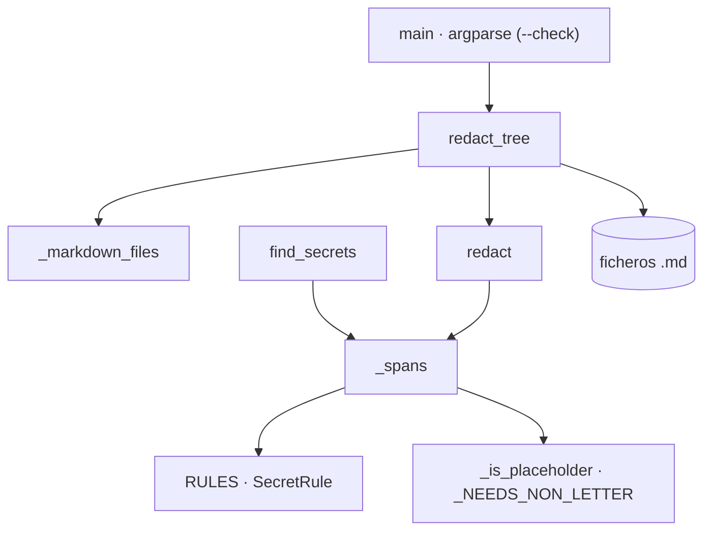

# redact_secrets

Detección y redacción deterministas de credenciales en ficheros Markdown (Fase 0c de `/document-project`, Paso 4b): sustituye el valor de cada credencial por `<REDACTADO>` antes de copiar el texto convertido a `_fuentes/` y comprueba `_fuentes/` antes del commit, sin mostrar nunca el valor.

## 1. Arquitectura y Diseño



Script standalone, solo stdlib. Las funciones de texto (`find_secrets`, `redact`, `_spans`) son
puras y separadas de la E/S (`redact_tree`, `main`). `_spans` aplica cada regla sobre el texto
**original**, descarta marcadores y solapes y ordena los tramos; `redact` los sustituye de atrás
hacia delante, de modo que los números de línea informados son los del texto original aunque se
sustituya un bloque de varias líneas. `redact_tree` lee y escribe **bytes** para conservar los
saltos de línea (LF o CRLF).

## 2. Modelo de Datos / Contratos

### API pública

| Función/Clase | Firma simplificada | Descripción | Retorna |
|---|---|---|---|
| `SecretRule` | `SecretRule(name: str, pattern: re.Pattern[str])` (frozen) | Regla de detección; el grupo `value`, si existe, es lo que se redacta; si no, el patrón entero | — |
| `Finding` | `Finding(path: str, line: int, rule: str)` (frozen) | Hallazgo **sin el valor** | — |
| `RULES` | `tuple[SecretRule, ...]` | `private_key`, `client_secret`, `password`, `token`, `url_basic_auth`, `jwt` | — |
| `find_secrets` | `find_secrets(text: str) -> list[tuple[int, str]]` | Línea (1-based) y regla de cada credencial | lista |
| `redact` | `redact(text: str) -> tuple[str, list[tuple[int, str]]]` | Texto redactado y hallazgos | tupla |
| `redact_tree` | `redact_tree(root: Path, check: bool = False) -> list[Finding]` | Redacta (o con `check`, solo detecta) los `.md` de un fichero o carpeta | lista |
| `main` | `main(argv: list[str] \| None = None) -> int` | CLI: `<ruta> … [--check]` | 0 · 1 · 2 |

### Contrato de entrada

| Parámetro | Tipo | Descripción | Restricciones |
|---|---|---|---|
| `paths` | rutas | Ficheros `.md` o carpetas (recorrido recursivo de `*.md`) | Deben existir; si no, exit 2 |
| `--check` | flag | Solo informa | No escribe ningún fichero |
| `text` | `str` | Markdown | UTF-8 |

### Contrato de salida

- Valor sustituido por `<REDACTADO>`; la clave, los separadores y el resto del texto se conservan.
- Informe `[redact] <fichero>:<línea> · <regla>` y recuento final; nunca el valor.
- Exit `0` sin hallazgos · `1` con hallazgos (redactados o pendientes con `--check`) · `2` error
  (ruta inexistente, UTF-8 inválido, error de E/S).

### Errores y casos especiales

- Las reglas `client_secret`, `password` y `token` exigen un valor con algún carácter que no sea
  letra (descarta prosa como «obligatorio» o «proporcionado»); una contraseña solo de letras no se
  detecta.
- Se descartan marcadores (`xxxxxx`, `--`, `***`, `<…>`, `{…}`, `${VAR}`), URL y valores que ya
  contienen `<REDACTADO>`.
- Tolera el Markdown de docling: guion bajo escapado (`client\_secret`), negritas y comillas entre
  la clave y el valor; separadores `=`, `:` y `(`.
- Tramos solapados (p. ej. un JWT tras `id_token=`): se conserva el primero.

## 3. Componentes y Clases

| Componente | Responsabilidad |
|---|---|
| `RULES`, `SecretRule` | Catálogo de patrones de credenciales |
| `_spans` | Tramos a redactar sin solapes, con descarte de marcadores |
| `_is_placeholder`, `_NEEDS_NON_LETTER`, `_PLACEHOLDER` | Filtros de falsos positivos |
| `find_secrets`, `redact` | API pura sobre texto |
| `redact_tree`, `_markdown_files` | E/S: recorrido de `.md`, escritura en bytes |
| `main` | CLI, informe y códigos de salida |

## 4. Dependencias y Requisitos

| Dependencia | Propósito | Requerida | Comportamiento sin ella |
|---|---|---|---|
| `argparse`, `re`, `dataclasses`, `pathlib`, `sys` (stdlib) | CLI, patrones, tipos, rutas | Sí | — (siempre disponibles) |
| `convert_to_md.py` (antes) | Produce los `.md` que se redactan | No | Se puede usar sobre cualquier Markdown |

## 5. Ejemplos Relacionados

- [Ejemplo: Redactar Credenciales de un Documento Convertido](../examples/redact_secrets_usage.md)
  — redacción de un `client_secret` en una URL, sin tocar marcadores ni descripciones de
  parámetros, y uso de la CLI en la Fase 0c y en el CIERRE.

## 6. Verificación y Tests

| Test | Qué verifica | Tipo |
|---|---|---|
| `test_detects_and_redacts_value_only` (8 casos) | Cada regla por palabra clave y URL; solo cambia el valor | unitario |
| `test_private_key_block_is_redacted_whole`, `test_jwt_is_redacted_whole` | Bloques PEM y JWT | unitario |
| `test_ignores_placeholders_and_prose` (9 casos) | Marcadores, prosa, URL, variables y valores ya redactados | unitario |
| `test_redact_is_idempotent`, `test_line_numbers_refer_to_original_text` | Idempotencia y líneas del texto original | unitario |
| `test_redact_tree_preserves_line_endings_and_other_files`, `test_check_mode_does_not_modify` | CRLF, solo `.md`, `--check` sin escritura | integración |
| `test_cli_exit_codes_and_report_never_shows_value` | Exit 0/1/2 y el valor nunca en la salida | integración |
| `test_large_document_is_fast` | 20 000 filas en menos de 5 s | rendimiento |

```bash
python -m pytest tests/test_redact_secrets.py -q
```

??? note "Evidencia"

    | Elemento | Fuente | Confianza |
    |---|---|---|
    | Reglas y tipos | `scripts/redact_secrets.py::RULES`, `::SecretRule`, `::Finding` | ✅ |
    | Tramos sin solapes y líneas originales | `scripts/redact_secrets.py::_spans`, `::find_secrets`, `::redact` | ✅ |
    | Filtros de falsos positivos | `scripts/redact_secrets.py::_is_placeholder`, `::_NEEDS_NON_LETTER` | ✅ |
    | E/S en bytes y solo `.md` | `scripts/redact_secrets.py::redact_tree`, `::_markdown_files` | ✅ |
    | CLI y códigos de salida | `scripts/redact_secrets.py::main` | ✅ |
    | Tests | `tests/test_redact_secrets.py` | ✅ |
