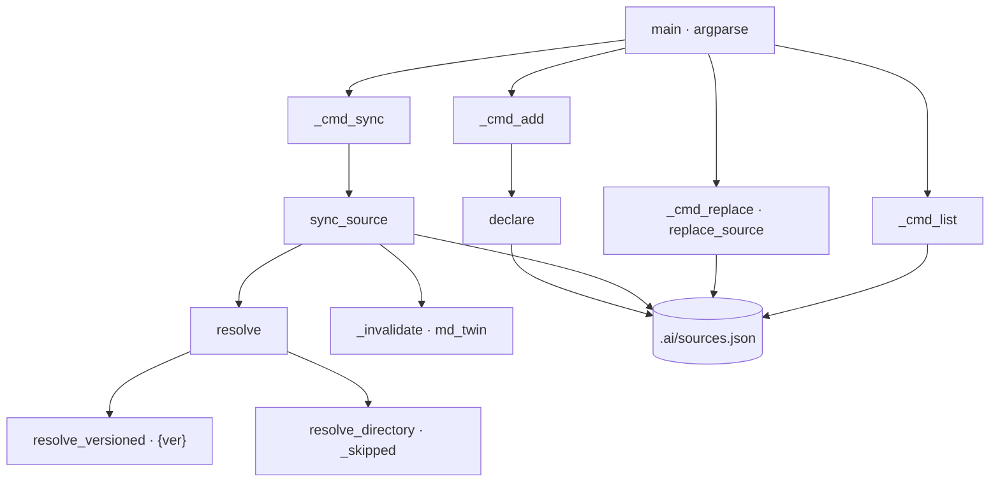

# snapshot_sources

Instantánea local y versionada de los orígenes documentales MATERIAL (Fase 0-pre de `/document-project`): copia ficheros, carpetas o patrones con `{ver}` a `<raíz del destino>/_staging/<nombre>/` y registra huella SHA256, versión e historial en `<raíz del destino>/.ai/sources.json`, sin escribir nunca en el origen ni acceder a la red.

## 1. Arquitectura y Diseño



Script standalone sin dependencias de otros módulos del proyecto ni de terceros (solo
stdlib). Cada subcomando es una función `_cmd_*` que delega en funciones puras sobre `Path`;
los tests las ejercitan con carpetas temporales, sin red. El manifiesto se lee entero, se
modifica en memoria y `sync` lo escribe después de cada origen con cambios (nunca con
`--dry-run`), de modo que `_staging/` y el manifiesto avanzan a la par. Un origen que falla
no detiene a los demás.

`resolve` decide la forma del origen por este orden: si la cadena contiene `{ver}`, patrón
con versión; si es un fichero, fichero suelto; si es una carpeta, recorrido recursivo; en
otro caso, `SnapshotError`. Las rutas de red (UNC) y las bibliotecas de SharePoint
sincronizadas con OneDrive son rutas del sistema de ficheros más; la adquisición de
repositorios remotos (git/glab) queda fuera del script.

La salida de `sync` respeta la convención de `convert_to_md.py`: la conversión de
`_staging/<nombre>/<rel>` es `_staging/<nombre>/md/<rel con sufijo .md>` (`md_twin`), y
`_invalidate` la borra junto con el binario antes de copiar, porque `convert_to_md.py` omite
los ficheros ya convertidos.

## 2. Modelo de Datos / Contratos

### API pública

| Función/Clase | Firma simplificada | Descripción | Retorna |
|---|---|---|---|
| `SnapshotError` | `Exception` | Origen no resoluble o declaración inválida | — |
| `Resolved` | `dataclass(frozen)`: `source: Path`, `rel: str`, `version: str \| None = None` | Fichero del origen y su ruta POSIX dentro de `_staging/<nombre>/` | — |
| `Change` | `dataclass(frozen)`: `kind`, `rel`, `version=None`, `previous_version=None` | Cambio aplicado o previsto; `kind` ∈ `alta` \| `modificado` \| `baja` | — |
| `version_key` | `version_key(version) -> tuple[int, ...]` | Clave de orden numérico por tramos (`1.2.50` > `1.2.9`) | Tupla de enteros |
| `stable_name` | `stable_name(template) -> str` | Quita `{ver}` con su prefijo `v`/`V` y un separador previo (` `, `_`, `.`, `-`); `SnapshotError` si no queda nombre útil | Nombre estable |
| `resolve_versioned` | `resolve_versioned(spec: Path) -> Resolved` | Fichero de versión más alta de `spec.parent` cuyo nombre encaja entero con el patrón (sin distinguir mayúsculas) | `Resolved` con `version` |
| `resolve_directory` | `resolve_directory(folder, include) -> list[Resolved]` | Ficheros de la carpeta (recursivo, orden alfabético), sin los omitidos, filtrados por glob sobre el nombre o la ruta POSIX | Lista de `Resolved` |
| `resolve` | `resolve(spec, include=()) -> list[Resolved]` | Ficheros que aporta un origen declarado (patrón, fichero o carpeta) | Lista de `Resolved` |
| `sha256` | `sha256(path) -> str` | SHA256 completo, lectura por bloques de 1 MiB | Hex de 64 caracteres |
| `read_manifest` | `read_manifest(path) -> dict[str, Any]` | Lee `.ai/sources.json`; `{"fuentes": {}}` si no existe; `SnapshotError` si no es un objeto con `fuentes` | Manifiesto |
| `write_manifest` | `write_manifest(path, data) -> None` | Escribe `{"doc_ia", "fuentes"}` con orígenes ordenados, sangría 2, UTF-8 y LF; crea `.ai/` | — |
| `replace_source` | `replace_source(data, name, spec, include, today) -> str` | Sustituye el origen de un nombre ya declarado por un documento reestructurado: valida que el nuevo resuelve, añade al historial `{fecha, cambio: "sustituido", origen_anterior, origen}`, vacía `ficheros` y quita `sincronizado`. Devuelve el origen anterior | origen anterior |
| `declare` | `declare(data, name, spec, include) -> None` | Añade o actualiza `origen` e `incluir` de un origen conservando `ficheros` e `historial` | — |
| `md_twin` | `md_twin(staging, rel) -> Path` | Ruta de la conversión Markdown de un fichero de `_staging/<nombre>/` | `Path` |
| `sync_source` | `sync_source(root, name, entry, today, dry_run=False) -> list[Change]` | Copia lo nuevo o cambiado, retira lo eliminado, invalida conversiones y actualiza `entry` (historial, `ficheros`, `sincronizado`) | Cambios en orden: altas/modificaciones y luego bajas |
| `format_change` | `format_change(name, change) -> str` | Línea de informe `  <TIPO> <nombre>/<rel> (v<anterior> → v<nueva>)` | Texto |
| `main` | `main(argv=None) -> int` | CLI con subcomandos `add`, `sync` y `list` | Código de salida |

### Contrato de entrada

| Parámetro | Tipo | Descripción | Restricciones |
|---|---|---|---|
| `--root` | `Path` | Raíz del destino (carpeta con `mkdocs.yml`); opción global, antes del subcomando | Obligatorio |
| `add name` | `str` | Nombre del origen: carpeta en `_staging/` y en `_fuentes/` | `^(?!\.+$)[\w.-]+$` (letras, dígitos, `.`, `_`, `-`; nunca solo puntos) |
| `add source` | `str` | Fichero, carpeta o patrón con `{ver}` | `{ver}` solo en el nombre del fichero, no en la carpeta; una ruta relativa se resuelve desde el directorio actual, no desde `--root` |
| `add --include` | `str` (repetible) | Patrón glob para carpetas | No admitido junto a `{ver}`; sin efecto en un fichero suelto |
| `sync names` | `str` (0..n) | Orígenes a sincronizar | Deben estar declarados; por defecto, todos |
| `sync --dry-run` | flag | Solo informa | No copia ni escribe el manifiesto |
| `sync --date` | `str` | Fecha del historial | Por defecto, la del día (`YYYY-MM-DD`); no se valida el formato |

### Contrato de salida

- `_staging/<nombre>/<rel>`: copia byte a byte (`shutil.copyfile`) de cada fichero del origen;
  con `{ver}`, `<rel>` es el nombre estable.
- `.ai/sources.json`:

    ```json
    {
      "doc_ia": "<versión de doc_ia>",
      "fuentes": {
        "<nombre>": {
          "ficheros": {"<rel>": {"sha256", "bytes", "origen", "version"}},
          "historial": [{"fecha", "fichero", "cambio", "sha256", "version", "version_anterior"}],
          "origen": "<ruta o patrón declarado>",
          "incluir": ["<glob>"],
          "sincronizado": "<fecha>"
        }
      }
    }
    ```

    `version` es `null` fuera de un patrón con `{ver}`. En el historial, `sha256` no aparece en
    las bajas, `version` solo si hay versión y `version_anterior` solo si cambió. `incluir` solo
    existe si se declaró. `ficheros` y `sincronizado` se actualizan solo cuando hay cambios.
- `sync`: una línea `[snapshot] <nombre>: sin cambios | N cambio(s)` por origen y una línea
  por cambio (`ALTA`, `MODIFICADO`, `BAJA`); código `0` sin cambios, `1` con cambios (también
  con `--dry-run`), `2` con error (también si solo falla uno de los orígenes).
- `list`: `<nombre>: <origen> · N fichero(s)` y, por fichero, `<rel> v<versión> · <12 hex>`;
  código `0`.
- `add`: mensaje de confirmación con la ruta del manifiesto; código `0`.

### Errores y casos especiales

- `replace` con un nombre no declarado, con el mismo origen («usa `sync`») o con un documento
  nuevo que no resuelve → `SnapshotError` (exit 2) sin tocar la declaración ni `_staging/`.

| Caso | Comportamiento |
|---|---|
| Origen inexistente o ilegible | `[snapshot] ERROR en <nombre>: …` por stderr; los demás orígenes se sincronizan y se registran; código `2` |
| `{ver}` en la carpeta del patrón, carpeta del patrón inexistente o ningún fichero que encaje | `SnapshotError` del origen → igual que un origen inexistente, código `2` |
| Patrón que no deja nombre estable (`v{ver}.docx`) | `SnapshotError` del origen → código `2` (solo se evalúa si algún fichero encaja) |
| Nombre inválido, `--include` con `{ver}` u origen no declarado en `sync` | `SnapshotError` capturado en `main` → `[snapshot] ERROR: …` y código `2`, sin sincronizar nada |
| `OSError` (permisos, red caída) | En un origen, como un origen inexistente; fuera de él (manifiesto, `pyproject.toml`), capturado en `main` → código `2` |
| Manifiesto con estructura inválida o JSON mal formado | `SnapshotError` → código `2` |
| Contenido y versión iguales pero copia ausente en `_staging/` | Se copia de nuevo como `modificado` |
| Mismo número con distinta escritura (`v1.2` y `v01.2`) | Misma clave numérica; desempata el nombre del fichero (orden de texto) |
| Carpetas `md`, `.git`, `_staging`, `__pycache__` u ocultas en el origen | Se omiten en cualquier nivel; también `~$*`, `Thumbs.db`, `desktop.ini`, `.DS_Store` y `*.tmp` |
| Sin orígenes declarados | `sync` lo indica y devuelve `0`; `list` no imprime nada |
| Consola no UTF-8 (cp1252) | Solo al ejecutarse como script, stdout/stderr se reconfiguran a UTF-8: la flecha `→` de un cambio de versión no interrumpe el `sync` |

## 3. Componentes y Clases

| Componente | Responsabilidad |
|---|---|
| `Resolved`, `Change` | Dataclasses inmutables de transporte entre resolución, sincronización e informe |
| `VERSION_TOKEN`, `VERSION_GROUP`, `STABLE_NAME_RE`, `NAME_RE` | Marca `{ver}`, grupo regex de versión (`\d+(?:\.\d+)*`), limpieza del nombre estable y validación del nombre de origen |
| `STAGING_DIR`, `MANIFEST` | Rutas fijas relativas a `--root`: `_staging` y `.ai/sources.json` |
| `SKIP_DIRS`, `SKIP_FILES`, `_skipped` | Omisión de salida de conversión, control de versiones, bloqueos de Office y metadatos |
| `_invalidate`, `md_twin` | Borrado del binario y de su `.md` en `_staging/` antes de copiar o al dar de baja |
| `_doc_ia_version` | Versión de doc_ia leída de su `pyproject.toml` (no del destino) para el manifiesto |
| `_cmd_add`, `_cmd_replace`, `_cmd_sync`, `_cmd_list`, `_parser`, `_manifest_path` | Capa CLI: argumentos, mensajes `[snapshot]` y códigos de salida |

## 4. Dependencias y Requisitos

| Dependencia | Propósito | Requerida | Comportamiento sin ella |
|---|---|---|---|
| `argparse`, `fnmatch`, `hashlib`, `json`, `re`, `shutil`, `tomllib`, `dataclasses`, `datetime`, `pathlib` (stdlib) | CLI, filtros glob, huellas, manifiesto, regex de versión y copia | Sí | — (siempre disponibles) |
| `pyproject.toml` de doc_ia | Versión que se guarda en el manifiesto | Al escribir el manifiesto | `OSError` → código `2` |
| Cliente de OneDrive (fuera del script) | Biblioteca de SharePoint sincronizada como carpeta local | Solo para orígenes de SharePoint | El origen no existe → código `2` |

## 5. Ejemplos Relacionados

- [Ejemplo: Adquirir Orígenes Documentales](../examples/snapshot_sources_usage.md) — patrón
  con `{ver}` y carpeta filtrada desde la CLI, cambio de versión con su historial y uso de
  `declare` y `sync_source` desde código propio.

## 6. Verificación y Tests

| Test | Qué verifica | Tipo |
|---|---|---|
| `test_version_key_compares_numerically` (1) | Orden numérico por tramos | unitario |
| `test_replace_switches_source_even_with_lower_version`, `test_replace_keeps_previous_history`, `test_replace_with_missing_document_keeps_old_declaration`, `test_replace_errors_exit_2` (2 casos), `test_list_tolerates_replaced_history` | Sustitución por documento reestructurado con versión menor, historial, documento inexistente, errores y `list` tras sustituir | integración |
| `test_stable_name_strips_version_and_separator` (4 casos), `test_stable_name_without_stem_is_an_error` (1) | Nombre estable con `_v`, espacio, `-V` y versión inicial; patrón sin nombre útil | unitario |
| `test_resolve_versioned_picks_highest_version`, `test_resolve_versioned_without_match_is_an_error` (2) | Versión más alta, otra extensión ignorada y patrón sin coincidencias | unitario |
| `test_resolve_directory_filters_and_skips_generated`, `test_resolve_missing_origin_is_an_error` (2) | Recorrido recursivo, omisiones, `include` y origen inexistente | unitario |
| `test_sync_versioned_file_records_evolution` (1) | Alta, idempotencia, cambio de versión con ruta estable, invalidación de `md/` e historial con `version_anterior` | integración (CLI) |
| `test_sync_directory_detects_modified_and_removed` (1) | `modificado` y `baja` en carpeta, retirada de la conversión e `incluir` guardado | integración (CLI) |
| `test_sync_dry_run_copies_nothing`, `test_sync_restores_deleted_staging_copy`, `test_sync_never_writes_into_the_origin` (3) | `--dry-run`, reposición de la copia y origen intacto | integración (CLI) |
| `test_errors_exit_2` (3 casos), `test_sync_missing_origin_exit_2` (1) | Nombre inválido, `--include` con `{ver}`, origen no declarado y origen inexistente → `2` | integración (CLI) |
| `test_add_rejects_names_that_leave_staging` (2 casos), `test_hand_edited_manifest_name_never_deletes_the_destination` | `.`/`..` rechazados al declarar y en un registro editado a mano; la raíz del destino no se borra | integración (CLI) |
| `test_sync_failing_origin_does_not_lose_the_others` (1) | Un origen caído devuelve `2` sin impedir que otro se copie y se registre | integración (CLI) |
| `test_list_shows_versions` (1) | `list` muestra el nombre estable con su versión | integración (CLI) |

Sin cubrir: el manifiesto inválido, el filtro sobre la ruta relativa, los ficheros
`SKIP_FILES` distintos de `~$*` y la salida en consolas no UTF-8.

```bash
python -m pytest tests/test_snapshot_sources.py -q
```

??? note "Evidencia"

    | Elemento | Fuente | Confianza |
    |---|---|---|
    | `Resolved`, `Change`, `SnapshotError` | `scripts/snapshot_sources.py::Resolved`, `::Change`, `::SnapshotError` | ✅ |
    | Orden numérico de versiones | `scripts/snapshot_sources.py::version_key` | ✅ |
    | Nombre estable y su error | `scripts/snapshot_sources.py::stable_name`, `::STABLE_NAME_RE` | ✅ |
    | Patrón con versión: carpeta, `fullmatch`, `IGNORECASE` y desempate | `scripts/snapshot_sources.py::resolve_versioned` (`max(found)`) | ✅ |
    | Recorrido de carpetas, omisiones y filtro | `scripts/snapshot_sources.py::resolve_directory`, `::_skipped`, `::SKIP_DIRS`, `::SKIP_FILES` | ✅ |
    | Orden de resolución del origen | `scripts/snapshot_sources.py::resolve` | ✅ |
    | Huella SHA256 por bloques | `scripts/snapshot_sources.py::sha256`, `::CHUNK` | ✅ |
    | Lectura, validación y escritura del manifiesto | `scripts/snapshot_sources.py::read_manifest`, `::write_manifest`, `::_doc_ia_version` | ✅ |
    | Declaración y sus errores | `scripts/snapshot_sources.py::declare`, `::NAME_RE` | ✅ |
    | Sustitución por documento reestructurado | `scripts/snapshot_sources.py::replace_source`, `::_cmd_replace` (retira `_staging/<nombre>/`) | ✅ |
    | Sincronización, invalidación e historial | `scripts/snapshot_sources.py::sync_source`, `::_invalidate`, `::md_twin` | ✅ |
    | Manifiesto escrito tras cada origen; un origen caído no frena a los demás | `scripts/snapshot_sources.py::_cmd_sync` (`failed`, `write_manifest`) | ✅ |
    | Informe y códigos de salida | `scripts/snapshot_sources.py::format_change`, `::_cmd_sync`, `::_cmd_list`, `::_cmd_add`, `::main` | ✅ |
    | Errores capturados (`SnapshotError`, `OSError`) | `scripts/snapshot_sources.py::main` | ✅ |
    | Consola cp1252 | `tests/test_snapshot_sources.py::test_cli_prints_version_arrow_on_non_utf8_console` | ✅ |
    | Tests del §6 | `tests/test_snapshot_sources.py` | ✅ |
