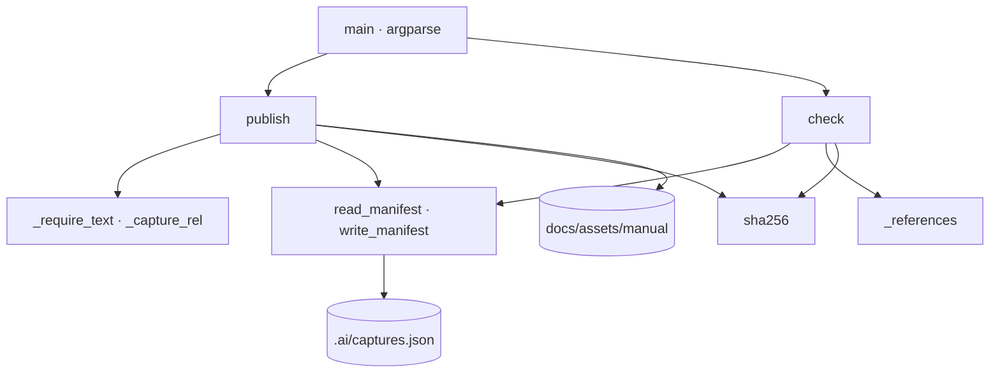

# web_captures

Publicación y control deterministas de las capturas del origen WEB (Arquetipo 15): copia a `docs/assets/manual/<origen>/` solo las capturas revisadas de `_staging/<origen>/`, las registra en `.ai/captures.json` y comprueba la coherencia entre imágenes, registro y citas del manual, sin red ni navegador.

## 1. Arquitectura y Diseño



Script standalone, solo stdlib. `publish` valida **todo** (nombre del origen, entorno, versión,
rol y cada ruta) antes de copiar nada, y escribe el manifiesto con orden estable. `check` es de
solo lectura: cruza tres conjuntos (imágenes en `docs/assets/manual/`, capturas registradas y
citas de las páginas) y devuelve los hallazgos en orden determinista.

## 2. Modelo de Datos / Contratos

### API pública

| Función/Clase | Firma simplificada | Descripción | Retorna |
|---|---|---|---|
| `CaptureError` | `Exception` | Publicación imposible o manifiesto ilegible | — |
| `Finding` | `Finding(kind: str, path: str, detail: str = "")` (frozen) | Hallazgo de `check`; `path` relativa a la raíz del destino | — |
| `publish` | `publish(root, origin, captures, *, env, version, role=None, today=None) -> list[str]` | Copia y registra las capturas revisadas | rutas publicadas |
| `check` | `check(root: Path) -> list[Finding]` | Coherencia de imágenes, registro y citas | hallazgos |
| `read_manifest` / `write_manifest` | `(path) -> dict` / `(path, data) -> None` | Lectura validada y escritura ordenada de `.ai/captures.json` | — |
| `main` | `main(argv: list[str] \| None = None) -> int` | CLI: `--root <destino> publish …` · `check` | 0 · 1 · 2 |

### Contrato de entrada

| Parámetro | Tipo | Descripción | Restricciones |
|---|---|---|---|
| `--root` | ruta | Raíz del destino (carpeta con `mkdocs.yml`) | Obligatorio |
| `origin` | `str` | Nombre del origen (carpeta de `_staging/`) | Letras, dígitos, `.`, `_`, `-` |
| `captures` | rutas | Capturas revisadas, relativas a `_staging/<origen>/` | Imágenes (`.png`, `.jpg`, `.jpeg`, `.webp`, `.gif`) que existen y no salen del origen |
| `--env` | `str` | Entorno (p. ej. `PRE`) | No vacío; nunca una URL |
| `--version` | `str` | Versión desplegada que se ve | No vacía; nunca una URL |
| `--role` | `str` | Rol con el que se tomaron | Opcional; nunca una URL |
| `--date` | `YYYY-MM-DD` | Fecha de publicación | Por defecto, hoy |

### Contrato de salida

`.ai/captures.json`:

```json
{
  "format": "doc_ia.web_captures",
  "format_version": 1,
  "doc_ia": "0.11.3",
  "origenes": {
    "kuniv": {
      "entorno": "PRE",
      "version": "1.8.8",
      "capturas": {
        "procesos/listado.png": {
          "sha256": "…64 hex…",
          "version": "1.8.8",
          "publicada": "2026-11-10",
          "rol": "Coordinador"
        }
      }
    }
  }
}
```

Hallazgos de `check` (`[captures] <tipo>: <ruta> · <detalle>`):

| Tipo | Significado |
|---|---|
| `sin_registrar` | Imagen en `docs/assets/manual/` que no pasó por `publish` |
| `modificada` | Huella distinta de la registrada |
| `falta` | Captura registrada sin fichero |
| `rota` | Cita a una imagen de `assets/manual/` que no existe |
| `sin_alt` | Cita sin texto alternativo |
| `huerfana` | Captura publicada que ninguna página cita |
| `url` | El manifiesto contiene una URL |

Exit de `publish`: `0` · `2` error. Exit de `check`: `0` sin hallazgos · `1` con hallazgos ·
`2` error (manifiesto inválido, E/S, UTF-8).

### Errores y casos especiales

- Un error de `publish` no deja copias parciales ni manifiesto: se valida antes de escribir.
- Los mensajes de error no repiten el valor de una URL rechazada.
- `check` ignora las citas dentro de bloques de código, las URL absolutas y las
  imágenes fuera de `assets/manual/`; quita `#…` y `?…` de la ruta antes de resolverla.
- Rutas con `\` se normalizan a `/`; las absolutas, con unidad o con `..` se rechazan. Un
  nombre de origen solo de puntos (`.`, `..`) también.
- `read_manifest` valida cada origen (objeto con `capturas` objeto); si no, `CaptureError`
  (exit 2).
- Bloques de código delimitados con ``` o ~~~ (3 o más, también indentados) y código inline se
  quitan antes de buscar citas; `` admite comillas dobles o simples. Las imágenes con
  referencia (`![alt][ref]`) no se reconocen.

## 3. Componentes y Clases

| Componente | Responsabilidad |
|---|---|
| `publish` | Validación, copia y registro |
| `_require_text`, `_capture_rel` | Metadatos sin URL y rutas dentro del origen |
| `check` | Cruce de imágenes, registro y citas |
| `_references` | Citas Markdown e `` de una página, resueltas relativas a `docs/` |
| `read_manifest`, `write_manifest` | Contrato `doc_ia.web_captures` v1, orden estable |
| `main` | CLI, informe y códigos de salida |

## 4. Dependencias y Requisitos

| Dependencia | Propósito | Requerida | Comportamiento sin ella |
|---|---|---|---|
| `argparse`, `hashlib`, `json`, `re`, `shutil`, `pathlib`, `tomllib` (stdlib) | CLI, huellas, manifiesto, rutas | Sí | — (siempre disponibles) |
| `snapshot_sources.py` (antes) | Copia las capturas del usuario a `_staging/<origen>/` | No | Las capturas pueden dejarse en `_staging/` por otro medio |
| `doc_trace.py` (después) | Sella las capturas en `fuentes:` y detecta su cambio con `drift` | No | Sin aviso de páginas afectadas por una captura nueva |

## 5. Ejemplos Relacionados

- [Ejemplo: Publicar Capturas Revisadas del Origen WEB](../examples/web_captures_usage.md) —
  publicación de solo la captura revisada, cita sin texto alternativo e imagen copiada a mano.

## 6. Verificación y Tests

| Test | Qué verifica | Tipo |
|---|---|---|
| `test_publish_copies_only_listed_captures_and_registers_them` | Solo lo indicado; metadatos y huella | integración |
| `test_publish_rejects_urls_and_empty_metadata` (3 casos) | URL y vacíos rechazados sin escribir | unitario |
| `test_publish_validates_every_capture_before_copying` (4 casos) | Todo o nada; fuera del origen, inexistente, no imagen | integración |
| `test_check_is_clean_when_published_and_cited_with_alt` | Caso limpio con atributos `{ … }` | integración |
| `test_check_reports_unregistered_modified_missing_and_orphan` | Cuatro tipos de hallazgo y su orden | integración |
| `test_check_reports_missing_alt_and_broken_links_but_ignores_code` | `sin_alt`, `rota`, ``, bloques de código | integración |
| `test_check_flags_a_url_written_into_the_manifest` | `url` | integración |
| `test_publish_rejects_origin_names_that_leave_staging` (4 casos) | `.`, `..`, `/` y vacío rechazados | unitario |
| `test_check_ignores_indented_fences_and_inline_code_and_reads_single_quotes` | Bloques indentados, código inline, `` con comillas simples | integración |
| `test_check_rejects_a_malformed_manifest_entry` | Origen mal formado → error y exit 2 | integración |
| `test_cli_exit_codes` | Exit 0/1/2 y error sin la URL | integración |

```bash
python -m pytest tests/test_web_captures.py -q
```

??? note "Evidencia"

    | Elemento | Fuente | Confianza |
    |---|---|---|
    | Validación previa y copia | `scripts/web_captures.py::publish`, `::_require_text`, `::_capture_rel` | ✅ |
    | Contrato del manifiesto y validación por origen | `scripts/web_captures.py::read_manifest`, `::write_manifest`, `::FORMAT` | ✅ |
    | Tipos de hallazgo | `scripts/web_captures.py::check` | ✅ |
    | Citas reconocidas | `scripts/web_captures.py::_references`, `::MD_IMAGE_RE`, `::HTML_IMAGE_RE`, `::HTML_ATTR_RE`, `::FENCE_RE`, `::INLINE_CODE_RE` | ✅ |
    | CLI y códigos de salida | `scripts/web_captures.py::main` | ✅ |
    | Tests | `tests/test_web_captures.py` | ✅ |
