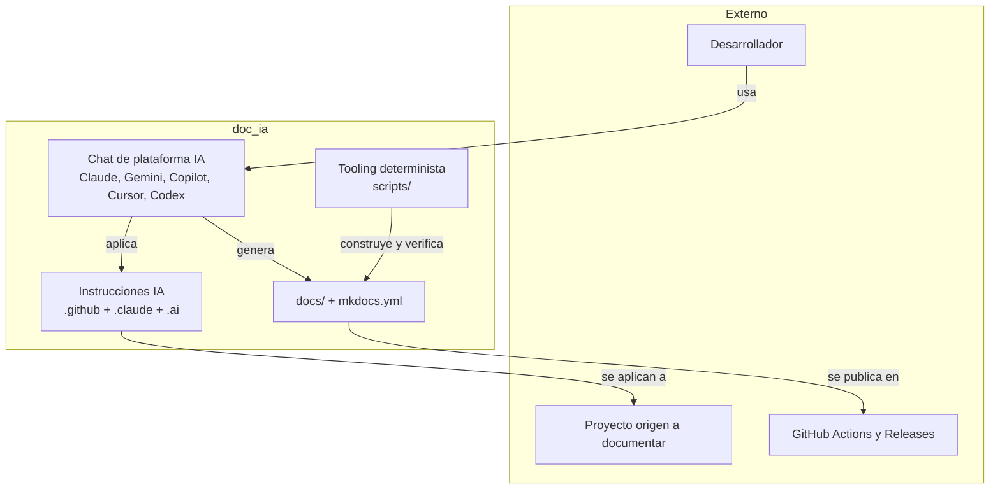
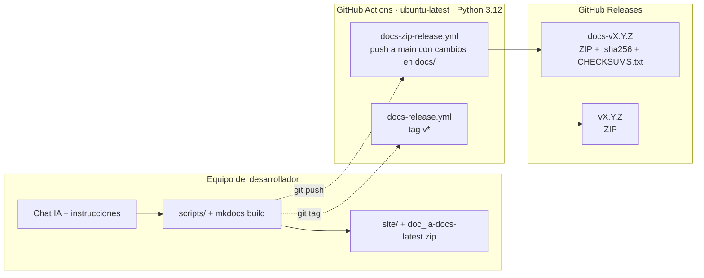

# Arquitectura del Sistema

Vista panorámica de doc_ia (modelo arc42-lite + C4). Las decisiones puntuales con
trade-offs se registran como ADR en la sección Arquitectura.

## 1. Visión General y Objetivos de Calidad

doc_ia es un proyecto de **tooling plano** (sin librería de negocio, sin `src/`, sin
servidor): scripts deterministas + documentación + sistema de instrucciones IA
multiplataforma. La generación documental ocurre **en el chat** de la plataforma IA;
el código Python solo construye, valida y empaqueta.

Objetivos de calidad: determinismo del tooling, cero credenciales, validación estricta
del sitio (`--strict`), trazabilidad de sesiones (`.ai/sessions/`).

## 2. Mapa de Módulos (Building Blocks)

| Carpeta | Responsabilidad |
|---|---|
| `scripts/` | Tooling determinista standalone: `check_env.py`, `build_docs_zip.py`, `convert_to_md.py`, `doc_trace.py`, `start-server.py` |
| `hooks/` | `sync_root_docs.py`: copia CHANGELOG.md / CONTRIBUTING.md a docs/ (hook MkDocs + PostToolUse) |
| `mkdocs_hooks.py` | Hook MkDocs nativo: genera `doc_ia-docs-latest.zip` + SHA256 en `site/` en cada build |
| `tests/` | Tests pytest del tooling (importan `scripts/` vía `sys.path`) |
| `docs/` + `mkdocs.yml` | Sitio MkDocs Material (este sitio, 33 páginas); `mkdocs.yml` es fuente única de navegación |
| `.github/` | Canónico (`SHARED_INSTRUCTIONS.md`), 12 agentes, 26 prompts, 3 instructions, 2 workflows CI |
| `.claude/` | 9 slash commands, hooks PostToolUse (sync_root_docs, ruff, mypy, pytest), plantillas |
| `.ai/` | Contexto persistente (product, architecture, glossary, runtime, standards) + sesiones trazadas |

Regla de capas: `scripts/` no importa de `docs/` ni `.github/`; `hooks/` no importa de
`scripts/`; los entry points de plataforma dependen del canónico, nunca entre sí.

## 3. Flujo en Ejecución (Runtime) y Despliegue

### Runtime

Operación típica — documentar un proyecto con `/document-project`:

```mermaid
flowchart LR
    accTitle: Operación típica de doc_ia
    accDescr: Resumen del flujo document-project: el usuario lo invoca desde el chat, se validan los parámetros, se clasifica y prepara el destino, se inventaría, se genera por arquetipos, se revisa y se cierra la sesión.
    A[Usuario en chat IA] -- invoca --> B[document-project<br/>valida 4 parámetros]
    B --> C[Clasificación y<br/>sincronización visual]
    C --> D[Inventario<br/>y PLAN_DOC]
    D --> E[Generación<br/>por arquetipos]
    E --> F[Navegación, revisión<br/>y build opcional]
    F --> G[Cierre de sesión<br/>y commit]
```

El detalle está en dos vistas: la del usuario en
[Documentar un Proyecto](functional/document_project.md#3-flujo-principal) y la máquina de fases
interna en [document_project (técnica)](api/document_project.md#1-arquitectura-y-diseno).

### Despliegue

doc_ia no se despliega como servicio: se ejecuta en local (chat IA + scripts) y publica su
documentación como ZIP offline en GitHub Releases mediante dos workflows.

| Entorno | Infraestructura | Componentes / artefactos | Fuente |
|---|---|---|---|
| Local | Python ≥ 3.12 + venv; chat de plataforma IA | `site/`, `site/doc_ia-docs-latest.zip` + `.sha256`, `dist/doc_ia-docs-{versión}.zip` | `mkdocs_hooks.py::on_post_build`, `scripts/build_docs_zip.py::main` |
| CI — calidad | GitHub Actions `ubuntu-latest`, Python 3.12 y 3.14 | ruff, mypy, pytest, `doc_trace` (drift bloqueante, matrix, llms), build `--strict` con MkDocs y build de paridad con Zensical (no bloqueante) en cada push/PR a `develop` y `main` | `.github/workflows/ci.yml::quality` |
| CI — ZIP de docs | GitHub Actions `ubuntu-latest`, Python 3.12 | Build `--strict`, artifact de 30 días, release `docs-v{versión}` | `.github/workflows/docs-zip-release.yml::build-and-publish` |
| CI — release de versión | GitHub Actions `ubuntu-latest`, Python 3.12 | ZIP adjunto a la release del tag `v*` | `.github/workflows/docs-release.yml::build-and-upload` |
| Sitio web | No se publica (decisión 2026-10-28) | `site_url` solo da la URL canónica del sitemap y de los enlaces de `llms.txt`; la distribución oficial es el ZIP offline | `mkdocs.yml::site_url` |

## 4. Conceptos Transversales y Estándares No Funcionales

| Dimensión | Mecanismo real en el repositorio |
|---|---|
| Seguridad | Sin API keys ni credenciales (`.gitignore` bloquea `.env`, `*.key`); el código nunca invoca servicios IA |
| Observabilidad | Salida por stdout con prefijos + códigos de retorno (`0`/`≠0`) aptos para CI y hooks |
| Rendimiento | Build incremental de MkDocs; ZIP por `shutil.make_archive`; sin servicios pesados |
| Compatibilidad | MkDocs Material por defecto; Zensical recíproco sobre el mismo `mkdocs.yml` (ver ADR-001), con build de paridad en CI y propuesta de pasar a ser el defecto (ADR-003) |
| Robustez/Errores | Fail-fast con `sys.exit` y mensajes explícitos; build estricto bloquea docs rotas |
| Tipado/Calidad | `mypy --strict` sobre `scripts/`, `ruff` lint+format, pytest determinista, hooks PostToolUse |

**Escenarios de calidad** (arc42 §10):

| Objetivo | Estímulo | Respuesta esperada | Mecanismo / evidencia |
|---|---|---|---|
| Validación estricta | Un enlace roto en `docs/` llega a `main` | El build termina con código ≠ 0 y no se publica release | `docs-zip-release.yml` (paso `mkdocs build --strict`) |
| Determinismo del tooling | Falta una herramienta obligatoria en el entorno | `check_env.py` imprime las ausentes y devuelve `1` | `scripts/check_env.py::main` |
| Cero credenciales | Se crea un `.env` o un `*.key` en el repositorio | Git lo ignora; no llega al remoto | `.gitignore` (`.env`, `.env.*`, `*.key`) |
| Integridad de la distribución | Un usuario descarga el ZIP offline | `sha256sum -c` coincide con el `.sha256` publicado | `scripts/build_docs_zip.py::_create_checksum_files` |
| Trazabilidad de sesiones | Se cierra una sesión de trabajo | Existe `.ai/sessions/<id>/TRACEABILITY.md` y fila en `INDEX.md` | Instrucciones de cierre (sin verificación automática) ⚠️ |

## 5. Decisiones, Extensión y Límites

- **Registro de decisiones**: [ADR-001 — MkDocs Material por defecto](adr/ADR-001-mkdocs-material-por-defecto.md) ·
  [ADR-002 — Arquetipos con evidencia verificable](adr/ADR-002-arquetipos-con-evidencia.md) ·
  [ADR-003 — Zensical por defecto (propuesto)](adr/ADR-003-zensical-por-defecto.md).
- **Extensión soportada**: añadir un arquetipo (prompt nuevo en `.github/prompts/` +
  registro en `DOCUMENTATION_STANDARD.md`), un agente (`.github/agents/` + `AGENTS.md`),
  un slash command (`.claude/commands/` + tabla en `CLAUDE.md`) o un script determinista
  en `scripts/` con sus tests.
- **Anti-patrones (límites)**: incrustar API keys; añadir componentes programáticos que
  invoquen IA; generar documentación fuera del chat; duplicar reglas del canónico en los
  entry points.
