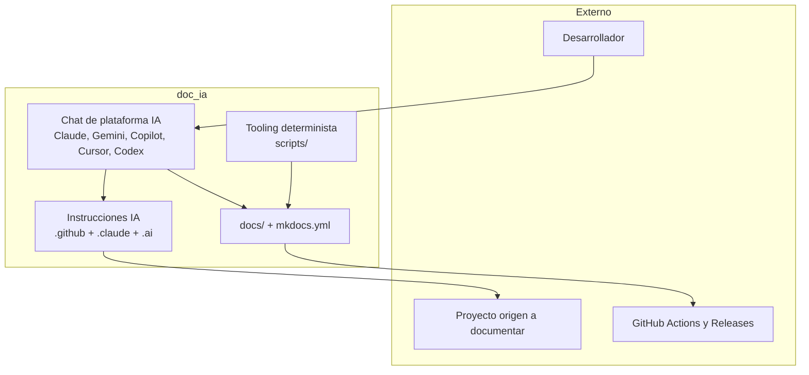
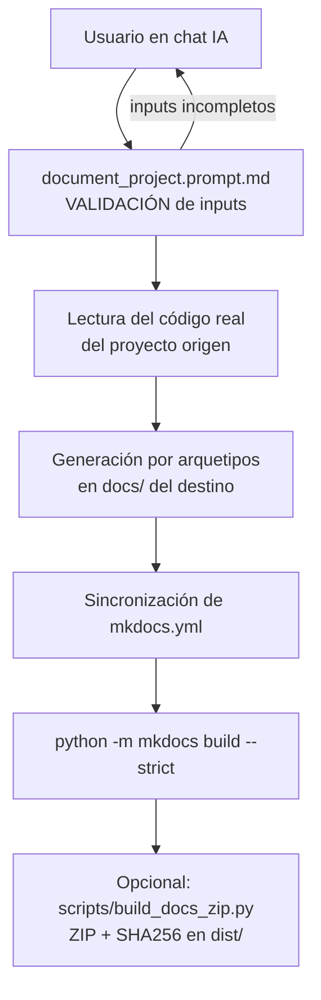

# Arquitectura del Sistema

Vista panorámica de doc_ia (modelo arc42-lite + C4). Las decisiones puntuales con
trade-offs se registran como ADR en la sección Arquitectura.

## 1. Visión General y Objetivos de Calidad

doc_ia es un proyecto de **tooling plano** (sin librería de negocio, sin `src/`, sin
servidor): scripts deterministas + documentación + sistema de instrucciones IA
multiplataforma. La generación documental ocurre **en el chat** de la plataforma IA;
el código Python solo construye, valida y empaqueta.

Objetivos de calidad: determinismo del tooling, cero credenciales, validación estricta
del sitio (`--strict`), trazabilidad de sesiones (`.ai/sessions/`).

## 2. Mapa de Módulos (Building Blocks)

| Carpeta | Responsabilidad |
|---|---|
| `scripts/` | Tooling determinista standalone: `check_env.py`, `build_docs_zip.py` |
| `tests/` | Tests pytest del tooling (importan `scripts/` vía `sys.path`) |
| `docs/` + `mkdocs.yml` | Sitio MkDocs Material (este sitio); `mkdocs.yml` es fuente única |
| `.github/` | Canónico (`SHARED_INSTRUCTIONS.md`), 12 agentes, 20 prompts, instructions, workflows CI |
| `.claude/` | 9 slash commands, hooks PostToolUse (ruff, mypy, pytest), plantillas |
| `.ai/` | Contexto persistente para agentes + sesiones trazadas |

Regla de capas: `scripts/` no importa de `docs/` ni `.github/`; los entry points de
plataforma dependen del canónico, nunca entre sí.

## 3. Flujo en Ejecución (Runtime)

Operación típica — documentar un proyecto con `/document-project`:

## 4. Conceptos Transversales y Estándares No Funcionales

| Dimensión | Mecanismo real en el repositorio |
|---|---|
| Seguridad | Sin API keys ni credenciales (`.gitignore` bloquea `.env`, `*.key`); el código nunca invoca servicios IA |
| Observabilidad | Salida por stdout con prefijos + códigos de retorno (`0`/`≠0`) aptos para CI y hooks |
| Rendimiento | Build incremental de MkDocs; ZIP por `shutil.make_archive`; sin servicios pesados |
| Compatibilidad | MkDocs Material por defecto; Zensical recíproco sobre el mismo `mkdocs.yml` (ver ADR-001) |
| Robustez/Errores | Fail-fast con `sys.exit` y mensajes explícitos; build estricto bloquea docs rotas |
| Tipado/Calidad | `mypy --strict` sobre `scripts/`, `ruff` lint+format, pytest determinista, hooks PostToolUse |

## 5. Decisiones, Extensión y Límites

- **Registro de decisiones**: [ADR-001 — MkDocs Material por defecto](adr/ADR-001-mkdocs-material-por-defecto.md).
- **Extensión soportada**: añadir un arquetipo (prompt nuevo en `.github/prompts/` +
  registro en `DOCUMENTATION_STANDARD.md`), un agente (`.github/agents/` + `AGENTS.md`),
  un slash command (`.claude/commands/` + tabla en `CLAUDE.md`) o un script determinista
  en `scripts/` con sus tests.
- **Anti-patrones (límites)**: incrustar API keys; añadir componentes programáticos que
  invoquen IA; generar documentación fuera del chat; duplicar reglas del canónico en los
  entry points.
