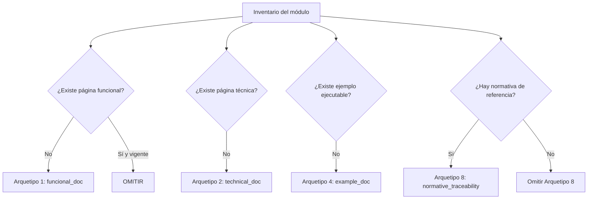

# Arquetipos Formales de Documentación

## 1. Descripción General

doc_ia define ocho arquetipos formales de documentación: plantillas con estructura
fija, audiencia definida y ubicación establecida. Cada arquetipo responde a una
pregunta diferente sobre el proyecto (qué hace, cómo funciona, cómo se usa, cómo se
implementa, por qué se decidió así, etc.) y garantiza que cualquier proyecto
documentado con doc_ia produce un conjunto de páginas coherente y auditable.

Los arquetipos se aplican a través de prompts individuales en `.github/prompts/` y
son orquestados por el flujo `/document-project`, que asigna automáticamente el
arquetipo correcto a cada módulo detectado durante el inventario. También se pueden
aplicar de forma individual a un único módulo o sección, sin invocar el flujo completo.

## 2. Reglas de Negocio

| Regla | Descripción | Impacto si se viola |
|---|---|---|
| Estructura fija | Cada arquetipo tiene secciones numeradas obligatorias que no se pueden omitir; si una sección no aplica, se escribe `*No aplica para este módulo.*` | Documentación incompleta, no auditable |
| Audiencia diferenciada | Cada arquetipo está diseñado para una audiencia específica (Product Owner, desarrollador, usuario final, etc.) | Mezcla de contenido técnico y funcional que dificulta la navegación |
| Ubicación canónica | Cada arquetipo tiene una carpeta de destino fija en `docs/` | Navegación rota, entradas de `mkdocs.yml` inconsistentes |
| Enlace bidireccional | El Arquetipo 2 (técnica, §5) debe enlazar al Arquetipo 4 (ejemplos, §5) y viceversa | Rompe la trazabilidad entre la referencia técnica y los ejemplos ejecutables |
| Arquetipo 8 condicional | La trazabilidad normativa solo se genera si el proyecto origen referencia normativa de obligado cumplimiento; si no, se omite | Generación innecesaria de páginas vacías o sin valor en proyectos sin normativa |

## 3. Casos de Uso

### Flujo principal — selección de arquetipo en el inventario

### Arquetipos disponibles

| Arquetipo | Pregunta que responde | Audiencia | Ubicación | Prompt |
|---|---|---|---|---|
| **1 — Funcional** | ¿Qué hace y por qué? | Product Owner, QA | `docs/functional/` | `functional_doc.prompt.md` |
| **2 — Técnica/API** | ¿Cómo funciona internamente? | Desarrolladores | `docs/api/` | `technical_doc.prompt.md` |
| **3 — Guía de Usuario** | ¿Cómo se usa/instala/opera? | Usuarios, operadores | `docs/guides/` | `guide_doc.prompt.md` |
| **4 — Ejemplos de Código** | ¿Cómo se implementa? | Desarrolladores | `docs/examples/` | `example_doc.prompt.md` |
| **5 — ADR** | ¿Por qué se decidió así? | Equipo técnico, arquitectos | `docs/adr/` | `architecture_doc.prompt.md` |
| **6 — Navegación Principal** | Intro + instalación + visión | Todos | `docs/index.md`, `installation.md`, `architecture.md` | `landing_doc.prompt.md` |
| **7 — Onboarding** | ¿Cómo me incorporo como desarrollador? | Nuevos contribuidores | `docs/guides/onboarding_dev.md` | `onboarding_dev.prompt.md` |
| **8 — Trazabilidad Normativa** | ¿Qué normativa aplica? (condicional) | Auditores, equipos de compliance | `docs/` (posición variable) | `normative_traceability.prompt.md` |

### Flujos alternativos

- **Módulo sin ejemplos ejecutables**: el Arquetipo 2 §5 incluye un marcador
  "Pendiente — crear ejemplo en docs/examples/..." en lugar de dejar la sección vacía.
- **Arquetipos parametrizables**: en doc_ia los arquetipos son también **producto**: se
  aplican pasando origen y destino como parámetros, generando documentación para proyectos
  externos.

## 4. Criterios de Aceptación

| ID | Dado | Cuando | Entonces |
|---|---|---|---|
| AC-01 | Un proyecto sin documentación previa | Se aplica el flujo completo de arquetipos | Cada módulo tiene al menos Arquetipo 1 + 2 + 4; las secciones vacías contienen `*No aplica*` |
| AC-02 | Un módulo con Arquetipo 2 generado | Se verifica la presencia del enlace bidireccional | La sección §5 del Arquetipo 2 enlaza a la página de ejemplos del módulo (o tiene el marcador de pendiente) |
| AC-03 | Un proyecto sin normativa de referencia | Se ejecuta la Fase 0 del inventario | El Arquetipo 8 no se genera ni aparece en `mkdocs.yml` |
| AC-04 | Cualquier arquetipo generado con sección vacía | Se revisa el documento | La sección vacía contiene `*No aplica para este módulo.*` y no se omite |

Verificación: `python -m mkdocs build --strict` sin warnings tras generar cualquier arquetipo.

## 5. Glosario y Términos

| Término | Definición |
|---|---|
| Arquetipo | Plantilla de documentación con estructura fija, audiencia definida y ubicación establecida en `docs/` |
| Sección fija | Sección obligatoria del arquetipo que no se puede omitir aunque esté vacía |
| Enlace bidireccional | Par de referencias cruzadas entre el Arquetipo 2 (técnica §5) y el Arquetipo 4 (ejemplos §5) |
| Arquetipo condicional | Arquetipo que solo se aplica si se cumple una condición específica (el Arquetipo 8 requiere normativa en el origen) |
| Origen | Proyecto cuyo código es la fuente de verdad para generar la documentación |
