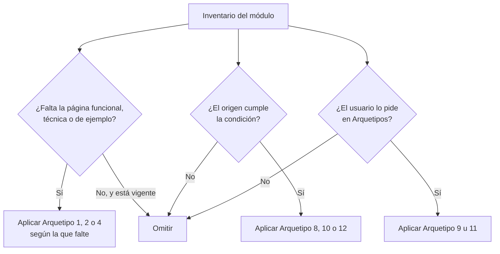

# Arquetipos Formales de Documentación

## 1. Objetivo y Descripción

doc_ia define doce arquetipos formales de documentación (más la variante 3b): plantillas
con estructura fija, audiencia definida y ubicación establecida. Cada arquetipo responde a
una pregunta diferente sobre el proyecto (qué hace, cómo funciona, cómo se usa, cómo se
implementa, por qué se decidió así, etc.) y garantiza que cualquier proyecto documentado
con doc_ia produce un conjunto de páginas coherente y auditable.

Los arquetipos 1–8 son la base; 3b y 9–11 son las adiciones de 2024-2025 (Diátaxis,
Keep a Changelog, Config Agente IA, Guía de Contribución). El 12 (Referencia del Sistema) y la
regla de evidencia verificable son las adiciones de 2026: cada afirmación importante indica de
qué parte del código sale y con qué grado de confianza.

Los arquetipos se aplican a través de prompts individuales en `.github/prompts/` y
son orquestados por el flujo `/document-project`, que asigna automáticamente el
arquetipo correcto a cada módulo detectado durante el inventario. También se pueden
aplicar de forma individual a un único módulo o sección, sin invocar el flujo completo.

## 2. Precondiciones

- Acceso al repositorio doc_ia desde una plataforma IA (los prompts de arquetipo viven en
  `.github/prompts/`).
- **Aplicación individual**: el módulo o componente a documentar (legible en el workspace),
  la ruta de destino dentro de la carpeta canónica del arquetipo y el idioma.
- **Aplicación orquestada**: los cuatro parámetros de [Documentar un Proyecto](document_project.md).
- **Arquetipos 9 y 11**: petición explícita en el parámetro `Arquetipos`.
- **Arquetipos 8 y 12**: que el origen cumpla su condición de activación (normativa de
  referencia; configuración, comandos, códigos de salida, eventos o interfaces publicadas).

## 3. Flujo Principal

Durante el inventario, cada módulo se evalúa en tres grupos: si le falta la página funcional,
técnica o de ejemplos, se aplica el arquetipo correspondiente; si ya existe y está vigente, se
omite. Los arquetipos condicionales (8, 10 y 12) solo se aplican cuando el origen cumple su
condición, y los opt-in (9 y 11) solo cuando el usuario los pide. La condición de cada uno:

| Arquetipo | Se aplica cuando | Si no se cumple |
|---|---|---|
| 1 — Funcional | Falta la página funcional del módulo | Se omite si existe y está vigente |
| 2 — Técnica | Falta la página técnica del módulo | Se omite si existe y está vigente |
| 4 — Ejemplos | Falta un ejemplo ejecutable del módulo | Se omite si existe y está vigente |
| 8 — Normativa | El origen tiene normativa de referencia | Se omite |
| 9 — Changelog | El parámetro Arquetipos incluye `changelog` | Se omite |
| 10 — Config IA | El proyecto tiene agentes IA configurados sin documentar | Se omite |
| 11 — Contribución | El parámetro Arquetipos incluye `contribución` | Se omite |
| 12 — Referencia | El origen expone configuración, CLI, códigos de salida o interfaces | Se omite |

### Arquetipos disponibles

| Arquetipo | Pregunta que responde | Audiencia | Ubicación | Prompt |
|---|---|---|---|---|
| **1 — Funcional** | ¿Qué hace y por qué? | Product Owner, QA | `docs/functional/` | `functional_doc.prompt.md` |
| **2 — Técnica/API** | ¿Cómo funciona internamente? | Desarrolladores | `docs/api/` | `technical_doc.prompt.md` |
| **3a — How-to** | ¿Cómo resuelvo esta tarea concreta? | Usuarios, operadores | `docs/guides/*_howto.md` | `howto_doc.prompt.md` |
| **3b — Tutorial** | ¿Cómo aprendo esto paso a paso? | Usuarios nuevos en el área | `docs/guides/*_tutorial.md` | `tutorial_doc.prompt.md` |
| **4 — Ejemplos de Código** | ¿Cómo se implementa? | Desarrolladores | `docs/examples/` | `example_doc.prompt.md` |
| **5 — ADR / MADR 4.0** | ¿Por qué se decidió así? | Equipo técnico, arquitectos | `docs/adr/` | `architecture_doc.prompt.md` |
| **6 — Navegación Principal** *(Var. A/B/C/D)* | Intro + instalación + visión + quick start | Todos | `docs/index.md`, `installation.md`, `architecture.md`, `quickstart.md` | `landing_doc.prompt.md` |
| **7 — Onboarding** | ¿Cómo me incorporo como desarrollador? | Nuevos contribuidores | `docs/guides/onboarding_dev.md` | `onboarding_dev.prompt.md` |
| **8 — Trazabilidad Normativa** | ¿Qué normativa aplica? (condicional) | Auditores, equipos de compliance | `docs/normativa/` | `normative_traceability.prompt.md` |
| **9 — Changelog** *(opt-in)* | ¿Qué cambió en cada versión? | Usuarios, QA, ops | `CHANGELOG.md` (raíz) | `changelog.prompt.md` |
| **10 — Config Agente IA** | ¿Cómo está configurado el agente IA? | Desarrolladores, auditores IA | `docs/ai-config/` | `ai_config_doc.prompt.md` |
| **11 — Guía de Contribución** *(opt-in)* | ¿Cómo contribuyo al proyecto? | Contribuidores externos | `CONTRIBUTING.md` (raíz) | `contributing_doc.prompt.md` |
| **12 — Referencia del Sistema** *(condicional)* | ¿Qué configuración, comandos y códigos expone? | Usuarios, operadores, integradores | `docs/reference/` | `reference_doc.prompt.md` |

## 4. Postcondiciones y Efectos

- Cada arquetipo aplicado produce un fichero Markdown en su ubicación canónica con todas
  sus secciones numeradas; las que no tienen contenido llevan `*No aplica para este módulo.*`.
- Las páginas de los Arquetipos 1, 2 y 12 terminan con el bloque plegable "Evidencia".
- La navegación del sitio (`mkdocs.yml`) incluye cada página nueva bajo su sección.
- Los Arquetipos 9 y 11 escriben en la raíz del repositorio (`CHANGELOG.md`,
  `CONTRIBUTING.md`); en doc_ia una copia sincronizada se publica además en `docs/`.
- Si el proyecto tiene varias páginas funcionales, existe además el Mapa Funcional
  (`docs/functional/index.md`, variante 1-I del Arquetipo 1).

## 5. Reglas de Negocio

| Regla | Descripción | Impacto si se viola |
|---|---|---|
| Estructura fija | Cada arquetipo tiene secciones numeradas obligatorias que no se pueden omitir; si una sección no aplica, se escribe `*No aplica para este módulo.*` | Documentación incompleta, no auditable |
| Audiencia diferenciada | Cada arquetipo está diseñado para una audiencia específica (Product Owner, desarrollador, usuario final, etc.) | Mezcla de contenido técnico y funcional que dificulta la navegación |
| Ubicación canónica | Cada arquetipo tiene una carpeta de destino fija en `docs/` | Navegación rota, entradas de `mkdocs.yml` inconsistentes |
| Enlace bidireccional | El Arquetipo 2 (técnica, §5) debe enlazar al Arquetipo 4 (ejemplos, §5) y viceversa | Rompe la trazabilidad entre la referencia técnica y los ejemplos ejecutables |
| Arquetipo 8 condicional | La trazabilidad normativa solo se genera si el proyecto origen referencia normativa de obligado cumplimiento; si no, se omite | Generación innecesaria de páginas vacías o sin valor en proyectos sin normativa |
| Arquetipo 12 condicional | La Referencia del Sistema solo se genera si el proyecto expone configuración, comandos, códigos de salida, eventos o interfaces publicadas | Páginas de referencia vacías en librerías sin superficie de usuario |
| Evidencia verificable | Las páginas funcionales, técnicas y de referencia terminan con un bloque plegable "Evidencia" que indica el origen de cada regla, contrato o criterio y su grado de confianza (✅ ⚠️ 🔍 ❌), y declaran al principio de qué ficheros derivan, con una huella que permite detectar cuándo esos ficheros cambian | Afirmaciones imposibles de auditar; lo inferido se confunde con lo verificado |
| Diagramas conformes | Cada diagrama declara título y descripción accesibles, no supera 12 nodos (8 en las páginas de navegación), muestra la perspectiva de su arquetipo sin repetir el de otra página y se sustituye por una tabla cuando no hay flujo | Diagramas ilegibles, inaccesibles para lectores de pantalla o duplicados que divergen al mantenerlos |
| Arquetipos 9 y 11 opt-in | Changelog (9) y Guía de Contribución (11) **no se generan por defecto** en `/document-project`; deben solicitarse explícitamente con el parámetro `Arquetipos: changelog` o `Arquetipos: contribución` | Generación de CHANGELOG.md y CONTRIBUTING.md sin que el usuario los haya pedido |

## 6. Límites, Flujos Alternativos y Casos Especiales

### Qué NO hace esta funcionalidad

- No genera contenido de forma programática: los prompts se ejecutan en el chat.
- No inventa secciones, capacidades ni contenido sin respaldo en el origen.
- No aplica los Arquetipos 8 y 12 sin su condición de activación, ni los 9 y 11 sin petición.
- No mezcla how-to y tutorial en el mismo fichero.

### Flujos alternativos

- **Módulo sin ejemplos ejecutables**: el Arquetipo 2 §5 incluye un marcador
  "Pendiente — crear ejemplo en docs/examples/..." en lugar de dejar la sección vacía.
- **Arquetipos parametrizables**: en doc_ia los arquetipos son también **producto**: se
  aplican pasando origen y destino como parámetros, generando documentación para proyectos
  externos.
- **Aplicación individual**: un arquetipo se puede aplicar a un único módulo o página sin
  invocar el flujo completo (ver [Aplicar Arquetipos Individualmente](../examples/archetypes_usage.md)).

### Casos especiales

- **Páginas en estructura anterior**: las páginas funcionales generadas con la estructura de
  5 secciones siguen siendo válidas en transición y se migran a las 8 secciones al
  actualizarse.
- **ADR en dos formatos**: el Arquetipo 5 admite formato completo (decisiones con varias
  alternativas y trade-offs) o mínimo (Contexto, Decisión, Consecuencias).
- **Navegación principal en cuatro variantes**: el Arquetipo 6 usa una plantilla distinta para
  Inicio (A), Instalación (B), Arquitectura (C) y Quick Start (D).

## 7. Criterios de Aceptación

| ID | Dado | Cuando | Entonces | Test |
|---|---|---|---|---|
| AC-01 | Un proyecto sin documentación previa | Se aplica el flujo completo de arquetipos | Cada módulo tiene al menos Arquetipo 1 + 2 + 4; las secciones vacías contienen `*No aplica*` | `tests/test_docs_conformance.py::test_every_script_has_functional_technical_and_example_pages` |
| AC-02 | Un módulo con Arquetipo 2 generado | Se verifica la presencia del enlace bidireccional | La sección §5 del Arquetipo 2 enlaza a la página de ejemplos del módulo (o tiene el marcador de pendiente) | `tests/test_docs_conformance.py::test_api_and_example_link_both_ways` |
| AC-03 | Un proyecto sin normativa de referencia | Se ejecuta la Fase 0 del inventario | El Arquetipo 8 no se genera ni aparece en `mkdocs.yml` | `tests/test_docs_conformance.py::test_no_normative_archetype_without_normative` |
| AC-04 | Cualquier arquetipo generado con sección vacía | Se revisa el documento | La sección vacía contiene `*No aplica para este módulo.*` y no se omite | `tests/test_docs_conformance.py::test_numbered_sections_are_never_empty` |
| AC-05 | Arquetipo 9 solicitado explícitamente (`Arquetipos: ..., changelog`) | Se ejecuta `/document-project` | `CHANGELOG.md` existe en raíz con Keep a Changelog v1.1.0 y sección `[Unreleased]`; si **no** se solicita, no se genera aunque el proyecto tenga releases | `tests/test_docs_conformance.py::test_changelog_follows_keep_a_changelog` |
| AC-06 | Proyecto con ≥1 plataforma IA configurada | Se ejecuta el inventario | Existe al menos un fichero en `docs/ai-config/` con las 7 secciones obligatorias del Arquetipo 10 | `tests/test_docs_conformance.py::test_ai_config_has_seven_sections` |
| AC-07 | Arquetipo 11 solicitado explícitamente (`Arquetipos: ..., contribución`) | Se ejecuta `/document-project` | `CONTRIBUTING.md` existe en raíz con las 6 secciones obligatorias del Arquetipo 11; si **no** se solicita, no se genera aunque el proyecto acepte contribuciones | `tests/test_docs_conformance.py::test_contributing_has_six_sections` |
| AC-08 | Arquetipo 3a (how-to) vs. 3b (tutorial) | Se selecciona el arquetipo | El fichero de destino usa `_howto.md` o `_tutorial.md` según corresponda; nunca los dos tipos mezclados en el mismo fichero | `tests/test_docs_conformance.py::test_guides_naming_convention` |
| AC-09 | Proyecto con CLI o variables de entorno | Se ejecuta `/document-project` | Existe `docs/reference/index.md` con las 6 secciones del Arquetipo 12 y la entrada "Referencia del Sistema" en `mkdocs.yml`; en una librería sin superficie de usuario no se genera | `tests/test_docs_conformance.py::test_reference_follows_archetype_12` |
| AC-10 | Página de Arquetipo 1, 2 o 12 generada | Se revisa el documento | Termina con el bloque plegable "Evidencia"; cada regla, contrato y criterio tiene fila con su fuente y su confianza | `tests/test_docs_conformance.py::test_functional_pages_follow_archetype_1`, `tests/test_docs_conformance.py::test_api_pages_follow_archetype_2`, `tests/test_docs_conformance.py::test_reference_follows_archetype_12` |
| AC-11 | Diagrama Mermaid con `@`, `(`, `)`, `{` o `}` en una etiqueta | Se genera el bloque | La etiqueta va entre comillas dobles y no contiene entidades HTML (`&#40;`), que Mermaid pintaría con un `&` sobrante | `tests/test_docs_conformance.py::test_mermaid_no_html_entities`, `tests/test_docs_conformance.py::test_mermaid_special_chars_quoted` |
| AC-12 | Diagrama Mermaid en cualquier página | Se genera o rediseña | Tiene como máximo 12 nodos, y 8 en las páginas del Arquetipo 6; si no hay flujo, se usa una tabla | `tests/test_docs_conformance.py::test_mermaid_max_nodes` |
| AC-13 | Diagrama Mermaid en cualquier página | Se genera el bloque | Declara `accTitle` y `accDescr` justo después del tipo, para que el SVG tenga título y descripción accesibles | `tests/test_docs_conformance.py::test_mermaid_has_accessibility` |

Verificación: `python -m mkdocs build --strict` sin warnings tras generar cualquier arquetipo.
Los arquetipos se aplican en el chat y no tienen tests automatizados.

Los tests verifican el **resultado** sobre la documentación de doc_ia (dogfooding): comprueban que un proyecto documentado con los arquetipos cumple cada criterio, no ejecutan el flujo `/document-project`, que ocurre en el chat ⚠️.

## 8. Glosario de Dominio

| Término | Definición |
|---|---|
| Arquetipo | Plantilla de documentación con estructura fija, audiencia definida y ubicación establecida en `docs/` |
| Sección fija | Sección obligatoria del arquetipo que no se puede omitir aunque esté vacía |
| Enlace bidireccional | Par de referencias cruzadas entre el Arquetipo 2 (técnica §5) y el Arquetipo 4 (ejemplos §5) |
| Arquetipo condicional | Arquetipo que solo se aplica si se cumple una condición específica (el 8 requiere normativa en el origen; el 12, superficie de usuario) |
| Arquetipo opt-in | Arquetipo que solo se genera si el usuario lo pide explícitamente (9 y 11) |
| Origen | Proyecto cuyo código es la fuente de verdad para generar la documentación |
| Bloque Evidencia | Bloque plegable final, sin número de sección, que lista la fuente y la confianza de cada afirmación de las páginas de los Arquetipos 1, 2 y 12 |
| Leyenda de confianza | ✅ verificado · ⚠️ parcial · 🔍 inferido · ❌ gap |
| Mapa Funcional | Variante índice del Arquetipo 1 que resume las capacidades, recorridos y glosario de todo el sistema |

??? note "Evidencia"

    | Elemento | Fuente | Confianza |
    |---|---|---|
    | Regla «Estructura fija» | `.github/DOCUMENTATION_STANDARD.md::3.1` (Regla de sección vacía) | ✅ |
    | Regla «Audiencia diferenciada» | `.github/DOCUMENTATION_STANDARD.md::3.1`–`3.15` (campo Audiencia) | ✅ |
    | Regla «Ubicación canónica» | `.github/DOCUMENTATION_STANDARD.md::3.1`–`3.15` (campo Ubicación) | ✅ |
    | Regla «Enlace bidireccional» | `.github/DOCUMENTATION_STANDARD.md::3.2` y `::3.4` (§5 obligatorio) | ✅ |
    | Regla «Arquetipo 8 condicional» | `.github/DOCUMENTATION_STANDARD.md::3.8` (Condición de activación) | ✅ |
    | Regla «Arquetipo 12 condicional» | `.github/DOCUMENTATION_STANDARD.md::3.15` (Condición de activación) | ✅ |
    | Regla «Evidencia verificable» | `.github/DOCUMENTATION_STANDARD.md::3.16` | ✅ |
    | Regla «Diagramas conformes» | `.github/DOCUMENTATION_STANDARD.md::3.17` | ✅ |
    | Regla «Arquetipos 9 y 11 opt-in» | `.claude/commands/document-project.md::Inputs requeridos` (Arquetipos) | ✅ |
    | Postcondición «copia sincronizada en `docs/`» | `hooks/sync_root_docs.py::PAIRS` | ✅ |
    | Postcondición «Mapa Funcional» | `.github/DOCUMENTATION_STANDARD.md::3.1` (Variante 1-I) | ✅ |
    | Caso «páginas en estructura anterior» | `.github/DOCUMENTATION_STANDARD.md::3.1` (Cambio respecto a v1) | ✅ |
    | Caso «ADR en dos formatos» | `.github/DOCUMENTATION_STANDARD.md::3.5` (Formatos disponibles) | ✅ |
    | AC-01 | `.github/DOCUMENTATION_STANDARD.md::7. Cómo Proceder` (Criterio de Completitud) | 🔍 |
    | AC-02 | `.github/DOCUMENTATION_STANDARD.md::3.2` (§5 Ejemplos Relacionados) | ✅ |
    | AC-03 | `.github/DOCUMENTATION_STANDARD.md::3.8` (Condición de activación) | ✅ |
    | AC-04 | `.github/DOCUMENTATION_STANDARD.md::3.1` (Regla de sección vacía) | ✅ |
    | AC-05 | `.github/DOCUMENTATION_STANDARD.md::3.12` + `.claude/commands/document-project.md::Inputs requeridos` | ✅ |
    | AC-06 | `.github/DOCUMENTATION_STANDARD.md::3.13` (7 secciones) | ✅ |
    | AC-07 | `.github/DOCUMENTATION_STANDARD.md::3.14` (6 secciones) + `.claude/commands/document-project.md::Inputs requeridos` | ✅ |
    | AC-08 | `.github/DOCUMENTATION_STANDARD.md::3.11` (Reglas, nombre de fichero) | ✅ |
    | AC-09 | `.github/DOCUMENTATION_STANDARD.md::3.15` (6 secciones, sección MkDocs) | ✅ |
    | AC-10 | `.github/DOCUMENTATION_STANDARD.md::3.16` (Revisión) | ✅ |
    | AC-11 | `.github/DOCUMENTATION_STANDARD.md::3.17` (Etiquetas) | ✅ |
    | AC-12 | `.github/DOCUMENTATION_STANDARD.md::3.17` (Tamaño) | ✅ |
    | AC-13 | `.github/DOCUMENTATION_STANDARD.md::3.17` (Accesibilidad) | ✅ |
