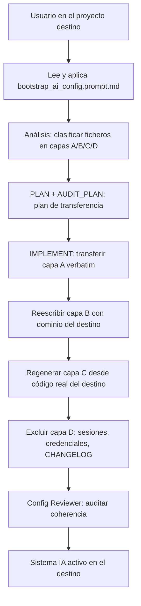

# Bootstrap de Configuración IA Multiplataforma

## 1. Descripción General

El bootstrap de configuración IA traslada el sistema de instrucciones de doc_ia a un
proyecto destino de cualquier lenguaje y arquitectura. El resultado es que el proyecto
destino hereda las plataformas IA (Claude Code, Gemini Code Assist, GitHub Copilot Chat,
Cursor y Codex), los agentes, los slash commands y los prompts de generación documental,
adaptados a su dominio específico.

Lo usan equipos que quieren incorporar el método de trabajo asistido por IA de doc_ia a
un proyecto existente, sea un servicio Python, una API en TypeScript, una aplicación en
Go o cualquier otro stack. Su valor está en que la transferencia es ordenada: en lugar de
copiar ficheros sin criterio, el bootstrap clasifica qué se copia verbatim, qué se adapta
y qué se regenera desde el código real del destino.

## 2. Reglas de Negocio

| Regla | Descripción | Impacto si se viola |
|---|---|---|
| Modelo PULL | El bootstrap se invoca desde el proyecto destino apuntando al origen como referencia de solo lectura | Si se lanza desde el origen, la IA no tiene contexto del destino y arrastra suposiciones del stack original |
| Cuatro capas de transferencia | Cada fichero pertenece a una capa (A verbatim, B adaptar, C regenerar, D excluir); la capa determina cómo se transfiere | Confundir capas provoca instrucciones con referencias al stack equivocado o ficheros de sesión copiados innecesariamente |
| Parámetros obligatorios de invocación | Origen, Destino, Lenguaje/arquitectura destino y Plataformas IA activas son necesarios para que el bootstrap funcione correctamente | La adaptación (capas B y C) quedaría anclada al stack de origen |
| Auditoría posterior con Config Reviewer | Tras el bootstrap, el agente Config Reviewer verifica la coherencia de las instrucciones IA generadas | Configuración inconsistente, reglas duplicadas o referencias a módulos inexistentes en el destino |
| Sin modificar el origen | El proyecto origen es de solo lectura durante el bootstrap | Cambios accidentales en doc_ia afectarían a otros proyectos que lo usen como plantilla |

## 3. Casos de Uso

### Flujo principal

### Capas de transferencia

| Capa | Acción | Ejemplos |
|---|---|---|
| **A — Metodología** | Copiar verbatim (revisar comandos embebidos) | `.github/agents/`, `.github/prompts/`, `.claude/commands/`, `.ai/sessions/TEMPLATE/` |
| **B — Especialización** | Copiar + reescribir dominio | `SHARED_INSTRUCTIONS.md`, `CLAUDE.md`, `GEMINI.md`, `copilot-instructions.md`, `.cursorrules` |
| **C — Contexto** | Regenerar analizando el destino desde cero | `.ai/{product,architecture,runtime,glossary,standards}.md` |
| **D — No copiar** | Excluir | `.ai/sessions/<fechas>/`, `CHANGELOG.md`, caches, `settings.local.json` |

### Flujos alternativos

- **Generador de documentación distinto**: si el destino usa Docusaurus, TypeDoc u otro
  generador, se indica como parámetro y la plantilla de `mkdocs.yml` se adapta o se omite.
- **Plataformas IA parciales**: si el equipo destino solo usa Claude Code y Copilot, los
  ficheros de Gemini y Cursor se excluyen del plan de transferencia.
- **Fase parcial**: es posible ejecutar solo PLAN y AUDIT_PLAN para obtener el diagnóstico
  sin realizar la transferencia; útil para estimar esfuerzo antes de comprometerse.

## 4. Criterios de Aceptación

| ID | Dado | Cuando | Entonces |
|---|---|---|---|
| AC-01 | Un proyecto TypeScript sin instrucciones IA | Se ejecuta el bootstrap completo | El destino tiene los cinco entry points IA adaptados al stack TypeScript, sin referencias a Python o MkDocs del origen |
| AC-02 | Un proyecto destino con generador Docusaurus | Se invoca el bootstrap indicando el generador | La plantilla `mkdocs.yml` no se copia; en su lugar se crea o adapta la configuración del generador del destino |
| AC-03 | El bootstrap completado | Se ejecuta Config Reviewer sobre el destino | No hay reglas duplicadas entre `SHARED_INSTRUCTIONS.md` y las especializaciones, y todas las rutas son relativas y portables |
| AC-04 | Ficheros de la capa D presente en el origen | Se ejecuta el bootstrap | Ningún fichero de la capa D se copia al destino |

Verificación: invocar `bootstrap_ai_config.prompt.md` desde el proyecto destino y auditar
con el agente Config Reviewer (`.github/agents/config-reviewer.agent.md`).

## 5. Glosario y Términos

| Término | Definición |
|---|---|
| Modelo PULL | Dirección de invocación del bootstrap: desde el proyecto destino apuntando al origen, no al revés |
| Origen | Repositorio doc_ia que actúa como plantilla de solo lectura durante el bootstrap |
| Destino | Proyecto que recibirá el sistema de instrucciones IA adaptado a su dominio |
| Entry point IA | Fichero leído automáticamente por cada plataforma IA al abrir el proyecto (`CLAUDE.md`, `GEMINI.md`, `copilot-instructions.md`, `.cursorrules`) |
| Config Reviewer | Agente de auditoría que verifica la coherencia de las instrucciones IA tras el bootstrap |
