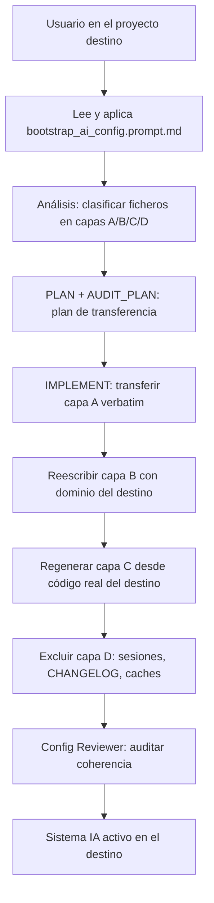

# Bootstrap de Configuración IA Multiplataforma

## 1. Objetivo y Descripción

El bootstrap de configuración IA traslada el sistema de instrucciones de doc_ia a un
proyecto destino de cualquier lenguaje y arquitectura. El resultado es que el proyecto
destino hereda las plataformas IA (Claude Code, Gemini Code Assist, GitHub Copilot Chat,
Cursor y Codex), los agentes, los slash commands y los prompts de generación documental,
adaptados a su dominio específico.

Lo usan equipos que quieren incorporar el método de trabajo asistido por IA de doc_ia a
un proyecto existente, sea un servicio Python, una API en TypeScript, una aplicación en
Go o cualquier otro stack. Su valor está en que la transferencia es ordenada: en lugar de
copiar ficheros sin criterio, el bootstrap clasifica qué se copia verbatim, qué se adapta
y qué se regenera desde el código real del destino.

## 2. Precondiciones

- El proyecto **destino** está abierto en la plataforma IA (el bootstrap se invoca desde él).
- El repositorio doc_ia (origen) es accesible en modo solo lectura.
- Los ocho datos de contexto del bootstrap están completos:
    - ruta del origen y ruta del destino;
    - lenguaje y framework del destino;
    - arquitectura del destino (capas, módulos, patrón);
    - plataformas IA activas;
    - herramientas de calidad del destino (linter, formateador, type-checker, test runner);
    - generador de documentación del destino (o "ninguno");
    - gestor de paquetes o comando de build.

## 3. Flujo Principal

Desde el proyecto destino, el usuario pide aplicar el prompt de bootstrap apuntando a doc_ia.
El asistente clasifica cada activo IA del origen en una de cuatro capas y presenta el plan de
transferencia con su auditoría. Al implementarlo, copia la metodología (capa A) revisando los
comandos embebidos, reescribe las partes de dominio (capa B), regenera desde cero el contexto
del destino (capa C) y excluye el historial del origen (capa D). Por último, el revisor de
configuración comprueba la coherencia del resultado.

### Capas de transferencia

| Capa | Acción | Ejemplos |
|---|---|---|
| **A — Metodología** | Copiar verbatim (revisar comandos embebidos) | `.github/agents/`, `.github/prompts/`, `.claude/commands/`, `.ai/sessions/TEMPLATE/` |
| **B — Especialización** | Copiar + reescribir dominio | `SHARED_INSTRUCTIONS.md`, `CLAUDE.md`, `GEMINI.md`, `copilot-instructions.md`, `.cursorrules` |
| **C — Contexto** | Regenerar analizando el destino desde cero | `.ai/{product,architecture,runtime,glossary,standards}.md` |
| **D — No copiar** | Excluir | `.ai/sessions/<fechas>/`, `CHANGELOG.md`, caches, `settings.local.json` |

## 4. Postcondiciones y Efectos

- El destino tiene los ficheros de la capa A copiados, con los comandos embebidos sustituidos
  por los equivalentes del destino.
- Los entry points de las plataformas activas (`CLAUDE.md`, `GEMINI.md`,
  `copilot-instructions.md`, `.cursorrules` y la guía de Codex) existen adaptados al destino y
  referencian `SHARED_INSTRUCTIONS.md` como fuente canónica.
- El contexto `.ai/*.md` del destino describe solo módulos y capacidades reales del destino.
- Ningún fichero de la capa D se ha copiado.
- El informe recoge ANÁLISIS, PLAN, AUDIT_PLAN, IMPLEMENT, AUDIT_CODE y VERSION.
- El repositorio origen no se ha modificado.

## 5. Reglas de Negocio

| Regla | Descripción | Impacto si se viola |
|---|---|---|
| Modelo PULL | El bootstrap se invoca desde el proyecto destino apuntando al origen como referencia de solo lectura | Si se lanza desde el origen, la IA no tiene contexto del destino y arrastra suposiciones del stack original |
| Cuatro capas de transferencia | Cada fichero pertenece a una capa (A verbatim, B adaptar, C regenerar, D excluir); la capa determina cómo se transfiere | Confundir capas provoca instrucciones con referencias al stack equivocado o ficheros de sesión copiados innecesariamente |
| Contexto obligatorio de invocación | Los ocho datos de contexto (origen, destino, lenguaje, arquitectura, plataformas IA, herramientas de calidad, generador de documentación y gestor de build) deben estar completos antes de emitir el PLAN | La adaptación (capas B y C) quedaría anclada al stack de origen |
| Auditoría posterior con Config Reviewer | Tras el bootstrap, el agente Config Reviewer verifica la coherencia de las instrucciones IA generadas | Configuración inconsistente, reglas duplicadas o referencias a módulos inexistentes en el destino |
| Sin modificar el origen | El proyecto origen es de solo lectura durante el bootstrap | Cambios accidentales en doc_ia afectarían a otros proyectos que lo usen como plantilla |

## 6. Límites, Flujos Alternativos y Casos Especiales

### Qué NO hace esta funcionalidad

- No modifica el repositorio origen.
- No copia el contexto de dominio del origen: lo regenera a partir del destino.
- No inventa módulos, capacidades ni APIs del destino.
- No transfiere historial (sesiones pasadas, changelog, caches).

### Flujos alternativos

- **Contexto incompleto**: si falta alguno de los ocho datos, el bootstrap se detiene y pide
  aclaración antes de emitir el PLAN.
- **Generador de documentación distinto**: si el destino usa Docusaurus, TypeDoc u otro
  generador, se indica como parámetro y la plantilla de `mkdocs.yml` se adapta o se omite.
- **Plataformas IA parciales**: si el equipo destino solo usa Claude Code y Copilot, los
  ficheros de Gemini y Cursor se excluyen del plan de transferencia.
- **Fase parcial**: es posible ejecutar solo PLAN y AUDIT_PLAN para obtener el diagnóstico
  sin realizar la transferencia; útil para estimar esfuerzo antes de comprometerse.

### Casos especiales

- **Codex sin fichero propio**: Codex lee los entry points compartidos; el bootstrap replica
  su guía de uso adaptada al destino en lugar de crear un fichero de instrucciones.
- **Destino sin documentación publicada**: el estándar documental y los prompts de
  arquetipos solo se transfieren si el destino publica documentación.

## 7. Criterios de Aceptación

| ID | Dado | Cuando | Entonces | Test |
|---|---|---|---|---|
| AC-01 | Un proyecto TypeScript sin instrucciones IA | Se ejecuta el bootstrap completo | El destino tiene los cinco entry points IA adaptados al stack TypeScript, sin referencias a Python o MkDocs del origen | Sin test |
| AC-02 | Un proyecto destino con generador Docusaurus | Se invoca el bootstrap indicando el generador | La plantilla `mkdocs.yml` no se copia; en su lugar se crea o adapta la configuración del generador del destino | Sin test |
| AC-03 | El bootstrap completado | Se ejecuta Config Reviewer sobre el destino | No hay reglas duplicadas entre `SHARED_INSTRUCTIONS.md` y las especializaciones, y todas las rutas son relativas y portables | Sin test |
| AC-04 | Ficheros de la capa D presente en el origen | Se ejecuta el bootstrap | Ningún fichero de la capa D se copia al destino | Sin test |

Verificación: invocar `bootstrap_ai_config.prompt.md` desde el proyecto destino y auditar
con el agente Config Reviewer (`.github/agents/config-reviewer.agent.md`). El bootstrap se
ejecuta en el chat y no tiene tests automatizados.

## 8. Glosario de Dominio

| Término | Definición |
|---|---|
| Modelo PULL | Dirección de invocación del bootstrap: desde el proyecto destino apuntando al origen, no al revés |
| Origen | Repositorio doc_ia que actúa como plantilla de solo lectura durante el bootstrap |
| Destino | Proyecto que recibirá el sistema de instrucciones IA adaptado a su dominio |
| Capa | Categoría de transferencia de un fichero: A (copiar), B (adaptar), C (regenerar), D (excluir) |
| Entry point IA | Fichero leído automáticamente por cada plataforma IA al abrir el proyecto (`CLAUDE.md`, `GEMINI.md`, `copilot-instructions.md`, `.cursorrules`) |
| Config Reviewer | Agente de auditoría que verifica la coherencia de las instrucciones IA tras el bootstrap |

??? note "Evidencia"

    | Elemento | Fuente | Confianza |
    |---|---|---|
    | Precondición «ocho datos de contexto» | `.github/prompts/bootstrap_ai_config.prompt.md::Contexto a completar` | ✅ |
    | Capas A/B/C/D y ejemplos | `.github/prompts/bootstrap_ai_config.prompt.md::Clasificación por capas` | ✅ |
    | Postcondición «entry points por plataforma» | `.github/prompts/bootstrap_ai_config.prompt.md::Mapeo por plataforma` | ✅ |
    | Postcondición «informe en seis fases» | `.github/prompts/bootstrap_ai_config.prompt.md::Devuelve en este orden` | ✅ |
    | Regla «Modelo PULL» | `.github/prompts/bootstrap_ai_config.prompt.md::Método y dirección de la llamada` | ✅ |
    | Regla «Cuatro capas de transferencia» | `.github/prompts/bootstrap_ai_config.prompt.md::Clasificación por capas` | ✅ |
    | Regla «Contexto obligatorio de invocación» | `.github/prompts/bootstrap_ai_config.prompt.md::Contexto a completar` (VALIDACIÓN) | ✅ |
    | Regla «Auditoría posterior con Config Reviewer» | `.github/prompts/bootstrap_ai_config.prompt.md::Auditoría posterior (AUDIT_CODE)` | ✅ |
    | Regla «Sin modificar el origen» | `.github/prompts/bootstrap_ai_config.prompt.md::Contexto a completar` (origen solo lectura) | ✅ |
    | Caso «Codex sin fichero propio» — el prompt cita `docs/codex_guide.md`; en doc_ia la guía está en `docs/guides/codex_guide.md` | `.github/prompts/bootstrap_ai_config.prompt.md::Objetivo` (Nota sobre Codex) | ⚠️ |
    | Caso «destino sin documentación publicada» | `.github/prompts/bootstrap_ai_config.prompt.md::Capa B` | ✅ |
    | Flujo «Plataformas IA parciales» | `.github/prompts/bootstrap_ai_config.prompt.md::Contexto a completar` (Plataformas IA activas) | 🔍 |
    | Flujo «Fase parcial (solo PLAN + AUDIT_PLAN)» | `.github/prompts/bootstrap_ai_config.prompt.md::Devuelve en este orden` | 🔍 |
    | AC-01 | `.github/prompts/bootstrap_ai_config.prompt.md::Auditoría posterior` (cero referencias huérfanas) | ✅ |
    | AC-02 | `.github/prompts/bootstrap_ai_config.prompt.md::Contexto a completar` (generador del destino) | 🔍 |
    | AC-03 | `.github/prompts/bootstrap_ai_config.prompt.md::Auditoría posterior` (DRY, rutas portables) | ✅ |
    | AC-04 | `.github/prompts/bootstrap_ai_config.prompt.md::Capa D` | ✅ |
