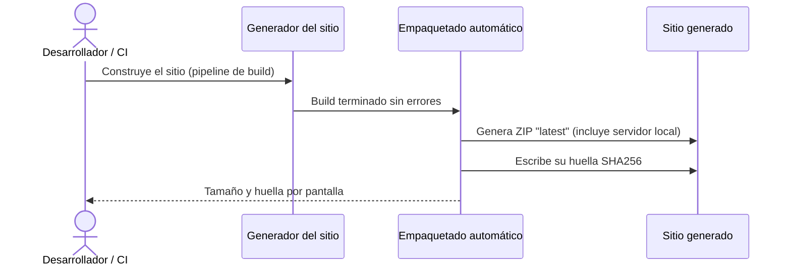
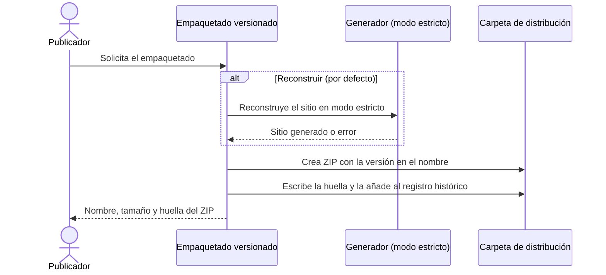

# ZIP de Documentación Offline

## 1. Objetivo y Descripción

La distribución offline empaqueta el sitio de documentación completo en un único archivo
ZIP con verificación de integridad, para que cualquier persona pueda consultar la
documentación sin conexión, archivarla por versión o distribuirla en entornos sin acceso
al repositorio. Quien recibe el ZIP lo extrae y hace doble clic en `index.html`: navega, busca
y ve los diagramas sin instalar Python, sin servidor y sin red.

Existen **dos mecanismos complementarios**, no alternativos:

| Mecanismo | Activación | Resultado |
|---|---|---|
| **Empaquetado automático en cada build** | Cada vez que se construye el sitio con el empaquetado (el pipeline de build) | Un ZIP "latest" dentro del sitio, con su huella, listo para descarga desde la propia documentación |
| **Empaquetado versionado** | Manual, o por el flujo de publicación del repositorio | Un ZIP con la versión del proyecto en el nombre, su huella y un registro histórico de huellas |

El empaquetado automático garantiza que siempre haya un ZIP "latest" disponible para
descarga desde el sitio. El versionado genera el ZIP trazable que se adjunta a cada release.
Ambos deben existir.

La usan los responsables de publicar cada versión de la documentación y el flujo de
publicación automática del repositorio. Su valor es doble: portabilidad (un solo fichero por
versión) y confianza (cada ZIP lleva su huella de integridad para detectar descargas
corruptas o manipuladas).

## 2. Precondiciones

- Generador de documentación Zensical instalado (es el único generador; versión fijada en los
  requisitos del proyecto).
- La versión del proyecto declarada en el manifiesto del proyecto (empaquetado versionado).
- Para empaquetar sin reconstruir: un sitio generado previamente.
- Para el empaquetado automático: construir mediante el empaquetado, que es el pipeline de
  build. Zensical no ejecuta hooks, así que construir con Zensical directamente no lo produce.
  No requiere instalar el proyecto como paquete.

## 3. Flujo Principal

### Empaquetado automático en cada build

### Empaquetado versionado

En el flujo automático, al terminar cada build el sitio se comprime en un ZIP "latest" (sin
incluir ZIPs ni huellas anteriores) al que se añade el servidor local para consulta offline,
y se escribe su huella. En el flujo versionado, el publicador lanza el empaquetado; por
defecto se reconstruye el sitio en modo estricto, después se crea el ZIP con la versión del
proyecto en el nombre, su huella y una nueva línea en el registro histórico de huellas.

## 4. Postcondiciones y Efectos

- **Automático**: dentro del sitio quedan `doc_ia-docs-latest.zip` y su `.sha256`; se
  sobrescriben en cada build.
- **Versionado**: en la carpeta de distribución (por defecto `dist/`, se crea si no existe)
  quedan `doc_ia-docs-<versión>.zip`, su `.zip.sha256` y una línea nueva con fecha en
  `CHECKSUMS.txt` (acumulativo; nunca se borra).
- El sitio generado se sobrescribe cuando el empaquetado versionado reconstruye.
- Los dos ZIP se abren con doble clic en `index.html` tras extraerlos, con navegación,
  búsqueda y diagramas, sin servidor ni red. El servidor local va incluido como alternativa.
- El ZIP automático se genera cuando el generador ya ha terminado y escrito el índice de
  búsqueda para ficheros locales, así que también lo incluye.
- Los diagramas se dibujan sin conexión: el sitio lleva su propia copia de Mermaid con versión
  fija. Las fuentes tipográficas siguen descargándose de
  internet; sin conexión se usan las del sistema.

## 5. Reglas de Negocio

| Regla | Descripción | Impacto si se viola |
|---|---|---|
| Versión única y trazable | El nombre del ZIP versionado incorpora la versión declarada del proyecto (`doc_ia-docs-<versión>.zip`) | Imposible saber qué versión de la documentación contiene un archivo |
| Registro histórico de huellas | Cada huella del ZIP versionado se acumula en `CHECKSUMS.txt` con fecha y hora | Se pierde la trazabilidad histórica de qué huella corresponde a qué release |
| Siempre "latest" | El empaquetado automático sobrescribe el ZIP "latest" en cada build; no mantiene histórico | El ZIP "latest" podría no corresponder al build más reciente si no se ejecutó |
| Build exitoso antes del ZIP | El ZIP se genera solo tras un build sin errores; nunca a partir de un sitio corrupto | Se distribuiría documentación con enlaces rotos o páginas huérfanas |
| Sin servicios IA | El empaquetado es tooling determinista local; nunca invoca servicios IA | Violaría el principio innegociable del proyecto |
| Sin instalación | El empaquetado funciona con cualquier Python que tenga el generador; carga sus pasos por ruta y no requiere instalar el proyecto como paquete | Dependencia frágil del entorno; falla si no está activo el entorno correcto |
| Diagramas sin conexión | El sitio sirve su propia copia de Mermaid, con versión exacta y huella fija, coherente con la configuración y con la validación de CI | Sin conexión, los diagramas aparecerían como bloques de código |
| Abrir sin servidor | Antes de empaquetar se comprueba que el sitio se puede abrir desde ficheros locales: índice de búsqueda en JS, ningún script descargado de internet y ningún enlace a carpeta. Si no, no se crea el ZIP | Quien recibe el ZIP necesitaría Python y un servidor, o vería listados de carpetas y una búsqueda que no responde |
| ZIP reproducible | El mismo contenido produce exactamente el mismo ZIP: entradas en orden fijo y con la misma fecha (la del último cambio publicado) | La release del tag y la de la documentación publicarían el mismo fichero con huellas distintas, y combinar el ZIP de una con la huella de la otra parecería una descarga corrupta |
| Enlaces de descarga coherentes | Los enlaces de la página de descargas resuelven, desde la URL publicada de esa página, al ZIP "latest" y a su huella tal como los genera el empaquetado automático | El modo estricto no revisa enlaces en HTML: la descarga quedaría rota sin aviso |

## 6. Límites, Flujos Alternativos y Casos Especiales

### Qué NO hace esta funcionalidad

- No publica el ZIP: la subida a la release la hace el flujo de publicación del repositorio.
- No valida la huella de una descarga: solo la genera; la validación la hace el usuario.
- No limpia ZIPs de versiones anteriores en la carpeta de distribución.

### Flujos alternativos

- **Empaquetar sin reconstruir**: si el sitio ya está generado, puede empaquetarse tal cual;
  si no existe sitio previo, el proceso se detiene con un error explicativo.
- **Build con errores**: si la reconstrucción estricta falla, no se genera ningún ZIP y el
  proceso termina con el código de error del generador.
- **Build no estricto**: puede reconstruirse sin modo estricto, aceptando avisos.
- **Carpeta de salida alternativa**: el destino del ZIP versionado puede cambiarse; la carpeta
  se crea si no existe.
- **Construir con Zensical directamente**: Zensical no ejecuta hooks, así que el empaquetado
  hace él mismo los pasos previo y posterior: copia los ficheros raíz a la documentación antes
  del build y, solo si el build termina sin errores, genera el ZIP "latest". Construir con
  Zensical fuera del empaquetado no produce el ZIP "latest" ni actualiza las copias, y Zensical
  no avisa.
- **Generador MkDocs**: ya no se soporta. Pedirlo al empaquetado termina con código 2 sin
  construir nada; la opción de elegir generador se mantiene una versión solo para aceptar
  Zensical en llamadas existentes.

### Casos especiales

- **Build fallido en el flujo automático**: el empaquetado no ejecuta el paso posterior al
  build cuando este falla, por lo que no se genera ZIP a partir de un sitio corrupto.
- **Sitio inexistente en el flujo automático**: se muestra un aviso y no se genera ZIP.
- **Servidor local ausente**: si el servidor local no existe en el repositorio, el ZIP
  automático se genera sin él.
- **Sitio que no se abre sin servidor**: si falta el índice de búsqueda en JS, alguna página
  carga un script de internet o enlaza a una carpeta, el empaquetado versionado se detiene con
  código 1 y lista hasta 20 problemas (con el número de los restantes). El ZIP automático no hace
  esta comprobación; la cubre la CI empaquetando cada build.
- **ZIP abierto sin extraer**: el doble clic dentro del ZIP abre solo `index.html`, sin estilos
  ni menú; las instrucciones piden extraerlo completo antes.
- **Navegador que bloquea scripts de ficheros locales** (p. ej. por política de empresa): el
  servidor local incluido es la alternativa; nunca se piden opciones de seguridad del navegador.

## 7. Criterios de Aceptación

| ID | Dado | Cuando | Entonces | Test |
|---|---|---|---|---|
| AC-01 | Un entorno completo y la versión 0.1.0 declarada en el proyecto | Se solicita el empaquetado versionado estándar | Se reconstruye el sitio en modo estricto y se crean `dist/doc_ia-docs-0.1.0.zip`, su `.zip.sha256` y la entrada en `CHECKSUMS.txt` | `tests/test_build_docs_zip.py::test_main_builds_strict_and_packages_versioned_zip` |
| AC-02 | Ningún sitio generado previamente | Se solicita empaquetar sin reconstruir | Se informa de un error explicativo y el proceso termina con fallo (código 1) sin crear ningún ZIP | `tests/test_build_docs_zip.py::test_main_no_build_without_site_exits_1` |
| AC-03 | Documentación con un enlace roto o página huérfana | Se solicita el empaquetado versionado estándar (build estricto) | El proceso se detiene con el código de error del generador y no se crea ningún ZIP | `tests/test_build_docs_zip.py::test_main_build_failure_propagates_exit_code` |
| AC-04 | Un ZIP ya generado con su huella `.sha256` | Se valida la integridad de la descarga | La huella calculada coincide con la registrada (`sha256sum -c` → OK) | `tests/test_build_docs_zip.py::test_sha256_file_matches_archive` |
| AC-05 | El paso posterior del empaquetado | Se construye el sitio con el empaquetado | Se genera `site/doc_ia-docs-latest.zip` y su `.sha256` sin ningún comando adicional ni instalación de paquetes | `tests/test_build_docs_zip.py::test_post_build_hook_creates_latest_zip` |
| AC-06 | Un Python con el generador instalado pero sin activar el entorno de doc_ia | Se construye el sitio con el empaquetado desde la raíz del proyecto | El empaquetado automático funciona (no requiere instalar el proyecto como paquete) | Sin test |
| AC-07 | Un `CHANGELOG.md` en la raíz | Se solicita el empaquetado versionado | La copia de `CHANGELOG.md` en la documentación se actualiza antes del build y, tras el build, existen `site/doc_ia-docs-latest.zip` y su `.sha256` | `tests/test_build_docs_zip.py::test_zensical_with_real_hooks_syncs_and_creates_latest_zip` |
| AC-08 | Documentación con un error que hace fallar el build estricto | Se solicita el empaquetado versionado | El proceso termina con el código de error del generador y no se genera ni el ZIP "latest" ni el versionado | `tests/test_build_docs_zip.py::test_zensical_build_failure_skips_post_build` |
| AC-09 | La página de descargas y la configuración del sitio (estilo de URL) | Se comprueba la conformidad del repositorio | Cada enlace al ZIP "latest" o a su huella resuelve, desde la URL de la página de descargas, a un fichero que genera el empaquetado automático en la raíz del sitio | `tests/test_zensical_compat.py::test_downloads_links_point_to_latest_zip` |
| AC-10 | El sitio construido | Se abre una página con diagramas sin conexión a internet | Los diagramas se dibujan con la copia local de Mermaid, cuya versión coincide con la configuración del sitio y con la validación de CI | `tests/test_mermaid_assets.py::test_vendored_mermaid_is_pinned`, `tests/test_mermaid_assets.py::test_extra_javascript_loads_local_mermaid_then_theme`, `tests/test_mermaid_assets.py::test_ci_validates_the_vendored_version` |
| AC-11 | Un sitio generado que ya contiene el ZIP "latest" y su huella, y las instrucciones de visualización en la raíz del proyecto | Se solicita el empaquetado versionado | El ZIP versionado no contiene ningún ZIP ni huella anidados e incluye en su raíz el servidor local y `VER_DOCUMENTACION.md`, igual que el ZIP "latest" | `tests/test_build_docs_zip.py::test_versioned_zip_matches_latest_layout` |
| AC-12 | La configuración del sitio y la plantilla para destinos | Se comprueba la conformidad del repositorio | Las dos declaran URLs `*.html`, el plugin `offline` y solo la copia local del shim de búsqueda, cuya huella está fijada | `tests/test_offline_assets.py::test_vendored_shim_is_pinned`, `tests/test_offline_assets.py::test_config_builds_a_site_that_opens_without_server` |
| AC-13 | Un sitio con un enlace a carpeta, un script de internet o sin índice de búsqueda en JS | Se solicita el empaquetado versionado | El proceso termina con código 1, nombra la página y el problema, y no crea ningún ZIP; con el índice de Zensical (o el de un sitio MkDocs anterior) y solo enlaces externos o a ficheros, el ZIP se crea | `tests/test_build_docs_zip.py::test_site_not_browsable_from_file_exits_1`, `tests/test_build_docs_zip.py::test_missing_search_index_js_exits_1`, `tests/test_build_docs_zip.py::test_zensical_search_index_layout_is_accepted`, `tests/test_build_docs_zip.py::test_external_and_file_links_are_not_folder_links` |
| AC-14 | El empaquetado automático y el plugin `offline` en el mismo build | Se construye el sitio con el empaquetado | El ZIP "latest" se genera cuando el generador ha terminado (con el índice de búsqueda en JS ya escrito), así que lo incluye | `tests/test_build_docs_zip.py::test_zensical_runs_hooks_around_build` |
| AC-15 | Las páginas de descargas y las instrucciones de visualización (instancia y plantilla) | Se comprueba la conformidad del repositorio | Indican extraer el ZIP y abrir `index.html` con doble clic, mantienen el servidor local como alternativa y nunca piden opciones de seguridad del navegador | `tests/test_docs_conformance.py::test_zip_opens_with_double_click_after_extracting`, `tests/test_docs_conformance.py::test_browser_security_flags_only_to_forbid_them` |
| AC-16 | Una llamada existente que elige generador | Se solicita el empaquetado con MkDocs, o con Zensical | Con MkDocs termina con código 2 y un mensaje que remite a ADR-003, sin construir nada; con Zensical funciona igual que sin elegir | `tests/test_build_docs_zip.py::test_mkdocs_builder_is_rejected`, `tests/test_build_docs_zip.py::test_legacy_builder_flag_zensical_is_accepted` |
| AC-17 | Un sitio ya generado | Se empaqueta dos veces, con distinta hora del sistema y de los ficheros | Los dos ZIP son idénticos byte a byte, sus entradas van ordenadas y llevan la fecha fijada | `tests/test_build_docs_zip.py::test_versioned_zip_is_reproducible`, `tests/test_build_docs_zip.py::test_latest_and_versioned_zip_have_same_bytes` |

Verificación manual: `python scripts/build_docs_zip.py` (AC-01/AC-03),
`python scripts/build_docs_zip.py --no-build` sin `site/` previo (AC-02),
`sha256sum -c dist/*.sha256` (AC-04), `python scripts/build_docs_zip.py` → comprobar
`site/doc_ia-docs-latest.zip` y la copia de `CHANGELOG.md` en `docs/` (AC-05 a AC-08).
Los tests simulan el generador; el build real lo ejecuta la CI. La apertura con doble clic se
probó en navegador real, sin red, con los ZIP de MkDocs y Zensical en Edge, Chrome y Firefox:
portada, navegación por enlaces, búsqueda con resultados y diagramas, sin peticiones locales
fallidas (`.ai/sessions/2026-10-29d_zip_sin_servidor/smoke/`). No forma parte de la CI.

## 8. Glosario de Dominio

| Término | Definición |
|---|---|
| Sitio | Conjunto de páginas HTML generadas a partir de la documentación fuente |
| Huella SHA256 | Resumen criptográfico que identifica de forma única el contenido de un archivo |
| Modo estricto | Construcción que trata cualquier aviso (enlace roto, página huérfana) como error |
| Distribución offline | Consulta de la documentación sin conexión ni acceso al repositorio |
| ZIP "latest" | ZIP del último build, sin versión en el nombre, que se sobrescribe en cada build |

??? note "Evidencia"

    | Elemento | Fuente | Confianza |
    |---|---|---|
    | Regla «Versión única y trazable» | `scripts/build_docs_zip.py::_version`, `::_zip` | ✅ |
    | Regla «Registro histórico de huellas» | `scripts/build_docs_zip.py::_create_checksum_files` (modo `"a"`) | ✅ |
    | Regla «Siempre latest» | `mkdocs_hooks.py::on_post_build` (`zip_path` fijo, modo `"w"`) | ✅ |
    | Regla «Build exitoso antes del ZIP» | `scripts/build_docs_zip.py::_build` (`sys.exit(returncode)`) | ✅ |
    | Regla «Sin servicios IA» | `scripts/build_docs_zip.py`, `mkdocs_hooks.py` (solo `shutil`, `zipfile`, `hashlib`, `subprocess` del generador) | ✅ |
    | Regla «Sin instalación» | `scripts/build_docs_zip.py::_load_hook` (`mkdocs_hooks.py` y `hooks/sync_root_docs.py` por ruta) | ✅ |
    | Regla «Enlaces de descarga coherentes» | `docs/downloads.md` (enlaces `href`), `mkdocs.yml::use_directory_urls`, `mkdocs_hooks.py::on_post_build` | ✅ |
    | ZIP automático excluye `.zip`/`.sha256` e incluye el servidor local | `mkdocs_hooks.py::on_post_build` | ✅ |
    | Zensical como único generador; pasos previo y posterior ejecutados por el script; MkDocs rechazado | `scripts/build_docs_zip.py::main` (`--builder`), `::_build`, `::BUILDER` | ✅ |
    | [COB-BUILDZIP-002](../decisiones/buildzip_decisiones.md#cob-buildzip-002) · Zensical no ejecuta `hooks:` y no avisa | zensical.org/compatibility/configuration (Zensical 0.0.73; re-verificado con 0.1.1) | ⚠️ (decisión: Aceptar riesgo) |
    | AC-01 | `scripts/build_docs_zip.py::main`, `::_create_checksum_files` | ✅ |
    | AC-02 | `scripts/build_docs_zip.py::main` (`--no-build` + `SITE_DIR` inexistente → `sys.exit(1)`) | ✅ |
    | AC-03 | `scripts/build_docs_zip.py::_build` | ✅ |
    | AC-04 | `scripts/build_docs_zip.py::_create_checksum_files` (formato `<hash>  <fichero>`) | ✅ |
    | AC-05 | `mkdocs_hooks.py::on_post_build`, `scripts/build_docs_zip.py::_post_build` | ✅ |
    | AC-06 | `scripts/build_docs_zip.py::_load_hook` | ✅ |
    | AC-07 | `scripts/build_docs_zip.py::_pre_build`, `::_post_build` | ✅ |
    | AC-08 | `scripts/build_docs_zip.py::_build` (`sys.exit` antes de `_post_build`) | ✅ |
    | AC-09 | `tests/test_zensical_compat.py::test_downloads_links_point_to_latest_zip` | ✅ |
    | Regla «Diagramas sin conexión» y AC-10 | `mkdocs.yml::extra_javascript`, `tests/test_mermaid_assets.py` | ✅ |
    | AC-11 | `scripts/build_docs_zip.py::_zip`, `::EXTRA_FILES` | ✅ |
    | Regla «Abrir sin servidor», AC-13 | `scripts/build_docs_zip.py::_offline_problems`, `::_check_offline`, `::OFFLINE_SEARCH_INDEXES` | ✅ |
    | AC-12 | `mkdocs.yml::use_directory_urls`, `::plugins`, `::extra` (`polyfills`), `.github/templates/TEMPLATE_mkdocs.yml`, `docs/assets/vendor/iframe-worker/SOURCE.txt` | ✅ |
    | Shim descargado de unpkg si falta la copia local | `zensical/config.py::_apply_offline_plugin` (Zensical 0.0.73 y 0.1.1) | ✅ |
    | AC-14 | `scripts/build_docs_zip.py::_build` (`_post_build` tras el build) | ✅ |
    | AC-16 | `scripts/build_docs_zip.py::main` (`parser.error`) | ✅ |
    | Regla «ZIP reproducible», AC-17 | `scripts/build_docs_zip.py::_zip`, `::_add_entry`, `::_zip_date_time`, `mkdocs_hooks.py::on_post_build` | ✅ |
    | AC-15 | `docs/downloads.md`, `VER_DOCUMENTACION.md`, `.github/templates/VER_DOCUMENTACION.template.md` | ✅ |
    | Navegación, búsqueda y diagramas por `file://`, sin red, en Edge y Chrome | `.ai/sessions/2026-10-29d_zip_sin_servidor/smoke/RESULTADOS.txt` (prueba con navegador sin ventana, fuera de la CI) | ✅ |
    | [COB-BUILDZIP-004](../decisiones/buildzip_decisiones.md#cob-buildzip-004) · Ídem en Firefox | Mismo fichero; sin ventana, Firefox no abre la búsqueda al enfocar el campo y la prueba la abre como el icono | ⚠️ (decisión: Aceptar riesgo) |
