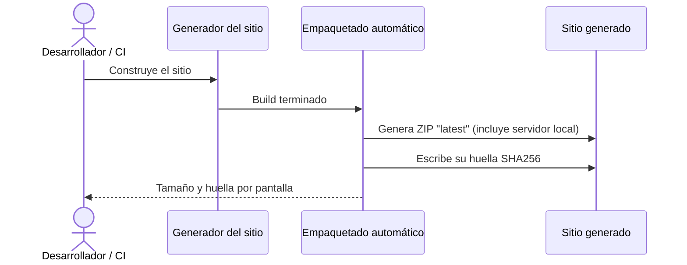
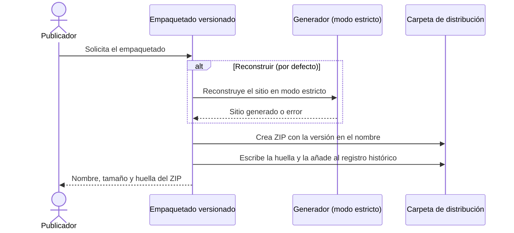

# ZIP de Documentación Offline

## 1. Objetivo y Descripción

La distribución offline empaqueta el sitio de documentación completo en un único archivo
ZIP con verificación de integridad, para que cualquier persona pueda consultar la
documentación sin conexión, archivarla por versión o distribuirla en entornos sin acceso
al repositorio.

Existen **dos mecanismos complementarios**, no alternativos:

| Mecanismo | Activación | Resultado |
|---|---|---|
| **Empaquetado automático en cada build** | Cada vez que se construye o se sirve el sitio | Un ZIP "latest" dentro del sitio, con su huella, listo para descarga desde la propia documentación |
| **Empaquetado versionado** | Manual, o por el flujo de publicación del repositorio | Un ZIP con la versión del proyecto en el nombre, su huella y un registro histórico de huellas |

El empaquetado automático garantiza que siempre haya un ZIP "latest" disponible para
descarga desde el sitio. El versionado genera el ZIP trazable que se adjunta a cada release.
Ambos deben existir.

La usan los responsables de publicar cada versión de la documentación y el flujo de
publicación automática del repositorio. Su valor es doble: portabilidad (un solo fichero por
versión) y confianza (cada ZIP lleva su huella de integridad para detectar descargas
corruptas o manipuladas).

## 2. Precondiciones

- Generador de documentación instalado (MkDocs por defecto; Zensical solo si se elige como
  alternativa y está instalado).
- La versión del proyecto declarada en el manifiesto del proyecto (empaquetado versionado).
- Para empaquetar sin reconstruir: un sitio generado previamente.
- Para el empaquetado automático: el hook de empaquetado declarado en la configuración del
  sitio. No requiere instalar el proyecto como paquete. Con Zensical, que no ejecuta hooks,
  el empaquetado automático solo ocurre si se construye mediante el empaquetado versionado.

## 3. Flujo Principal

### Empaquetado automático en cada build

### Empaquetado versionado

En el flujo automático, al terminar cada build el sitio se comprime en un ZIP "latest" (sin
incluir ZIPs ni huellas anteriores) al que se añade el servidor local para consulta offline,
y se escribe su huella. En el flujo versionado, el publicador lanza el empaquetado; por
defecto se reconstruye el sitio en modo estricto, después se crea el ZIP con la versión del
proyecto en el nombre, su huella y una nueva línea en el registro histórico de huellas.

## 4. Postcondiciones y Efectos

- **Automático**: dentro del sitio quedan `doc_ia-docs-latest.zip` y su `.sha256`; se
  sobrescriben en cada build.
- **Versionado**: en la carpeta de distribución (por defecto `dist/`, se crea si no existe)
  quedan `doc_ia-docs-<versión>.zip`, su `.zip.sha256` y una línea nueva con fecha en
  `CHECKSUMS.txt` (acumulativo; nunca se borra).
- El sitio generado se sobrescribe cuando el empaquetado versionado reconstruye.
- El ZIP automático incluye el servidor local para navegar la documentación sin conexión.

## 5. Reglas de Negocio

| Regla | Descripción | Impacto si se viola |
|---|---|---|
| Versión única y trazable | El nombre del ZIP versionado incorpora la versión declarada del proyecto (`doc_ia-docs-<versión>.zip`) | Imposible saber qué versión de la documentación contiene un archivo |
| Registro histórico de huellas | Cada huella del ZIP versionado se acumula en `CHECKSUMS.txt` con fecha y hora | Se pierde la trazabilidad histórica de qué huella corresponde a qué release |
| Siempre "latest" | El empaquetado automático sobrescribe el ZIP "latest" en cada build; no mantiene histórico | El ZIP "latest" podría no corresponder al build más reciente si no se ejecutó |
| Build exitoso antes del ZIP | El ZIP se genera solo tras un build sin errores; nunca a partir de un sitio corrupto | Se distribuiría documentación con enlaces rotos o páginas huérfanas |
| Sin servicios IA | El empaquetado es tooling determinista local; nunca invoca servicios IA | Violaría el principio innegociable del proyecto |
| Sin instalación | El empaquetado automático funciona con cualquier Python que tenga el generador; no requiere instalar el proyecto como paquete | Dependencia frágil del entorno; falla si no está activo el entorno correcto |
| Enlaces de descarga coherentes | Los enlaces de la página de descargas resuelven, desde la URL publicada de esa página, al ZIP "latest" y a su huella tal como los genera el empaquetado automático | El modo estricto no revisa enlaces en HTML: la descarga quedaría rota sin aviso |

## 6. Límites, Flujos Alternativos y Casos Especiales

### Qué NO hace esta funcionalidad

- No publica el ZIP: la subida a la release la hace el flujo de publicación del repositorio.
- No valida la huella de una descarga: solo la genera; la validación la hace el usuario.
- No limpia ZIPs de versiones anteriores en la carpeta de distribución.

### Flujos alternativos

- **Empaquetar sin reconstruir**: si el sitio ya está generado, puede empaquetarse tal cual;
  si no existe sitio previo, el proceso se detiene con un error explicativo.
- **Build con errores**: si la reconstrucción estricta falla, no se genera ningún ZIP y el
  proceso termina con el código de error del generador.
- **Build no estricto**: puede reconstruirse sin modo estricto, aceptando avisos.
- **Carpeta de salida alternativa**: el destino del ZIP versionado puede cambiarse; la carpeta
  se crea si no existe.
- **Generador alternativo**: puede construirse con Zensical si está instalado. Como Zensical
  no ejecuta los hooks de la configuración del sitio, el empaquetado versionado los ejecuta
  él mismo: copia los ficheros raíz a la documentación antes del build y, solo si el build
  termina sin errores, genera el ZIP "latest". Construir con Zensical directamente, fuera del
  empaquetado, no produce el ZIP "latest" ni actualiza las copias, y Zensical no avisa.

### Casos especiales

- **Build fallido en el flujo automático**: el generador no ejecuta el paso posterior al build
  cuando este falla, por lo que no se genera ZIP a partir de un sitio corrupto.
- **Sitio inexistente en el flujo automático**: se muestra un aviso y no se genera ZIP.
- **Servidor local ausente**: si el servidor local no existe en el repositorio, el ZIP
  automático se genera sin él.

## 7. Criterios de Aceptación

| ID | Dado | Cuando | Entonces | Test |
|---|---|---|---|---|
| AC-01 | Un entorno completo y la versión 0.1.0 declarada en el proyecto | Se solicita el empaquetado versionado estándar | Se reconstruye el sitio en modo estricto y se crean `dist/doc_ia-docs-0.1.0.zip`, su `.zip.sha256` y la entrada en `CHECKSUMS.txt` | `tests/test_build_docs_zip.py::test_main_builds_strict_and_packages_versioned_zip` |
| AC-02 | Ningún sitio generado previamente | Se solicita empaquetar sin reconstruir | Se informa de un error explicativo y el proceso termina con fallo (código 1) sin crear ningún ZIP | `tests/test_build_docs_zip.py::test_main_no_build_without_site_exits_1` |
| AC-03 | Documentación con un enlace roto o página huérfana | Se solicita el empaquetado versionado estándar (build estricto) | El proceso se detiene con el código de error del generador y no se crea ningún ZIP | `tests/test_build_docs_zip.py::test_main_build_failure_propagates_exit_code` |
| AC-04 | Un ZIP ya generado con su huella `.sha256` | Se valida la integridad de la descarga | La huella calculada coincide con la registrada (`sha256sum -c` → OK) | `tests/test_build_docs_zip.py::test_sha256_file_matches_archive` |
| AC-05 | El empaquetado automático declarado en la configuración del sitio | Se construye el sitio | Se genera `site/doc_ia-docs-latest.zip` y su `.sha256` sin ningún comando adicional ni instalación de paquetes | `tests/test_build_docs_zip.py::test_post_build_hook_creates_latest_zip` |
| AC-06 | Un Python con el generador instalado pero sin activar el entorno de doc_ia | Se construye el sitio desde la raíz del proyecto | El empaquetado automático funciona (no requiere instalar el proyecto como paquete) | Sin test |
| AC-07 | Zensical como generador y un `CHANGELOG.md` en la raíz | Se solicita el empaquetado versionado con Zensical | La copia de `CHANGELOG.md` en la documentación se actualiza antes del build y, tras el build, existen `site/doc_ia-docs-latest.zip` y su `.sha256` | `tests/test_build_docs_zip.py::test_zensical_with_real_hooks_syncs_and_creates_latest_zip` |
| AC-08 | Zensical como generador y documentación con un error que hace fallar el build estricto | Se solicita el empaquetado versionado con Zensical | El proceso termina con el código de error del generador y no se genera ni el ZIP "latest" ni el versionado | `tests/test_build_docs_zip.py::test_zensical_build_failure_skips_post_build` |
| AC-09 | La página de descargas y la configuración del sitio (estilo de URL) | Se comprueba la conformidad del repositorio | Cada enlace al ZIP "latest" o a su huella resuelve, desde la URL de la página de descargas, a un fichero que genera el empaquetado automático en la raíz del sitio | `tests/test_zensical_compat.py::test_downloads_links_point_to_latest_zip` |

Verificación manual: `python scripts/build_docs_zip.py` (AC-01/AC-03),
`python scripts/build_docs_zip.py --no-build` sin `site/` previo (AC-02),
`sha256sum -c dist/*.sha256` (AC-04), `python -m mkdocs build` → comprobar
`site/doc_ia-docs-latest.zip` (AC-05/AC-06),
`python scripts/build_docs_zip.py --builder zensical` con Zensical instalado (AC-07/AC-08).
Los tests simulan el generador; el build real no está automatizado.

## 8. Glosario de Dominio

| Término | Definición |
|---|---|
| Sitio | Conjunto de páginas HTML generadas a partir de la documentación fuente |
| Huella SHA256 | Resumen criptográfico que identifica de forma única el contenido de un archivo |
| Modo estricto | Construcción que trata cualquier aviso (enlace roto, página huérfana) como error |
| Distribución offline | Consulta de la documentación sin conexión ni acceso al repositorio |
| ZIP "latest" | ZIP del último build, sin versión en el nombre, que se sobrescribe en cada build |

??? note "Evidencia"

    | Elemento | Fuente | Confianza |
    |---|---|---|
    | Regla «Versión única y trazable» | `scripts/build_docs_zip.py::_version`, `::_zip` | ✅ |
    | Regla «Registro histórico de huellas» | `scripts/build_docs_zip.py::_create_checksum_files` (modo `"a"`) | ✅ |
    | Regla «Siempre latest» | `mkdocs_hooks.py::on_post_build` (`zip_path` fijo, modo `"w"`) | ✅ |
    | Regla «Build exitoso antes del ZIP» | `scripts/build_docs_zip.py::_build` (`sys.exit(returncode)`) | ✅ |
    | Regla «Sin servicios IA» | `scripts/build_docs_zip.py`, `mkdocs_hooks.py` (solo `shutil`, `zipfile`, `hashlib`, `subprocess` del generador) | ✅ |
    | Regla «Sin instalación» | `mkdocs.yml::hooks` (`mkdocs_hooks.py` por ruta) | ✅ |
    | Regla «Enlaces de descarga coherentes» | `docs/downloads.md` (enlaces `href`), `mkdocs.yml::use_directory_urls`, `mkdocs_hooks.py::on_post_build` | ✅ |
    | ZIP automático excluye `.zip`/`.sha256` e incluye el servidor local | `mkdocs_hooks.py::on_post_build` | ✅ |
    | Generador alternativo Zensical con hooks ejecutados por el script | `scripts/build_docs_zip.py::main` (`--builder`), `::_build`, `::HOOKLESS_BUILDERS` | ✅ |
    | Zensical no ejecuta `hooks:` y no avisa | zensical.org/compatibility/configuration (Zensical 0.0.73) | ⚠️ |
    | AC-01 | `scripts/build_docs_zip.py::main`, `::_create_checksum_files` | ✅ |
    | AC-02 | `scripts/build_docs_zip.py::main` (`--no-build` + `SITE_DIR` inexistente → `sys.exit(1)`) | ✅ |
    | AC-03 | `scripts/build_docs_zip.py::_build` | ✅ |
    | AC-04 | `scripts/build_docs_zip.py::_create_checksum_files` (formato `<hash>  <fichero>`) | ✅ |
    | AC-05 | `mkdocs_hooks.py::on_post_build` | ✅ |
    | AC-06 | `mkdocs.yml::hooks` | ✅ |
    | AC-07 | `scripts/build_docs_zip.py::_pre_build`, `::_post_build` | ✅ |
    | AC-08 | `scripts/build_docs_zip.py::_build` (`sys.exit` antes de `_post_build`) | ✅ |
    | AC-09 | `tests/test_zensical_compat.py::test_downloads_links_point_to_latest_zip` | ✅ |
