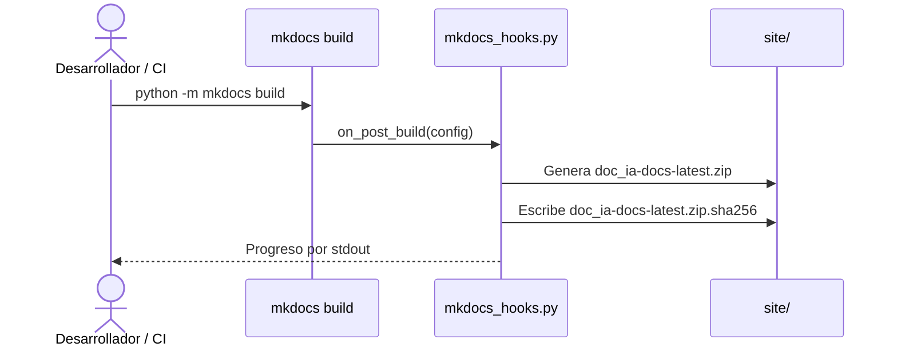
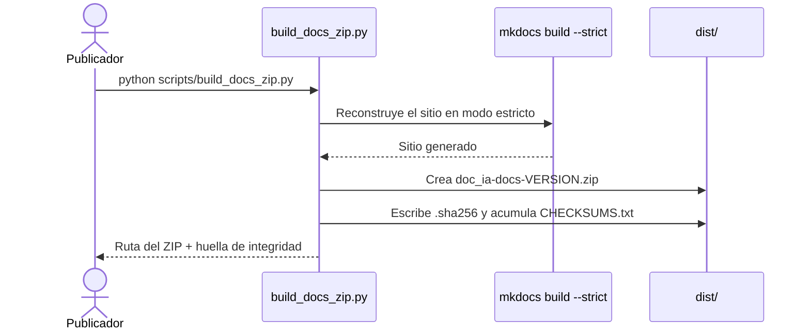

# ZIP de Documentación Offline

## 1. Descripción General

La distribución offline empaqueta el sitio de documentación completo en un único archivo
ZIP con verificación de integridad, para que cualquier persona pueda consultar la
documentación sin conexión, archivarla por versión o distribuirla en entornos sin acceso
al repositorio.

Existen **dos mecanismos complementarios**, no alternativos:

| Mecanismo | Artefacto | Activación | Salida |
|---|---|---|---|
| **Hook MkDocs** (`mkdocs_hooks.py`) | Automático en cada build | `mkdocs build` / `mkdocs serve` | `site/doc_ia-docs-latest.zip` + `.sha256` |
| **Script local** (`scripts/build_docs_zip.py`) | Manual | `python scripts/build_docs_zip.py` | `dist/doc_ia-docs-<versión>.zip` + `.sha256` + `CHECKSUMS.txt` |

El hook garantiza que siempre haya un ZIP "latest" disponible para descarga inline desde
el sitio. El script genera el ZIP versionado y trazable para releases. Ambos deben existir.

La usan los responsables de publicar cada versión de la documentación y el flujo de
publicación automática del repositorio, que adjunta el ZIP a cada release. Su valor es
doble: portabilidad (un solo fichero por versión) y confianza (cada ZIP lleva su huella
de integridad para detectar descargas corruptas o manipuladas).

## 2. Reglas de Negocio

| Regla | Aplica a | Descripción | Impacto si se viola |
|---|---|---|---|
| Versión única y trazable | Script | El nombre incorpora la versión declarada en `pyproject.toml` (`doc_ia-docs-<versión>.zip`) | Imposible saber qué versión de la documentación contiene un archivo |
| Registro histórico de checksums | Script | El `.sha256` se acumula en `CHECKSUMS.txt` con timestamp | Se pierde la trazabilidad histórica de qué hash corresponde a qué release |
| Siempre "latest" | Hook | El hook sobreescribe `doc_ia-docs-latest.zip` en cada build; no mantiene histórico | El ZIP "latest" podría no corresponder al build más reciente si el hook no se ejecutó |
| Build exitoso antes del ZIP | Ambos | El ZIP se genera solo tras un build sin errores; nunca a partir de un sitio corrupto | Se distribuiría documentación con enlaces rotos o páginas huérfanas |
| Sin servicios IA | Ambos | El empaquetado es tooling determinista local; nunca invoca servicios IA | Violaría el principio innegociable del proyecto |
| Sin instalación (hook) | Hook | El hook funciona con cualquier Python que tenga `mkdocs`; no requiere `pip install -e .` | Dependencia frágil de venv; falla en entornos sin el venv correcto activo |

## 3. Casos de Uso

### Flujo automático (hook MkDocs)

### Flujo manual (script versionado)

### Flujos alternativos y de error

- **Empaquetar sin reconstruir** (script): si el sitio ya está generado, puede empaquetarse tal
  cual (opción `--no-build`); si no existe sitio previo, el proceso se detiene con error explicativo.
- **Build con errores** (script): si la reconstrucción estricta falla, no se genera ningún ZIP y
  el proceso termina con el código de error del generador.
- **Carpeta de salida alternativa** (script): el destino del ZIP puede cambiarse; la carpeta se
  crea si no existe.
- **Generador alternativo** (script): puede empaquetarse un sitio construido con Zensical si está instalado.
- **Hook sin site/**: el hook `on_post_build` solo se ejecuta si el build previo fue exitoso; MkDocs
  no invoca el hook si el build falla, por lo que no genera ZIP a partir de un sitio corrupto.

## 4. Criterios de Aceptación

| ID | Dado | Cuando | Entonces |
|---|---|---|---|
| AC-01 | Un entorno completo y la versión 0.1.0 declarada en el proyecto | Se solicita el empaquetado estándar (script) | Se reconstruye el sitio en modo estricto y se crean `dist/doc_ia-docs-0.1.0.zip`, su `.zip.sha256` y la entrada en `CHECKSUMS.txt` |
| AC-02 | Ningún sitio generado previamente | Se solicita empaquetar sin reconstruir (`--no-build`) | Se informa de un error explicativo y el proceso termina con fallo (código 1) sin crear ningún ZIP |
| AC-03 | Documentación con un enlace roto o página huérfana | Se solicita el empaquetado estándar (build estricto) | El proceso se detiene con el código de error del generador y no se crea ningún ZIP |
| AC-04 | Un ZIP ya generado con su huella `.sha256` | Se valida la integridad de la descarga | La huella calculada coincide con la registrada (`sha256sum -c` → OK) |
| AC-05 | `mkdocs_hooks.py` referenciado en `hooks:` de `mkdocs.yml` | Se ejecuta `python -m mkdocs build` | Se genera `site/doc_ia-docs-latest.zip` y su `.sha256` sin ningún comando adicional ni instalación de paquetes |
| AC-06 | Un Python con `mkdocs` instalado pero sin activar el venv de doc_ia | Se ejecuta `python -m mkdocs build` desde la raíz del proyecto | El hook funciona correctamente (no requiere `pip install -e .` ni entry points registrados) |

Verificación script: `python scripts/build_docs_zip.py` (AC-01/AC-03),
`python scripts/build_docs_zip.py --no-build` sin `site/` previo (AC-02),
`sha256sum -c dist/*.sha256` (AC-04).
Verificación hook: `python -m mkdocs build` → comprobar `site/doc_ia-docs-latest.zip` (AC-05/AC-06).

## 5. Glosario y Términos

| Término | Definición |
|---|---|
| Sitio | Conjunto de páginas HTML generadas a partir de la documentación fuente |
| Huella SHA256 | Resumen criptográfico que identifica de forma única el contenido de un archivo |
| Modo estricto | Construcción que trata cualquier aviso (enlace roto, página huérfana) como error |
| Distribución offline | Consulta de la documentación sin conexión ni acceso al repositorio |
