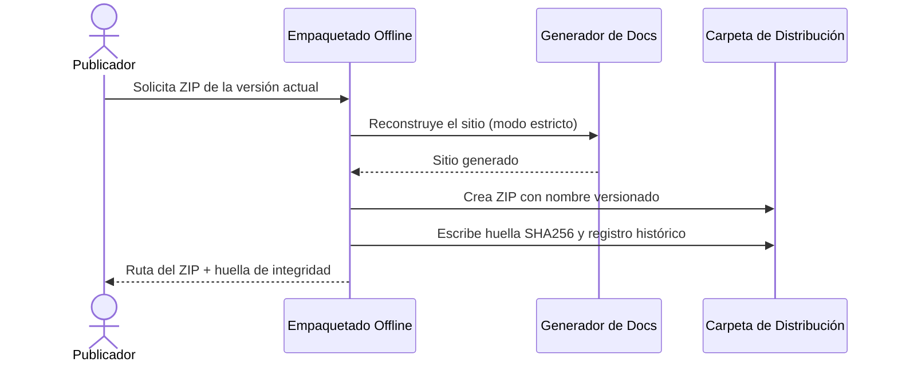

# ZIP de Documentación Offline

## 1. Descripción General

La distribución offline empaqueta el sitio de documentación completo en un único archivo
ZIP con verificación de integridad, para que cualquier persona pueda consultar la
documentación sin conexión, archivarla por versión o distribuirla en entornos sin acceso
al repositorio.

La usan los responsables de publicar cada versión de la documentación y el flujo de
publicación automática del repositorio, que adjunta el ZIP a cada release. Su valor es
doble: portabilidad (un solo fichero por versión) y confianza (cada ZIP lleva su huella
de integridad para detectar descargas corruptas o manipuladas).

## 2. Reglas de Negocio

| Regla | Descripción | Impacto si se viola |
|---|---|---|
| Versión única y trazable | El nombre del ZIP incorpora la versión declarada del proyecto (`doc_ia-docs-<versión>.zip`) | Imposible saber qué versión de la documentación contiene un archivo |
| Integridad verificable | Cada ZIP se acompaña de su huella SHA256 (fichero `.sha256`) y se acumula en un registro histórico (`CHECKSUMS.txt`) | Una descarga corrupta o alterada pasaría desapercibida |
| Build validado por defecto | Antes de empaquetar se reconstruye el sitio en modo estricto; cualquier aviso detiene el proceso | Se distribuiría documentación con enlaces rotos o páginas huérfanas |
| Sin servicios IA | El empaquetado es tooling determinista local; nunca invoca servicios IA | Violaría el principio innegociable del proyecto |

## 3. Casos de Uso

### Flujo principal

### Flujos alternativos y de error

- **Empaquetar sin reconstruir**: si el sitio ya está generado, puede empaquetarse tal
  cual (opción "sin build"); si no existe sitio previo, el proceso se detiene con un
  error explicativo.
- **Build con errores**: si la reconstrucción estricta falla, no se genera ningún ZIP y
  el proceso termina con el código de error del generador.
- **Carpeta de salida alternativa**: el destino del ZIP puede cambiarse; la carpeta se
  crea si no existe.
- **Generador alternativo**: puede empaquetarse un sitio construido con el generador
  alternativo compatible (Zensical) si está instalado.

## 4. Criterios de Aceptación      ← PENDIENTE QA — No añadir hasta validación

[Esta sección se completará cuando el equipo QA valide los criterios.
Estructura prevista: Tabla | ID | Criterio | Verificable con |
Redacción: "Dado X, cuando Y, entonces Z."]

## 5. Glosario y Términos

| Término | Definición |
|---|---|
| Sitio | Conjunto de páginas HTML generadas a partir de la documentación fuente |
| Huella SHA256 | Resumen criptográfico que identifica de forma única el contenido de un archivo |
| Modo estricto | Construcción que trata cualquier aviso (enlace roto, página huérfana) como error |
| Distribución offline | Consulta de la documentación sin conexión ni acceso al repositorio |
