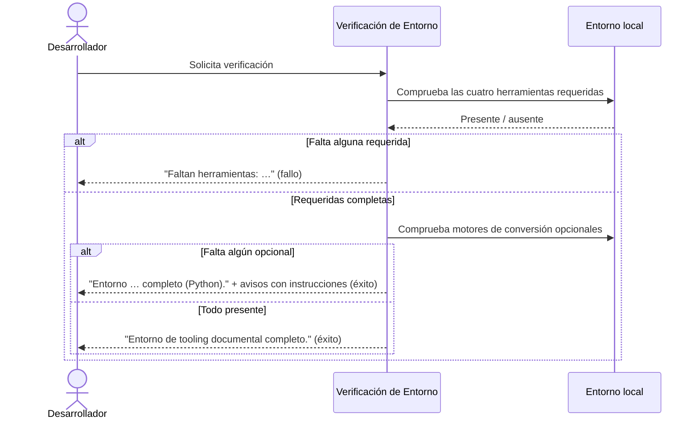

# Verificación de Entorno

## 1. Objetivo y Descripción

La verificación de entorno comprueba, antes de empezar a trabajar, que el puesto del
desarrollador tiene instaladas todas las herramientas necesarias para generar y validar
documentación. Evita descubrir a mitad de una sesión que falta una herramienta y que el
trabajo se interrumpa o produzca resultados incompletos.

La usan los desarrolladores que mantienen el proyecto y los flujos automatizados (tareas
del editor y comprobaciones previas) como primer paso de cualquier sesión de trabajo. Su
valor es dar una respuesta inmediata e inequívoca: el entorno está completo o falta algo
concreto, sin pasos manuales de inspección. Además, informa de las herramientas opcionales
de conversión de documentos que faltan y de cómo instalarlas.

## 2. Precondiciones

- Python disponible y ejecutándose desde el entorno que se quiere comprobar (el resultado
  describe el entorno Python activo, no otro).
- Ningún parámetro: la verificación se lanza sin opciones.

## 3. Flujo Principal

El desarrollador solicita la verificación. Primero se comprueban las cuatro herramientas
requeridas; si falta alguna, se informa de la lista exacta y se termina con fallo, sin
revisar las opcionales. Si las requeridas están completas, se revisan los motores de
conversión opcionales (docling, markitdown y sus complementos, pandoc): cada ausencia genera
un aviso con la instrucción de instalación, pero el resultado sigue siendo éxito.

## 4. Postcondiciones y Efectos

- No se crea, modifica ni elimina ningún fichero: la verificación solo lee el entorno.
- El resultado queda en el mensaje por pantalla y en el código de finalización
  (éxito o fallo), apto para tareas del editor y comprobaciones automáticas.

## 5. Reglas de Negocio

| Regla | Descripción | Impacto si se viola |
|---|---|---|
| Conjunto fijo de herramientas | Se verifican exactamente cuatro herramientas requeridas (mkdocs, ruff, mypy, pytest) y herramientas opcionales de conversión (docling, markitdown, pandoc) | Una herramienta ausente no detectada provoca fallos posteriores en build o validación |
| Resultado binario para requeridas | El resultado es "completo" o "faltan herramientas" con su lista; no hay estados intermedios | Ambigüedad sobre si se puede trabajar o no |
| Avisos informativos para opcionales | Las herramientas de conversión (docling, markitdown, pandoc) se reportan como avisos, no como errores | El script fallaría por un motor de conversión que solo se necesita al convertir documentos |
| Sin servicios externos | La comprobación es local y no contacta con ningún servicio IA ni de red | Violaría el principio del proyecto de ejecución determinista sin APIs |

## 6. Límites, Flujos Alternativos y Casos Especiales

### Qué NO hace esta funcionalidad

- No instala ni actualiza herramientas: solo informa de cuáles faltan.
- No comprueba versiones mínimas: una herramienta se considera presente si está disponible,
  sea cual sea su versión.
- No verifica que el build de documentación funcione ni que los tests pasen.

### Flujos alternativos

- **Faltan una o varias herramientas requeridas**: se informa de la lista exacta de ausentes
  y se termina con fallo, para que la instalación pueda corregirse antes de continuar.
- **Faltan herramientas opcionales**: se informa del entorno como completo e incluye un aviso
  por cada motor o complemento ausente con su instrucción de instalación.

### Casos especiales

- **Verificación de un conjunto distinto**: los flujos internos (pruebas) pueden verificar
  una lista alternativa de herramientas sin cambiar el comportamiento por defecto.
- **docling presente**: el aviso indica además si se ha detectado soporte de GPU NVIDIA o si
  solo se usará CPU.

## 7. Criterios de Aceptación

| ID | Dado | Cuando | Entonces | Test |
|---|---|---|---|---|
| AC-01 | Un entorno con las cuatro herramientas requeridas y todas las opcionales instaladas | Se ejecuta la verificación de entorno | Se informa "Entorno de tooling documental completo." y el proceso termina con éxito (código 0) | `tests/test_check_env.py::test_missing_tools_empty_when_tools_exist` |
| AC-02 | Un entorno donde falta al menos una herramienta requerida | Se ejecuta la verificación de entorno | Se informa "Faltan herramientas: " con la lista exacta de ausentes y el proceso termina con fallo (código 1) | `tests/test_check_env.py::test_missing_tools_detects_absent_tool` |
| AC-03 | Una lista alternativa de herramientas a comprobar | Se solicita la verificación de ese conjunto | El resultado incluye solo las ausentes, preservando el orden de la lista | `tests/test_check_env.py::test_missing_tools_detects_absent_tool` |
| AC-04 | Requeridas completas pero sin pandoc en el sistema | Se ejecuta la verificación de entorno | Se informa el entorno como completo, con un aviso sobre pandoc, y el proceso termina con éxito (código 0) | `tests/test_check_env.py::test_missing_system_tools_detects_absent_tool`, `tests/test_check_env.py::test_missing_system_tools_empty_when_tool_exists` |

Verificación: `python scripts/check_env.py` (AC-01/AC-02/AC-04) y
`python -m pytest tests/test_check_env.py -q` (detección de ausentes). Los tests cubren la
detección de herramientas, no el mensaje ni el código de salida final ⚠️.

## 8. Glosario de Dominio

| Término | Definición |
|---|---|
| Tooling documental | Conjunto de herramientas locales necesarias para generar y validar la documentación |
| Entorno completo | Estado en el que las cuatro herramientas requeridas están instaladas y son utilizables |
| Herramienta opcional | Motor de conversión de documentos cuya ausencia solo genera un aviso |

??? note "Evidencia"

    | Elemento | Fuente | Confianza |
    |---|---|---|
    | Regla «Conjunto fijo de herramientas» | `scripts/check_env.py::REQUIRED_TOOLS`, `::OPTIONAL_PYTHON_TOOLS`, `::SYSTEM_TOOLS` | ✅ |
    | Regla «Resultado binario para requeridas» | `scripts/check_env.py::main` | ✅ |
    | Regla «Avisos informativos para opcionales» | `scripts/check_env.py::main` (lista `warnings`, retorno 0) | ✅ |
    | Regla «Sin servicios externos» | `scripts/check_env.py` (solo `importlib.util.find_spec` y `shutil.which`) | ✅ |
    | Presencia sin comprobar versión | `scripts/check_env.py::missing_tools` | ✅ |
    | Aviso de GPU con docling | `scripts/check_env.py::main` (`nvidia-smi`) | ✅ |
    | AC-01 | `scripts/check_env.py::main` | ⚠️ (el test cubre la detección, no el mensaje final) |
    | AC-02 | `scripts/check_env.py::main`, `::missing_tools` | ⚠️ (el test no comprueba el código 1) |
    | AC-03 | `scripts/check_env.py::missing_tools` | ⚠️ (el test usa una sola herramienta; el orden no se comprueba) |
    | AC-04 | `scripts/check_env.py::main`, `::missing_system_tools` | ⚠️ (el test cubre la detección, no el aviso) |
