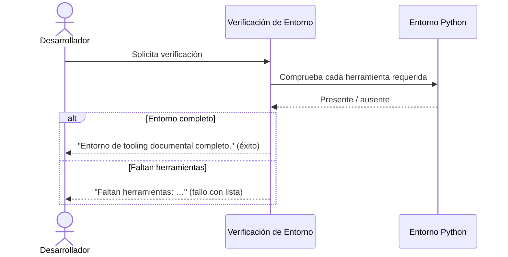

# Verificación de Entorno

## 1. Descripción General

La verificación de entorno comprueba, antes de empezar a trabajar, que el puesto del
desarrollador tiene instaladas todas las herramientas necesarias para generar y validar
documentación. Evita descubrir a mitad de una sesión que falta una herramienta y que el
trabajo se interrumpa o produzca resultados incompletos.

La usan los desarrolladores que mantienen el proyecto y los flujos automatizados (tareas
del editor y comprobaciones previas) como primer paso de cualquier sesión de trabajo. Su
valor es dar una respuesta inmediata e inequívoca: el entorno está completo o falta algo
concreto, sin pasos manuales de inspección.

## 2. Reglas de Negocio

| Regla | Descripción | Impacto si se viola |
|---|---|---|
| Conjunto fijo de herramientas | Se verifican exactamente cuatro herramientas: el generador de documentación, el analizador de estilo, el verificador de tipos y el ejecutor de pruebas | Una herramienta ausente no detectada provoca fallos posteriores en build o validación |
| Resultado binario | El resultado es "completo" o "faltan herramientas" con su lista; no hay estados intermedios | Ambigüedad sobre si se puede trabajar o no |
| Sin servicios externos | La comprobación es local y no contacta con ningún servicio IA ni de red | Violaría el principio del proyecto de ejecución determinista sin APIs |

## 3. Casos de Uso

### Flujo principal

### Flujos alternativos y de error

- **Faltan una o varias herramientas**: la verificación informa de la lista exacta de
  ausentes y termina señalando fallo, para que la instalación pueda corregirse antes de
  continuar.
- **Verificación de un conjunto distinto**: los flujos internos (pruebas) pueden verificar
  una lista alternativa de herramientas sin cambiar el comportamiento por defecto.

## 4. Criterios de Aceptación      ← PENDIENTE QA — No añadir hasta validación

[Esta sección se completará cuando el equipo QA valide los criterios.
Estructura prevista: Tabla | ID | Criterio | Verificable con |
Redacción: "Dado X, cuando Y, entonces Z."]

## 5. Glosario y Términos

| Término | Definición |
|---|---|
| Tooling documental | Conjunto de herramientas locales necesarias para generar y validar la documentación |
| Entorno completo | Estado en el que las cuatro herramientas requeridas están instaladas y son utilizables |
