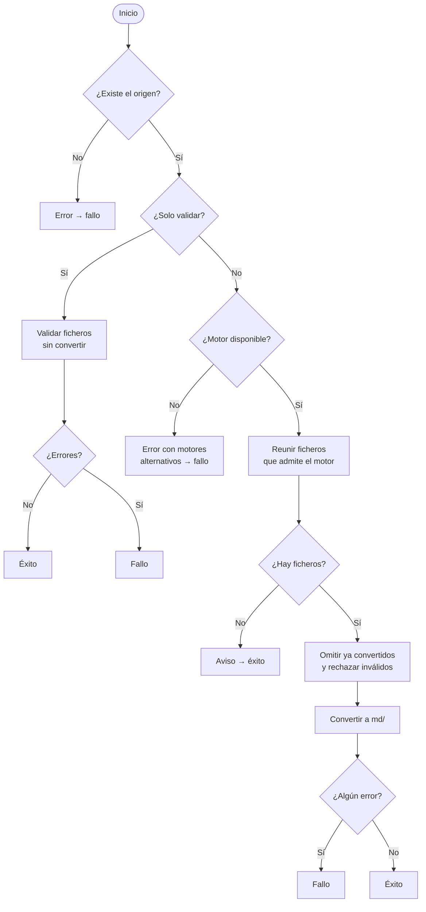

# Conversión de Documentos a Markdown (`convert_to_md`)

## 1. Objetivo y Descripción

La conversión transforma documentos en formatos que el agente IA no puede leer directamente
(PDF, Word, PowerPoint, Excel, ODT, EPUB, RST, HTML, imágenes, correo, LaTeX, audio…) en
Markdown, y deja el resultado en una carpeta `md/` junto a los originales. Así el flujo
[Documentar un Proyecto](document_project.md) puede aprovechar manuales, especificaciones y
normativa que solo existen en formatos binarios o propietarios.

Ofrece tres motores de conversión, elegidos con `--engine`:

| Motor | Formatos | Características |
|---|---|---|
| **docling** (por defecto) | PDF, DOCX, PPTX, XLSX, CSV, HTML, EPUB, imágenes (PNG/JPG/TIFF/BMP/WebP), correo (EML/MSG), LaTeX, audio (WAV/MP3) | OCR integrado, aceleración GPU opcional, fragmentación para RAG, metadatos, conversión por lotes |
| **markitdown** | PDF, DOCX, PPTX, XLSX, XLS, CSV, EPUB, HTML, MSG | Ligero, una sola instalación |
| **pandoc** | DOC, ODT, RST, TEX/LATEX | Herramienta externa; mejor calidad para formatos Office antiguos y LaTeX |

Antes de convertir, cada fichero pasa una validación previa (vacío, ZIP corrupto, cabecera
inválida) para no gastar tiempo en ficheros dañados. Más detalle en la
[referencia técnica](../api/convert_to_md.md) y en los
[ejemplos de uso](../examples/convert_to_md_usage.md); la instalación de los motores está en
[Instalación](../installation.md).

## 2. Precondiciones

- Al menos **un motor** instalado:

    | Motor | Instalación |
    |---|---|
    | docling | `pip install docling` |
    | markitdown | `pip install markitdown` |
    | pandoc | `winget install JohnMacFarlane.Pandoc` (Windows) / `brew install pandoc` (macOS) / `sudo apt install pandoc` (Linux) |

- El origen indicado debe ser un fichero o un directorio existente.
- docling es **opcional**: sin él, usar `--engine markitdown` o `--engine pandoc`.
- Para GPU: controlador NVIDIA y `nvidia-smi` disponible. La CPU es la opción por defecto.

## 3. Flujo Principal



El usuario indica un fichero o carpeta de origen. Si no existe, se informa y termina con
fallo. En modo "solo validar" se revisa cada fichero sin convertir nada. En modo normal se
comprueba que el motor está instalado (si no, se sugieren los otros), se reúnen los ficheros
que ese motor admite (ignorando la propia carpeta `md/`), se omiten los ya convertidos, se
rechazan los inválidos y se convierte el resto. Cualquier fichero fallido hace que el
resultado global sea fallo; el resto de ficheros se convierte igualmente.

## 4. Postcondiciones y Efectos

- Se crea `<origen>/md/` con un `.md` por fichero convertido, **reflejando la estructura de
  carpetas** del origen para evitar colisiones de nombres:

    ```
    origen/
      docs/design.docx    →  md/docs/design.md
      specs/req.pdf       →  md/specs/req.md
      img/scan.png        →  md/img/scan.md       (solo con docling)
    ```

- Con metadatos, cada `.md` empieza con un frontmatter YAML: fichero de origen, motor y
  fecha de conversión (docling añade versión y título).
- Con fragmentación (solo docling), junto a cada `.md` se crea `chunks/<nombre>/` con un
  fichero por fragmento (`001.md`, `002.md`…) y un índice `_manifest.json`.
- Los originales no se modifican. En modo "solo validar" o "simulación" no se crea ningún
  fichero.
- Resultado final: éxito o fallo, con una línea por fichero (`OK`, `OMITIR`, `INVÁLID`,
  `NOSOPOR`, `ERROR`).

## 5. Reglas de Negocio

| Regla | Descripción | Impacto si se viola |
|---|---|---|
| Idempotencia | Un fichero cuyo `.md` ya existe no se vuelve a convertir, salvo que se fuerce | Re-conversiones lentas y sobrescritura de ediciones manuales en `md/` |
| Validación previa | Ficheros vacíos, ZIP corruptos (DOCX/PPTX/XLSX/EPUB), cabeceras PDF o de imagen inválidas y audio de menos de 1 KB se rechazan antes de convertir | Errores opacos del motor o tiempo perdido con ficheros dañados |
| Formato según motor | Cada motor solo procesa sus formatos; un fichero no admitido se marca como no soportado | Conversiones fallidas o resultados vacíos |
| Estructura reflejada | La salida replica las carpetas del origen bajo `md/` | Colisiones entre ficheros con el mismo nombre en carpetas distintas |
| Exclusión de `md/` | La carpeta de salida nunca se vuelve a recorrer como origen | Conversión recursiva de los propios resultados |
| Opciones coherentes | Fragmentación, lotes y concurrencia solo con docling; Flash Attention exige GPU | Ejecuciones con opciones que el motor ignoraría o no admite |
| Sin servicios IA externos | Toda la conversión es local; ningún motor invoca APIs de IA | Violaría el principio del proyecto |

## 6. Límites, Flujos Alternativos y Casos Especiales

### Qué NO hace esta funcionalidad

- No resume, traduce ni interpreta el contenido: solo cambia el formato.
- No borra los `.md` de ficheros que ya no existen en el origen.
- No reconvierte los `.md` que ya existen en el origen: el Markdown ya es legible por el agente.
- No detecta si un original cambió después de convertirlo: si su `.md` existe, se omite
  (usar `--force` para regenerar).

### Flujos alternativos

- **Motor no instalado**: error con la instrucción de instalación y los motores alternativos.
- **Simulación** (`--dry-run`): lista qué se convertiría sin crear ficheros; no exige el motor
  instalado.
- **Solo validar** (`--validate-only`): informa de cada fichero `OK` o `INVÁLID`; si el motor
  no está instalado, solo avisa (no es fallo).
- **Forzar** (`--force`): re-convierte aunque exista el `.md`.
- **Origen sin ficheros convertibles**: aviso informativo y éxito.

### Casos especiales

- **GPU en modo automático** (`--device auto`): detecta la GPU NVIDIA si está disponible.
  Si el usuario ha ocultado la GPU de forma explícita antes de ejecutar, se respeta y se usa CPU.
- **`--device cuda` sin GPU disponible**: error inmediato.
- **Fragmentación sin soporte**: si docling no ofrece el fragmentador, se avisa y el `.md`
  principal se conserva.

## 7. Criterios de Aceptación

| ID | Dado | Cuando | Entonces | Test |
|---|---|---|---|---|
| AC-01 | Un fichero cuyo `.md` ya existe en `md/` | Se convierte sin forzar | Se marca `OMITIR`, el `.md` no cambia y no cuenta como error | `tests/test_convert_to_md.py::test_convert_file_skips_existing`, `tests/test_convert_to_md.py::test_prefilter_omits_existing` |
| AC-02 | Un fichero cuyo `.md` ya existe | Se convierte con `--force` | El fichero se procesa de nuevo en lugar de omitirse | `tests/test_convert_to_md.py::test_convert_file_force_reconvert` |
| AC-03 | Un fichero vacío o con cabecera PDF inválida | Se valida o se convierte | Se marca `INVÁLID` con el motivo y cuenta como error | `tests/test_convert_to_md.py::test_validate_empty_file`, `tests/test_convert_to_md.py::test_validate_invalid_pdf_header`, `tests/test_convert_to_md.py::test_convert_file_invalid_file`, `tests/test_convert_to_md.py::test_prefilter_rejects_invalid` |
| AC-04 | Un fichero en `a/b/deep.docx` | Se convierte | La salida es `md/a/b/deep.md` | `tests/test_convert_to_md.py::test_output_path_nested` |
| AC-05 | Una carpeta origen que ya contiene `md/` con ficheros | Se reúnen los ficheros a convertir | Los ficheros dentro de `md/` se ignoran | `tests/test_convert_to_md.py::test_collect_files_excludes_md_subfolder` |
| AC-06 | Un fichero que el motor elegido no admite | Se convierte | Se marca `NOSOPOR` y cuenta como error | `tests/test_convert_to_md.py::test_convert_file_unsupported_format` |
| AC-07 | Una carpeta con ficheros válidos | Se ejecuta con `--validate-only` | Termina con éxito y no crea `md/` | `tests/test_convert_to_md.py::test_validate_only_does_not_create_output` |
| AC-08 | Una carpeta con un fichero inválido | Se ejecuta con `--validate-only` | Termina con fallo (código 1) | `tests/test_convert_to_md.py::test_validate_only_report_invalid_file` |
| AC-09 | Un fichero válido | Se ejecuta con `--dry-run` en cualquier motor | No se crea el `.md` y el resultado es éxito | `tests/test_convert_to_md.py::test_convert_file_dry_run_docling`, `tests/test_convert_to_md.py::test_convert_file_dry_run_markitdown`, `tests/test_convert_to_md.py::test_convert_file_dry_run_pandoc` |
| AC-10 | El motor elegido no está instalado | Se convierte un fichero | La conversión de ese fichero falla | `tests/test_convert_to_md.py::test_convert_file_docling_not_installed`, `tests/test_convert_to_md.py::test_convert_file_markitdown_not_installed`, `tests/test_convert_to_md.py::test_convert_file_pandoc_not_installed` |
| AC-11 | `--chunk`, `--batch-size >1` o `--workers >1` con un motor distinto de docling | Se lanzan las opciones | Se rechazan antes de convertir | `tests/test_convert_to_md.py::test_parse_args_chunk_requires_docling`, `tests/test_convert_to_md.py::test_parse_args_batch_requires_docling`, `tests/test_convert_to_md.py::test_parse_args_workers_requires_docling` |
| AC-12 | Un origen que no existe | Se ejecuta la conversión | Se informa del error y termina con fallo (código 1) | Sin test |
| AC-13 | Un origen con ficheros `.md` además de documentos convertibles | Se recogen los ficheros a convertir con cualquier motor | Los `.md` del origen no se incluyen | `tests/test_convert_to_md.py::test_collect_files_skips_existing_markdown` |

Verificación: `python -m pytest tests/test_convert_to_md.py -q`.

## 8. Glosario de Dominio

| Término | Definición |
|---|---|
| Motor de conversión | Herramienta que transforma un formato concreto en Markdown (docling, markitdown, pandoc) |
| Validación previa | Comprobación rápida de integridad del fichero antes de convertirlo |
| Estructura reflejada | Réplica de la jerarquía de carpetas del origen dentro de `md/` |
| Fragmento (chunk) | Trozo de un documento convertido, pensado para búsqueda semántica (RAG) |
| Frontmatter | Bloque YAML al inicio del `.md` con metadatos de la conversión |

??? note "Evidencia"

    | Elemento | Fuente | Confianza |
    |---|---|---|
    | Formatos por motor | `scripts/convert_to_md.py::ENGINE_EXTENSIONS` | ✅ |
    | Regla «Idempotencia» | `scripts/convert_to_md.py::convert_file`, `::_prefilter_files` | ✅ |
    | Regla «Validación previa» | `scripts/convert_to_md.py::validate_file` | ✅ |
    | Regla «Formato según motor» | `scripts/convert_to_md.py::convert_file` (`NOSOPOR`) | ✅ |
    | Regla «Estructura reflejada» | `scripts/convert_to_md.py::output_path` | ✅ |
    | Regla «Exclusión de md/» | `scripts/convert_to_md.py::collect_files` | ✅ |
    | Regla «Opciones coherentes» | `scripts/convert_to_md.py::_parse_args` (`parser.error`) | ✅ |
    | Regla «Sin servicios IA externos» | `scripts/convert_to_md.py` (motores locales: docling, markitdown, pandoc) | ✅ |
    | Frontmatter de metadatos | `scripts/convert_to_md.py::_build_metadata_basic`, `::_format_frontmatter` | ✅ |
    | Salida de fragmentos | `scripts/convert_to_md.py::_run_chunking` | ✅ |
    | Simulación sin motor instalado | `scripts/convert_to_md.py::main` | ✅ |
    | Solo validar con motor ausente = aviso | `scripts/convert_to_md.py::_validate_only_report` | ✅ |
    | GPU en modo automático: detecta GPU y respeta una ocultación explícita del usuario | `scripts/convert_to_md.py::_CUDA_ENV_INJECTED`, `::_detect_device`; `tests/test_convert_to_md.py::test_detect_device_auto_ignores_import_default` | ✅ |
    | AC-01 | `scripts/convert_to_md.py::convert_file` | ✅ |
    | AC-02 | `scripts/convert_to_md.py::convert_file` | ⚠️ (el test combina `--force` con simulación) |
    | AC-03 | `scripts/convert_to_md.py::validate_file` | ✅ |
    | AC-04 | `scripts/convert_to_md.py::output_path` | ✅ |
    | AC-05 | `scripts/convert_to_md.py::collect_files` | ✅ |
    | AC-06 | `scripts/convert_to_md.py::convert_file` | ✅ |
    | AC-07 | `scripts/convert_to_md.py::main` | ✅ |
    | AC-08 | `scripts/convert_to_md.py::_validate_only_report` | ✅ |
    | AC-09 | `scripts/convert_to_md.py::convert_file` | ✅ |
    | AC-10 | `scripts/convert_to_md.py::convert_file` | ⚠️ (el mensaje con alternativas de `main` no está cubierto) |
    | AC-11 | `scripts/convert_to_md.py::_parse_args` | ✅ |
    | AC-12 | `scripts/convert_to_md.py::main` | ✅ |
    | AC-13 | `scripts/convert_to_md.py::DOCLING_EXTENSIONS`, `::collect_files` | ✅ |
