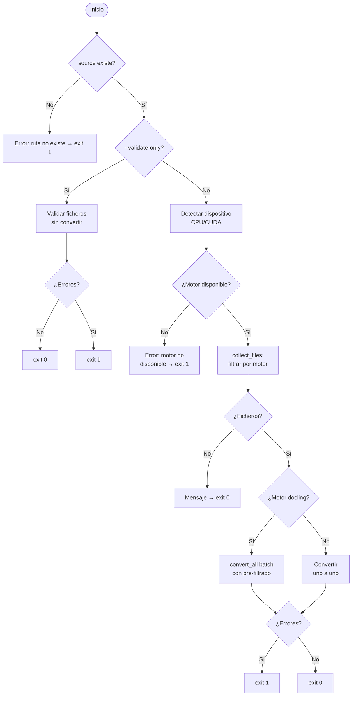

# Conversión de Documentos a Markdown (`convert_to_md`)

## 1. Objetivo

Convertir ficheros en formatos no legibles directamente por el agente IA (PDF, DOCX, PPTX, ODT,
EPUB, RST, HTML, imágenes, email, audio…) a Markdown, depositando el resultado en una carpeta
`md/` dentro del directorio origen. Permite que el flujo `/document-project` procese proyectos
que incluyen documentación en formatos binarios o propietarios.

El script ofrece tres motores de conversión seleccionables con `--engine`:

| Motor | Formatos | Características |
|---|---|---|
| **docling** (default) | PDF, DOCX, PPTX, XLSX, CSV, HTML, EPUB, imágenes (PNG/JPG/TIFF/BMP/WebP), email (EML/MSG), LaTeX, audio (WAV/MP3) | OCR integrado (easyocr/tesseract/rapidocr), aceleración GPU (CUDA), chunking RAG, metadata frontmatter, conversión batch |
| **markitdown** | PDF, DOCX, PPTX, XLSX, XLS, CSV, EPUB, HTML, HTM, MSG | Ligero, sin dependencias pesadas, un solo `pip install` |
| **pandoc** | DOC, ODT, RST, TEX/LATEX | Binario externo, calidad óptima para formatos Office legacy y LaTeX |

## 2. Precondiciones

- Al menos **un motor** instalado:

    | Motor | Instalación |
    |---|---|
    | docling | `pip install docling` |
    | markitdown | `pip install markitdown` |
    | pandoc | `winget install JohnMacFarlane.Pandoc` (Windows) / `brew install pandoc` (macOS) / `sudo apt install pandoc` (Linux) |

- El argumento `source` debe ser un fichero o directorio existente.
- Docling es **opcional**: si no está instalado, usar `--engine markitdown` o `--engine pandoc`.
- Para GPU (CUDA): NVIDIA driver + nvidia-smi en PATH. CPU es el default.

## 3. Flujo Principal



## 4. Comportamiento Esperado

| Situación | Salida |
|---|---|
| Fichero ya convertido en `md/` | `OMITIR` — no re-convierte (idempotente) |
| `--force` con fichero existente | Re-convierte aunque ya exista |
| Conversión exitosa | `OK fichero.pdf -> md/fichero.md` |
| Error de conversión | `ERROR fichero.pdf: <mensaje>` + exit 1 |
| Motor no instalado | `ERROR: Motor 'docling' no disponible.` con alternativas |
| Sin ficheros convertibles | Mensaje informativo + exit 0 |
| `--dry-run` | Lista qué se convertiría, sin ejecutar |
| `--validate-only` | Valida integridad de ficheros sin convertir |
| `--metadata` | Añade frontmatter YAML con origen, motor y fecha |
| `--chunk` (solo docling) | Genera fragmentos RAG en `md/chunks/` |
| Fichero vacío | `INVÁLID: fichero vacío (0 bytes)` |
| PDF con cabecera inválida | `INVÁLID: cabecera PDF inválida (fichero corrupto)` |
| DOCX/PPTX/XLSX ZIP corrupto | `INVÁLID: archivo ZIP inválido` |

**Estructura de salida** — reflejada para evitar colisiones de nombres:

```
origen/
  docs/design.docx    →  md/docs/design.md
  specs/req.pdf       →  md/specs/req.md
  img/scan.png        →  md/img/scan.md       (solo con docling)
```

## 5. Referencias

- [Referencia técnica: convert_to_md](../api/convert_to_md.md) — funciones, CLI, ConvertOptions, constantes.
- [Ejemplo: Convertir Documentos a Markdown](../examples/convert_to_md_usage.md) — invocaciones
  para cada motor, validación, batch y metadata.
- [Instalación — herramientas de conversión](../installation.md) — docling, markitdown y pandoc.
- Integrado en el flujo [Documentar un Proyecto](document_project.md) § Fase 0b.
