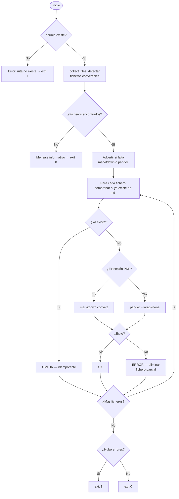

# Conversión de Documentos a Markdown (`convert_to_md`)

## 1. Objetivo

Convertir ficheros en formatos no legibles directamente por el agente IA (PDF, DOCX, PPTX, ODT,
EPUB, RST, HTML…) a Markdown, depositando el resultado en una carpeta `md/` dentro del directorio
origen. Permite que el flujo `/document-project` procese proyectos que incluyen documentación en
formatos binarios o propietarios.

El script selecciona la herramienta según la extensión:

| Formato | Herramienta | Motivo |
|---|---|---|
| **PDF** | `markitdown` (Python) | Pandoc no puede leer PDF |
| DOCX, DOC, PPTX, ODT, EPUB, RST, HTML, HTM | `pandoc` (binario externo) | Calidad óptima de Markdown para formatos Office/web |

## 2. Precondiciones

- **markitdown** instalado para convertir PDF: `pip install markitdown`
- **pandoc** instalado en el PATH para DOCX/PPTX/ODT/…:

    | Sistema | Comando |
    |---|---|
    | Windows | `winget install JohnMacFarlane.Pandoc` |
    | macOS | `brew install pandoc` |
    | Linux (Debian/Ubuntu) | `sudo apt install pandoc` |
    | Linux (Fedora/RHEL) | `sudo dnf install pandoc` |

- El argumento `source` debe ser un fichero o directorio existente.
- Formatos soportados: `.pdf`, `.docx`, `.doc`, `.pptx`, `.odt`, `.epub`, `.rst`, `.html`, `.htm`.
- No es necesario tener ambas herramientas: el script solo falla en los ficheros cuya
  herramienta esté ausente; los demás se convierten correctamente.

## 3. Flujo Principal



## 4. Comportamiento Esperado

| Situación | Salida |
|---|---|
| Fichero ya convertido en `md/` | `OMITIR` — no re-convierte (idempotente) |
| Conversión exitosa | `OK fichero.pdf → md/fichero.md` |
| Error de markitdown o pandoc | `ERROR fichero.pdf: <mensaje>` + exit 1 |
| markitdown no instalado (PDF) | `ERROR nombre.pdf: markitdown no instalado (pip install markitdown)` |
| pandoc no encontrado (DOCX/…) | `ERROR nombre.docx: pandoc no encontrado en el PATH` |
| Sin ficheros convertibles | Mensaje informativo + exit 0 |
| `--dry-run` | Lista qué se convertiría, sin ejecutar conversión |

**Estructura de salida** — reflejada para evitar colisiones de nombres:

```
origen/
  docs/design.docx    →  md/docs/design.md
  specs/req.pdf       →  md/specs/req.md
```

## 5. Referencias

- [Instalación — herramientas de conversión](../installation.md) — markitdown y pandoc por plataforma.
- Integrado en el flujo [Documentar un Proyecto](document_project.md) § Fase 0b.
