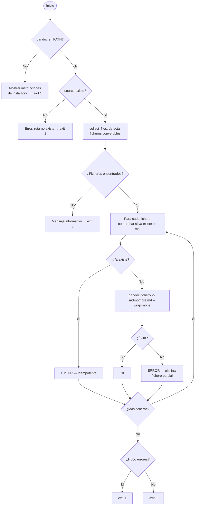

# Conversión de Documentos a Markdown (`convert_to_md`)

## 1. Objetivo

Convertir ficheros en formatos no legibles directamente por el agente IA (PDF, DOCX, PPTX, ODT,
EPUB, RST, HTML…) a Markdown mediante **pandoc**, depositando el resultado en una carpeta `md/`
dentro del directorio origen. Permite que el flujo `/document-project` procese proyectos que
incluyen documentación en formatos binarios o propietarios.

## 2. Precondiciones

- **pandoc instalado** en el PATH del sistema operativo:

    | Sistema | Comando |
    |---|---|
    | Windows | `winget install JohnMacFarlane.Pandoc` |
    | macOS | `brew install pandoc` |
    | Linux (Debian/Ubuntu) | `sudo apt install pandoc` |
    | Linux (Fedora/RHEL) | `sudo dnf install pandoc` |

- El argumento `source` debe ser un fichero o directorio existente.
- Formatos soportados: `.pdf`, `.docx`, `.doc`, `.pptx`, `.odt`, `.epub`, `.rst`, `.html`, `.htm`.

## 3. Flujo Principal



## 4. Comportamiento Esperado

| Situación | Salida |
|---|---|
| Fichero ya convertido en `md/` | `OMITIR` — no re-convierte (idempotente) |
| Conversión exitosa | `OK fichero.pdf → md/fichero.md` |
| Error de pandoc | `ERROR fichero.pdf: <mensaje pandoc>` + exit 1 |
| pandoc no instalado | Mensaje con instrucciones de instalación + exit 1 |
| Sin ficheros convertibles | Mensaje informativo + exit 0 |
| `--dry-run` | Lista qué se convertiría, sin ejecutar pandoc |

**Estructura de salida** — reflejada para evitar colisiones de nombres:

```
origen/
  docs/design.docx    →  md/docs/design.md
  specs/req.pdf       →  md/specs/req.md
```

## 5. Referencias

- [Instalación — Pandoc](../installation.md) — instrucciones de instalación de pandoc por plataforma.
- Integrado en el flujo [Documentar un Proyecto](document_project.md) § Fase 0b.
