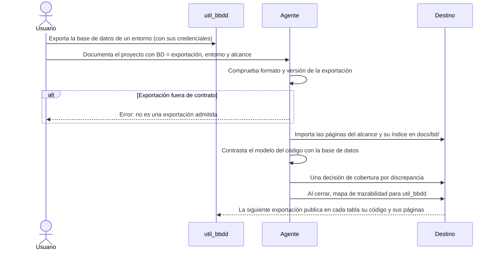

# Trazabilidad con la Base de Datos

## 1. Objetivo y Descripción

La trazabilidad con la base de datos incorpora a la documentación de un proyecto el esquema
**real** de su base de datos —tablas, vistas y rutinas tal como están desplegadas en un
entorno— y lo contrasta con el modelo de datos que declara el código. Es el origen de tipo
**BASE DE DATOS** de [Documentar un Proyecto](document_project.md), que se activa con el
parámetro opcional `BD`.

doc_ia no se conecta nunca a la base de datos ni a la red. Quien documenta genera antes, con
su librería `util_bbdd` y sus propias credenciales, una exportación en Markdown de la base de
datos: una página por objeto y un catálogo legible por máquina con su formato y versión. doc_ia
solo lee esa exportación y, a partir de ella:

- trae a la documentación del proyecto las páginas de los objetos que le corresponden (su
  alcance, expresado con patrones de nombre como `PED_*`), con un índice que indica de qué base
  de datos, motor y fecha procede la foto y qué objetos vecinos quedan fuera;
- compara el modelo del código con la base de datos y lista lo que solo está en un lado: tablas,
  columnas, columnas obligatorias u opcionales y relaciones sin clave ajena;
- entre dos exportaciones, indica qué objetos han aparecido, desaparecido o cambiado y qué
  páginas de la documentación los citan, para revisarlas;
- devuelve a `util_bbdd` un mapa de trazabilidad: para cada tabla o vista, las páginas
  funcionales y técnicas que la explican y los ficheros de código que la usan, de modo que la
  siguiente exportación los publica en la página de cada tabla.

Un ejemplo real motiva la funcionalidad: sobre la exportación de una base de datos MariaDB de un
entorno de calidad con 630 tablas, el contraste del módulo de un proyecto encontró cinco
discrepancias reales, entre ellas una columna presente en la base de datos que el modelo del
código no declara y una columna de relación sin clave ajena en la base de datos.

## 2. Precondiciones

- Una exportación Markdown de la base de datos generada con `util_bbdd` 5.3 o posterior: una
  carpeta con `manifest.json` y `docs/catalog.json` en los formatos y versiones que doc_ia
  admite.
- Saber qué entorno representa la exportación (desarrollo, calidad, producción…) y los patrones
  de nombre del alcance del proyecto.
- Para importar: la raíz del destino de la documentación.
- Para contrastar: el modelo de datos del código en un formato con adaptador. Hoy solo existe
  el de `entities.xml` (vdyn).
- Para el mapa de trazabilidad con código: el repositorio del código bajo git.

## 3. Flujo Principal

El usuario exporta la base de datos con `util_bbdd` y la indica al documentar el proyecto
junto con el entorno que representa y los patrones del alcance. El agente comprueba que la
exportación cumple el contrato y muestra su motor y fecha. Después importa en la sección
«Base de datos» del destino las páginas de los objetos del alcance, con un índice que recoge la
base de datos, el motor, la fecha y los objetos relacionados que no se han importado. Contrasta
el modelo del código con la base de datos: cada discrepancia se registra como decisión de
cobertura para que una persona decida, y la página técnica del modelo de datos la cita con un
enlace a la columna afectada. En las sesiones siguientes, comparar el catálogo nuevo con el
guardado señala las páginas a revisar. Al cerrar la sesión se regenera el mapa de trazabilidad,
que la siguiente exportación de `util_bbdd` usa para enlazar cada tabla con su código y su
documentación.

## 4. Postcondiciones y Efectos

- **Importar**: la carpeta `docs/bd/` del destino (o la indicada) contiene una página por
  objeto del alcance, con la misma ruta que en la exportación, y un `index.md` generado con el
  entorno indicado, la base de datos, el esquema, el motor, la fecha de la exportación, la versión de `util_bbdd`, la
  tabla de objetos importados y la frontera (objetos enlazados por clave ajena que no se han
  importado).
- Los enlaces de esas páginas a objetos no importados se han convertido en texto; los enlaces
  entre objetos importados, los externos y los internos de la página se conservan.
- Las páginas de objetos que han salido del alcance se han retirado.
- `_fuentes/<nombre>/` contiene el catálogo del subconjunto importado (con los patrones del
  alcance) y la cabecera del manifiesto con el entorno: es la referencia de la siguiente
  comparación.
- Repetir la importación sin cambios en la exportación ni en el alcance no modifica ningún
  fichero.
- **Contrastar**: un informe con el número de discrepancias y una fila por discrepancia (tipo,
  objeto y detalle); opcionalmente, también en un fichero.
- **Comparar exportaciones**: una lista de los objetos del alcance con alta, baja o
  modificación y las páginas que citan cada uno. Se hace antes de importar la exportación nueva,
  comparando su catálogo completo con el subconjunto guardado.
- **Mapa de trazabilidad**: `.ai/trace_map.toml` en el destino, regenerado completo en cada
  ejecución.

## 5. Reglas de Negocio

| Regla | Descripción | Impacto si se viola |
|---|---|---|
| Sin conexión a la base de datos | doc_ia solo lee la exportación; las credenciales y la conexión son de `util_bbdd`, fuera de doc_ia | doc_ia manejaría credenciales y accesos a sistemas de terceros |
| Contrato versionado | Solo se aceptan las versiones conocidas del formato del manifiesto y del catálogo; cualquier otra se rechaza | Se importaría una exportación con otra estructura y se documentarían datos mal leídos |
| Foto de un entorno | La exportación describe lo desplegado en un entorno y una fecha concretos; importar exige indicar el entorno, que el índice de la sección muestra junto con base de datos, motor y fecha y que queda guardado con el catálogo | Se presentaría como «el modelo» un esquema que puede diferir entre entornos |
| Solo el alcance | Se importan, contrastan y comparan solo los objetos cuyos nombres encajan con los patrones (sin distinguir mayúsculas); un alcance sin coincidencias al importar es un error | La documentación del módulo arrastraría cientos de tablas ajenas, o quedaría vacía sin aviso |
| Sin enlaces rotos | Un enlace a un objeto no importado se convierte en texto | El build estricto del sitio fallaría por enlaces a páginas inexistentes |
| Sección generada | `docs/bd/` es un artefacto: no se edita a mano, se regenera y retira lo que sale del alcance; sus diagramas quedan fuera de las reglas Mermaid del estándar | Los cambios manuales se perderían en la siguiente importación |
| Nada a medias | Antes de escribir, se comprueba el entorno, el contrato, el alcance y que existen todas las páginas que cita el catálogo; si algo falla, el destino no cambia | Una importación interrumpida dejaría la sección mezclando dos exportaciones |
| Código y base de datos se contrastan | Se contrastan tablas y vistas (lo que modela el código; las rutinas no). Ninguno corrige al otro: toda discrepancia es una decisión de cobertura `COB-DATOS-…` que decide una persona | Se «arreglaría» la documentación en silencio ocultando una diferencia real entre lo construido y lo desplegado |
| Sin lint de esquema | La calidad del esquema (claves ajenas sin índice, comentarios ausentes…) no forma parte de la documentación | La documentación mezclaría hallazgos de diseño de la base de datos con la descripción del sistema |
| Mapa desde la evidencia | El mapa de trazabilidad solo enlaza una tabla o vista con páginas que la citan —por el nombre de la tabla o por el de su entidad o clases del código— y con los ficheros de código de su entidad; sin evidencia, no hay entrada | `util_bbdd` publicaría enlaces inventados entre tablas, código y documentación |
| Funcional o técnica | En el mapa, son funcionales las páginas de `functional/` y las guías how-to y tutorial; el resto (técnica, referencia, ejemplos, decisiones de arquitectura, otras guías) son técnicas | `util_bbdd` enlazaría desde la tabla la explicación de negocio con la técnica cambiadas |
| Nombres exactos | Un nombre de tabla solo cita si aparece entero (`PED_LINEA` no cita `PED_LINEAS`); una entidad del código admite el nombre de sus clases con sufijo en mayúscula (`PedPedidoWnd`), pero no otra entidad que empiece igual (`PedPedidoinfo`) | El mapa enlazaría páginas y código de otra tabla |
| Sin red | Todo se lee y escribe en el sistema de ficheros local | Dependencia de conexión o de servicios externos |

## 6. Límites, Flujos Alternativos y Casos Especiales

### Qué NO hace esta funcionalidad

- No se conecta a la base de datos ni genera la exportación: eso lo hace `util_bbdd`.
- No documenta datos, solo la estructura del esquema.
- No revisa la calidad del esquema (sin lint).
- No resuelve las discrepancias: las registra para que decida una persona.
- No contrasta otros modelos de código que `entities.xml` (vdyn); otros formatos necesitarían
  su propio adaptador.
- No convierte la exportación (ya es Markdown) ni la copia entera a `_fuentes/`: solo el
  catálogo del subconjunto y la cabecera del manifiesto.

### Flujos alternativos

- **Sin parámetro `BD`**: nada de esta funcionalidad se aplica.
- **Exportación fuera de contrato** (otro formato, versión no admitida, catálogo sin objetos,
  un objeto sin identificador, tipo, nombre o página, fichero inexistente o JSON inválido): error
  con su motivo y resultado 2.
- **Sin entorno**, **alcance sin coincidencias** o **página citada inexistente**: error y
  resultado 2; no se escribe nada.
- **Alcance reducido**: las páginas de los objetos que salen del alcance se retiran y los
  enlaces que apuntaban a ellos pasan a texto.
- **Sin patrones de alcance**: se toman todos los objetos del catálogo.
- **Contraste sin discrepancias**: resultado 0; con discrepancias, resultado 1.
- **Mapa sin repositorio de código o sin `entities.xml`**: el mapa solo recoge las páginas que
  citan cada objeto.

### Casos especiales

- **Vistas**: se comparan columnas y nulabilidad, pero no claves ajenas, que las vistas no
  tienen.
- **Rutinas** (procedimientos y funciones): se importan si encajan en el alcance, pero no se
  contrastan con el código ni entran en el mapa de trazabilidad.
- **Imágenes** en las páginas importadas: se conservan sin tocar.
- **Relación hacia una entidad de otro paquete** no declarada en el mismo `entities.xml`: solo
  se comprueba que exista alguna clave ajena en la columna, no a qué tabla apunta.
- **Varias exportaciones del mismo proyecto** (por ejemplo, dos entornos): cada una se importa
  con su propio nombre en `_fuentes/`.
- **Páginas de la sección generada**: no cuentan como evidencia al comparar exportaciones ni al
  generar el mapa. Si la sección se importó en otra carpeta, se indica la misma al comparar y al
  generar el mapa.
- **Rutas con espacios o acentos** en el repositorio de código: se leen tal cual.

## 7. Criterios de Aceptación

| ID | Dado | Cuando | Entonces | Test |
|---|---|---|---|---|
| AC-01 | Un catálogo con una versión de formato no admitida o un manifiesto de otro formato | Se lee o se ejecuta `info` | Error «no soportada» y resultado 2 | `tests/test_db_trace.py::test_rejects_foreign_or_newer_formats` |
| AC-02 | Una página con enlaces a un objeto importado, a uno no importado, externos e internos | Se importa | Solo el enlace al objeto no importado pasa a texto en código | `tests/test_db_trace.py::test_rewrite_links_keeps_imported_and_external` |
| AC-03 | Una exportación y un alcance `MOD_*` y `V_MOD` | Se importa dos veces | Solo se importan los objetos del alcance; índice con motor y frontera; catálogo del subconjunto en `_fuentes/`; la segunda vez, sin cambios | `tests/test_db_trace.py::test_import_pages_selects_scope_and_is_idempotent` |
| AC-04 | Un alcance importado | Se reduce el alcance y se importa | La página que sale se retira y su enlace pasa a texto | `tests/test_db_trace.py::test_import_pages_retires_objects_out_of_scope` |
| AC-05 | Un alcance que no encaja con ningún objeto | Se importa | Error «ningún objeto» | `tests/test_db_trace.py::test_import_pages_without_matches_is_an_error` |
| AC-06 | Un modelo del código y un catálogo con diferencias | Se contrastan | Tabla solo en el código, tabla solo en la BD, columna en cada lado, nulabilidad distinta, FK a otra tabla y relación sin FK | `tests/test_db_trace.py::test_compare_reports_tables_columns_nullability_and_fk` |
| AC-07 | Un alcance con discrepancias y otro sin ellas | Se contrasta desde la CLI | Resultados 1 y 0 | `tests/test_db_trace.py::test_compare_cli_exit_codes` |
| AC-08 | Dos catálogos con un objeto nuevo, uno retirado y uno con otra huella | Se comparan | Alta, baja y modificado, en ese orden | `tests/test_db_trace.py::test_catalog_changes_by_hash` |
| AC-09 | Páginas funcionales y técnicas que citan tablas y vistas, y la sección importada | Se genera el mapa | Cada objeto con sus páginas funcionales y técnicas; sin evidencia, sin entrada; la sección importada no cuenta | `tests/test_db_trace.py::test_tracemap_from_documentation_evidence` |
| AC-10 | Ficheros de código y páginas de distintas carpetas | Se clasifican | Son código de la entidad su clase, su interfaz `I…`, una clase con sufijo en mayúscula o su carpeta, pero no otra entidad que empieza igual; son funcionales `functional/` y las guías how-to y tutorial | `tests/test_db_trace.py::test_entity_code_and_page_classification` |
| AC-11 | Una página funcional que cita una clase de la entidad y otra que cita una entidad de nombre más largo | Se genera el mapa | La tabla se enlaza solo con la primera | `tests/test_db_trace.py::test_tracemap_finds_pages_by_entity_name` |
| AC-12 | Un entorno en blanco, o un catálogo que cita una página inexistente | Se importa | Error «entorno» o «páginas inexistentes» y la sección no se crea | `tests/test_db_trace.py::test_select_requires_env_and_does_not_write_partially` |
| AC-13 | Una página con una imagen y un enlace a un objeto no importado | Se importa | La imagen se conserva y solo el enlace pasa a texto | `tests/test_db_trace.py::test_rewrite_links_leaves_images_alone` |
| AC-14 | Un catálogo con un objeto sin nombre ni página | Se lee | Error que indica qué falta | `tests/test_db_trace.py::test_catalog_with_incomplete_object_is_an_error` |
| AC-15 | Una rutina cuyo nombre encaja en el alcance | Se contrasta | No genera discrepancia | `tests/test_db_trace.py::test_compare_ignores_routines` |
| AC-16 | El catálogo completo de una exportación y el subconjunto guardado | Se comparan con y sin alcance | Sin alcance, los objetos de fuera salen como alta; con alcance, no hay cambios | `tests/test_db_trace.py::test_changes_limited_to_scope` |

Verificación: `python -m pytest tests/test_db_trace.py -q`.

## 8. Glosario de Dominio

| Término | Definición |
|---|---|
| Origen BASE DE DATOS | Exportación de `util_bbdd` indicada con el parámetro `BD`; describe el esquema real de un entorno |
| Exportación | Carpeta generada por `util_bbdd` con una página Markdown por objeto, `manifest.json` y `docs/catalog.json` |
| Catálogo | `catalog.json`: lista de objetos con tipo, nombre, página, huella, columnas y claves ajenas |
| Entorno | Instalación concreta de la base de datos (desarrollo, calidad, producción…) que fotografía la exportación |
| Alcance | Patrones de nombre (glob, sin distinguir mayúsculas) de los objetos que pertenecen al proyecto |
| Frontera | Objetos fuera del alcance enlazados por clave ajena con los importados |
| Contraste | Comparación del modelo del código con la base de datos; cada discrepancia es una ficha `COB-DATOS-…` |
| Mapa de trazabilidad | `.ai/trace_map.toml`: por tabla o vista, sus páginas y su código, que `util_bbdd` publica en la siguiente exportación |

??? note "Evidencia"

    | Elemento | Fuente | Confianza |
    |---|---|---|
    | Parámetro `BD` y tipo BASE DE DATOS | `.github/prompts/document_project.prompt.md::Origen BASE DE DATOS (opción BD)`, `::Fase 0a`, `.claude/commands/document-project.md` (Inputs requeridos) | ✅ |
    | Regla «Sin conexión a la base de datos» y «Sin red» | `scripts/db_trace.py` (docstring del módulo; sin red ni drivers) | ✅ |
    | Regla «Contrato versionado» | `scripts/db_trace.py::load_manifest`, `::load_catalog`, `::SUPPORTED_MANIFEST`, `::SUPPORTED_CATALOG` | ✅ |
    | Regla «Foto de un entorno» e índice | `scripts/db_trace.py::import_pages` (`--env` obligatorio, `doc_ia_entorno`), `::_index_page`, `.github/prompts/document_project.prompt.md::Origen BASE DE DATOS (opción BD)` (punto 2) | ✅ |
    | Regla «Solo el alcance» | `scripts/db_trace.py::matches`, `::select_objects`, `::import_pages` | ✅ |
    | Regla «Sin enlaces rotos» | `scripts/db_trace.py::rewrite_links` | ✅ |
    | Regla «Sección generada» y retirada | `scripts/db_trace.py::import_pages`, `::GENERATED_NOTE`, `.github/prompts/document_project.prompt.md::Origen BASE DE DATOS (opción BD)` (punto 3) | ✅ |
    | Catálogo del subconjunto y cabecera en `_fuentes/` | `scripts/db_trace.py::import_pages` | ✅ |
    | Regla «Código y base de datos se contrastan» | `.github/prompts/document_project.prompt.md::Origen BASE DE DATOS (opción BD)` (punto 4), prioridad de fuentes (punto 5) | ✅ |
    | Regla «Sin lint de esquema» | `.github/prompts/document_project.prompt.md::Origen BASE DE DATOS (opción BD)` (punto 6) | ✅ |
    | Contraste y sus tipos de discrepancia | `scripts/db_trace.py::load_entities`, `::compare` | ✅ |
    | Comparar exportaciones (por alcance, antes de importar) | `scripts/db_trace.py::catalog_changes`, `::pages_citing`, `.github/prompts/document_project.prompt.md::Origen BASE DE DATOS (opción BD)` (punto 5) | ✅ |
    | Regla «Mapa desde la evidencia», búsqueda por tabla o entidad y clasificación de páginas | `scripts/db_trace.py::build_tracemap`, `::pages_citing`, `::is_functional`, `::is_entity_code` | ✅ |
    | Caso «Páginas de la sección generada» y `--subdir` | `scripts/db_trace.py::pages_citing` (`skip`), `::_cmd_changes`, `::build_tracemap`, `::_parser` | ✅ |
    | Regla «Nada a medias» | `scripts/db_trace.py::import_pages` (comprobaciones antes de escribir) | ✅ |
    | Rutinas fuera del contraste e imágenes conservadas | `scripts/db_trace.py::compare`, `::SCHEMA_KINDS`, `::LINK_RE` | ✅ |
    | Objeto incompleto en el catálogo | `scripts/db_trace.py::load_catalog`, `::REQUIRED_KEYS` | ✅ |
    | Rutas con espacios o acentos | `scripts/db_trace.py::build_tracemap` (`core.quotepath=off`, `ls-files -z`) | ✅ |
    | Mapa en el CIERRE | `.github/prompts/document_project.prompt.md::Devuelve en este orden` (Trazabilidad para la BD) | ✅ |
    | Resultados 0, 1 y 2 | `scripts/db_trace.py::_cmd_select`, `::_cmd_compare`, `::_cmd_changes`, `::main` | ✅ |
    | AC-01 – AC-16 | `tests/test_db_trace.py` | ✅ |
