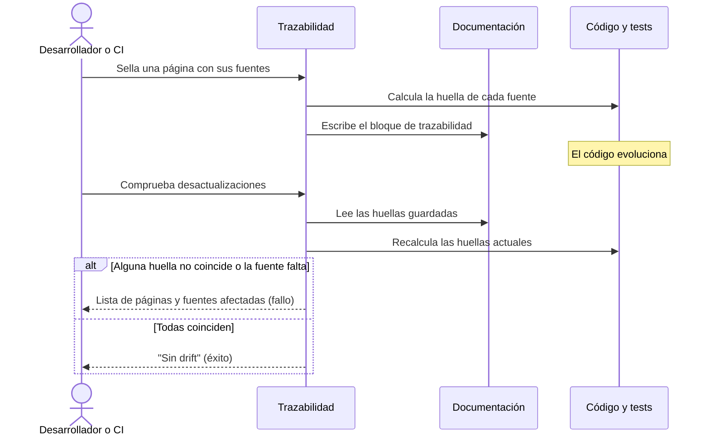

# Trazabilidad entre Documentación y Código

## 1. Objetivo y Descripción

La trazabilidad mantiene la documentación honesta con el código que describe. Cada página
puede declarar de qué ficheros fuente se ha obtenido y guardar una huella de su contenido;
cuando una de esas fuentes cambia, la comprobación avisa de qué páginas han quedado
desactualizadas, en lugar de descubrirlo cuando un lector ya ha confiado en información
obsoleta.

Además, la trazabilidad cruza los criterios de aceptación de las páginas funcionales con
los tests que existen realmente: detecta criterios que citan un test inexistente y tests
que no respaldan ningún criterio. Por último, genera un índice de la documentación pensado
para que los agentes IA encuentren las páginas publicadas (formato `llms.txt`).

Para volver a documentar un proyecto sin releerlo entero, la trazabilidad guarda al cerrar
cada sesión el punto exacto del historial del proyecto documentado (su *baseline*). En la
sesión siguiente lista los ficheros cambiados desde ese punto y las páginas que los citan
como evidencia, de modo que solo se revisa lo que ha cambiado.

Cuando la documentación marca apartados como parciales, sin cubrir o por verificar, las
personas responsables deciden qué hacer con cada uno en un registro de decisiones que revisan
y editan a mano. La trazabilidad comprueba que ese registro está bien formado y que cada
decisión tomada ya se ve en la documentación, enlazada a su ficha; las decisiones aún
pendientes se listan, pero no se consideran un fallo.

La usan los desarrolladores y revisores que mantienen la documentación, a mano o en
integración continua. Todo el proceso es local y determinista: no consulta servicios IA ni
la red, y el mismo repositorio produce siempre el mismo resultado.

## 2. Precondiciones

- Repositorio con una carpeta de documentación y, para la matriz, una carpeta de tests.
- Para detectar desactualizaciones: páginas con el bloque inicial de trazabilidad (arquetipo,
  fuentes con su huella y fecha de revisión); las páginas sin él se ignoran.
- Para el índice para agentes IA: configuración del sitio con su navegación.
- Para el modo incremental: el proyecto documentado bajo control de versiones con Git y Git
  instalado; sin él, la sesión siguiente se hace completa.
- Para las decisiones de cobertura: registros de decisiones en la carpeta `decisiones/` de la
  documentación; sin ellos, la comprobación termina con éxito.
- Entorno con las herramientas del tooling documental (la lectura de la configuración usa la
  misma librería que el generador del sitio).

## 3. Flujo Principal

El desarrollador sella una página indicando sus fuentes: se calcula una huella de cada una
y se guarda al principio de la página. Más adelante, la comprobación recorre todas las
páginas selladas, recalcula las huellas y compara. Si una fuente ha cambiado, ha
desaparecido o apunta fuera del repositorio, se informa de la página y la fuente concretas y
se termina con fallo; el desarrollador revisa la página y la vuelve a sellar. La matriz de
criterios y el índice para agentes IA se ejecutan como operaciones independientes.

## 4. Postcondiciones y Efectos

- **Sellar**: reescribe solo el bloque inicial de la página (o lo crea); el resto del
  contenido queda intacto.
- **Comprobar desactualizaciones**: no modifica nada; informa por pantalla y con el código de
  finalización.
- **Matriz de criterios**: muestra la matriz por pantalla o la escribe en el fichero indicado.
- **Índice para agentes IA**: escribe `llms.txt` en la carpeta de documentación del proyecto
  indicado como raíz (el sitio lo publica en su raíz); en modo comprobación no escribe nada.
- **Baseline**: escribe o actualiza la entrada del proyecto en `.ai/doc_state.json` del
  destino, conservando la de los demás proyectos.
- **Cambios desde el baseline**: no modifica nada; informa de los ficheros cambiados, las
  páginas que los citan, las que solo los mencionan, los ejemplos enlazados y los ficheros
  sin página; termina con éxito si no hay cambios, con fallo si los hay y con código 3 si
  no hay baseline utilizable.
- **Decisiones de cobertura**: no modifica nada; muestra por pantalla o escribe en el fichero
  indicado un resumen por registro, las decisiones pendientes y los hallazgos; termina con
  fallo si hay algún hallazgo.

## 5. Reglas de Negocio

| Regla | Descripción | Impacto si se viola |
|---|---|---|
| Huella estable entre sistemas | La huella no depende de los saltos de línea (Windows/Linux) | Falsas desactualizaciones al cambiar de sistema o de configuración de Git |
| Sellar no encadena desactualizaciones | En fuentes que son a su vez páginas, la huella ignora su bloque de trazabilidad | Resellar una página marcaría como desactualizadas todas las que la citan |
| Nunca leer fuera del repositorio | Una fuente que apunta fuera del repositorio se informa y no se lee; al sellar se rechaza | Exposición de ficheros ajenos al proyecto a través de la documentación |
| Sin test inventado | La matriz falla si un criterio cita un test que no existe | Criterios de aceptación con una cobertura aparente que no es real |
| Índice solo de lo publicado | El índice para agentes IA incluye solo las páginas de la navegación; los enlaces externos se omiten | Páginas internas o enlaces ajenos expuestos como documentación del proyecto |
| Determinismo | Sin servicios IA ni red; orden estable de páginas, fuentes y tests | Resultados distintos para el mismo repositorio; incompatible con CI |
| Cita frente a mención | Una página que cita el fichero como evidencia (bloque «Evidencia» o fuentes declaradas) se revisa; una que solo lo nombra en el texto se avisa aparte | Revisar ADR, changelog y guías por cada cambio, o dejar de revisar las páginas que sí dependen del fichero |
| Lo que genera la documentación no es un cambio | Si la documentación vive dentro del proyecto, su carpeta, el contexto de sesiones, las fuentes convertidas, la configuración del sitio y las instrucciones de visualización no cuentan como cambios | Cada cierre de sesión aparecería como cambio del proyecto en la siguiente |
| Una decisión tomada se ve en la documentación | Cada apartado con una decisión tomada enlaza su ficha y muestra el estado que fija la decisión | La documentación contradice o pierde una decisión de las personas responsables |
| Una decisión editada avisa | Al sellar una página se guarda también la huella de cada registro de decisiones que enlaza; si alguien edita el registro, la comprobación de desactualizaciones marca la página, aunque la documentación viva en otro repositorio que el código. Una página que enlaza un registro sin haberlo sellado también se informa | Decisiones nuevas que nadie aplica a la documentación |
| Decidir no es tarea de la herramienta | Las decisiones pendientes se listan, pero no son fallo; la herramienta nunca escribe en el registro | Bloquear la integración continua mientras alguien decide, o decisiones tomadas por una máquina |
| Vocabulario cerrado | Cada estado admite solo ciertas decisiones; una decisión tomada exige responsable, fecha y estado resultante | Decisiones ambiguas que no se pueden aplicar ni auditar |
| Ante la duda, sesión completa | Sin baseline, sin Git, con el punto guardado fuera del historial o con otra versión menor de doc_ia, se pide la sesión completa (código 3) | Una sesión incremental que omite cambios reales o aplica reglas de arquetipos antiguas |

## 6. Límites, Flujos Alternativos y Casos Especiales

### Qué NO hace esta funcionalidad

- No decide qué fuentes tiene una página: las indica quien sella (o se conservan las ya
  declaradas).
- No corrige la documentación desactualizada: solo la señala.
- No ejecuta los tests: la matriz comprueba que los tests citados existen, no que pasen.
- No detecta cambios en fuentes que una página no declara.
- En modo incremental no interpreta los cambios: dice qué ficheros cambiaron y qué páginas
  los citan; decidir si la página sigue vigente corresponde al flujo de documentación.
- No toma decisiones de cobertura ni aplica las tomadas: comprueba que el registro y la
  documentación coinciden; aplicarlas corresponde al flujo de documentación.

### Flujos alternativos

- **Sellar sin fuentes** en una página que tampoco las tenía: se rechaza con un error.
- **Fuente inexistente al sellar**: se rechaza con un error.
- **Índice desactualizado en modo comprobación**: se informa y termina con fallo, sin escribir.
- **Invocación sin operación**: error de uso.
- **Cambios sin baseline utilizable** (no hay entrada para el proyecto, el proyecto no usaba
  Git, el punto guardado ya no está en el historial o la versión menor de doc_ia cambió):
  se indica el motivo y se termina con código 3 para que la sesión sea completa.

### Casos especiales

- **Página sin bloque de trazabilidad**: la comprobación la ignora (no es un fallo).
- **Fecha de revisión**: si no se indica al sellar, se usa la fecha del día, de modo que dos
  sellados en días distintos producen bloques distintos aunque las fuentes no cambien ⚠️.
- **Tests agrupados en clases**: también cuentan como tests existentes en la matriz.
- **Página o configuración inexistente**: sellar una página que no existe, o generar el índice
  sin navegación definida, termina con un mensaje de error claro (código 1), sin traza técnica.
- **Proyecto en una subcarpeta de un repositorio**: los cambios se calculan solo dentro de
  esa carpeta y con rutas relativas a ella, las mismas que usan las citas.
- **Cambios sin confirmar al tomar el baseline**: se avisa; como los cambios se comparan con
  el estado actual de los ficheros, en la sesión siguiente se vuelven a revisar.
- **Ficheros renombrados**: se informan con la ruta anterior y la nueva, y cuentan las
  páginas que citan cualquiera de las dos.
- **Identificadores de ejemplo**: los identificadores de apartado escritos como código (en un
  bloque o entre comillas invertidas) no cuentan, de modo que se puede documentar el formato.
- **Símbolo de aviso con o sin variante gráfica**: ambos se reconocen como «parcial».

## 7. Criterios de Aceptación

| ID | Dado | Cuando | Entonces | Test |
|---|---|---|---|---|
| AC-01 | Una página recién sellada cuyas fuentes no han cambiado | Se comprueban desactualizaciones | No hay hallazgos y el cuerpo de la página se conserva | `tests/test_doc_trace.py::test_stamp_then_no_drift` |
| AC-02 | Una página sellada cuya fuente se modifica | Se comprueban desactualizaciones | Se informa la fuente como desactualizada | `tests/test_doc_trace.py::test_drift_detects_stale_source` |
| AC-03 | Una página que declara una fuente que ya no existe | Se comprueban desactualizaciones | Se informa la fuente como ausente | `tests/test_doc_trace.py::test_drift_detects_missing_source` |
| AC-04 | Una página que declara una fuente fuera del repositorio | Se comprueban desactualizaciones | Se informa como fuera del repositorio y no se lee | `tests/test_doc_trace.py::test_drift_never_reads_outside_repo` |
| AC-05 | Una fuente fuera del repositorio | Se intenta sellar la página | Se rechaza con un error | `tests/test_doc_trace.py::test_stamp_rejects_source_outside_repo` |
| AC-06 | Una página sin fuentes declaradas | Se sella sin indicar fuentes | Se rechaza con un error | `tests/test_doc_trace.py::test_stamp_requires_sources` |
| AC-07 | Una página ya sellada | Se vuelve a sellar sin indicar fuentes ni arquetipo | Se conservan sus fuentes y su arquetipo con huellas actualizadas | `tests/test_doc_trace.py::test_stamp_preserves_existing_sources_and_archetype` |
| AC-08 | El mismo contenido con saltos de línea distintos, o una página con y sin bloque de trazabilidad | Se calcula la huella | La huella es idéntica | `tests/test_doc_trace.py::test_fingerprint_ignores_line_endings`, `tests/test_doc_trace.py::test_fingerprint_markdown_ignores_frontmatter` |
| AC-09 | Un criterio que cita un test inexistente | Se genera la matriz | El test aparece como inexistente y la operación termina con fallo | `tests/test_doc_trace.py::test_matrix_reports_unknown_and_uncited`, `tests/test_doc_trace.py::test_main_matrix_exit_code_on_unknown_test` |
| AC-10 | Tests que ningún criterio cita, incluidos tests dentro de clases | Se genera la matriz | Aparecen en la lista de tests sin criterio de aceptación | `tests/test_doc_trace.py::test_matrix_reports_unknown_and_uncited`, `tests/test_doc_trace.py::test_collect_test_ids_includes_class_methods` |
| AC-11 | Una configuración del sitio con etiquetas especiales del generador y un enlace externo en la navegación | Se genera el índice para agentes IA | El índice incluye las páginas con su URL publicada y omite el enlace externo | `tests/test_doc_trace.py::test_build_llms_txt_tolerates_python_tags` |
| AC-12 | Un índice para agentes IA ausente o desactualizado | Se comprueba en modo comprobación | Termina con fallo; tras regenerarlo, la comprobación termina con éxito | `tests/test_doc_trace.py::test_main_llms_check_detects_outdated` |
| AC-13 | Ninguna operación indicada | Se invoca la trazabilidad | Termina con error de uso (código 2) | `tests/test_doc_trace.py::test_main_requires_subcommand` |
| AC-14 | Una página sin bloque de trazabilidad o sin fuentes declaradas | Se leen sus datos de trazabilidad | Se considera no sellada | `tests/test_doc_trace.py::test_read_page_meta_without_frontmatter`, `tests/test_doc_trace.py::test_read_page_meta_without_sources`, `tests/test_doc_trace.py::test_drift_ignores_unsealed_page` |
| AC-15 | Un proyecto documentado bajo Git sin cambios pendientes | Se guarda su baseline | El estado del destino registra el punto actual del historial, la rama, que no hay cambios pendientes y la versión de doc_ia | `tests/test_doc_trace.py::test_baseline_records_clean_head` |
| AC-16 | Un baseline guardado y el proyecto sin cambios | Se piden los cambios | Se informa «sin cambios» y termina con éxito | `tests/test_doc_trace.py::test_changes_without_changes_exit_0` |
| AC-17 | Un fichero modificado citado como evidencia y nombrado en una guía, uno renombrado y uno nuevo con «ñ» | Se piden los cambios | Cada fichero aparece con las páginas que lo citan; la guía, solo como mención; el renombrado con su ruta anterior; el nuevo, sin página; se añade el ejemplo enlazado y termina con fallo | `tests/test_doc_trace.py::test_changes_maps_files_to_citing_pages_and_examples` |
| AC-18 | Varios proyectos documentados en el mismo destino | Se piden los cambios de uno | Se reconocen sus citas con el nombre del proyecto delante | `tests/test_doc_trace.py::test_changes_matches_prefixed_citations_of_multi_origin` |
| AC-19 | Sin baseline, proyecto sin Git, punto guardado fuera del historial u otra versión menor de doc_ia | Se piden los cambios | Se indica el motivo y termina con código 3 (sesión completa) | `tests/test_doc_trace.py::test_changes_falls_back_to_full_mode_exit_3`, `tests/test_doc_trace.py::test_baseline_without_git_then_changes_is_full_mode` |
| AC-20 | La documentación vive dentro del proyecto documentado | Se cierra una sesión y se piden los cambios | Los ficheros que genera la documentación no cuentan como cambios ni como cambios pendientes; un cambio en el código sí | `tests/test_doc_trace.py::test_destination_inside_origin_ignores_its_own_artifacts` |
| AC-21 | Un proyecto en una subcarpeta de un repositorio más grande | Se piden los cambios | Solo cuentan los ficheros de esa carpeta, con rutas relativas a ella | `tests/test_doc_trace.py::test_origin_in_subfolder_of_repository_uses_origin_relative_paths` |
| AC-22 | Una documentación sin registros de decisiones | Se comprueban las decisiones | Termina con éxito | `tests/test_doc_trace.py::test_decisions_without_registers_is_clean` |
| AC-23 | Un apartado con su decisión pendiente | Se comprueban las decisiones | No es hallazgo; aparece en la lista de pendientes | `tests/test_doc_trace.py::test_pending_card_is_not_a_finding` |
| AC-24 | Una decisión tomada | Se comprueban las decisiones | Sin hallazgos si el apartado enlaza la ficha y muestra el estado resultante; si conserva el estado anterior o no enlaza la ficha, se informa como no reflejada y termina con fallo | `tests/test_doc_trace.py::test_decided_and_reflected_is_clean`, `tests/test_doc_trace.py::test_decided_but_page_keeps_old_symbol_is_unreflected`, `tests/test_doc_trace.py::test_decided_without_link_to_card_is_unreflected`, `tests/test_doc_trace.py::test_main_decisions_exit_1_and_writes_report` |
| AC-25 | Una decisión sin responsable o sin fecha, fuera del vocabulario de su estado, con fecha mal escrita, de otro ámbito o con «No aplica» solo en uno de los dos campos | Se comprueban las decisiones | Se informa como incompleta o inválida y no se exige reflejarla | `tests/test_doc_trace.py::test_decided_without_owner_or_date_is_incomplete`, `tests/test_doc_trace.py::test_decision_not_allowed_for_state_is_invalid`, `tests/test_doc_trace.py::test_bad_date_and_scope_are_invalid`, `tests/test_doc_trace.py::test_not_applicable_must_match_and_be_written_in_page` |
| AC-26 | Un apartado con dos fichas, una ficha que ninguna página cita, un apartado sin ficha o una ficha pendiente con otro estado en la página | Se comprueban las decisiones | Se informa cada caso | `tests/test_doc_trace.py::test_duplicate_orphan_entry_and_orphan_ref`, `tests/test_doc_trace.py::test_pending_card_with_different_page_symbol_is_mismatch` |
| AC-27 | Identificadores escritos como código y apartados dentro del bloque plegable «Evidencia», con el símbolo de aviso en cualquiera de sus formas | Se comprueban las decisiones | Los de código se ignoran; los del bloque plegable se comprueban | `tests/test_doc_trace.py::test_ids_in_code_are_ignored_and_admonition_rows_are_read`, `tests/test_doc_trace.py::test_warning_symbol_without_variation_selector` |
| AC-28 | Un proyecto documentado en otra carpeta, indicada como raíz | Se comprueban desactualizaciones o se genera la matriz sin indicar las carpetas de documentación y de tests | Se usan las del proyecto indicado, no las de doc_ia | `tests/test_doc_trace.py::test_main_drift_defaults_follow_root`, `tests/test_doc_trace.py::test_main_matrix_defaults_follow_root` |
| AC-29 | Una página que enlaza un registro de decisiones | Se sella y después se edita el registro | La página aparece como desactualizada, también si la documentación vive en otro repositorio | `tests/test_doc_trace.py::test_stamp_seals_linked_register_and_drift_detects_its_edit`, `tests/test_doc_trace.py::test_drift_seals_registers_of_external_destination` |
| AC-30 | Una página que enlaza un registro sin haberlo sellado, o que solo enlaza registros | Se comprueban desactualizaciones o se sella | Se informa como no sellada; se puede sellar sin indicar fuentes; los enlaces escritos como código no cuentan | `tests/test_doc_trace.py::test_drift_reports_unsealed_register_link`, `tests/test_doc_trace.py::test_stamp_page_that_only_links_registers`, `tests/test_doc_trace.py::test_register_links_inside_code_are_not_sealed` |

Verificación: `python -m pytest tests/test_doc_trace.py -q`.

## 8. Glosario de Dominio

| Término | Definición |
|---|---|
| Huella | Resumen corto del contenido de una fuente; cambia cuando cambia la fuente |
| Sellar | Calcular las huellas de las fuentes de una página y guardarlas en su bloque de trazabilidad |
| Drift (desactualización) | Diferencia entre la huella guardada en una página y la huella actual de su fuente |
| Matriz de trazabilidad | Cruce entre los criterios de aceptación y los tests que los verifican |
| `llms.txt` | Índice de la documentación publicada en un formato pensado para agentes IA |
| Baseline | Punto del historial del proyecto documentado que refleja la documentación al cerrar una sesión |
| Cita / mención | Cita: el fichero aparece como evidencia de la página. Mención: solo se nombra en el texto |
| Registro de decisiones de cobertura | Documento que las personas editan para decidir sobre cada apartado parcial, sin cubrir o por verificar |
| Ficha | Entrada del registro para un apartado: estado detectado, decisión, contexto, responsable, fecha y estado resultante |
| Decisión reflejada | La documentación enlaza la ficha y muestra el estado que fija la decisión |

??? note "Evidencia"

    | Elemento | Fuente | Confianza |
    |---|---|---|
    | Regla «Huella estable entre sistemas» | `scripts/doc_trace.py::fingerprint` | ✅ |
    | Regla «Sellar no encadena desactualizaciones» | `scripts/doc_trace.py::fingerprint` (rama `.md`) | ✅ |
    | Regla «Nunca leer fuera del repositorio» | `scripts/doc_trace.py::_resolve_source`, `::check_drift`, `::stamp_page` | ✅ |
    | Regla «Sin test inventado» | `scripts/doc_trace.py::build_matrix`, `::_cmd_matrix` | ✅ |
    | Regla «Índice solo de lo publicado» | `scripts/doc_trace.py::build_llms_txt` (filtro `.md`) | ✅ |
    | Regla «Determinismo» | `scripts/doc_trace.py::check_drift`, `::collect_test_ids`, `::format_frontmatter` (`sorted`) | ✅ |
    | Fecha del día por defecto al sellar | `scripts/doc_trace.py::stamp_page` (`date.today()`) | ✅ |
    | Página sin bloque ignorada por la comprobación | `scripts/doc_trace.py::check_drift` (`meta is None`) | ✅ |
    | AC-01 | `scripts/doc_trace.py::stamp_page`, `::check_drift` | ✅ |
    | AC-02 | `scripts/doc_trace.py::check_drift` | ✅ |
    | AC-03 | `scripts/doc_trace.py::check_drift` | ✅ |
    | AC-04 | `scripts/doc_trace.py::_resolve_source`, `::check_drift` | ✅ |
    | AC-05 | `scripts/doc_trace.py::stamp_page` | ✅ |
    | AC-06 | `scripts/doc_trace.py::stamp_page` | ✅ |
    | AC-07 | `scripts/doc_trace.py::stamp_page` | ✅ |
    | AC-08 | `scripts/doc_trace.py::fingerprint` | ✅ |
    | AC-09 | `scripts/doc_trace.py::build_matrix`, `::_cmd_matrix` | ✅ |
    | AC-10 | `scripts/doc_trace.py::build_matrix`, `::collect_test_ids` | ✅ |
    | AC-11 | `scripts/doc_trace.py::build_llms_txt`, `::_load_yaml`, `::_page_url` | ✅ |
    | AC-12 | `scripts/doc_trace.py::_cmd_llms` | ✅ |
    | AC-13 | `scripts/doc_trace.py::_parser` (`required=True`) | ✅ |
    | Modo incremental: baseline y cambios | `scripts/doc_trace.py::take_baseline`, `::write_baseline`, `::check_changes`, `::changed_files` | ✅ |
    | Regla «Cita frente a mención» | `scripts/doc_trace.py::pages_citing`, `::_split_citations` | ✅ |
    | Regla «Lo que genera la documentación no es un cambio» | `scripts/doc_trace.py::documentation_paths`, `::DOC_ARTIFACTS` | ✅ |
    | Regla «Ante la duda, sesión completa» | `scripts/doc_trace.py::check_changes`, `::_cmd_changes` (código 3) | ✅ |
    | AC-15 – AC-21 | `scripts/doc_trace.py::_cmd_baseline`, `::_cmd_changes`, `::format_changes`, `::linked_examples` | ✅ |
    | Decisiones de cobertura: lectura del registro y de los apartados | `scripts/doc_trace.py::parse_registers`, `::collect_coverage_rows`, `::_code_free_lines` | ✅ |
    | Regla «Una decisión tomada se ve en la documentación» | `scripts/doc_trace.py::check_decisions`, `::_reflection_problem` | ✅ |
    | Regla «Decidir no es tarea de la herramienta» | `scripts/doc_trace.py::check_decisions` (fichas `Pendiente` sin hallazgo), `::_cmd_decisions` (solo lectura) | ✅ |
    | Regla «Vocabulario cerrado» | `scripts/doc_trace.py::DECISIONS_BY_STATE`, `::_validate_entry` | ✅ |
    | AC-22 – AC-27 | `scripts/doc_trace.py::check_decisions`, `::format_decisions`, `::_cmd_decisions` | ✅ |
    | AC-28 | `scripts/doc_trace.py::_cmd_drift`, `::_cmd_matrix` (valores por defecto desde `--root`) | ✅ |
    | Regla «Una decisión editada avisa», AC-29 y AC-30 | `scripts/doc_trace.py::linked_registers`, `::stamp_page`, `::check_drift` (`unsealed`) | ✅ |
    | [COB-DOCTRACE-001](../decisiones/doctrace_decisiones.md#cob-doctrace-001) · AC-14 | `scripts/doc_trace.py::read_page_meta` | ⚠️ → ✅ (decisión: Remediar) |
