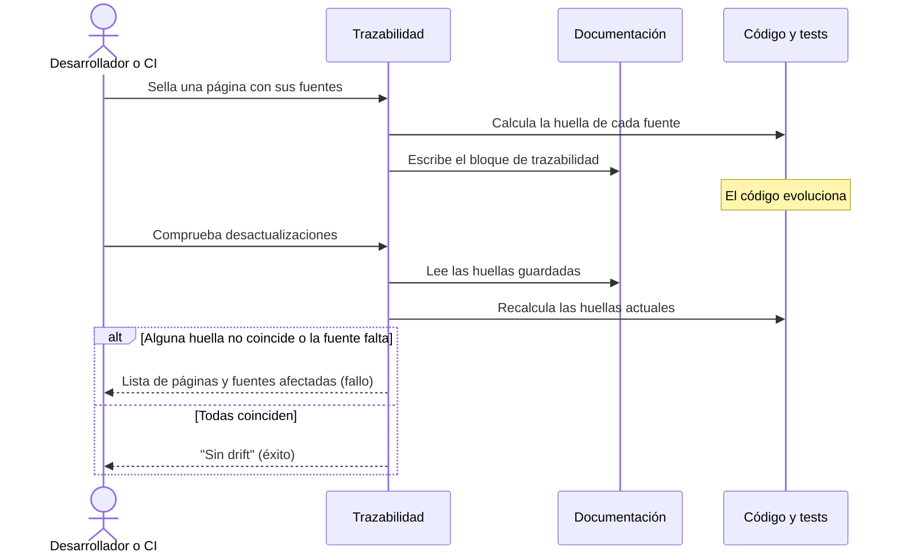

# Trazabilidad entre Documentación y Código

## 1. Objetivo y Descripción

La trazabilidad mantiene la documentación honesta con el código que describe. Cada página
puede declarar de qué ficheros fuente se ha obtenido y guardar una huella de su contenido;
cuando una de esas fuentes cambia, la comprobación avisa de qué páginas han quedado
desactualizadas, en lugar de descubrirlo cuando un lector ya ha confiado en información
obsoleta.

Además, la trazabilidad cruza los criterios de aceptación de las páginas funcionales con
los tests que existen realmente: detecta criterios que citan un test inexistente y tests
que no respaldan ningún criterio. Por último, genera un índice de la documentación pensado
para que los agentes IA encuentren las páginas publicadas (formato `llms.txt`).

La usan los desarrolladores y revisores que mantienen la documentación, a mano o en
integración continua. Todo el proceso es local y determinista: no consulta servicios IA ni
la red, y el mismo repositorio produce siempre el mismo resultado.

## 2. Precondiciones

- Repositorio con una carpeta de documentación y, para la matriz, una carpeta de tests.
- Para detectar desactualizaciones: páginas con el bloque inicial de trazabilidad (arquetipo,
  fuentes con su huella y fecha de revisión); las páginas sin él se ignoran.
- Para el índice para agentes IA: configuración del sitio con su navegación.
- Entorno con las herramientas del tooling documental (la lectura de la configuración usa la
  misma librería que el generador del sitio).

## 3. Flujo Principal

El desarrollador sella una página indicando sus fuentes: se calcula una huella de cada una
y se guarda al principio de la página. Más adelante, la comprobación recorre todas las
páginas selladas, recalcula las huellas y compara. Si una fuente ha cambiado, ha
desaparecido o apunta fuera del repositorio, se informa de la página y la fuente concretas y
se termina con fallo; el desarrollador revisa la página y la vuelve a sellar. La matriz de
criterios y el índice para agentes IA se ejecutan como operaciones independientes.

## 4. Postcondiciones y Efectos

- **Sellar**: reescribe solo el bloque inicial de la página (o lo crea); el resto del
  contenido queda intacto.
- **Comprobar desactualizaciones**: no modifica nada; informa por pantalla y con el código de
  finalización.
- **Matriz de criterios**: muestra la matriz por pantalla o la escribe en el fichero indicado.
- **Índice para agentes IA**: escribe `llms.txt` en la carpeta de documentación (el sitio lo
  publica en su raíz); en modo comprobación no escribe nada.

## 5. Reglas de Negocio

| Regla | Descripción | Impacto si se viola |
|---|---|---|
| Huella estable entre sistemas | La huella no depende de los saltos de línea (Windows/Linux) | Falsas desactualizaciones al cambiar de sistema o de configuración de Git |
| Sellar no encadena desactualizaciones | En fuentes que son a su vez páginas, la huella ignora su bloque de trazabilidad | Resellar una página marcaría como desactualizadas todas las que la citan |
| Nunca leer fuera del repositorio | Una fuente que apunta fuera del repositorio se informa y no se lee; al sellar se rechaza | Exposición de ficheros ajenos al proyecto a través de la documentación |
| Sin test inventado | La matriz falla si un criterio cita un test que no existe | Criterios de aceptación con una cobertura aparente que no es real |
| Índice solo de lo publicado | El índice para agentes IA incluye solo las páginas de la navegación; los enlaces externos se omiten | Páginas internas o enlaces ajenos expuestos como documentación del proyecto |
| Determinismo | Sin servicios IA ni red; orden estable de páginas, fuentes y tests | Resultados distintos para el mismo repositorio; incompatible con CI |

## 6. Límites, Flujos Alternativos y Casos Especiales

### Qué NO hace esta funcionalidad

- No decide qué fuentes tiene una página: las indica quien sella (o se conservan las ya
  declaradas).
- No corrige la documentación desactualizada: solo la señala.
- No ejecuta los tests: la matriz comprueba que los tests citados existen, no que pasen.
- No detecta cambios en fuentes que una página no declara.

### Flujos alternativos

- **Sellar sin fuentes** en una página que tampoco las tenía: se rechaza con un error.
- **Fuente inexistente al sellar**: se rechaza con un error.
- **Índice desactualizado en modo comprobación**: se informa y termina con fallo, sin escribir.
- **Invocación sin operación**: error de uso.

### Casos especiales

- **Página sin bloque de trazabilidad**: la comprobación la ignora (no es un fallo).
- **Fecha de revisión**: si no se indica al sellar, se usa la fecha del día, de modo que dos
  sellados en días distintos producen bloques distintos aunque las fuentes no cambien ⚠️.
- **Tests agrupados en clases**: también cuentan como tests existentes en la matriz.
- **Página o configuración inexistente**: sellar una página que no existe, o generar el índice
  sin navegación definida, termina con un mensaje de error claro (código 1), sin traza técnica.

## 7. Criterios de Aceptación

| ID | Dado | Cuando | Entonces | Test |
|---|---|---|---|---|
| AC-01 | Una página recién sellada cuyas fuentes no han cambiado | Se comprueban desactualizaciones | No hay hallazgos y el cuerpo de la página se conserva | `tests/test_doc_trace.py::test_stamp_then_no_drift` |
| AC-02 | Una página sellada cuya fuente se modifica | Se comprueban desactualizaciones | Se informa la fuente como desactualizada | `tests/test_doc_trace.py::test_drift_detects_stale_source` |
| AC-03 | Una página que declara una fuente que ya no existe | Se comprueban desactualizaciones | Se informa la fuente como ausente | `tests/test_doc_trace.py::test_drift_detects_missing_source` |
| AC-04 | Una página que declara una fuente fuera del repositorio | Se comprueban desactualizaciones | Se informa como fuera del repositorio y no se lee | `tests/test_doc_trace.py::test_drift_never_reads_outside_repo` |
| AC-05 | Una fuente fuera del repositorio | Se intenta sellar la página | Se rechaza con un error | `tests/test_doc_trace.py::test_stamp_rejects_source_outside_repo` |
| AC-06 | Una página sin fuentes declaradas | Se sella sin indicar fuentes | Se rechaza con un error | `tests/test_doc_trace.py::test_stamp_requires_sources` |
| AC-07 | Una página ya sellada | Se vuelve a sellar sin indicar fuentes ni arquetipo | Se conservan sus fuentes y su arquetipo con huellas actualizadas | `tests/test_doc_trace.py::test_stamp_preserves_existing_sources_and_archetype` |
| AC-08 | El mismo contenido con saltos de línea distintos, o una página con y sin bloque de trazabilidad | Se calcula la huella | La huella es idéntica | `tests/test_doc_trace.py::test_fingerprint_ignores_line_endings`, `tests/test_doc_trace.py::test_fingerprint_markdown_ignores_frontmatter` |
| AC-09 | Un criterio que cita un test inexistente | Se genera la matriz | El test aparece como inexistente y la operación termina con fallo | `tests/test_doc_trace.py::test_matrix_reports_unknown_and_uncited`, `tests/test_doc_trace.py::test_main_matrix_exit_code_on_unknown_test` |
| AC-10 | Tests que ningún criterio cita, incluidos tests dentro de clases | Se genera la matriz | Aparecen en la lista de tests sin criterio de aceptación | `tests/test_doc_trace.py::test_matrix_reports_unknown_and_uncited`, `tests/test_doc_trace.py::test_collect_test_ids_includes_class_methods` |
| AC-11 | Una configuración del sitio con etiquetas especiales del generador y un enlace externo en la navegación | Se genera el índice para agentes IA | El índice incluye las páginas con su URL publicada y omite el enlace externo | `tests/test_doc_trace.py::test_build_llms_txt_tolerates_python_tags` |
| AC-12 | Un índice para agentes IA ausente o desactualizado | Se comprueba en modo comprobación | Termina con fallo; tras regenerarlo, la comprobación termina con éxito | `tests/test_doc_trace.py::test_main_llms_check_detects_outdated` |
| AC-13 | Ninguna operación indicada | Se invoca la trazabilidad | Termina con error de uso (código 2) | `tests/test_doc_trace.py::test_main_requires_subcommand` |
| AC-14 | Una página sin bloque de trazabilidad o sin fuentes declaradas | Se leen sus datos de trazabilidad | Se considera no sellada | `tests/test_doc_trace.py::test_read_page_meta_without_frontmatter`, `tests/test_doc_trace.py::test_read_page_meta_without_sources` |

Verificación: `python -m pytest tests/test_doc_trace.py -q`.

## 8. Glosario de Dominio

| Término | Definición |
|---|---|
| Huella | Resumen corto del contenido de una fuente; cambia cuando cambia la fuente |
| Sellar | Calcular las huellas de las fuentes de una página y guardarlas en su bloque de trazabilidad |
| Drift (desactualización) | Diferencia entre la huella guardada en una página y la huella actual de su fuente |
| Matriz de trazabilidad | Cruce entre los criterios de aceptación y los tests que los verifican |
| `llms.txt` | Índice de la documentación publicada en un formato pensado para agentes IA |

??? note "Evidencia"

    | Elemento | Fuente | Confianza |
    |---|---|---|
    | Regla «Huella estable entre sistemas» | `scripts/doc_trace.py::fingerprint` | ✅ |
    | Regla «Sellar no encadena desactualizaciones» | `scripts/doc_trace.py::fingerprint` (rama `.md`) | ✅ |
    | Regla «Nunca leer fuera del repositorio» | `scripts/doc_trace.py::_resolve_source`, `::check_drift`, `::stamp_page` | ✅ |
    | Regla «Sin test inventado» | `scripts/doc_trace.py::build_matrix`, `::_cmd_matrix` | ✅ |
    | Regla «Índice solo de lo publicado» | `scripts/doc_trace.py::build_llms_txt` (filtro `.md`) | ✅ |
    | Regla «Determinismo» | `scripts/doc_trace.py::check_drift`, `::collect_test_ids`, `::format_frontmatter` (`sorted`) | ✅ |
    | Fecha del día por defecto al sellar | `scripts/doc_trace.py::stamp_page` (`date.today()`) | ✅ |
    | Página sin bloque ignorada por la comprobación | `scripts/doc_trace.py::check_drift` (`meta is None`) | ✅ |
    | AC-01 | `scripts/doc_trace.py::stamp_page`, `::check_drift` | ✅ |
    | AC-02 | `scripts/doc_trace.py::check_drift` | ✅ |
    | AC-03 | `scripts/doc_trace.py::check_drift` | ✅ |
    | AC-04 | `scripts/doc_trace.py::_resolve_source`, `::check_drift` | ✅ |
    | AC-05 | `scripts/doc_trace.py::stamp_page` | ✅ |
    | AC-06 | `scripts/doc_trace.py::stamp_page` | ✅ |
    | AC-07 | `scripts/doc_trace.py::stamp_page` | ✅ |
    | AC-08 | `scripts/doc_trace.py::fingerprint` | ✅ |
    | AC-09 | `scripts/doc_trace.py::build_matrix`, `::_cmd_matrix` | ✅ |
    | AC-10 | `scripts/doc_trace.py::build_matrix`, `::collect_test_ids` | ✅ |
    | AC-11 | `scripts/doc_trace.py::build_llms_txt`, `::_load_yaml`, `::_page_url` | ✅ |
    | AC-12 | `scripts/doc_trace.py::_cmd_llms` | ✅ |
    | AC-13 | `scripts/doc_trace.py::_parser` (`required=True`) | ✅ |
    | AC-14 | `scripts/doc_trace.py::read_page_meta` | ⚠️ (los tests cubren la lectura; que la comprobación ignore la página se deduce de `check_drift`) |
