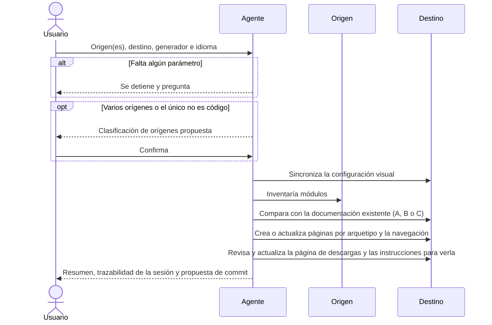

# Documentar un Proyecto

## 1. Objetivo y Descripción

La documentación de un proyecto con doc_ia parte de una única operación de entrada:
indicar el origen (o los orígenes) a documentar, el destino donde se escribirá la
documentación, el generador de sitio y el idioma. A partir de estos cuatro parámetros,
el flujo de trabajo clasifica los orígenes según su naturaleza (código fuente, normativa,
especificación, pantallas…), orquesta el inventario del proyecto, la generación de
documentación por arquetipos formales y la sincronización de la navegación del sitio.

La usan los desarrolladores y technical writers que quieren documentar desde cero un
proyecto existente, o actualizar y completar su documentación a medida que el código
evoluciona. También cubre casos donde la fuente documental incluye material
heterogéneo: normativa de referencia, capturas de pantalla o especificaciones de
requisitos que enriquecen la documentación del proyecto principal.

Su valor está en que un único punto de entrada cubre todo el ciclo
(inventariar → generar → revisar → publicar) sin necesidad de coordinar prompts ni
decidir manualmente qué arquetipo aplicar a cada módulo.

## 2. Precondiciones

- Una plataforma IA con acceso al repositorio doc_ia: Claude Code (comando `/document-project`)
  o Gemini, Copilot, Cursor y Codex (prompt `document_project.prompt.md`).
- Los cuatro parámetros obligatorios: **origen(es)**, **destino**, **generador**
  (`mkdocs-material` por defecto, o `zensical`) e **idioma**.
- Cada origen indicado existe y es legible.
- Al menos uno de los orígenes es de tipo CÓDIGO.
- Opcionales: tipo de cada origen, estrategia (solo con ≥2 orígenes CÓDIGO), alcance,
  subconjunto de arquetipos y verificación (`--verify-tools`, `--verify-build`).
- Para la verificación de build: el generador elegido instalado en el entorno.

## 3. Flujo Principal

El usuario invoca el flujo con los cuatro parámetros; si falta alguno, el flujo se detiene y
pregunta. Con varios orígenes, o si el único no es código, se clasifican primero y el usuario
confirma la clasificación. Después se sincroniza la configuración visual del destino y se
inventaría el origen: cada módulo y página recibe un estado (A sin documentación, B
desactualizada, C vigente) que decide la acción del plan (crear, actualizar u omitir). La
generación recorre los arquetipos módulo a módulo —funcional y mapa funcional, técnica,
referencia del sistema si hay superficie de usuario, ejemplos y guías—, se sincroniza la
navegación, se revisa el resultado, se genera o actualiza la página de descargas, se escriben en la raíz del destino las
instrucciones para ver la documentación desde cero (`VER_DOCUMENTACION.md`) y se cierra
la sesión con su artefacto de trazabilidad y una propuesta de commit.

## 4. Postcondiciones y Efectos

- Las páginas en estado A existen en el destino; las de estado B están actualizadas
  conservando las secciones vigentes; las de estado C no se han modificado.
- Las páginas con bloque "Evidencia" declaran sus fuentes en el frontmatter; si el destino
  dispone del tooling de trazabilidad, quedan selladas y sin desactualizaciones.
- La navegación del generador en el destino (`mkdocs.yml`) incluye todas las páginas nuevas
  y la configuración estándar verificada (tema, assets, Mermaid).
- `docs/downloads.md` existe en el destino (variante A o B) y los huecos de distribución
  offline quedan reportados en el resumen.
- `VER_DOCUMENTACION.md` existe en la raíz del destino, fuera de `docs/`, con los requisitos y
  pasos para ver la documentación desde cero en Windows, macOS y Linux, y viaja dentro del ZIP.
- El destino tiene los cinco recursos visuales en `docs/assets/`, entre ellos su propia copia de Mermaid, de modo que los diagramas se ven también sin conexión, y un `.gitignore` con los
  patrones estándar.
- Si el origen tiene documentos convertidos a Markdown, el destino tiene su copia en
  `_fuentes/`, fuera de `docs/` y versionada, y ninguna carpeta con otro nombre para ellos.
- Existe `.ai/sessions/YYYY-MM-DD/` en el destino con `00_REQUEST.md`,
  `00_CONTEXT_SNAPSHOT.md` y `TRACEABILITY.md`; en la primera sesión se crean además los
  cinco ficheros de contexto `.ai/*.md`.
- Se **propone** un commit `docs(<scope>): …`; el flujo no lo ejecuta por sí mismo.
- Con `--verify-build`: el sitio se ha construido en modo estricto y el resultado figura en
  el informe.

## 5. Reglas de Negocio

| Regla | Descripción | Impacto si se viola |
|---|---|---|
| Cuatro parámetros obligatorios | Origen(es), Destino, Generador e Idioma son requeridos; el flujo se detiene y pregunta si falta alguno | Se documentaría un proyecto equivocado, en la ruta incorrecta o con el generador inadecuado |
| Clasificación de orígenes | Con ≥2 orígenes, o cuando el único origen no es de tipo CÓDIGO, se ejecuta la Fase 0a antes del inventario; el usuario confirma la clasificación antes de continuar | Sin clasificación, un origen NORMATIVA o UI se trataría como proyecto de código y generaría páginas incorrectas |
| Inventario previo a generación | Antes de escribir cualquier página se clasifica el estado de la documentación existente (sin doc / desactualizado / vigente) | Se sobreescribirían páginas vigentes o se ignorarían páginas desactualizadas |
| Generación en el chat | Toda la generación documental ocurre en el chat de la plataforma IA (Claude Code, Gemini, Copilot, Cursor, Codex); nunca en código Python ni en CI | Violaría el principio innegociable del proyecto de ejecución sin APIs externas |
| Sin inventar | El contenido generado se basa únicamente en el código y la documentación real del origen; no se inventan módulos, APIs, salidas ni dependencias | Documentación incorrecta que no corresponde al proyecto real |
| Preservación de lo vigente | Las páginas clasificadas como vigentes (estado C) no se modifican; las desactualizadas (B) se actualizan conservando las secciones aún correctas | Se perdería documentación válida o se introduciría regresión de contenido |
| `downloads.md` siempre obligatorio | Cada sesión genera o actualiza `docs/downloads.md` en el destino (Fase 7b); el flujo detecta tres señales de distribución offline (`TIENE_ZIP_SCRIPT`, `TIENE_MKDOCS_PLUGIN`, `TIENE_WORKFLOW_GITHUB`) y reporta los huecos | El destino quedaría sin una página de descarga offline o con datos desactualizados |
| Instrucciones de visualización siempre | Cada sesión genera o actualiza `VER_DOCUMENTACION.md` en la raíz del destino (Fase 7c) desde una plantilla con secciones fijas: qué ruta seguir (web, ZIP, código fuente), cómo instalar Python en cada sistema, cómo arrancar el servidor local y problemas frecuentes; los valores (versión de Python, dependencias, nombre del ZIP, publicación) salen del destino | Quien recibe la documentación sin conocimientos técnicos ni Python no sabría verla: abrir `index.html` con doble clic no navega |
| Sincronización visual obligatoria (Fase 0b) | Al inicio de toda sesión se verifican: assets CSS/JS en `docs/assets/`, configuración de `mkdocs.yml` (sin `navigation.sections` si `nav.css` presente), `.gitignore` con patrones estándar (`site/`, `*.pdf`, `*.doc`, `*.docx`). Aplica tanto en creación como en actualización ⚠️ | El destino tendría assets desincronizados, menú lateral sin colapso o binarios versionados por error |
| Zensical sin pérdidas silenciosas | Con generador Zensical, que no ejecuta `hooks:` ni los plugins que no soporta, el flujo detecta si el script de build del destino ejecuta él mismo esos pasos (`TIENE_PIPELINE_SIN_HOOKS`), reporta el Gap A4 si no lo hace y señala los plugins no soportados; nunca crea `zensical.toml` | El destino perdería sin aviso la sincronización de ficheros raíz, el ZIP "latest" o la función de un plugin |
| Documentos pre-convertidos (`md/`) | Si el origen contiene carpetas `md/` (generadas por `convert_to_md.py`), se usan como contexto de primera clase en Fases 2-4 sin re-conversión; no generan páginas propias ni reciben estado A/B/C | Se perdería contexto valioso de documentos binarios o se intentaría re-convertir innecesariamente |
| Fuentes convertidas en `_fuentes/` | El destino recibe siempre una copia de los documentos convertidos en `_fuentes/<origen>/…`, con la misma ruta que en el origen, aunque origen y destino sean el mismo repositorio. Es el único nombre válido: otro nombre existente se migra a `_fuentes/` con confirmación, y nada se borra sin confirmar. Su texto se versiona en el destino; los binarios, no | Cada sesión elegiría un nombre distinto (`.fuentes/`, `_fuentes/`), la evidencia apuntaría a rutas fuera del repositorio y la trazabilidad no detectaría cambios en esos documentos |
| Contexto persistente `.ai/*.md` | En la primera sesión de un destino nuevo (o si faltan), se crean los 5 ficheros de contexto raíz: `product.md`, `architecture.md`, `glossary.md`, `runtime.md`, `standards.md`; en sesiones posteriores se actualizan si el inventario detecta cambios relevantes | Una IA futura no tendría el snapshot del proyecto para su `00_CONTEXT_SNAPSHOT` |

## 6. Límites, Flujos Alternativos y Casos Especiales

### Qué NO hace esta funcionalidad

- No genera contenido mediante APIs de IA ni desde código: todo ocurre en el chat.
- No documenta orígenes compuestos solo por MATERIAL (sin ningún proyecto de código).
- No decide la estrategia con varios proyectos de código: siempre la pregunta.
- No modifica páginas vigentes (estado C).
- No ejecuta el build del sitio salvo que se pida `--verify-build`.
- No está pensado para una sola página suelta: para eso se aplica directamente el prompt
  del arquetipo correspondiente.
- No hace el commit: lo propone al cierre de la sesión.

### Flujos alternativos

- **Parámetro faltante o ambiguo**: el flujo se detiene y pregunta al usuario antes de
  inventariar. No se asume destino ni idioma por defecto.
- **Origen no legible**: si la ruta indicada no existe o no es accesible, se pide
  confirmación antes de continuar.
- **Orígenes heterogéneos**: con ≥2 orígenes o cuando el único origen no es CÓDIGO, la
  Fase 0a detecta el tipo de cada uno (ver [Tipos de Origen](origin_types.md)) y presenta
  una tabla al usuario para confirmación antes de inventariar. Los orígenes de tipo MATERIAL
  no generan páginas propias: su contenido enriquece secciones concretas de los arquetipos
  del proyecto CÓDIGO principal.
- **Estrategia multi-CÓDIGO**: con ≥2 orígenes de tipo CÓDIGO, el flujo pregunta la
  estrategia de documentación (`federado`, `hub+satélite`, `monorepo`); nunca se
  autodetecta porque depende del contexto organizacional.
- **Sin origen CÓDIGO**: si todos los orígenes son MATERIAL, el flujo se detiene e
  informa que `/document-project` requiere al menos un origen de tipo CÓDIGO.
- **Verificación de build**: paso opcional (`--verify-build`) que construye el sitio en
  modo estricto al final y confirma que compila sin errores.
- **Generador Zensical**: la configuración y los assets son los mismos (Zensical lee el mismo
  `mkdocs.yml`). Cambian el build, que se hace a través del script del destino para que se
  ejecuten los pasos que Zensical ignora, la comprobación de plugins soportados y la señal
  adicional del pipeline en la página de descargas.

### Casos especiales

- **Documentación parcialmente existente**: el inventario clasifica cada módulo y página
  de forma independiente; las páginas vigentes no se tocan.
- **Alcance restringido**: se puede indicar un subconjunto de módulos o un subconjunto de
  arquetipos; el resto queda fuera del plan de generación.
- **Normativa detectada**: si el origen referencia normativa de obligado cumplimiento, el
  flujo ofrece el Arquetipo 8; si no, lo omite.
- **Carpetas `md/` pre-convertidas**: se reutilizan como contexto sin volver a convertir.
- **Destino con fuentes bajo otro nombre** (`.fuentes/` o `fuentes/` en su raíz): el
  inventario propone migrarlas a `_fuentes/` y actualizar las páginas que las citan; si una misma
  fuente difiere entre las dos carpetas, el flujo se detiene y pregunta.

## 7. Criterios de Aceptación

| ID | Dado | Cuando | Entonces | Test |
|---|---|---|---|---|
| AC-01 | Un proyecto con código fuente sin documentación previa | Se invoca el flujo con los cuatro parámetros completos | Se genera documentación para cada módulo detectado, el sitio compila sin errores, la navegación está actualizada y existe el artefacto `.ai/sessions/YYYY-MM-DD/` en el destino | Sin test |
| AC-02 | Un proyecto con documentación existente, parte vigente y parte desactualizada | Se invoca el flujo | Se actualiza solo lo desactualizado; lo vigente se conserva verbatim; no se crea contenido duplicado | Sin test |
| AC-03 | Un flujo invocado con el parámetro Destino vacío | Se inicia la ejecución | El flujo se detiene, informa del campo faltante y pide al usuario que lo complete antes de continuar | Sin test |
| AC-04 | Un proyecto con un módulo ya documentado que no ha cambiado | Se ejecuta el inventario | El módulo recibe estado C (vigente) y no se genera ni modifica ninguna página para él | Sin test |
| AC-05 | Dos orígenes: un proyecto Python y un PDF de normativa | Se invoca el flujo | La Fase 0a presenta una tabla con los tipos detectados (CÓDIGO y NORMATIVA), el usuario confirma, y el PDF enriquece las reglas de negocio de la documentación funcional sin generar página propia | Sin test |
| AC-06 | Todos los orígenes indicados son MATERIAL (sin ningún proyecto de código) | Se inicia la ejecución | El flujo se detiene con un mensaje que informa que se requiere al menos un origen de tipo CÓDIGO y orienta al prompt de arquetipo directo | Sin test |
| AC-07 | Cualquier sesión de `/document-project` completada | El flujo llega al RESUMEN | Existe el artefacto `.ai/sessions/YYYY-MM-DD/` con los tres ficheros obligatorios (`00_REQUEST.md`, `00_CONTEXT_SNAPSHOT.md`, `TRACEABILITY.md`) y se propone un commit Conventional Commits | Sin test |
| AC-08 | Un destino con generador Zensical, `hooks:` en `mkdocs.yml` y un script de build que no ejecuta esos hooks | Se ejecuta el flujo | El inventario y DOWNLOADS reportan `TIENE_PIPELINE_SIN_HOOKS = false` y el Gap A4 con la acción de actualizar el script; los plugins no soportados aparecen como hallazgo en RESUMEN; no se crea `zensical.toml` | Sin test |
| AC-09 | Un origen con PDFs convertidos en `md/`, documentado en su propio repositorio o en uno aparte | Se ejecuta el flujo | Los `.md` convertidos quedan copiados en `_fuentes/<origen>/…` de la raíz del destino, fuera de `docs/`; el inventario los lista y el commit propuesto los incluye | Sin test |
| AC-10 | Un destino que ya guarda fuentes convertidas en `.fuentes/` | Se ejecuta el flujo y el usuario confirma la migración | Las fuentes pasan a `_fuentes/`, las páginas que las citaban apuntan a la nueva ruta y no queda ninguna carpeta `.fuentes/` | Sin test |
| AC-11 | Un destino documentado con el generador por defecto, sin publicación web | Se completa el flujo | Existe `VER_DOCUMENTACION.md` en la raíz del destino con las secciones fijas 0-7, sin marcadores por rellenar, con la ruta web marcada "No aplica" y los comandos para Windows, macOS y Linux | `tests/test_docs_conformance.py::test_view_instructions_filled_for_doc_ia` |

Verificación: ejecutar `/document-project` (Claude Code) o
`Lee y aplica .github/prompts/document_project.prompt.md` con los cuatro parámetros en
cualquier plataforma IA soportada. El flujo se ejecuta en el chat y no tiene tests
automatizados.

## 8. Glosario de Dominio

| Término | Definición |
|---|---|
| Origen | Ruta raíz del proyecto cuyo código y estructura se van a documentar; puede ser único o múltiple |
| Destino | Ruta donde se escriben los archivos de documentación generados |
| Estado A | Módulo sin página de documentación existente; acción derivada: CREAR |
| Estado B | Módulo con página existente pero desactualizada respecto al código actual; acción derivada: ACTUALIZAR |
| Estado C | Módulo con página existente y vigente; acción derivada: OMITIR |
| Arquetipo formal | Plantilla de documentación con estructura fija y audiencia definida (ver [Arquetipos Formales](archetypes.md)) |
| Generador | Herramienta de sitio estático que construye el HTML a partir de los archivos Markdown (`mkdocs-material` por defecto) |
| Tipo de origen | Naturaleza del origen; determina el tratamiento documental. Ocho tipos: `CÓDIGO`, `NORMATIVA`, `ESPECIFICACIÓN`, `UI/PANTALLAS`, `REFERENCIA`, `CONTRATO`, `INFRAESTRUCTURA`, `MANUAL`. Catálogo completo: [Tipos de Origen](origin_types.md) |
| MATERIAL | Término colectivo para orígenes que no son de tipo CÓDIGO; su contenido enriquece secciones de los arquetipos del proyecto CÓDIGO principal sin generar páginas propias |
| `CONTRATO` | Especificaciones machine-readable de las APIs y modelos de datos del propio proyecto (OpenAPI, AsyncAPI, GraphQL, Protobuf, SQL DDL, DBML…); enriquece Arquetipo 2 §1 y §2 y Arquetipo 12 §5 |
| `INFRAESTRUCTURA` | Artefactos IaC y de despliegue del propio proyecto (Terraform, Kubernetes, Docker, Ansible…); enriquece Arquetipo 2 §4 y Arquetipo 6C §3 › Despliegue |
| `MANUAL` | Documentación narrativa ya escrita para el propio proyecto (manuales de usuario, guías de administrador, runbooks…); enriquece Arquetipos 3a, 3b, 6 y 7 |
| Fase 0a | Paso de clasificación de orígenes ejecutado antes del inventario cuando hay ≥2 orígenes o el único origen no es CÓDIGO; requiere confirmación del usuario antes de continuar |
| Fase 0b | Sincronización visual obligatoria al inicio de toda sesión: verificar assets CSS/JS, `mkdocs.yml` (sin `navigation.sections`), `.gitignore` con patrones estándar |
| Carpeta `md/` | Artefactos generados por `convert_to_md.py` en la Fase 0c: versiones Markdown de documentos binarios del origen. No generan páginas propias |
| `_fuentes/` | Copia de las carpetas `md/` en la raíz del destino, fuera de `docs/`; es lo que se lee como contexto en Fases 2-4 y lo que cita la evidencia. Único nombre válido |
| Contexto `.ai/*.md` | Ficheros de contexto persistente del proyecto (`product.md`, `architecture.md`, `glossary.md`, `runtime.md`, `standards.md`); creados en la primera sesión de un destino nuevo |
| Estrategia | Forma de documentar múltiples orígenes de tipo CÓDIGO: `federado` (cada proyecto independiente), `hub+satélite` (un proyecto concentra el destino), `monorepo` (un `mkdocs.yml` raíz agrupa secciones); nunca se autodetecta |
| Cierre de sesión | Paso final obligatorio del flujo: crea los artefactos `.ai/sessions/YYYY-MM-DD/` en el destino, actualiza o crea `.ai/*.md` si es primera sesión, y propone un commit Conventional Commits con el resumen de la sesión |

??? note "Evidencia"

    | Elemento | Fuente | Confianza |
    |---|---|---|
    | Regla «Cuatro parámetros obligatorios» | `.github/prompts/document_project.prompt.md::VALIDACIÓN (bloqueante)` | ✅ |
    | Regla «Clasificación de orígenes» | `.github/prompts/document_project.prompt.md::Fase 0a` | ✅ |
    | Regla «Inventario previo a generación» | `.github/prompts/document_project.prompt.md::Fase 1` | ✅ |
    | Regla «Generación en el chat» | `.github/prompts/document_project.prompt.md::Política innegociable` | ✅ |
    | Regla «Sin inventar» | `CLAUDE.md::Contrato documental obligatorio` | ✅ |
    | Regla «Preservación de lo vigente» | `.github/prompts/document_project.prompt.md::Protocolo ACTUALIZAR (estado B)` | ✅ |
    | Regla «`downloads.md` siempre obligatorio» | `.github/prompts/document_project.prompt.md::Fase 7b` | ✅ |
    | Regla «Instrucciones de visualización siempre» y AC-11 | `.github/prompts/document_project.prompt.md::Fase 7c`, `.github/templates/VER_DOCUMENTACION.template.md`, `tests/test_docs_conformance.py::test_view_instructions_rule_everywhere` (coherencia de las instrucciones; el resultado solo se comprueba sobre doc_ia) | ⚠️ |
    | Regla «Sincronización visual (Fase 0b)» | `.claude/commands/document-project.md::Sincronización de Configuración Visual (Fase 0b)`, `.github/prompts/document_project.prompt.md::Fase 0b` | ✅ |
    | Regla «Documentos pre-convertidos (`md/`)» | `.github/prompts/document_project.prompt.md::Fase 0c — Paso 0` | ✅ |
    | Regla «Fuentes convertidas en `_fuentes/`», AC-09 y AC-10 | `.github/prompts/document_project.prompt.md::Fase 0c — Paso 5`, `tests/test_docs_conformance.py::test_sources_folder_is_canonical` (coherencia de las instrucciones, no del resultado) | ⚠️ |
    | Regla «Contexto persistente `.ai/*.md`» | `.claude/commands/document-project.md::Devuelve en este orden` (tabla de ficheros `.ai/`) | ✅ |
    | Precondición «generador instalado para `--verify-build`» | `.github/prompts/document_project.prompt.md::Fase 7` | ✅ |
    | Postcondición «commit propuesto, no ejecutado» | `.github/prompts/document_project.prompt.md::Devuelve en este orden` (punto 10) | ✅ |
    | AC-01 | `.github/prompts/document_project.prompt.md::Devuelve en este orden` | 🔍 |
    | AC-02 | `.github/prompts/document_project.prompt.md::Protocolo ACTUALIZAR (estado B)` | ✅ |
    | AC-03 | `.github/prompts/document_project.prompt.md::VALIDACIÓN (bloqueante)` | ✅ |
    | AC-04 | `.github/prompts/document_project.prompt.md::Fase 1` | ✅ |
    | AC-05 | `.github/prompts/document_project.prompt.md::Fase 0a` | ✅ |
    | AC-06 | `.github/DOCUMENTATION_STANDARD.md::3.10 Documentación con Múltiples Orígenes` (caso degenerado) | ✅ |
    | AC-07 | `.github/prompts/document_project.prompt.md::Devuelve en este orden` (punto 10) | ✅ |
    | Regla «Zensical sin pérdidas silenciosas» y AC-08 | `.github/prompts/document_project.prompt.md::Reglas por generador: Zensical` | ✅ |
