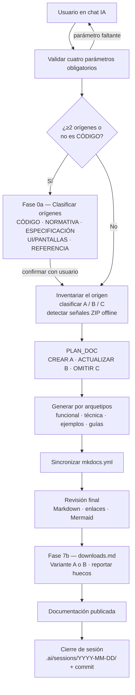

# Documentar un Proyecto

## 1. Descripción General

La documentación de un proyecto con doc_ia parte de una única operación de entrada:
indicar el origen (o los orígenes) a documentar, el destino donde se escribirá la
documentación, el generador de sitio y el idioma. A partir de estos cuatro parámetros,
el flujo de trabajo clasifica los orígenes según su naturaleza (código fuente, normativa,
especificación, pantallas…), orquesta el inventario del proyecto, la generación de
documentación por arquetipos formales y la sincronización de la navegación del sitio.

La usan los desarrolladores y technical writers que quieren documentar desde cero un
proyecto existente, o actualizar y completar su documentación a medida que el código
evoluciona. También cubre casos donde la fuente documental incluye material
heterogéneo: normativa de referencia, capturas de pantalla o especificaciones de
requisitos que enriquecen la documentación del proyecto principal.

Su valor está en que un único punto de entrada cubre todo el ciclo
(inventariar → generar → revisar → publicar) sin necesidad de coordinar prompts ni
decidir manualmente qué arquetipo aplicar a cada módulo.

## 2. Reglas de Negocio

| Regla | Descripción | Impacto si se viola |
|---|---|---|
| Cuatro parámetros obligatorios | Origen(es), Destino, Generador e Idioma son requeridos; el flujo se detiene y pregunta si falta alguno | Se documentaría un proyecto equivocado, en la ruta incorrecta o con el generador inadecuado |
| Clasificación de orígenes | Con ≥2 orígenes, o cuando el único origen no es de tipo CÓDIGO, se ejecuta la Fase 0a antes del inventario; el usuario confirma la clasificación antes de continuar | Sin clasificación, un origen NORMATIVA o UI se trataría como proyecto de código y generaría páginas incorrectas |
| Inventario previo a generación | Antes de escribir cualquier página se clasifica el estado de la documentación existente (sin doc / desactualizado / vigente) | Se sobreescribirían páginas vigentes o se ignorarían páginas desactualizadas |
| Generación en el chat | Toda la generación documental ocurre en el chat de la plataforma IA (Claude Code, Gemini, Copilot, Cursor, Codex); nunca en código Python ni en CI | Violaría el principio innegociable del proyecto de ejecución sin APIs externas |
| Sin inventar | El contenido generado se basa únicamente en el código y la documentación real del origen; no se inventan módulos, APIs, salidas ni dependencias | Documentación incorrecta que no corresponde al proyecto real |
| Preservación de lo vigente | Las páginas clasificadas como vigentes (estado C) no se modifican; las desactualizadas (B) se actualizan conservando las secciones aún correctas | Se perdería documentación válida o se introduciría regresión de contenido |
| `downloads.md` siempre obligatorio | Cada sesión genera o actualiza `docs/downloads.md` en el destino (Fase 7b); el flujo detecta tres señales de distribución offline (`TIENE_ZIP_SCRIPT`, `TIENE_MKDOCS_PLUGIN`, `TIENE_WORKFLOW_GITHUB`) y reporta los huecos | El destino quedaría sin una página de descarga offline o con datos desactualizados |

## 3. Casos de Uso

### Flujo principal

### Flujos alternativos y de error

- **Parámetro faltante o ambiguo**: el flujo se detiene y pregunta al usuario antes de
  inventariar. No se asume destino ni idioma por defecto.
- **Origen no legible**: si la ruta indicada no existe o no es accesible, se pide
  confirmación antes de continuar.
- **Orígenes heterogéneos**: con ≥2 orígenes o cuando el único origen no es CÓDIGO, la
  Fase 0a detecta el tipo de cada uno (CÓDIGO, NORMATIVA, ESPECIFICACIÓN, UI/PANTALLAS,
  REFERENCIA) y presenta una tabla al usuario para confirmación antes de inventariar.
  Los orígenes de tipo MATERIAL no generan páginas propias: su contenido enriquece
  secciones concretas de los arquetipos del proyecto CÓDIGO principal.
- **Estrategia multi-CÓDIGO**: con ≥2 orígenes de tipo CÓDIGO, el flujo pregunta la
  estrategia de documentación (`federado`, `hub+satélite`, `monorepo`); nunca se
  autodetecta porque depende del contexto organizacional.
- **Sin origen CÓDIGO**: si todos los orígenes son MATERIAL, el flujo se detiene e
  informa que `/document-project` requiere al menos un origen de tipo CÓDIGO.
- **Documentación parcialmente existente**: el inventario clasifica cada módulo y página
  de forma independiente; las páginas vigentes no se tocan.
- **Alcance restringido**: se puede indicar un subconjunto de módulos o un subconjunto de
  arquetipos; el resto queda fuera del plan de generación.
- **Verificación de build**: paso opcional (`--verify-build`) que ejecuta
  `python -m mkdocs build --strict` al final y confirma que el sitio compila sin errores.

## 4. Criterios de Aceptación

| ID | Dado | Cuando | Entonces |
|---|---|---|---|
| AC-01 | Un proyecto con código fuente sin documentación previa | Se invoca el flujo con los cuatro parámetros completos | Se genera documentación para cada módulo detectado, el sitio compila sin errores, la navegación está actualizada y existe el artefacto `.ai/sessions/YYYY-MM-DD/` en el destino |
| AC-02 | Un proyecto con documentación existente, parte vigente y parte desactualizada | Se invoca el flujo | Se actualiza solo lo desactualizado; lo vigente se conserva verbatim; no se crea contenido duplicado |
| AC-03 | Un flujo invocado con el parámetro Destino vacío | Se inicia la ejecución | El flujo se detiene, informa del campo faltante y pide al usuario que lo complete antes de continuar |
| AC-04 | Un proyecto con un módulo ya documentado que no ha cambiado | Se ejecuta el inventario | El módulo recibe estado C (vigente) y no se genera ni modifica ninguna página para él |
| AC-05 | Dos orígenes: un proyecto Python y un PDF de normativa | Se invoca el flujo | La Fase 0a presenta una tabla con los tipos detectados (CÓDIGO y NORMATIVA), el usuario confirma, y el PDF enriquece §2 del funcional sin generar página propia |
| AC-06 | Todos los orígenes indicados son MATERIAL (sin ningún proyecto de código) | Se inicia la ejecución | El flujo se detiene con un mensaje que informa que se requiere al menos un origen de tipo CÓDIGO y orienta al prompt de arquetipo directo |
| AC-07 | Cualquier sesión de `/document-project` completada | El flujo llega al RESUMEN | Existe el artefacto `.ai/sessions/YYYY-MM-DD/` con los tres ficheros obligatorios (`00_REQUEST.md`, `00_CONTEXT_SNAPSHOT.md`, `TRACEABILITY.md`) y se propone un commit Conventional Commits |

Verificación: ejecutar `/document-project` (Claude Code) o
`Lee y aplica .github/prompts/document_project.prompt.md` con los cuatro parámetros en
cualquier plataforma IA soportada.

## 5. Glosario y Términos

| Término | Definición |
|---|---|
| Origen | Ruta raíz del proyecto cuyo código y estructura se van a documentar; puede ser único o múltiple |
| Destino | Ruta donde se escriben los archivos de documentación generados |
| Estado A | Módulo sin página de documentación existente; acción derivada: CREAR |
| Estado B | Módulo con página existente pero desactualizada respecto al código actual; acción derivada: ACTUALIZAR |
| Estado C | Módulo con página existente y vigente; acción derivada: OMITIR |
| Arquetipo formal | Plantilla de documentación con estructura fija y audiencia definida (ver [Arquetipos Formales](archetypes.md)) |
| Generador | Herramienta de sitio estático que construye el HTML a partir de los archivos Markdown (`mkdocs-material` por defecto) |
| Tipo de origen | Naturaleza del origen; determina el tratamiento documental. Ocho tipos: `CÓDIGO`, `NORMATIVA`, `ESPECIFICACIÓN`, `UI/PANTALLAS`, `REFERENCIA`, `CONTRATO`, `INFRAESTRUCTURA`, `MANUAL`. Catálogo completo: [Tipos de Origen](origin_types.md) |
| MATERIAL | Término colectivo para orígenes que no son de tipo CÓDIGO; su contenido enriquece secciones de los arquetipos del proyecto CÓDIGO principal sin generar páginas propias |
| `CONTRATO` | Especificaciones machine-readable de las APIs y modelos de datos del propio proyecto (OpenAPI, AsyncAPI, GraphQL, Protobuf, SQL DDL, DBML…); enriquece Arquetipo 2 §1 y §2 |
| `INFRAESTRUCTURA` | Artefactos IaC y de despliegue del propio proyecto (Terraform, Kubernetes, Docker, Ansible…); enriquece Arquetipo 2 §4 y Arquetipo 6D |
| `MANUAL` | Documentación narrativa ya escrita para el propio proyecto (manuales de usuario, guías de administrador, runbooks…); enriquece Arquetipos 3a, 3b, 6 y 7 |
| Fase 0a | Paso de clasificación de orígenes ejecutado antes del inventario cuando hay ≥2 orígenes o el único origen no es CÓDIGO; requiere confirmación del usuario antes de continuar |
| Estrategia | Forma de documentar múltiples orígenes de tipo CÓDIGO: `federado` (cada proyecto independiente), `hub+satélite` (un proyecto concentra el destino), `monorepo` (un `mkdocs.yml` raíz agrupa secciones); nunca se autodetecta |
| Cierre de sesión | Paso final obligatorio del flujo: crea los artefactos `.ai/sessions/YYYY-MM-DD/` en el destino y propone un commit Conventional Commits con el resumen de la sesión |
