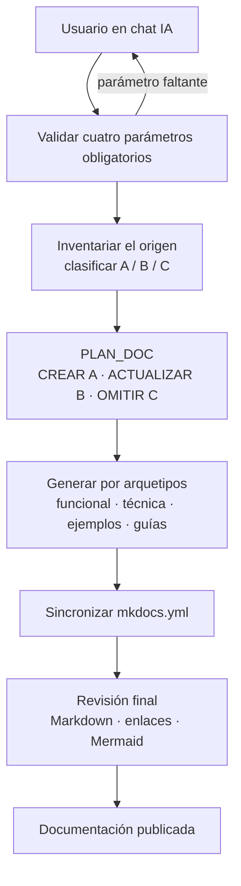

# Documentar un Proyecto

## 1. Descripción General

La documentación de un proyecto con doc_ia parte de una única operación de entrada:
indicar el origen a documentar, el destino donde se escribirá la documentación, el
generador de sitio y el idioma. A partir de estos cuatro parámetros, el flujo de
trabajo orquesta el inventario del proyecto, la generación de documentación por
arquetipos formales y la sincronización de la navegación del sitio.

La usan los desarrolladores y technical writers que quieren documentar desde cero un
proyecto existente, o actualizar y completar su documentación a medida que el código
evoluciona. Su valor está en que un único punto de entrada cubre todo el ciclo
(inventariar → generar → revisar → publicar) sin necesidad de coordinar prompts ni
decidir manualmente qué arquetipo aplicar a cada módulo.

## 2. Reglas de Negocio

| Regla | Descripción | Impacto si se viola |
|---|---|---|
| Cuatro parámetros obligatorios | Origen(es), Destino, Generador e Idioma son requeridos; el flujo se detiene y pregunta si falta alguno | Se documentaría un proyecto equivocado, en la ruta incorrecta o con el generador inadecuado |
| Inventario previo a generación | Antes de escribir cualquier página se clasifica el estado de la documentación existente (sin doc / desactualizado / vigente) | Se sobreescribirían páginas vigentes o se ignorarían páginas desactualizadas |
| Generación en el chat | Toda la generación documental ocurre en el chat de la plataforma IA (Claude Code, Gemini, Copilot, Cursor, Codex); nunca en código Python ni en CI | Violaría el principio innegociable del proyecto de ejecución sin APIs externas |
| Sin inventar | El contenido generado se basa únicamente en el código y la documentación real del origen; no se inventan módulos, APIs, salidas ni dependencias | Documentación incorrecta que no corresponde al proyecto real |
| Preservación de lo vigente | Las páginas clasificadas como vigentes (estado C) no se modifican; las desactualizadas (B) se actualizan conservando las secciones aún correctas | Se perdería documentación válida o se introduciría regresión de contenido |

## 3. Casos de Uso

### Flujo principal

### Flujos alternativos y de error

- **Parámetro faltante o ambiguo**: el flujo se detiene y pregunta al usuario antes de
  inventariar. No se asume destino ni idioma por defecto.
- **Origen no legible**: si la ruta indicada no existe o no es accesible, se pide
  confirmación antes de continuar.
- **Documentación parcialmente existente**: el inventario clasifica cada módulo y página
  de forma independiente; las páginas vigentes no se tocan.
- **Alcance restringido**: se puede indicar un subconjunto de módulos o un subconjunto de
  arquetipos; el resto queda fuera del plan de generación.
- **Verificación de build**: paso opcional (`--verify-build`) que ejecuta
  `python -m mkdocs build --strict` al final y confirma que el sitio compila sin errores.

## 4. Criterios de Aceptación

| ID | Dado | Cuando | Entonces |
|---|---|---|---|
| AC-01 | Un proyecto con código fuente sin documentación previa | Se invoca el flujo con los cuatro parámetros completos | Se genera documentación para cada módulo detectado, el sitio compila sin errores y la navegación está actualizada |
| AC-02 | Un proyecto con documentación existente, parte vigente y parte desactualizada | Se invoca el flujo | Se actualiza solo lo desactualizado; lo vigente se conserva verbatim; no se crea contenido duplicado |
| AC-03 | Un flujo invocado con el parámetro Destino vacío | Se inicia la ejecución | El flujo se detiene, informa del campo faltante y pide al usuario que lo complete antes de continuar |
| AC-04 | Un proyecto con un módulo ya documentado que no ha cambiado | Se ejecuta el inventario | El módulo recibe estado C (vigente) y no se genera ni modifica ninguna página para él |

Verificación: ejecutar `/document-project` (Claude Code) o
`Lee y aplica .github/prompts/document_project.prompt.md` con los cuatro parámetros en
cualquier plataforma IA soportada.

## 5. Glosario y Términos

| Término | Definición |
|---|---|
| Origen | Ruta raíz del proyecto cuyo código y estructura se van a documentar |
| Destino | Ruta donde se escriben los archivos de documentación generados |
| Estado A | Módulo sin página de documentación existente; acción derivada: CREAR |
| Estado B | Módulo con página existente pero desactualizada respecto al código actual; acción derivada: ACTUALIZAR |
| Estado C | Módulo con página existente y vigente; acción derivada: OMITIR |
| Arquetipo formal | Plantilla de documentación con estructura fija y audiencia definida (ver [Arquetipos Formales](archetypes.md)) |
| Generador | Herramienta de sitio estático que construye el HTML a partir de los archivos Markdown (`mkdocs-material` por defecto) |
