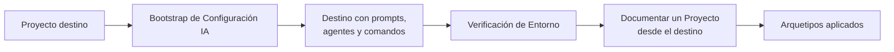

# Mapa Funcional — doc_ia

Vista funcional de todo el sistema: qué capacidades ofrece doc_ia, cómo se encadenan entre sí
y qué términos comparten. Cada capacidad enlaza a su página funcional detallada.

## 1. Capacidades del Sistema

| Capacidad | Módulo(s) | Página funcional | Criterios | Tests |
|---|---|---|---|---|
| Comprobar que el entorno tiene las herramientas necesarias | Tooling determinista | [Verificación de Entorno](check_env.md) | AC-01 – AC-06 | 6/6 |
| Convertir documentos previos a Markdown para usarlos como contexto | Tooling determinista | [Conversión de Documentos a Markdown](convert_to_md.md) | AC-01 – AC-13 | 12/13 |
| Empaquetar la documentación para consulta offline con verificación de integridad | Tooling determinista | [ZIP de Documentación Offline](build_docs_zip.md) | AC-01 – AC-15 | 14/15 |
| Traer a una zona de trabajo local, con versión e historial, los documentos de origen que viven en carpetas de red, SharePoint sincronizado o carpetas de solo lectura | Tooling determinista | [Adquisición de Orígenes Documentales](snapshot_sources.md) | AC-01 – AC-19 | 19/19 |
| Retirar las credenciales de los documentos convertidos antes de versionarlos en `_fuentes/` | Tooling determinista | [Redacción de Credenciales](redact_secrets.md) | AC-01 – AC-10 | 10/10 |
| Llevar a cada destino la metodología, los lanzadores `/documentar` y una guía para relanzar su documentación sin abrir doc_ia | Tooling determinista | [Kit de Documentación en el Destino](kit.md) | AC-01 – AC-15 | 15/15 |
| Incorporar el esquema real de la base de datos de un entorno, contrastarlo con el modelo del código y devolver a `util_bbdd` el mapa de páginas y código de cada tabla | Tooling determinista | [Trazabilidad con la Base de Datos](db_trace.md) | AC-01 – AC-19 | 19/19 |
| Publicar en el manual de funcionamiento solo las capturas revisadas de la aplicación desplegada y comprobar que imágenes, registro y citas coinciden | Tooling determinista | [Capturas del Origen WEB](web_captures.md) | AC-01 – AC-11 | 11/11 |
| Detectar documentación desactualizada respecto al código, cruzar criterios con tests y comprobar que las decisiones de cobertura se reflejan | Tooling determinista | [Trazabilidad Docs ↔ Código](doc_trace.md) | AC-01 – AC-33 | 33/33 |
| Documentar un proyecto completo desde una única operación de entrada | Flujos IA | [Documentar un Proyecto](document_project.md) | AC-01 – AC-12 | 1/12 |
| Clasificar cada origen (código, normativa, especificación, contrato…) y decidir su tratamiento | Flujos IA | [Catálogo de Tipos de Origen](origin_types.md) | AC-01 – AC-09 | 1/9 |
| Producir documentación con estructura fija, evidencia verificable y decisiones humanas citadas | Flujos IA | [Arquetipos Formales](archetypes.md) | AC-01 – AC-17 | 17/17 |
| Trasladar el sistema de instrucciones IA a otro proyecto | Flujos IA | [Bootstrap de Configuración IA](bootstrap.md) | AC-01 – AC-05 | 1/5 |

**Cobertura de pruebas**: 159 de 184 criterios tienen un test automatizado. Los flujos IA se
ejecutan en el chat de la plataforma IA: de ellos solo se comprueba la estructura de la
documentación resultante (Arquetipos) ⚠️.

## 2. Recorridos Transversales

### Documentar un proyecto con documentos previos

```mermaid
flowchart LR
    accTitle: Recorrido de documentos previos a ZIP offline
    accDescr: Los documentos previos se copian de su ubicación de solo lectura a una zona de trabajo local, se convierten a Markdown, se documenta el proyecto clasificando orígenes y aplicando arquetipos, y se construye el sitio y su ZIP offline con SHA256.
    S[Orígenes de solo lectura<br/>red, SharePoint, carpetas] --> A
    A[Copia local en _staging/<br/>con versión e historial] --> B[Conversión a Markdown<br/>carpeta md/]
    B --> C[Documentar un Proyecto]
    C --> D[Clasificación de orígenes]
    D --> E[Arquetipos por módulo<br/>+ Mapa Funcional + Referencia]
    E --> F[Build del sitio]
    F --> G[ZIP offline + SHA256]
```

Si los documentos viven en una carpeta de red, en SharePoint o en otra ubicación que no se debe
tocar, primero se copian a la zona de trabajo `_staging/` del destino, que registra su versión y
sus cambios. Los documentos que el agente IA no puede leer se convierten a Markdown. Después,
la documentación del proyecto copia la carpeta `md/` a `_fuentes/` del destino, clasifica cada
origen y usa esa copia como contexto.
Los arquetipos generan las páginas y la build produce el sitio, que se empaqueta en el ZIP offline.

### Llevar doc_ia a otro proyecto y documentarlo

El bootstrap copia al proyecto destino las instrucciones de doc_ia, incluidos los prompts de
arquetipos. A partir de ahí el destino verifica su entorno y se documenta a sí mismo con el
mismo flujo de entrada.

## 3. Actores y Permisos

*No aplica para este sistema.* doc_ia no distingue roles ni permisos: cualquier usuario con
acceso al repositorio y a una plataforma IA puede usar todas las capacidades.

## 4. Glosario Global

| Término | Definición |
|---|---|
| Origen | Lo que se documenta o se toma como fuente: el proyecto a documentar en *Documentar un Proyecto*; doc_ia como plantilla en el *Bootstrap* |
| Destino | Carpeta o repositorio donde se escriben la documentación o la configuración generadas |
| Arquetipo | Plantilla formal de documentación con secciones fijas, audiencia y ubicación definidas |
| Tipo de origen | Naturaleza de un origen (`CÓDIGO`, `NORMATIVA`, `ESPECIFICACIÓN`, `UI/PANTALLAS`, `REFERENCIA`, `CONTRATO`, `INFRAESTRUCTURA`, `MANUAL`, `BASE DE DATOS`) que decide su tratamiento |
| MATERIAL | Cualquier origen que no es código; enriquece las páginas del proyecto principal sin generar páginas propias |
| Contrato propio | Especificación de las APIs o datos del propio proyecto (`CONTRATO`); los contratos de terceros son `REFERENCIA` |
| Carpeta `md/` | Resultado de la conversión a Markdown, junto a los documentos originales |
| `_fuentes/` | Copia de las carpetas `md/` en el proyecto documentado; sirve como contexto al documentarlo y queda versionada con él |
| Kit de documentación | Copia de la metodología de doc_ia (`.doc_ia/`), lanzadores `/documentar` y `DOCUMENTAR.md` en el destino; la instala y actualiza toda sesión de *Documentar un Proyecto* |
| `_staging/` | Zona de trabajo local del destino, fuera del control de versiones, con la copia de los orígenes que no se deben escribir; las fases siguientes trabajan sobre ella |

??? note "Evidencia"

    | Elemento | Fuente | Confianza |
    |---|---|---|
    | Capacidad «Verificación de Entorno» y 6/6 tests | `docs/functional/check_env.md::§7` | ✅ |
    | Capacidad «Conversión a Markdown» y 12/13 tests | `docs/functional/convert_to_md.md::§7` | ✅ |
    | Capacidad «ZIP offline» y 14/15 tests | `docs/functional/build_docs_zip.md::§7` | ✅ |
    | Capacidad «Adquisición de orígenes» y 19/19 tests | `docs/functional/snapshot_sources.md::§7` | ✅ |
    | Capacidad «Redacción de credenciales» y 10/10 tests | `docs/functional/redact_secrets.md::§7` | ✅ |
    | Capacidad «Kit de documentación» y 15/15 tests | `docs/functional/kit.md::§7` | ✅ |
    | Capacidad «Trazabilidad con la Base de Datos» y 19/19 tests | `docs/functional/db_trace.md::§7` | ✅ |
    | Capacidad «Capturas del Origen WEB» y 11/11 tests | `docs/functional/web_captures.md::§7` | ✅ |
    | Capacidad «Trazabilidad» y 33/33 tests | `docs/functional/doc_trace.md::§7` | ✅ |
    | Capacidad «Documentar un Proyecto» y 1/12 tests | `docs/functional/document_project.md::§7` | ✅ |
    | Capacidad «Tipos de Origen» y 1/9 tests | `docs/functional/origin_types.md::§7` | ✅ |
    | Capacidad «Arquetipos» y 17/17 tests | `docs/functional/archetypes.md::§7` | ✅ |
    | Capacidad «Bootstrap» y 1/5 tests | `docs/functional/bootstrap.md::§7` | ✅ |
    | Recorrido «documentos previos» | `docs/functional/snapshot_sources.md::§1`, `docs/functional/convert_to_md.md::§1`, `docs/functional/document_project.md::§3` | ✅ |
    | [COB-SISTEMA-002](../decisiones/sistema_decisiones.md#cob-sistema-002) · Recorrido «bootstrap → documentar» | `docs/functional/bootstrap.md::§4`, `docs/functional/document_project.md::§2` | 🔍 → ✅ (decisión: Aportar evidencia) |
    | Sin roles ni permisos | Ninguna página funcional define «Actores y permisos» | ✅ |
    | Doble sentido de «Origen» | `docs/functional/bootstrap.md::§8`, `docs/functional/document_project.md::§8` | ✅ |
