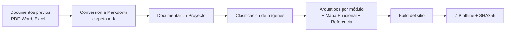
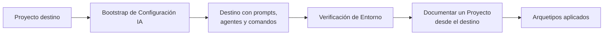

# Mapa Funcional — doc_ia

Vista funcional de todo el sistema: qué capacidades ofrece doc_ia, cómo se encadenan entre sí
y qué términos comparten. Cada capacidad enlaza a su página funcional detallada.

## 1. Capacidades del Sistema

| Capacidad | Módulo(s) | Página funcional | Criterios | Tests |
|---|---|---|---|---|
| Comprobar que el entorno tiene las herramientas necesarias | Tooling determinista | [Verificación de Entorno](check_env.md) | AC-01 – AC-06 | 6/6 |
| Convertir documentos previos a Markdown para usarlos como contexto | Tooling determinista | [Conversión de Documentos a Markdown](convert_to_md.md) | AC-01 – AC-13 | 12/13 |
| Empaquetar la documentación para consulta offline con verificación de integridad | Tooling determinista | [ZIP de Documentación Offline](build_docs_zip.md) | AC-01 – AC-09 | 8/9 |
| Detectar documentación desactualizada respecto al código y cruzar criterios con tests | Tooling determinista | [Trazabilidad Docs ↔ Código](doc_trace.md) | AC-01 – AC-14 | 14/14 |
| Documentar un proyecto completo desde una única operación de entrada | Flujos IA | [Documentar un Proyecto](document_project.md) | AC-01 – AC-08 | 0/8 |
| Clasificar cada origen (código, normativa, especificación, contrato…) y decidir su tratamiento | Flujos IA | [Catálogo de Tipos de Origen](origin_types.md) | AC-01 – AC-09 | 0/9 |
| Producir documentación con estructura fija y evidencia verificable | Flujos IA | [Arquetipos Formales](archetypes.md) | AC-01 – AC-13 | 13/13 |
| Trasladar el sistema de instrucciones IA a otro proyecto | Flujos IA | [Bootstrap de Configuración IA](bootstrap.md) | AC-01 – AC-04 | 0/4 |

**Cobertura de pruebas**: 50 de 73 criterios tienen un test automatizado. Los flujos IA se
ejecutan en el chat de la plataforma IA: de ellos solo se comprueba la estructura de la
documentación resultante (Arquetipos) ⚠️.

## 2. Recorridos Transversales

### Documentar un proyecto con documentos previos

Los documentos que el agente IA no puede leer se convierten primero a Markdown. Después,
la documentación del proyecto clasifica cada origen y usa la carpeta `md/` como contexto.
Los arquetipos generan las páginas y la build produce el sitio, que se empaqueta en el ZIP offline.

### Llevar doc_ia a otro proyecto y documentarlo

El bootstrap copia al proyecto destino las instrucciones de doc_ia, incluidos los prompts de
arquetipos. A partir de ahí el destino verifica su entorno y se documenta a sí mismo con el
mismo flujo de entrada.

## 3. Actores y Permisos

*No aplica para este sistema.* doc_ia no distingue roles ni permisos: cualquier usuario con
acceso al repositorio y a una plataforma IA puede usar todas las capacidades.

## 4. Glosario Global

| Término | Definición |
|---|---|
| Origen | Lo que se documenta o se toma como fuente: el proyecto a documentar en *Documentar un Proyecto*; doc_ia como plantilla en el *Bootstrap* |
| Destino | Carpeta o repositorio donde se escriben la documentación o la configuración generadas |
| Arquetipo | Plantilla formal de documentación con secciones fijas, audiencia y ubicación definidas |
| Tipo de origen | Naturaleza de un origen (`CÓDIGO`, `NORMATIVA`, `ESPECIFICACIÓN`, `UI/PANTALLAS`, `REFERENCIA`, `CONTRATO`, `INFRAESTRUCTURA`, `MANUAL`) que decide su tratamiento |
| MATERIAL | Cualquier origen que no es código; enriquece las páginas del proyecto principal sin generar páginas propias |
| Contrato propio | Especificación de las APIs o datos del propio proyecto (`CONTRATO`); los contratos de terceros son `REFERENCIA` |
| Carpeta `md/` | Resultado de la conversión a Markdown; sirve como contexto al documentar un proyecto |

??? note "Evidencia"

    | Elemento | Fuente | Confianza |
    |---|---|---|
    | Capacidad «Verificación de Entorno» y 6/6 tests | `docs/functional/check_env.md::§7` | ✅ |
    | Capacidad «Conversión a Markdown» y 12/13 tests | `docs/functional/convert_to_md.md::§7` | ✅ |
    | Capacidad «ZIP offline» y 8/9 tests | `docs/functional/build_docs_zip.md::§7` | ✅ |
    | Capacidad «Trazabilidad» y 14/14 tests | `docs/functional/doc_trace.md::§7` | ✅ |
    | Capacidad «Documentar un Proyecto» y 0/8 tests | `docs/functional/document_project.md::§7` | ✅ |
    | Capacidad «Tipos de Origen» y 0/9 tests | `docs/functional/origin_types.md::§7` | ✅ |
    | Capacidad «Arquetipos» y 10/10 tests | `docs/functional/archetypes.md::§7` | ✅ |
    | Capacidad «Bootstrap» y 0/4 tests | `docs/functional/bootstrap.md::§7` | ✅ |
    | Recorrido «documentos previos» | `docs/functional/convert_to_md.md::§1`, `docs/functional/document_project.md::§3` | ✅ |
    | Recorrido «bootstrap → documentar» | `docs/functional/bootstrap.md::§4`, `docs/functional/document_project.md::§2` | 🔍 |
    | Sin roles ni permisos | Ninguna página funcional define «Actores y permisos» | ✅ |
    | Doble sentido de «Origen» | `docs/functional/bootstrap.md::§8`, `docs/functional/document_project.md::§8` | ✅ |
