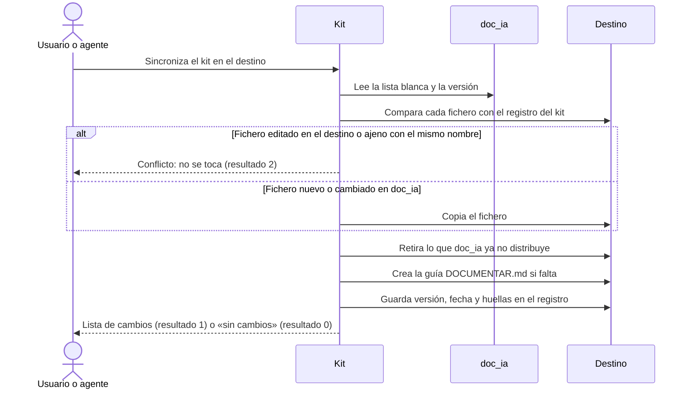

# Kit de Documentación en el Destino

## 1. Objetivo y Descripción

El kit de documentación hace que cada proyecto documentado con doc_ia lleve dentro lo
necesario para volver a documentarse sin abrir doc_ia: una copia fijada de la metodología
(instrucciones, prompts de arquetipo, plantillas) y de las herramientas deterministas, un
lanzador `/documentar` para cada plataforma IA y una guía para las personas que mantienen la
documentación. Quien recibe el repositorio de documentación lo abre, escribe `/documentar` y
la sesión se repite con los parámetros y decisiones de ese proyecto.

La copia se instala y se actualiza al empezar cada sesión de
[Documentar un Proyecto](document_project.md), y se puede comprobar en cualquier momento: si
alguien ha editado un fichero del kit, si falta alguno o si doc_ia ha publicado una versión
más reciente. Qué se copia lo decide una lista blanca de doc_ia, de modo que lo que solo sirve
para desarrollar doc_ia no viaja a los destinos. Cada destino guarda además un registro con la
versión de doc_ia instalada y la huella de cada fichero del kit.

La actualización es prudente: nunca pisa un fichero del kit que se haya cambiado en el
destino ni un fichero propio del proyecto que tenga el mismo nombre que un lanzador, salvo que
se pida expresamente. La guía para las personas solo se crea si falta; después es del
proyecto. Todo el proceso es local: no accede a la red ni consulta servicios IA.

## 2. Precondiciones

- Una raíz del destino existente (la carpeta que contiene o contendrá `mkdocs.yml`), indicada
  siempre de forma explícita y distinta del propio doc_ia.
- Para instalar o actualizar: un doc_ia accesible como carpeta (el repositorio desde el que se
  lanza, o el que se indique) con su lista blanca y todos los ficheros que esta cita.
- Para comprobar: el kit ya instalado en el destino; para detectar ficheros desfasados, además,
  un doc_ia accesible con el que comparar.
- Desde la copia del kit de un destino, la actualización exige indicar de qué doc_ia se trae:
  una copia no puede actualizarse a sí misma.

## 3. Flujo Principal

El agente sincroniza el kit al inicio de cada sesión (o una persona lo hace a mano). La
herramienta lee de doc_ia qué ficheros forman el kit y su versión, y compara cada uno con la
huella que el registro del destino guarda de la última instalación. Lo nuevo o cambiado en
doc_ia se copia; lo que el destino ha modificado, o lo que ya existía sin haberlo instalado el
kit, se deja como está y se informa como conflicto. Lo que doc_ia ya no distribuye se retira.
La guía para personas se crea con el nombre del proyecto solo si no existe. Por último se
guarda el registro con la versión de doc_ia, la fecha y las huellas.

Más tarde, desde el propio destino, `/documentar` lee el prompt de instancia del proyecto
(sus parámetros y decisiones, que mantiene el cierre de cada sesión) y aplica la metodología
de la copia del kit.

## 4. Postcondiciones y Efectos

- **Instalar o actualizar**: el destino contiene en `.doc_ia/` la metodología y las
  herramientas de la lista blanca, con la misma ruta que en doc_ia; en su raíz, los lanzadores
  `/documentar` para Claude Code (`.claude/commands/documentar.md`), GitHub Copilot
  (`.github/prompts/documentar.prompt.md`), agentes genéricos (`AGENTS.md`) y Gemini
  (`GEMINI.md`); y `DOCUMENTAR.md` con el nombre del proyecto, si no existía.
- El registro `.doc_ia/kit.lock.json` guarda la versión de doc_ia, la fecha y la huella de
  cada fichero gestionado por el kit (no la de `DOCUMENTAR.md`, que es del proyecto).
- Los ficheros que doc_ia ya no distribuye y no se han editado en el destino ya no existen.
- Los ficheros en conflicto conservan su contenido.
- **Simulación**: informa de los cambios previstos sin escribir nada.
- **Comprobar**: lista los ficheros del kit editados o ausentes, la falta de `DOCUMENTAR.md` o
  del prompt de instancia `.ai/prompts/documentar.prompt.md` y, si se indica doc_ia, los
  ficheros desfasados o nuevos; no modifica nada.
- El prompt de instancia no lo crea esta herramienta: lo crea `/documentar` o el cierre de la
  sesión de documentación, y lo actualiza cada cierre.

## 5. Reglas de Negocio

| Regla | Descripción | Impacto si se viola |
|---|---|---|
| Lista blanca | Solo se copia lo que cita la lista blanca de doc_ia; lo que es de desarrollo de doc_ia (instrucciones compartidas, bootstrap, revisión de configuración, cierre de versión, tests) no entra | Los destinos recibirían ficheros ajenos a su documentación o confundirían el kit con la configuración de desarrollo |
| Nunca pisar lo editado | Un fichero del kit cuya huella ya no coincide con la del registro es un conflicto y no se sobrescribe sin `--force` | Se perderían cambios locales sin aviso |
| Nunca pisar lo ajeno | Un fichero que existe en el destino sin haberlo instalado el kit (p. ej. un `/documentar` propio) es un conflicto y no se sobrescribe sin `--force` | El kit sustituiría la configuración IA propia del proyecto |
| Retirar lo que doc_ia ya no distribuye | Un fichero registrado que ya no está en la lista blanca se borra, salvo que esté editado (conflicto) | Quedarían prompts o scripts obsoletos que el agente seguiría leyendo |
| La guía es del proyecto | `DOCUMENTAR.md` se crea solo si falta, sin el comentario de la plantilla y con el nombre del sitio; nunca se actualiza ni se registra su huella | Se perderían los ejemplos propios del proyecto en cada sesión |
| Copia fijada y trazable | El registro guarda versión de doc_ia, fecha y huella SHA256 de cada fichero gestionado; en los ficheros de texto la huella no depende del fin de línea (CRLF o LF) | No se sabría con qué versión de la metodología se documentó ni si alguien la cambió; al clonar en otro sistema operativo todo el kit parecería editado |
| Una copia no se actualiza a sí misma | La copia del kit de un destino se niega a sincronizar sin indicar el doc_ia de origen, y nunca se sincroniza doc_ia sobre sí mismo | El kit se «actualizaría» con su propia copia sin traer nada nuevo, o se escribiría dentro de doc_ia |
| Sin red ni servicios IA | Todo se lee y escribe en el sistema de ficheros local | Dependencia de conexión o credenciales |

## 6. Límites, Flujos Alternativos y Casos Especiales

### Qué NO hace esta funcionalidad

- No documenta: solo deja en el destino lo necesario para lanzar la documentación.
- No crea ni actualiza el prompt de instancia: lo hacen `/documentar` y el cierre de sesión.
- No sustituye la configuración de IA de desarrollo que deja el
  [Bootstrap de Configuración IA](bootstrap.md): el kit usa solo nombres propios
  (`/documentar`, `.doc_ia/`, `DOCUMENTAR.md`).
- No descarga doc_ia de la red: el doc_ia de origen es siempre una carpeta local.
- No hace commit: el cierre de la sesión lo incluye en el commit propuesto.

### Flujos alternativos

- **Simulación**: lista los cambios previstos sin escribir ficheros ni registro; el resultado
  es el mismo que tendría la sincronización real.
- **Forzar**: con `--force` se sobrescriben los ficheros editados y ajenos y se retiran los
  que doc_ia ya no distribuye aunque estén editados.
- **Desde el destino**: la copia del kit se puede usar indicando el doc_ia de origen con
  `--from`; sin él, se niega con un error y resultado 2.
- **Sin doc_ia accesible**: solo se puede comprobar la integridad del kit con su registro; el
  flujo de documentación avisa de que el kit no se ha podido actualizar.
- **Lista blanca mal formada** o que cita un fichero inexistente en doc_ia: error y resultado 2.

### Casos especiales

- **Destino ya documentado sin kit**: la primera sincronización lo instala completo; un
  `AGENTS.md` o `GEMINI.md` propio queda como conflicto.
- **Kit editado a mano**: la comprobación lo señala y la sincronización no lo toca; para
  volver a la versión de doc_ia hay que forzar.
- **Fichero del kit borrado en el destino**: la comprobación lo señala como ausente y la
  siguiente sincronización lo repone.
- **Clon en otro sistema operativo**: si git devuelve los ficheros del kit con otro fin de
  línea, no cuentan como editados.
- **Sin `site_name` en `mkdocs.yml`**: la guía usa el nombre de la carpeta del destino.

## 7. Criterios de Aceptación

| ID | Dado | Cuando | Entonces | Test |
|---|---|---|---|---|
| AC-01 | Un destino vacío con `mkdocs.yml` | Se instala el kit | Metodología en `.doc_ia/`, lanzadores en la raíz, `DOCUMENTAR.md` con el nombre del sitio y registro con versión, fecha y huellas (sin `DOCUMENTAR.md`) | `tests/test_kit.py::test_install_copies_methodology_launchers_and_instance` |
| AC-02 | Un kit instalado y `DOCUMENTAR.md` editado por el proyecto | Se sincroniza de nuevo | No hay cambios y `DOCUMENTAR.md` conserva su contenido | `tests/test_kit.py::test_sync_is_idempotent_and_keeps_project_owned_files` |
| AC-03 | Un fichero cambiado en doc_ia y otro retirado de la lista blanca | Se sincroniza | El cambiado se actualiza y el retirado se borra del destino | `tests/test_kit.py::test_sync_updates_changed_and_removes_retired` |
| AC-04 | Un fichero del kit editado en el destino | Se sincroniza sin y con `--force` | Sin `--force`, conflicto y contenido local intacto; con `--force`, se sobrescribe | `tests/test_kit.py::test_sync_never_overwrites_local_edits_without_force` |
| AC-05 | Un `/documentar` propio del proyecto | Se instala el kit | Conflicto «fichero ajeno» y el fichero propio se conserva | `tests/test_kit.py::test_sync_does_not_overwrite_foreign_launcher` |
| AC-06 | Un destino sin kit, con kit sin prompt de instancia, al día, desfasado y con un fichero borrado | Se comprueba | Señala kit no instalado, prompt de instancia ausente, nada, fichero desfasado y fichero ausente | `tests/test_kit.py::test_check_detects_edits_missing_instance_and_outdated` |
| AC-07 | doc_ia como destino, o la copia del kit de un destino como origen | Se sincroniza | Error «el destino no puede ser el propio doc_ia» | `tests/test_kit.py::test_sync_rejects_vendored_copy_and_self` |
| AC-08 | Instalación, sincronización sin cambios, comprobaciones, edición local y origen vendorizado | Se ejecuta la CLI | Resultados 1, 0, 1, 0, 2 y 2 con `ERROR` por stderr | `tests/test_kit.py::test_cli_exit_codes` |
| AC-09 | Una lista blanca con sección desconocida o lanzador sin `->` | Se lee | Error con su motivo | `tests/test_kit.py::test_manifest_rejects_unknown_section_and_bad_pair` |
| AC-10 | La lista blanca real de doc_ia | Se lee | Todos los ficheros citados existen y ninguno es de desarrollo de doc_ia | `tests/test_kit.py::test_real_manifest_files_exist_and_exclude_doc_ia_development` |
| AC-11 | El kit real y un destino vacío | Se instala | Sin conflictos; `kit.py`, `AGENTS.md` y `GEMINI.md` presentes; `DOCUMENTAR.md` sin marcador ni comentario de plantilla | `tests/test_kit.py::test_real_kit_installs_into_empty_destination` |
| AC-12 | El comando, el prompt y el agente de documentar | Se revisan sus instrucciones | Los tres exigen `kit.py sync` y el prompt de instancia, y la lista blanca incluye todo prompt, agente o plantilla que citan | `tests/test_docs_conformance.py::test_kit_rule_everywhere`, `tests/test_docs_conformance.py::test_kit_manifest_ships_everything_the_flow_cites` |
| AC-13 | Las plantillas de `DOCUMENTAR.md` y del prompt de instancia | Se revisan | Secciones fijas 0-6 y 1-7, ejemplos de `/documentar` e independencia entre proyectos | `tests/test_docs_conformance.py::test_kit_documentar_template_has_fixed_sections`, `tests/test_docs_conformance.py::test_kit_instance_template_has_fixed_sections` |
| AC-14 | Un kit instalado cuyo fichero se recupera con otro fin de línea (CRLF ↔ LF) en otro equipo | Se comprueba y se sincroniza | No es una edición: sin conflicto; un fichero binario sí cambia de huella | `tests/test_kit.py::test_digest_ignores_line_endings_but_not_binary`, `tests/test_kit.py::test_checkout_with_other_line_endings_is_not_an_edit` |
| AC-15 | Un kit al día | Se sincroniza otro día sin cambios en doc_ia | No cambia ningún fichero del destino, tampoco el registro; si doc_ia cambia, el registro se actualiza con la fecha nueva | `tests/test_kit.py::test_sync_without_changes_does_not_rewrite_the_lock` |

Verificación: `python -m pytest tests/test_kit.py tests/test_docs_conformance.py -q -k kit`.

## 8. Glosario de Dominio

| Término | Definición |
|---|---|
| Kit de documentación | Lo que doc_ia deja en un destino para relanzar su documentación: copia de la metodología, lanzadores, registro y guía |
| Copia del kit (`.doc_ia/`) | Carpeta del destino con la metodología y las herramientas de doc_ia, con la misma ruta que en doc_ia |
| Lista blanca | Fichero de doc_ia (`.github/kit/MANIFEST.txt`) que decide qué se copia, en tres secciones: metodología, lanzadores e instancia |
| Lanzador | Fichero en la raíz del destino que cada plataforma IA reconoce y que remite a `/documentar` |
| Registro del kit (`kit.lock.json`) | Versión de doc_ia, fecha y huella de cada fichero gestionado por el kit |
| Prompt de instancia | `.ai/prompts/documentar.prompt.md`: parámetros y decisiones de ese proyecto, que `/documentar` aplica sin preguntar |
| Conflicto | Fichero que la sincronización no toca: editado en el destino o ajeno con el mismo nombre |
| `/documentar` | Orden con la que se relanza la documentación desde el destino |

??? note "Evidencia"

    | Elemento | Fuente | Confianza |
    |---|---|---|
    | Copia en `.doc_ia/`, lanzadores e instancia | `scripts/kit.py::managed_files`, `::sync`, `.github/kit/MANIFEST.txt` | ✅ |
    | Regla «Lista blanca» y exclusiones | `.github/kit/MANIFEST.txt` (cabecera), `tests/test_kit.py::test_real_manifest_files_exist_and_exclude_doc_ia_development` | ✅ |
    | Reglas «Nunca pisar lo editado» y «Nunca pisar lo ajeno» | `scripts/kit.py::sync` (`previous is None`, `current != previous`) | ✅ |
    | Regla «Retirar lo que doc_ia ya no distribuye» | `scripts/kit.py::sync` (bucle sobre `locked`) | ✅ |
    | Regla «La guía es del proyecto» y nombre del sitio | `scripts/kit.py::render_instance`, `::SITE_NAME_RE`, `::LEADING_COMMENT_RE`, `::managed_files` (sin `[instancia]`) | ✅ |
    | Regla «Copia fijada y trazable» | `scripts/kit.py::write_lock`, `::sha256`, `::doc_ia_version` | ✅ |
    | Regla «Una copia no se actualiza a sí misma» | `scripts/kit.py::resolve_source`, `::sync` | ✅ |
    | Comprobación y sus hallazgos | `scripts/kit.py::check`, `::INSTANCE_PROMPT` | ✅ |
    | Resultados 0, 1 y 2 | `scripts/kit.py::_cmd_sync`, `::_cmd_check`, `::main` | ✅ |
    | Sincronización en toda sesión y prompt de instancia en el CIERRE | `.github/prompts/document_project.prompt.md::Kit de documentación en el destino y <doc_ia>`, `::Fase 0b`, `::Devuelve en este orden` (punto 10) | ✅ |
    | Lanzadores remiten al prompt de instancia y a `.doc_ia/` | `.github/templates/kit/documentar.command.md`, `.github/templates/kit/AGENTS.md` | ✅ |
    | Distinción con el bootstrap | `.github/prompts/bootstrap_ai_config.prompt.md` (nota «No confundir con el kit») | ✅ |
    | Sin red | `scripts/kit.py` (docstring del módulo; solo `pathlib`/`shutil`) | ✅ |
    | AC-01 – AC-15 | `tests/test_kit.py`, `tests/test_docs_conformance.py` | ✅ |
