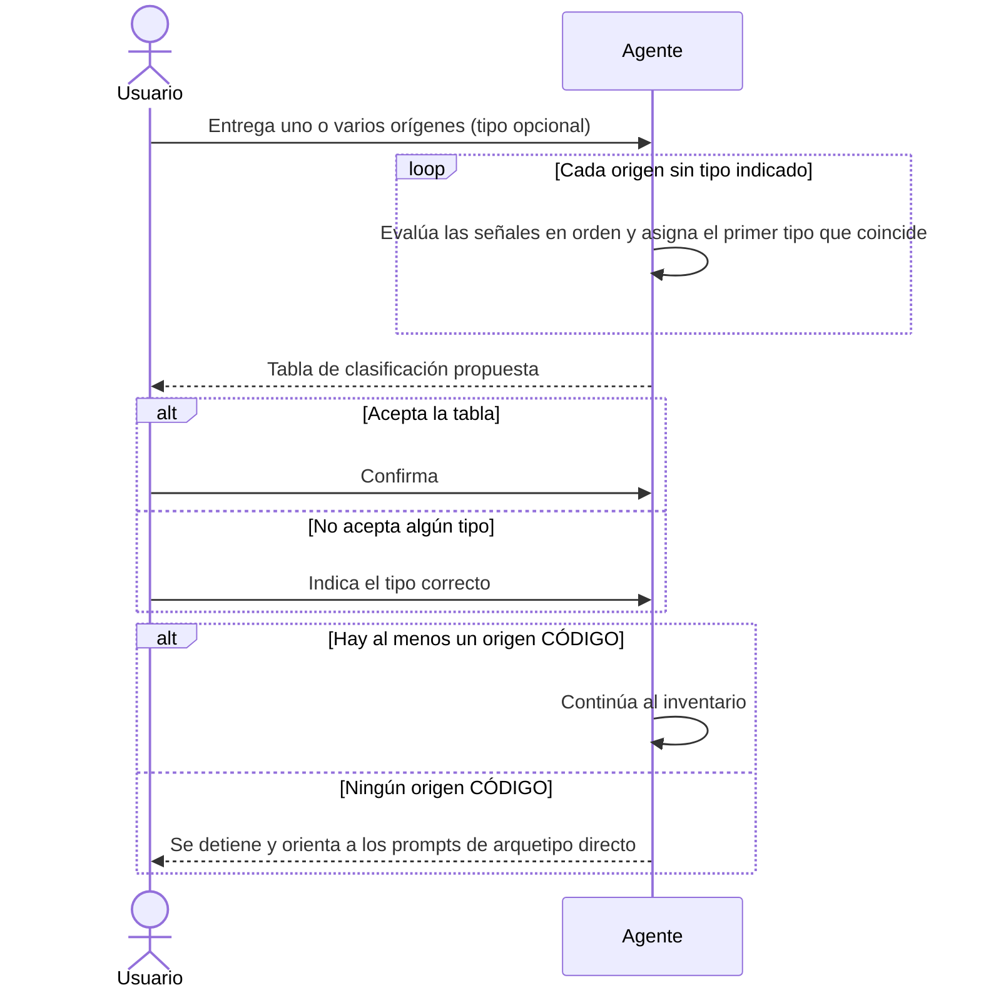

# Catálogo de Tipos de Origen

## 1. Objetivo y Descripción

Cuando se invoca `/document-project` con uno o varios orígenes, el agente clasifica cada
uno en un **tipo de origen** antes de inventariar y generar documentación. El tipo
determina qué tratamiento documental se aplica: si el origen genera páginas completas por
arquetipos (tipo `CÓDIGO`) o si enriquece secciones concretas de la documentación del
proyecto principal (tipos `MATERIAL`).

El catálogo define nueve tipos. La clasificación la propone el agente a partir de señales
en el sistema de ficheros; el usuario confirma antes de continuar. Así se evita que un PDF
de normativa, un mockup o una especificación de API se traten como si fueran código y
produzcan páginas vacías o incorrectas.

## 2. Precondiciones

- Se ha invocado `/document-project` (o su prompt) con los cuatro parámetros obligatorios.
- Hay **dos o más orígenes**, o el único origen no es de tipo `CÓDIGO`: en otro caso la
  clasificación no se ejecuta y el origen se trata directamente como proyecto de código.
- Cada origen es una ruta existente y legible.
- Opcional: el usuario puede indicar el tipo de cada origen; si lo omite, se autodetecta.

## 3. Flujo Principal

Para cada origen, el agente evalúa las señales en el orden de la tabla siguiente y asigna el
primer tipo que coincide; lo que no encaja en ninguno se considera referencia de terceros.
Presenta el resultado en una tabla y espera la confirmación del usuario antes de inventariar.

| Orden | Señal | Tipo |
|---|---|---|
| 1 | Archivos fuente o manifiestos de build | `CÓDIGO` |
| 2 | PDF o documento con palabras clave legales | `NORMATIVA` |
| 3 | Word/PDF de requisitos o ficheros `.feature` | `ESPECIFICACIÓN` |
| 4 | Imágenes o PDFs de diseño, carpeta `mockups/` | `UI/PANTALLAS` |
| 5 | YAML con `openapi:`/`asyncapi:`, `.graphql`, `.proto`, `.sql` DDL, `.dbml`, carpeta `schemas/` | `CONTRATO` |
| 6 | `.tf`, `Dockerfile`, `docker-compose`, YAML en `k8s/`, `helm/`, Ansible | `INFRAESTRUCTURA` |
| 7 | PDF/Word/MD propio con `manual`, `guide` o `runbook` en el nombre o la carpeta | `MANUAL` |
| 8 | Exportación de `util_bbdd`: `manifest.json` con formato `util_bbdd.doc.markdown` y `docs/catalog.json` (solo con el parámetro `BD`) | `BASE DE DATOS` |
| 9 | Ninguna de las anteriores | `REFERENCIA` |

### Tipos y señales de detección

| Tipo | Naturaleza | Señales en el sistema de ficheros | Ejemplos de artefactos |
|---|---|---|---|
| `CÓDIGO` | Archivos fuente ejecutables que implementan la lógica del sistema | `.py`, `.js`, `.ts`, `.cs`, `.java`, `.go`, `.rs`, `.rb`, `.php`, …; `pyproject.toml`, `package.json`, `pom.xml`, `Cargo.toml`, `go.mod`; directorios `src/` o `tests/` presentes | `scripts/check_env.py`, `src/main.ts`, `lib/core.go` |
| `NORMATIVA` | Documentos legales o regulatorios de obligado cumplimiento | PDFs/docs cuyo nombre o carpeta contenga: `ley`, `decreto`, `directiva`, `rgpd`, `gdpr`, `une`, `iso`, `reglamento`, `compliance`, `normativa`, `legislación`, `boe`, `doue` | `RGPD-2016-679.pdf`, `ley-39-2015.pdf`, `ISO-27001.pdf`, `BOE-A-2004-21760.pdf` |
| `ESPECIFICACIÓN` | Requisitos, user stories, casos de uso o pliegos del proyecto | Word/PDF de requisitos; ficheros `.feature` (BDD/Gherkin); carpetas `specs/`, `requirements/`, `ux/`, `user-stories/` | `PRD-v2.docx`, `requirements.pdf`, `login.feature` |
| `UI/PANTALLAS` | Wireframes, mockups, capturas de pantalla o prototipos de interfaz | `.png`, `.jpg`, `.pdf` de diseño; carpetas `mockups/`, `screens/`, `wireframes/`, `figma-exports/`, `designs/` | `mockup-login.png`, `flujo-checkout.pdf`, `screens/` |
| `CONTRATO` | Especificaciones machine-readable de las APIs y modelos de datos **propios del proyecto** | `.yaml`/`.json` con clave `openapi:` o `asyncapi:`; `.graphql`/`.gql`; `.proto`; `.avsc`; `.sql` DDL en `db/`/`migrations/`; `.dbml`; carpetas `api/`, `contracts/`, `schemas/`, `proto/`, `graphql/` | `openapi.yaml`, `schema.graphql`, `service.proto`, `asyncapi.yml`, `schema.sql`, `models.dbml` |
| `INFRAESTRUCTURA` | Artefactos IaC y de despliegue que describen cómo se ejecuta el sistema | `.tf` (Terraform); `Dockerfile`, `docker-compose.yml`, `.dockerfile`; YAML en `k8s/`, `deploy/`, `manifests/`, `helm/`; playbooks Ansible `.yml` en `roles/`/`ansible/`; CloudFormation `.yaml` en `cloudformation/` | `main.tf`, `docker-compose.yml`, `k8s/deployment.yaml`, `helm/Chart.yaml` |
| `MANUAL` | Documentación narrativa ya escrita **por/para el propio proyecto**: manuales de usuario, guías de administrador, runbooks operativos, notas de versión, ayuda en línea | `.pdf`, `.docx`, `.odt`, `.md` con nombres que contengan `manual`, `guia`, `guide`, `handbook`, `runbook`, `ayuda`, `help`, `user-guide`, `admin-guide`, `release-notes`; carpetas `manuals/`, `help/`, `user-docs/`, `documentation/`; ficheros `.chm` | `manual-usuario-v3.pdf`, `admin-guide.docx`, `runbook-ops.md`, `help/` |
| `BASE DE DATOS` | Esquema **real** de la base de datos desplegada en un entorno (no sus datos), exportado por el usuario con `util_bbdd` fuera de doc_ia | `manifest.json` con `format: util_bbdd.doc.markdown` y `docs/catalog.json` con `format: util_bbdd.doc.catalog`; solo con el parámetro opcional `BD` | `export_calidad/manifest.json`, `export_calidad/docs/tables/*.md` |
| `REFERENCIA` | Documentación de terceros que el proyecto consume o referencia (sin ser código propio) | Manuales externos, RFCs, especificaciones de protocolo ajenas al proyecto; PDFs/docs en `docs/external/`, `references/` | `RFC-7807.pdf`, `stripe-api-reference.pdf`, `oauth2-spec.pdf` |

### Mapeo MATERIAL → arquetipos enriquecidos

Los orígenes de tipo MATERIAL **no generan páginas propias**; su contenido enriquece
secciones concretas de los arquetipos del proyecto `CÓDIGO` principal.

| Tipo | Arquetipo(s) enriquecido(s) | Sección(es) afectadas |
|---|---|---|
| `NORMATIVA` | Arquetipo 8 (completo) + Arquetipo 1 (proyecto principal) | Arq. 8 completo; Arq. 1 §5 Reglas de Negocio |
| `ESPECIFICACIÓN` | Arquetipo 1 (proyecto principal); Arquetipo 14 si es un diseño técnico de integraciones | §3 Flujo Principal, §5 Reglas de Negocio, §6 Flujos Alternativos, §7 Criterios de Aceptación; Arq. 14: contratos, periodicidad y efectos (manda el código si discrepan) |
| `UI/PANTALLAS` | Arquetipos 1 + 3 (+ 15 con la opción `WEB`) | Arq. 1 §3 Flujo Principal; Arq. 3 (How-to/Tutorial) §3 Pasos; con `WEB`, Arquetipo 15 (`docs/manual/`) y fichas `COB-WEB-…` del contraste |
| `REFERENCIA` | Arquetipo 2 o Arquetipo 5 | Arq. 2 §4 Dependencias y Requisitos; o Arq. 5 decisión (ADR) |
| `CONTRATO` | Arquetipos 2 + 12 (proyecto principal) | Arq. 2 §1 Arquitectura y §2 Modelo de Datos / Contratos; Arq. 12 §5 Interfaces Publicadas |
| `INFRAESTRUCTURA` | Arquetipos 2 + 6 | Arq. 2 §4 Dependencias y Requisitos; Arq. 6C §3 › Despliegue |
| `MANUAL` | Arquetipos 3a · 3b · 6 · 7 | Arq. 3a §3 Pasos (tareas ya descritas); Arq. 3b §3 (contenido de aprendizaje); Arq. 6A/B §1 Descripción; Arq. 7 §3 Configurar el Entorno y §5 Primer Resultado |
| `BASE DE DATOS` | Sección generada `docs/bd/` + Arquetipos 2 · 12 · 13 | Sección `docs/bd/` importada con [db_trace](db_trace.md); Arq. 2 §2 Modelo de Datos (evidencia con ancla de columna); Arq. 12 §5; fichas `COB-DATOS-…` del contraste código ↔ BD |

`BASE DE DATOS` y `UI/PANTALLAS` con la opción `WEB` son las excepciones a «MATERIAL no genera
páginas propias». Las páginas de `docs/bd/` no las escribe el agente: se importan generadas desde
la exportación y no se editan. Con `WEB`, las capturas de la aplicación **desplegada** en un
entorno alimentan el manual de funcionamiento (`docs/manual/`, Arquetipo 15). `WEB` no es un tipo
nuevo, sino una forma de obtener material `UI/PANTALLAS`: capturas que aporta el usuario o un
recorrido de solo lectura en el chat.

## 4. Postcondiciones y Efectos

- El usuario ha visto una tabla `Origen | Tipo detectado | Señales encontradas | Rol propuesto`
  y ha confirmado o corregido cada tipo.
- Cada origen MATERIAL queda asignado a las secciones de arquetipo que enriquecerá; ningún
  origen MATERIAL produce una página propia en `docs/`.
- Con dos o más orígenes `CÓDIGO`, queda pendiente la elección de estrategia por el usuario.
- Si ningún origen es `CÓDIGO`, el flujo termina sin escribir documentación.
- La clasificación no crea ni modifica ficheros por sí misma.

## 5. Reglas de Negocio

| Regla | Descripción | Impacto si se viola |
|---|---|---|
| Un origen `CÓDIGO` obligatorio | `/document-project` requiere al menos un origen de tipo `CÓDIGO` para funcionar; sin él el flujo se detiene | Se documentarían solo fuentes MATERIAL sin proyecto de código que contextualice el resultado |
| Autodetección + confirmación | El tipo se propone por señales; el usuario confirma siempre antes de inventariar | Un origen `NORMATIVA` tratado como `CÓDIGO` generaría páginas técnicas vacías o incorrectas |
| MATERIAL no genera páginas propias | Los tipos no-`CÓDIGO` enriquecen secciones de los arquetipos del proyecto `CÓDIGO`; nunca se les crean páginas independientes en `docs/` | Páginas huérfanas sin contenido real derivable del origen |
| `CONTRATO` propio del proyecto | El tipo `CONTRATO` aplica a especificaciones de la API/datos del **propio proyecto**, no a contratos externos; los externos son `REFERENCIA` | Un contrato de terceros procesado como `CONTRATO` del proyecto inventaría una API que no pertenece al proyecto |
| `INFRAESTRUCTURA` sin inventario de código | Los artefactos IaC no tienen módulos Python/JS inventariables; solo enriquecen las secciones de despliegue y dependencias | Intentar un inventario A/B/C sobre `.tf` o K8s YAML produce resultados vacíos |
| `BASE DE DATOS` se contrasta | Describe lo desplegado en un entorno; se contrasta con el `CÓDIGO` (lo construido) y ninguno corrige al otro: cada discrepancia es una ficha `COB-DATOS-…`. doc_ia no se conecta a la base de datos | Se «corregiría» en silencio el modelo del código con un esquema de un entorno concreto, o al revés |
| `UI/PANTALLAS` desplegadas se contrastan | Con la opción `WEB`, las capturas describen lo desplegado en un entorno (con su versión); se contrastan con el `CÓDIGO` y cada diferencia es una ficha `COB-WEB-…`. Ningún script navega por la aplicación y su dirección no se versiona | El manual contradiría al código sin que nadie lo decida, o la dirección interna del entorno quedaría publicada |
| `MANUAL` propio del proyecto | El tipo `MANUAL` aplica a documentación narrativa escrita **por/para el propio proyecto**; la documentación de terceros es `REFERENCIA` | Documentación de un tercero procesada como `MANUAL` generaría guías de operación que no corresponden al proyecto |
| Requisitos frente a manual | Un documento propio que describe lo que se va a construir (PRD, requisitos, user stories) es `ESPECIFICACIÓN` aunque su nombre diga `manual`; lo que describe lo ya construido es `MANUAL`. El nombre solo propone el tipo | Un PRD llamado `manual_producto.pdf` enriquecería guías de uso en lugar de los criterios de aceptación |

## 6. Límites, Flujos Alternativos y Casos Especiales

### Qué NO hace esta funcionalidad

- No aplica ningún tipo sin confirmación del usuario.
- No genera páginas para los orígenes MATERIAL.
- No convierte documentos binarios a Markdown (eso lo cubre la conversión previa con
  carpetas `md/`, que el destino recibe copiadas en `_fuentes/`).
- No adquiere los orígenes: si un origen no es una carpeta local de trabajo (un fichero con la
  versión en el nombre, una carpeta de red, una biblioteca de SharePoint sincronizada o un
  repositorio remoto), la Fase 0-pre lo copia antes a `_staging/` del destino y la
  clasificación se hace sobre esa copia (ver [Adquisición de Orígenes](snapshot_sources.md)).
- No decide la estrategia entre varios proyectos de código.

### Flujos alternativos

- **Sin origen `CÓDIGO`**: el flujo se detiene con mensaje orientativo hacia los prompts
  de arquetipo directo (`normative_traceability.prompt.md`, etc.).
- **Corrección del usuario**: si el usuario no acepta el tipo propuesto, se usa el tipo que
  indique antes de continuar al inventario.

### Casos especiales

- **Señales mixtas**: un directorio puede contener `.tf` Y `.py`; en ese caso prevalece
  `CÓDIGO` si hay archivos fuente ejecutables acompañados de tests o manifiesto de build.
  Los `.tf` dentro del mismo repo se tratan como `INFRAESTRUCTURA` acompañante.
- **Normativa sin fuerza obligatoria**: solo lo de obligado cumplimiento (leyes, decretos,
  órdenes) es `NORMATIVA` y activa el Arquetipo 8; planes, estrategias, guías o protocolos sin
  fuerza normativa son `REFERENCIA` aunque estén en la carpeta de normativa. En la duda, se
  pregunta en la confirmación. El nombre de cada norma se toma de su texto, no del nombre del
  fichero.
- **Contrato externo (tercero)**: si el `.yaml` openapi describe una API de un proveedor
  externo (ej. la API de Stripe), es `REFERENCIA`, no `CONTRATO`. La distinción es la
  propiedad: si es la API del proyecto, es `CONTRATO`; si es la de un tercero, es `REFERENCIA`.
- **Manual propio vs. REFERENCIA**: si el manual describe la aplicación que se está documentando
  es `MANUAL`; si describe un producto de tercero que el proyecto usa, es `REFERENCIA`. Un
  manual de usuario de SAP que el equipo consume → `REFERENCIA`; el manual de usuario de tu
  propia aplicación → `MANUAL`.
- **Manual propio vs. ESPECIFICACIÓN**: `ESPECIFICACIÓN` es intención pre-implementación
  (requisitos, user stories); `MANUAL` es descripción post-implementación de lo que ya existe.
  Un PRD todavía no desarrollado → `ESPECIFICACIÓN`; el manual escrito después del desarrollo → `MANUAL`.

## 7. Criterios de Aceptación

| ID | Dado | Cuando | Entonces | Test |
|---|---|---|---|---|
| AC-01 | Un directorio con `openapi.yaml` (clave `openapi:`) del propio proyecto | Se ejecuta la clasificación | El tipo detectado es `CONTRATO` y el agente propone enriquecer Arquetipo 2 §2 y Arquetipo 12 §5 | Sin test |
| AC-02 | Un directorio con `main.tf` y `Dockerfile` | Se ejecuta la clasificación | El tipo detectado es `INFRAESTRUCTURA` y el agente propone enriquecer Arquetipo 2 §4 y Arquetipo 6C §3 › Despliegue | Sin test |
| AC-03 | Un directorio con `stripe-api.yaml` (API externa de pago) | Se ejecuta la clasificación | El tipo detectado es `REFERENCIA` (no `CONTRATO`), porque el fichero no describe la API del propio proyecto | Sin test |
| AC-04 | Un directorio con `.py` + `openapi.yaml` del mismo proyecto | Se ejecuta la clasificación | El `.py` es `CÓDIGO` y el `openapi.yaml` es `CONTRATO`; el agente lista ambos como orígenes con tipos distintos | Sin test |
| AC-05 | Todos los orígenes son MATERIAL (ninguno es `CÓDIGO`) | Se invoca `/document-project` | El flujo se detiene con mensaje orientativo; no se genera ninguna documentación | Sin test |
| AC-06 | Un proyecto con `schema.sql` de migraciones de base de datos propia | Se ejecuta la clasificación | El tipo es `CONTRATO` (modelo de datos propio), no `CÓDIGO` ni `REFERENCIA` | Sin test |
| AC-07 | Un fichero `manual-usuario-v3.pdf` del propio proyecto | Se ejecuta la clasificación | El tipo detectado es `MANUAL` y el agente propone enriquecer Arquetipos 3a, 3b, 6 y 7 | Sin test |
| AC-08 | El manual de un producto de tercero (ej. `manual-sap-fi.pdf`) | Se ejecuta la clasificación | El tipo detectado es `REFERENCIA` (no `MANUAL`), porque no describe la aplicación propia | Sin test |
| AC-09 | Un PRD (Product Requirements Document) sin implementar aún | Se ejecuta la clasificación | El tipo es `ESPECIFICACIÓN` (no `MANUAL`), porque es intención pre-implementación | `tests/test_docs_conformance.py::test_specification_vs_manual_criterion` |

Verificación: invocar `/document-project` con cada tipo de origen de la tabla y confirmar
que la clasificación propuesta coincide con el tipo esperado. La clasificación se ejecuta en
el chat y no tiene tests automatizados.

## 8. Glosario de Dominio

| Término | Definición |
|---|---|
| Tipo de origen | Categoría que determina cómo procesa el agente un artefacto: si genera documentación completa (`CÓDIGO`) o enriquece secciones concretas (MATERIAL) |
| MATERIAL | Término colectivo para todos los tipos de origen que no son `CÓDIGO`; su contenido no genera páginas propias sino que enriquece arquetipos del proyecto principal |
| Señal de detección | Característica del sistema de ficheros (extensión, nombre de carpeta, clave YAML) que el agente usa para proponer un tipo; requiere confirmación del usuario antes de aplicarse |
| Contrato propio | Especificación machine-readable (OpenAPI, AsyncAPI, GraphQL, Protobuf, SQL DDL, DBML…) que describe las APIs o datos del **propio proyecto**; si describe un tercero es `REFERENCIA` |
| IaC | Infrastructure as Code; artefactos declarativos que describen cómo se despliega y opera el sistema (Terraform, Kubernetes, Docker, Ansible…) |
| Exportación de base de datos | Carpeta que genera `util_bbdd` con el esquema de un entorno: una página Markdown por objeto, `manifest.json` y `docs/catalog.json`; es el origen `BASE DE DATOS` |
| Manual propio | Documentación narrativa escrita por o para el propio proyecto (manual de usuario, guía de administrador, runbook operativo); a diferencia de `REFERENCIA` (terceros) y `ESPECIFICACIÓN` (pre-implementación) |

??? note "Evidencia"

    | Elemento | Fuente | Confianza |
    |---|---|---|
    | Precondición «≥2 orígenes o único no CÓDIGO» | `.github/prompts/document_project.prompt.md::Fase 0a` | ✅ |
    | Tabla de señales y orden de evaluación | `.github/DOCUMENTATION_STANDARD.md::3.10 Documentación con Múltiples Orígenes` (Tipos de origen, Orden de evaluación), `.github/prompts/document_project.prompt.md::Fase 0a` (paso 1) | ✅ |
    | [COB-ORIGINS-001](../decisiones/origins_decisiones.md#cob-origins-001) · Mapeo MATERIAL → arquetipos (numeración v2 del Arq. 1) | `.github/DOCUMENTATION_STANDARD.md::3.10` (Mapeo MATERIAL → arquetipos), renumerado según `::3.1` | ⚠️ → ✅ (decisión: tabla coincidente con §3.10) |
    | Postcondición «tabla Origen · Tipo · Señales · Rol» | `.github/prompts/document_project.prompt.md::Fase 0a` (paso 2) | ✅ |
    | Regla «Un origen `CÓDIGO` obligatorio» | `.github/DOCUMENTATION_STANDARD.md::3.10` (Caso degenerado) | ✅ |
    | Regla «Autodetección + confirmación» | `.github/DOCUMENTATION_STANDARD.md::3.10` (Regla) | ✅ |
    | Regla «MATERIAL no genera páginas propias» | `.github/DOCUMENTATION_STANDARD.md::3.10` (Mapeo MATERIAL) | ✅ |
    | Regla «`CONTRATO` propio del proyecto» | `.github/DOCUMENTATION_STANDARD.md::3.10` (tabla de tipos, fila `CONTRATO`) | ✅ |
    | [COB-ORIGINS-002](../decisiones/origins_decisiones.md#cob-origins-002) · Regla «`INFRAESTRUCTURA` sin inventario de código» | `.github/DOCUMENTATION_STANDARD.md::3.10` (fila `INFRAESTRUCTURA`) | 🔍 → ✅ (decisión: consecuencia de «MATERIAL no genera páginas propias») |
    | Regla «`MANUAL` propio del proyecto» | `.github/DOCUMENTATION_STANDARD.md::3.10` (fila `MANUAL`) | ✅ |
    | Regla «Requisitos frente a manual» | `.github/DOCUMENTATION_STANDARD.md::3.10` (Requisitos frente a manual), `.github/prompts/document_project.prompt.md::Fase 0a`, `tests/test_docs_conformance.py::test_specification_vs_manual_criterion` (coherencia de las instrucciones) | ✅ |
    | [COB-ORIGINS-005](../decisiones/origins_decisiones.md#cob-origins-005) · Flujo «Corrección del usuario» | `.github/DOCUMENTATION_STANDARD.md::3.10` (Regla: el usuario confirma antes del INVENTARIO), `.github/prompts/document_project.prompt.md` (parámetro «Tipo de cada origen»: se confirma con el usuario) | 🔍 → ✅ (decisión: Aportar evidencia) |
    | Señales `normativa`, `legislación`, `boe`, `doue` y caso «Normativa sin fuerza obligatoria» | `.github/prompts/document_project.prompt.md::Fase 0a` (paso 1, `NORMATIVA`) | ✅ |
    | Tipo `BASE DE DATOS`: señal, parámetro `BD`, mapeo, excepción `docs/bd/` y regla de contraste | `.github/prompts/document_project.prompt.md::Fase 0a` (paso 1 y mapeo), `::Origen BASE DE DATOS (opción BD)`, prioridad de fuentes (punto 5), `scripts/db_trace.py::load_manifest`, `::import_pages` | ✅ |
    | Orden 8 de la señal `BASE DE DATOS` en la tabla y su mapeo | `.github/DOCUMENTATION_STANDARD.md::3.10` (Tipos de origen, Mapeo MATERIAL → arquetipos), `.github/prompts/document_project.prompt.md::Fase 0a` (lista de tipos: tras `MANUAL`, antes de `REFERENCIA`) | ✅ |
    | Excepción y regla de `UI/PANTALLAS` con la opción `WEB` | `.github/DOCUMENTATION_STANDARD.md::3.10` (Origen WEB, Mapeo MATERIAL), `::3.20`, `.github/prompts/document_project.prompt.md::Origen WEB` | ✅ |
    | Límite «No adquiere los orígenes» | `.github/prompts/document_project.prompt.md::Fase 0-pre`, `scripts/snapshot_sources.py` (docstring del módulo) | ✅ |
    | AC-01 | `.github/DOCUMENTATION_STANDARD.md::3.10` (filas `CONTRATO`) | ✅ |
    | AC-02 | `.github/DOCUMENTATION_STANDARD.md::3.10` (filas `INFRAESTRUCTURA`) | ✅ |
    | AC-03 | `.github/DOCUMENTATION_STANDARD.md::3.10` (`REFERENCIA` = ajena al proyecto) | ✅ |
    | [COB-ORIGINS-003](../decisiones/origins_decisiones.md#cob-origins-003) · AC-04 | `.github/prompts/document_project.prompt.md::Fase 0a` | 🔍 → ✅ (decisión: regla explícita en la Fase 0a; sin test posible) |
    | AC-05 | `.github/DOCUMENTATION_STANDARD.md::3.10` (Caso degenerado) | ✅ |
    | AC-06 | `.github/DOCUMENTATION_STANDARD.md::3.10` (`.sql` DDL en `db/`/`migrations/`) | ✅ |
    | AC-07 | `.github/DOCUMENTATION_STANDARD.md::3.10` (fila `MANUAL`) | ✅ |
    | AC-08 | `.github/DOCUMENTATION_STANDARD.md::3.10` (`REFERENCIA` = manuales de terceros) | ✅ |
    | [COB-ORIGINS-004](../decisiones/origins_decisiones.md#cob-origins-004) · AC-09 | `.github/DOCUMENTATION_STANDARD.md::3.10` (`ESPECIFICACIÓN` = requisitos) | 🔍 → ✅ (decisión: criterio añadido a §3.10 y a la Fase 0a) |
