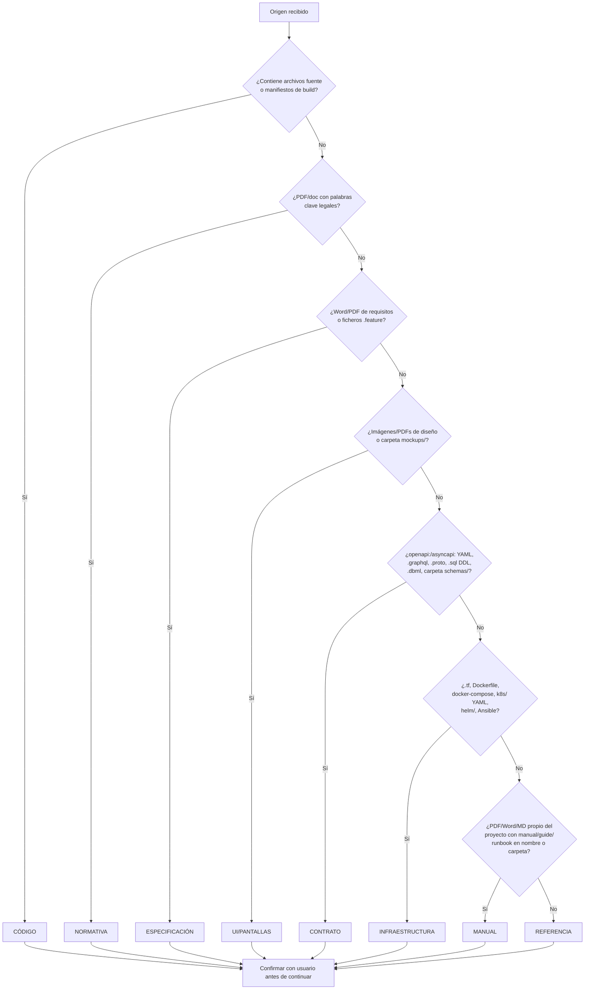

# Catálogo de Tipos de Origen

## 1. Descripción General

Cuando se invoca `/document-project` con uno o varios orígenes, el agente clasifica cada
uno en un **tipo de origen** antes de inventariar y generar documentación. El tipo
determina qué tratamiento documental se aplica: si el origen genera páginas completas por
arquetipos (tipo `CÓDIGO`) o si enriquece secciones concretas de la documentación del
proyecto principal (tipos `MATERIAL`).

El catálogo define ocho tipos. La clasificación la propone el agente a partir de señales
en el sistema de ficheros; el usuario confirma antes de continuar.

## 2. Reglas de Negocio

| Regla | Descripción | Impacto si se viola |
|---|---|---|
| Un origen `CÓDIGO` obligatorio | `/document-project` requiere al menos un origen de tipo `CÓDIGO` para funcionar; sin él el flujo se detiene | Se documentarían solo fuentes MATERIAL sin proyecto de código que contextualice el resultado |
| Autodetección + confirmación | El tipo se propone por señales; el usuario confirma siempre antes de inventariar | Un origen `NORMATIVA` tratado como `CÓDIGO` generaría páginas técnicas vacías o incorrectas |
| MATERIAL no genera páginas propias | Los tipos no-`CÓDIGO` enriquecen secciones de los arquetipos del proyecto `CÓDIGO`; nunca se les crean páginas independientes en `docs/` | Páginas huérfanas sin contenido real derivable del origen |
| `CONTRATO` propio del proyecto | El tipo `CONTRATO` aplica a especificaciones de la API/datos del **propio proyecto**, no a contratos externos; los externos son `REFERENCIA` | Un contrato de terceros procesado como `CONTRATO` del proyecto inventaría una API que no pertenece al proyecto |
| `INFRAESTRUCTURA` sin inventario de código | Los artefactos IaC no tienen módulos Python/JS inventariables; solo enriquecen las secciones de despliegue y dependencias | Intentar un inventario A/B/C sobre `.tf` o K8s YAML produce resultados vacíos |
| `MANUAL` propio del proyecto | El tipo `MANUAL` aplica a documentación narrativa escrita **por/para el propio proyecto**; la documentación de terceros es `REFERENCIA` | Documentación de un tercero procesada como `MANUAL` generaría guías de operación que no corresponden al proyecto |

## 3. Catálogo de Tipos

### Tipos y señales de detección

| Tipo | Naturaleza | Señales en el sistema de ficheros | Ejemplos de artefactos |
|---|---|---|---|
| `CÓDIGO` | Archivos fuente ejecutables que implementan la lógica del sistema | `.py`, `.js`, `.ts`, `.cs`, `.java`, `.go`, `.rs`, `.rb`, `.php`, …; `pyproject.toml`, `package.json`, `pom.xml`, `Cargo.toml`, `go.mod`; directorios `src/` o `tests/` presentes | `scripts/check_env.py`, `src/main.ts`, `lib/core.go` |
| `NORMATIVA` | Documentos legales o regulatorios de obligado cumplimiento | PDFs/docs cuyo nombre o carpeta contenga: `ley`, `decreto`, `directiva`, `rgpd`, `gdpr`, `une`, `iso`, `reglamento`, `compliance` | `RGPD-2016-679.pdf`, `ley-39-2015.pdf`, `ISO-27001.pdf` |
| `ESPECIFICACIÓN` | Requisitos, user stories, casos de uso o pliegos del proyecto | Word/PDF de requisitos; ficheros `.feature` (BDD/Gherkin); carpetas `specs/`, `requirements/`, `ux/`, `user-stories/` | `PRD-v2.docx`, `requirements.pdf`, `login.feature` |
| `UI/PANTALLAS` | Wireframes, mockups, capturas de pantalla o prototipos de interfaz | `.png`, `.jpg`, `.pdf` de diseño; carpetas `mockups/`, `screens/`, `wireframes/`, `figma-exports/`, `designs/` | `mockup-login.png`, `flujo-checkout.pdf`, `screens/` |
| `REFERENCIA` | Documentación de terceros que el proyecto consume o referencia (sin ser código propio) | Manuales externos, RFCs, especificaciones de protocolo ajenas al proyecto; PDFs/docs en `docs/external/`, `references/` | `RFC-7807.pdf`, `stripe-api-reference.pdf`, `oauth2-spec.pdf` |
| `CONTRATO` | Especificaciones machine-readable de las APIs y modelos de datos **propios del proyecto** | `.yaml`/`.json` con clave `openapi:` o `asyncapi:`; `.graphql`/`.gql`; `.proto`; `.avsc`; `.sql` DDL en `db/`/`migrations/`; `.dbml`; carpetas `api/`, `contracts/`, `schemas/`, `proto/`, `graphql/` | `openapi.yaml`, `schema.graphql`, `service.proto`, `asyncapi.yml`, `schema.sql`, `models.dbml` |
| `INFRAESTRUCTURA` | Artefactos IaC y de despliegue que describen cómo se ejecuta el sistema | `.tf` (Terraform); `Dockerfile`, `docker-compose.yml`, `.dockerfile`; YAML en `k8s/`, `deploy/`, `manifests/`, `helm/`; playbooks Ansible `.yml` en `roles/`/`ansible/`; CloudFormation `.yaml` en `cloudformation/` | `main.tf`, `docker-compose.yml`, `k8s/deployment.yaml`, `helm/Chart.yaml` |
| `MANUAL` | Documentación narrativa ya escrita **por/para el propio proyecto**: manuales de usuario, guías de administrador, runbooks operativos, notas de versión, ayuda en línea | `.pdf`, `.docx`, `.odt`, `.md` con nombres que contengan `manual`, `guia`, `guide`, `handbook`, `runbook`, `ayuda`, `help`, `user-guide`, `admin-guide`, `release-notes`; carpetas `manuals/`, `help/`, `user-docs/`, `documentation/`; ficheros `.chm` | `manual-usuario-v3.pdf`, `admin-guide.docx`, `runbook-ops.md`, `help/` |

### Mapeo MATERIAL → arquetipos enriquecidos

Los orígenes de tipo MATERIAL **no generan páginas propias**; su contenido enriquece
secciones concretas de los arquetipos del proyecto `CÓDIGO` principal.

| Tipo | Arquetipo(s) enriquecido(s) | Sección(es) afectadas |
|---|---|---|
| `NORMATIVA` | Arquetipo 8 (completo) + Arquetipo 1 (proyecto principal) | Arq. 8 completo; Arq. 1 §2 Reglas de Negocio |
| `ESPECIFICACIÓN` | Arquetipo 1 (proyecto principal) | §2 Reglas de Negocio, §3 Casos de Uso, §4 Criterios de Aceptación |
| `UI/PANTALLAS` | Arquetipos 1 + 3 | Arq. 1 §3 Casos de Uso; Arq. 3 (How-to/Tutorial) §3 Pasos |
| `REFERENCIA` | Arquetipo 2 o Arquetipo 5 | Arq. 2 §4 Dependencias y Requisitos; o Arq. 5 decisión (ADR) |
| `CONTRATO` | Arquetipos 2 + 12 (proyecto principal) | Arq. 2 §1 Arquitectura y §2 Modelo de Datos / Contratos; Arq. 12 §5 Interfaces Publicadas |
| `INFRAESTRUCTURA` | Arquetipos 2 + 6 | Arq. 2 §4 Dependencias y Requisitos; Arq. 6C §3 › Despliegue |
| `MANUAL` | Arquetipos 3a · 3b · 6 · 7 | Arq. 3a §3 Pasos (tareas ya descritas); Arq. 3b §3 (contenido de aprendizaje); Arq. 6A/B §1 Descripción; Arq. 7 §3 Configurar el Entorno y §5 Primer Resultado |

### Flujo de clasificación

### Flujos alternativos

- **Señales mixtas**: un directorio puede contener `.tf` Y `.py`; en ese caso prevalece
  `CÓDIGO` si hay archivos fuente ejecutables acompañados de tests o manifiesto de build.
  Los `.tf` dentro del mismo repo se tratan como `INFRAESTRUCTURA` acompañante.
- **Contrato externo (tercero)**: si el `.yaml` openapi describe una API de un proveedor
  externo (ej. la API de Stripe), es `REFERENCIA`, no `CONTRATO`. La distinción es la
  propiedad: si es la API del proyecto, es `CONTRATO`; si es la de un tercero, es `REFERENCIA`.
- **Manual propio vs. REFERENCIA**: si el manual describe la aplicación que se está documentando
  es `MANUAL`; si describe un producto de tercero que el proyecto usa, es `REFERENCIA`. Un
  manual de usuario de SAP que el equipo consume → `REFERENCIA`; el manual de usuario de tu
  propia aplicación → `MANUAL`.
- **Manual propio vs. ESPECIFICACIÓN**: `ESPECIFICACIÓN` es intención pre-implementación
  (requisitos, user stories); `MANUAL` es descripción post-implementación de lo que ya existe.
  Un PRD todavía no desarrollado → `ESPECIFICACIÓN`; el manual escrito después del desarrollo → `MANUAL`.
- **Sin origen `CÓDIGO`**: el flujo se detiene con mensaje orientativo hacia los prompts
  de arquetipo directo (`normative_traceability.prompt.md`, etc.).

## 4. Criterios de Aceptación

| ID | Dado | Cuando | Entonces |
|---|---|---|---|
| AC-01 | Un directorio con `openapi.yaml` (clave `openapi:`) del propio proyecto | Se ejecuta la clasificación | El tipo detectado es `CONTRATO` y el agente propone enriquecer Arquetipo 2 §2 |
| AC-02 | Un directorio con `main.tf` y `Dockerfile` | Se ejecuta la clasificación | El tipo detectado es `INFRAESTRUCTURA` y el agente propone enriquecer Arquetipo 2 §4 y Arquetipo 6C |
| AC-03 | Un directorio con `stripe-api.yaml` (API externa de pago) | Se ejecuta la clasificación | El tipo detectado es `REFERENCIA` (no `CONTRATO`), porque el fichero no describe la API del propio proyecto |
| AC-04 | Un directorio con `.py` + `openapi.yaml` del mismo proyecto | Se ejecuta la clasificación | El `.py` es `CÓDIGO` y el `openapi.yaml` es `CONTRATO`; el agente lista ambos como orígenes con tipos distintos |
| AC-05 | Todos los orígenes son MATERIAL (ninguno es `CÓDIGO`) | Se invoca `/document-project` | El flujo se detiene con mensaje orientativo; no se genera ninguna documentación |
| AC-06 | Un proyecto con `schema.sql` de migraciones de base de datos propia | Se ejecuta la clasificación | El tipo es `CONTRATO` (modelo de datos propio), no `CÓDIGO` ni `REFERENCIA` |
| AC-07 | Un fichero `manual-usuario-v3.pdf` del propio proyecto | Se ejecuta la clasificación | El tipo detectado es `MANUAL` y el agente propone enriquecer Arquetipos 3a, 3b, 6 y 7 |
| AC-08 | El manual de un producto de tercero (ej. `manual-sap-fi.pdf`) | Se ejecuta la clasificación | El tipo detectado es `REFERENCIA` (no `MANUAL`), porque no describe la aplicación propia |
| AC-09 | Un PRD (Product Requirements Document) sin implementar aún | Se ejecuta la clasificación | El tipo es `ESPECIFICACIÓN` (no `MANUAL`), porque es intención pre-implementación |

Verificación: invocar `/document-project` con cada tipo de origen de la tabla y confirmar
que la clasificación propuesta coincide con el tipo esperado.

## 5. Glosario y Términos

| Término | Definición |
|---|---|
| Tipo de origen | Categoría que determina cómo procesa el agente un artefacto: si genera documentación completa (`CÓDIGO`) o enriquece secciones concretas (MATERIAL) |
| MATERIAL | Término colectivo para todos los tipos de origen que no son `CÓDIGO`; su contenido no genera páginas propias sino que enriquece arquetipos del proyecto principal |
| Señal de detección | Característica del sistema de ficheros (extensión, nombre de carpeta, clave YAML) que el agente usa para proponer un tipo; requiere confirmación del usuario antes de aplicarse |
| Contrato propio | Especificación machine-readable (OpenAPI, AsyncAPI, GraphQL, Protobuf, SQL DDL, DBML…) que describe las APIs o datos del **propio proyecto**; si describe un tercero es `REFERENCIA` |
| IaC | Infrastructure as Code; artefactos declarativos que describen cómo se despliega y opera el sistema (Terraform, Kubernetes, Docker, Ansible…) |
| Manual propio | Documentación narrativa escrita por o para el propio proyecto (manual de usuario, guía de administrador, runbook operativo); a diferencia de `REFERENCIA` (terceros) y `ESPECIFICACIÓN` (pre-implementación) |
