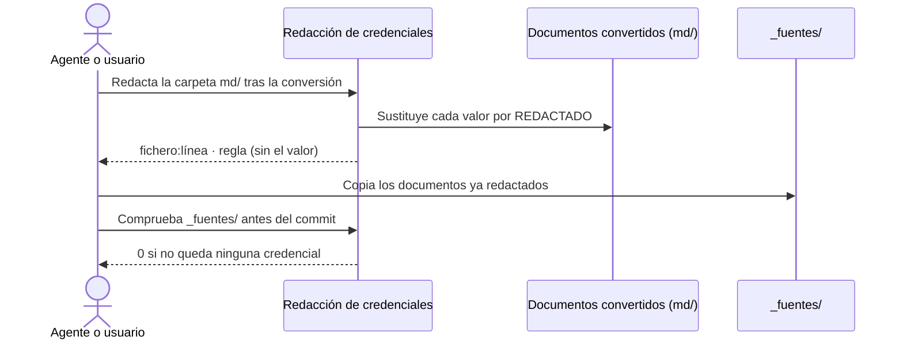

# Redacción de Credenciales

## 1. Objetivo y Descripción

Los documentos que acompañan a un proyecto —diseños técnicos, especificaciones, páginas de
wiki— a veces llevan credenciales en claro: un secreto de OAuth en una URL de ejemplo, una
contraseña o un token de un servicio. Al documentar, su texto convertido a Markdown se copia a
`_fuentes/` y se versiona en el repositorio de documentación, de modo que cualquier credencial que
contenga quedaría publicada en el historial.

La redacción de credenciales sustituye el **valor** de cada credencial por `<REDACTADO>` en los
documentos convertidos, **antes** de copiarlos a `_fuentes/` (Fase 0c de
[Documentar un Proyecto](document_project.md)), y comprueba al cerrar la sesión que no queda
ninguna. Conserva la clave («`client_secret=`», «Contraseña:») para que el documento siga diciendo
qué había y dónde, y nunca muestra el valor en su informe.

Es una red de seguridad local y determinista, sin red ni servicios IA. No sustituye a la revisión
del INVENTARIO: hay formas de escribir una credencial que no reconoce.

## 2. Precondiciones

- Documentos ya convertidos a Markdown (`.md`), normalmente en `_staging/<origen>/md/`.
- Para la comprobación del cierre: la carpeta `_fuentes/` de la raíz del destino.

## 3. Flujo Principal

1. Tras convertir los documentos de un origen, se ejecuta la redacción sobre su carpeta `md/`.
2. Cada credencial reconocida se sustituye por `<REDACTADO>` y se informa del fichero, la línea y
   el tipo de credencial.
3. Los documentos redactados se copian a `_fuentes/` (Paso 5 de la Fase 0c).
4. Antes del commit, una comprobación sobre `_fuentes/` sin modificar nada debe terminar sin
   hallazgos; si encuentra alguno, se redacta antes de versionar.
5. Se avisa al usuario de que el documento **original** sigue conteniendo la credencial, para que
   se retire de allí y se rote.

## 4. Postcondiciones y Efectos

- **Redactar**: los `.md` con credenciales quedan con `<REDACTADO>` en el lugar de cada valor; el
  resto del texto y sus saltos de línea no cambian. Los ficheros que no son `.md` no se tocan.
- **Comprobar**: no modifica nada; informa de lo que quedaría por redactar.
- El informe nunca contiene el valor de una credencial.

## 5. Reglas de Negocio

| Regla | Descripción | Impacto si se viola |
|---|---|---|
| Solo el valor | Se sustituye el valor y se conserva la clave | Se perdería la constancia de que el documento contenía una credencial y dónde |
| Nunca el valor en el informe | El informe da fichero, línea y tipo, nunca el valor encontrado | La credencial se filtraría a la consola o a los registros de la sesión |
| Marcadores y prosa no se tocan | No se redactan marcadores (`xxxxxx`, `--`, `***`, `<…>`, `${VAR}`), URL ni palabras corrientes tras la clave («Password: obligatorio») | Documentos estropeados con falsos positivos |
| Idempotente | Un valor ya redactado no se vuelve a detectar | Hallazgos repetidos en cada sesión |
| Antes de `_fuentes/` | La redacción se ejecuta antes de copiar a `_fuentes/` y se comprueba antes del commit | La credencial quedaría en el historial del repositorio |
| Red de seguridad | La revisión del INVENTARIO sigue siendo obligatoria | Credenciales escritas de forma no reconocida pasarían inadvertidas |

## 6. Límites, Flujos Alternativos y Casos Especiales

### Qué NO hace esta funcionalidad

- No modifica el documento original: solo la copia convertida.
- No rota ni revoca credenciales: avisa para que lo haga quien corresponda.
- No reconoce pares «usuario / clave» sin `=`, `:` o `(` entre la clave y el valor, ni contraseñas
  formadas solo por letras.
- No revisa ficheros que no sean `.md`.

### Flujos alternativos

- **Solo comprobar**: con la opción de comprobación informa y termina con 1 si hay hallazgos, sin
  modificar nada (uso en el CIERRE sobre `_fuentes/`).
- **Ruta inexistente**: error y resultado 2.

### Casos especiales

- **Markdown de docling**: el guion bajo escapado (`client\_secret`) y la negrita alrededor del
  valor (`**valor**`) se reconocen.
- **Claves privadas**: el bloque `BEGIN … PRIVATE KEY` completo se sustituye por un único
  `<REDACTADO>`.
- **Tokens JWT** sueltos se redactan enteros.

## 7. Criterios de Aceptación

| ID | Dado | Cuando | Entonces | Test |
|---|---|---|---|---|
| AC-01 | Un `client_secret`, una contraseña, un token, credenciales en una URL o una clave de API | Se redacta el texto | Solo el valor se sustituye por `<REDACTADO>` y la clave se conserva | `tests/test_redact_secrets.py::test_detects_and_redacts_value_only` |
| AC-02 | Un bloque de clave privada | Se redacta | El bloque entero se sustituye y la línea informada es la de inicio | `tests/test_redact_secrets.py::test_private_key_block_is_redacted_whole` |
| AC-03 | Un token JWT | Se redacta | El token desaparece del texto | `tests/test_redact_secrets.py::test_jwt_is_redacted_whole` |
| AC-04 | Descripciones de parámetros, marcadores, URL o prosa | Se analiza el texto | No hay hallazgos y el texto no cambia | `tests/test_redact_secrets.py::test_ignores_placeholders_and_prose` |
| AC-05 | Un texto ya redactado | Se redacta de nuevo | No hay hallazgos ni cambios | `tests/test_redact_secrets.py::test_redact_is_idempotent` |
| AC-06 | Varias credenciales en un texto con un bloque de varias líneas | Se analizan | Las líneas informadas son las del texto original | `tests/test_redact_secrets.py::test_line_numbers_refer_to_original_text` |
| AC-07 | Una carpeta con un `.md` con saltos CRLF y un `.txt` | Se redacta la carpeta | El `.md` se redacta conservando los saltos; el `.txt` no se toca | `tests/test_redact_secrets.py::test_redact_tree_preserves_line_endings_and_other_files` |
| AC-08 | Un `.md` con una credencial | Se comprueba sin redactar | Se informa y el fichero no cambia | `tests/test_redact_secrets.py::test_check_mode_does_not_modify` |
| AC-09 | Un `.md` con una credencial | Se ejecuta la herramienta: comprobar, redactar, redactar otra vez y sobre una ruta inexistente | Resultados 1, 1, 0 y 2; el valor nunca aparece en la salida | `tests/test_redact_secrets.py::test_cli_exit_codes_and_report_never_shows_value` |
| AC-10 | Un documento de 20 000 filas con una credencial al final | Se comprueba | La encuentra en menos de 5 segundos | `tests/test_redact_secrets.py::test_large_document_is_fast` |

Verificación: `python -m pytest tests/test_redact_secrets.py -q`.

## 8. Glosario de Dominio

| Término | Definición |
|---|---|
| Credencial | Valor que da acceso a un sistema: contraseña, secreto de cliente OAuth, token, clave de API o clave privada |
| Redactar | Sustituir el valor de una credencial por `<REDACTADO>` conservando la clave |
| Marcador | Texto que ocupa el lugar de un valor sin serlo (`xxxxxx`, `--`, `<oculto>`, `${VAR}`) |
| `_fuentes/` | Carpeta versionada del destino con el texto convertido de los documentos fuente |

??? note "Evidencia"

    | Elemento | Fuente | Confianza |
    |---|---|---|
    | Reglas de detección | `scripts/redact_secrets.py::RULES` | ✅ |
    | Regla «Solo el valor» | `scripts/redact_secrets.py::_spans` (grupo `value`), `::redact` | ✅ |
    | Regla «Nunca el valor en el informe» | `scripts/redact_secrets.py::Finding`, `::main` | ✅ |
    | Regla «Marcadores y prosa no se tocan» | `scripts/redact_secrets.py::_is_placeholder`, `::_NEEDS_NON_LETTER` | ✅ |
    | Regla «Idempotente» | `scripts/redact_secrets.py::_is_placeholder` (`REDACTED`) | ✅ |
    | Regla «Antes de `_fuentes/`» | `.github/prompts/document_project.prompt.md::Paso 4b` | ✅ |
    | Comprobar sin modificar y resultados 0/1/2 | `scripts/redact_secrets.py::redact_tree`, `::main` | ✅ |
    | Saltos de línea y solo `.md` | `scripts/redact_secrets.py::redact_tree`, `::_markdown_files` | ✅ |
    | AC-01 – AC-10 | `tests/test_redact_secrets.py` | ✅ |
